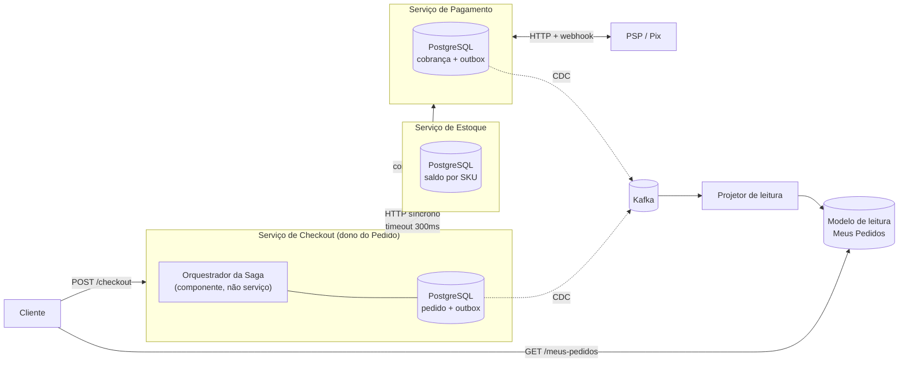

# Template de System Design: Aula 04 - Microsserviços & Padrão Saga

> **Contexto do Cenário: O Pedido Pago Sem Produto na Black Friday**
>
> Sua equipe está arquitetando a transação distribuída de compra na Black Friday para o marketplace:
>
> 1. **O Incidente:** Um cliente comprou uma Smart TV de R$ 3.000 via Pix. O gateway de pagamentos debitou o valor imediatamente e confirmou a transação. No milissegundo seguinte, o serviço de Estoque esgotou as unidades e rejeitou a reserva. O dinheiro sumiu da conta do cliente, o produto não existe para entrega e o pedido travou em um estado inconsistente.
> 2. **O Desafio Distribuído:** Não existe transação única (`@Transactional`) entre bancos de dados autônomos de Checkout, Pagamento e Estoque.
> 3. **A Carga:** 5.000 TPS de checkout simultâneo e milhões de clientes consultando o status da compra em "Meus Pedidos".
>
> **Instruções:** Responda às decisões arquiteturais abaixo fundamentando suas escolhas estritamente com base nos requisitos e restrições deste cenário. Documente suas decisões no repositório contínuo do seu projeto através de commits atômicos e bem descritivos.

---

## 0. Recorte e premissas assumidas

Antes de qualquer decisão, declaro o terreno. Premissa escondida é furo de avaliação, e em transação distribuída quase toda discordância entre duas pessoas competentes acaba sendo discordância sobre uma premissa que nenhuma das duas disse em voz alta.

**O que estou desenhando:** a **transação distribuída de compra** — a coordenação entre Checkout, Pagamento e Estoque, da criação do pedido até um estado final (confirmado ou cancelado com o cliente inteiro). Isso inclui a máquina de estados do pedido, o modelo de coordenação, as compensações, a publicação confiável de eventos e o modelo de leitura de "Meus Pedidos". Não inclui a mecânica interna de cada participante: como o Estoque decrementa saldo e como o PSP liquida um Pix são caixas-pretas com contrato.

**O que o cenário dá como dado:**

| Dado | Valor |
| :--- | :--- |
| Serviços envolvidos | Checkout, Pagamento, Estoque |
| Bancos | Autônomos, um por serviço — não há `@Transactional` abrangente |
| Volumetria de escrita | 5.000 TPS de checkout simultâneo |
| Volumetria de leitura | Milhões de clientes consultando "Meus Pedidos" |
| Meio de pagamento do incidente | Pix, debitado e confirmado imediatamente |
| Falha relatada | Estoque rejeitou a reserva **depois** do pagamento aprovado |
| Consequência relatada | Dinheiro debitado, produto inexistente, pedido travado em estado inconsistente |
| Valor em jogo no caso relatado | R$ 3.000 |

**O que estou assumindo (premissas):**

| # | Premissa | Valor assumido | Por que assumo |
| :--- | :--- | :--- | :--- |
| P1 | Propriedade do dado | Checkout é dono do agregado `Pedido`; Estoque é dono do saldo por SKU; Pagamento é dono da cobrança e do seu ciclo com o PSP | É a divisão que o cenário implica ao dizer "bancos autônomos de Checkout, Pagamento e Estoque" |
| P2 | Perfil do pico | Pico de 2 a 4 horas com 5.000 TPS; fora dele, uma ordem de grandeza abaixo | "Black Friday" no enunciado; a janela importa porque muda o cálculo de capacidade das compensações |
| P3 | Stack | Java 21, Spring Boot 3.x, PostgreSQL por serviço, Kafka como broker, Kubernetes com múltiplas réplicas por serviço | Stack dominante em plataforma de pagamento no mercado brasileiro e a que eu sustento numa discussão técnica |
| P4 | O PSP é externo | Pagamento fala com um PSP/gateway terceiro por HTTP, recebe `webhook` de liquidação e **não** oferece protocolo transacional de duas fases | É a realidade de qualquer integração Pix; nenhum PSP expõe `prepare`/`commit` |
| P5 | Mecânica do Pix | Não existe pré-autorização nem bloqueio de valor a pedido do lojista. O Pix liquida ou não liquida. Desfazer é uma **nova transação** (`devolução`, `pacs.004`), assíncrona, que depende de saldo na conta do recebedor e deve ser iniciada em até 90 dias | Regulamento do Pix (Res. BCB nº 1/2020 e alterações) e API Pix do BACEN. **É a premissa que mais muda este desenho** |
| P6 | Reserva de estoque tem prazo | A reserva expira se o pagamento não liquidar. Assumo **15 minutos**, compatível com a expiração do QR Code de cobrança | Sem expiração, carrinho abandonado consome estoque e nenhum desenho de Saga fecha |
| P7 | Pedido com múltiplos itens | O pedido pode ter N itens de SKUs diferentes; a reserva é tudo-ou-nada no nível do pedido | Marketplace real; e é o que cria o caso de compensação parcial do item 2.2 |
| P8 | SLA de resolução da saga | 99% dos pedidos atingem estado final em menos de 5 segundos depois da liquidação; 100% em menos de 15 minutos; nenhum pedido permanece em estado intermediário por mais de 1 hora sem alarme | O enunciado não dá SLA, e sem SLA não há critério para dizer se a consistência eventual é "aceitável" |
| P9 | Idempotência do PSP | O PSP aceita chave de idempotência na cobrança e identificador de devolução escolhido por mim (`PUT /pix/{e2eid}/devolucao/{id}`) | É o contrato da API Pix; `id` é gerado pelo sistema do usuário recebedor |

**Formato das respostas:** primeira pessoa, decisão explícita, alternativas nomeadas, trade-off assumido em cada item. Diagramas em Mermaid onde o texto sozinho não resolve.

**Visão geral do desenho que estou propondo, para orientar a leitura:**



---

## 1. Transações Distribuídas: Coordenação e Trade-offs

### 1.1 Volumetria e Pragmatismo: 2PC vs Saga

- **Análise Crítica:** Em quais cenários arquiteturais uma transação ACID local ou Two-Phase Commit (2PC) resolveria o problema com menor custo operacional? Por que, para o cenário de 5.000 TPS na Black Friday com serviços e bancos autônomos, o 2PC é inviável e a consistência eventual se torna necessária?

  > Começo pela parte da pergunta que normalmente é respondida de má vontade, porque ela é a mais importante: **em muito mais casos do que a literatura de microsserviços sugere, a transação local resolve melhor — e a primeira pergunta de um desenho de Saga deveria ser se as fronteiras transacionais são necessárias, não como coordená-las.**
  >
  > #### Quando a transação ACID local resolve com menor custo
  >
  > Em todo cenário em que as linhas que precisam ser atômicas podem estar no mesmo banco. Concretamente:
  >
  > 1. **Checkout e Pagamento no mesmo contexto delimitado.** Essa é a observação que eu levaria para a mesa de desenho antes de qualquer discussão sobre Saga. `Pedido` e `Cobrança` têm o mesmo ciclo de vida, o mesmo dono de negócio, a mesma criticidade e a mesma volumetria. Separá-los em dois serviços com dois bancos cria uma fronteira transacional que **não existia no domínio**: ela foi criada pelo desenho, e agora precisa ser remendada com Saga, outbox, compensação e tudo o que vem neste documento. Um monolito modular com os dois módulos no mesmo PostgreSQL resolve a atomicidade entre pedido e cobrança com `@Transactional` e uma linha de código. Para a maioria absoluta das lojas, inclusive lojas grandes, essa é a arquitetura certa, e Saga é complexidade comprada sem necessidade.
  > 2. **Operações internas entre duas contas do mesmo núcleo.** Débito e crédito de uma transferência interna, baixa de boleto contra o saldo da conta, lançamento contábil de duas partidas. Dinheiro saindo de um lugar e entrando em outro, no mesmo banco, é o caso de uso canônico de ACID e não deveria sair dele.
  > 3. **Processos em lote com janela própria.** Fechamento contábil noturno, conciliação D+1, liquidação de arquivo de retorno. Volumetria concentrada, nenhum cliente esperando, indisponibilidade momentânea aceitável. É onde ACID sobre um banco único, ou até 2PC, custa menos operacionalmente que Saga.
  > 4. **Sistemas onde a invariante é multi-linha e a inconsistência é inaceitável mesmo por segundos.** Se a regra é "não existe cobrança sem pedido", escrever as duas linhas na mesma transação é mais barato do que detectar a violação depois e compensar — e é mais barato de *provar* para um auditor.
  >
  > O critério que uso: **toda fronteira transacional que eu crio é uma dívida que eu vou pagar em código de compensação, em observabilidade e em casos de suporte.** Vale criar quando compro autonomia real — times independentes, perfis de escala diferentes, ciclos de release diferentes. No cenário, o Estoque passa nesse teste com folga: ele escala com leitura de catálogo, pertence a outro time, tem contenção de natureza completamente diferente e é consultado por fluxos que não têm nada a ver com checkout. Pagamento e Checkout passam com muito menos folga — e eu registraria essa objeção no desenho mesmo aceitando a separação que o enunciado impõe.
  >
  > #### Quando o 2PC resolveria com menor custo operacional
  >
  > 2PC não é um erro histórico; é uma ferramenta com uma faixa de aplicação estreita. Ele resolve melhor quando **todas** estas condições valem ao mesmo tempo:
  >
  > | Condição | Por quê |
  > | :--- | :--- |
  > | Volumetria baixa a moderada (dezenas a poucas centenas de TPS) | O custo do protocolo é latência de lock, e latência de lock vira fila |
  > | Todos os participantes falam XA de verdade | Dois schemas no mesmo Oracle, PostgreSQL + IBM MQ num contêiner JEE com gerenciador de transação, dois bancos do mesmo fornecedor |
  > | Mesmo time, mesmo ciclo de release, mesma janela de manutenção | 2PC acopla disponibilidade e versionamento |
  > | Indisponibilidade de qualquer participante pode parar a operação | É isso que 2PC entrega: consistência ao custo de disponibilidade |
  > | Existe um coordenador de transação durável e monitorado, com procedimento de resolução de transações em dúvida | Sem isso, 2PC é uma bomba com relógio |
  >
  > Exemplos concretos em que eu usaria 2PC sem desconforto: movimentação entre dois schemas de um mesmo core bancário dentro da janela de batch; gravação em banco e publicação em fila dentro de um ambiente legado homogêneo com XA já operante; integração entre dois sistemas internos de baixa volumetria onde compensação custaria mais engenharia do que o protocolo. Em instituição financeira isso existe e funciona — em centenas de TPS, com janela de manutenção, e com um time que sabe rodar `SELECT * FROM pg_prepared_xacts` quando o coordenador cai.
  >
  > #### Por que 2PC é inviável neste cenário — cinco argumentos, em ordem crescente de letalidade
  >
  > **1. É um protocolo bloqueante, e a volumetria transforma isso em fila.** No 2PC, cada participante adquire os locks na fase de `prepare` e os **mantém** até receber `commit` ou `rollback`. O tempo de retenção deixa de ser o tempo de execução de um `UPDATE` local — microssegundos — e passa a ser o tempo de duas viagens de rede mais o tempo do participante mais lento. Chamando isso de 50 ms conservadores, a Lei de Little dá o número que importa: `concorrência = vazão × latência` = 5.000 × 0,05 = **250 transações distribuídas simultaneamente com locks retidos em três bancos**. Cada uma retendo também uma conexão em cada participante. Não é que fique lento: é que a capacidade de atendimento colapsa, e o p99 explode antes do throughput nominal.
  >
  > **2. O coordenador é ponto único de falha com um modo de falha especialmente feio.** Se o coordenador morre entre `prepare` e `commit`, o participante fica com uma transação **em dúvida**: ele não pode liberar os locks (pode ser que a decisão tenha sido `commit`) nem efetivar (pode ser que tenha sido `rollback`). No PostgreSQL isso é uma linha em `pg_prepared_xacts` que só sai com `COMMIT PREPARED` ou `ROLLBACK PREPARED` manual. Pior: uma transação preparada órfã **fixa o `xmin` mais antigo**, o que impede o `VACUUM` de limpar versões mortas em todo o banco. O resultado é inchaço progressivo e, se ninguém notar, a proteção de *transaction ID wraparound* derruba o banco inteiro para se proteger. Em Black Friday, isso é um incidente de plataforma, não de pedido.
  >
  > **3. Disponibilidade multiplica para baixo.** Com 2PC, **qualquer** escrita exige **todos** os participantes de pé. Três serviços a 99,95% em série dão 99,85% no melhor caso — e isso ignora que o próprio coordenador tem disponibilidade. Em Saga, o Estoque cair significa que novas reservas falham; em 2PC, o Estoque cair significa que nenhuma compra de nenhum produto acontece. O enunciado fala de pico de Black Friday, que é exatamente a hora em que algum componente vai degradar.
  >
  > **4. Acoplamento de autonomia, que era o motivo de separar os serviços.** 2PC amarra os três serviços ao mesmo gerenciador de transação, à mesma versão de driver, à mesma janela de deploy. Se eu vou pagar o preço de ter três bancos autônomos, pagar também o preço de coordená-los sincronamente me dá o pior dos dois mundos: a complexidade operacional da distribuição sem a autonomia que a justificava.
  >
  > **5. O argumento que encerra a discussão: o dinheiro não está num banco de dados meu.** O passo de pagamento é uma chamada HTTP a um PSP externo (P4). **Não existe fase de preparação no Pix.** Não há `PREPARE` que reserve R$ 3.000 na conta do cliente para eu confirmar depois; não existe pré-autorização como no cartão (P5). O Pix liquida ou não liquida, e desfazer é uma transação nova. Mesmo que os três bancos internos falassem XA perfeitamente e a volumetria fosse de 50 TPS, o 2PC estaria morto no nascimento, porque o participante mais importante da transação não implementa o protocolo e nunca vai implementar. **Esse é o ponto que eu defenderia primeiro numa arguição**, porque ele não depende de nenhuma premissa de volumetria: é estrutural.
  >
  > #### Por que a consistência eventual se torna necessária — e o que ela cobra
  >
  > Com 2PC fora e ACID local impossível entre bancos autônomos, sobra uma única família de solução: **sequência de transações locais, cada uma commitada no seu próprio banco, com ação compensatória para cada passo já efetivado.** Isso é a Saga. A consistência eventual não é uma escolha estética aqui: é o que resta quando atomicidade distribuída é inviável.
  >
  > O que é importante dizer com precisão, porque é onde a maioria das respostas para: **a Saga preserva A, C e D, e abandona o I.** Cada transação local é atômica, durável e deixa o banco consistente com suas próprias constraints. O que não existe é **isolamento**: entre o passo 1 e o passo 3, o sistema está num estado intermediário que outros podem observar. Isso não é um detalhe acadêmico — é a origem de anomalias concretas:
  >
  > | Anomalia | Como aparece neste cenário |
  > | :--- | :--- |
  > | Leitura de estado intermediário | O cliente abre "Meus Pedidos" e vê um pedido que ainda não existe completamente — ou que vai ser cancelado em 3 segundos |
  > | Atualização perdida | Uma compensação em curso e uma ação do cliente (cancelar manualmente) escrevendo no mesmo pedido |
  > | Leitura suja de saldo | O relatório de estoque soma reservas que vão ser liberadas |
  >
  > Existe um catálogo clássico de contramedidas para a falta de isolamento em Saga, e é ele que eu aplico neste desenho em vez de inventar remendos pontuais:
  >
  > - **Trava semântica (*semantic lock*):** a reserva de estoque **é** a trava semântica. O saldo não foi baixado, mas também não está disponível para outro cliente. Um estado `AGUARDANDO_PAGAMENTO` é um cadeado declarado no domínio, não no banco.
  > - **Atualizações comutativas:** a liberação de reserva e a baixa definitiva são operações cuja ordem relativa não corrompe o saldo, porque ambas são deltas sobre um contador e nenhuma delas pode levar o saldo a um valor inválido.
  > - **Visão pessimista:** ordenar os passos para que o passo irreversível seja o último. É exatamente o que faço no item 2.1, e é a contramedida de maior impacto do documento.
  > - **Releitura do valor (*reread value*):** antes de efetivar o estoque, reler e revalidar a reserva em vez de confiar no que foi lido no passo anterior.
  > - **Arquivo de versão (*version file*):** registrar as operações recebidas por pedido com número de sequência, de forma que um evento fora de ordem seja identificado e descartado em vez de aplicado.
  >
  > **O que a consistência eventual cobra, nomeado explicitamente:** uma janela em que o sistema está observavelmente inconsistente. Essa janela deixa de ser um bug e passa a ser **requisito de produto com número** (P8). O cliente pode ver "processando" por alguns segundos; o estoque pode mostrar reservado algo que será liberado; o relatório financeiro só fecha depois da conciliação. Em troca, eu ganho: cada serviço sobrevive à queda dos outros, o pico é absorvido por fila em vez de por lock, e o passo com o PSP externo — que nunca participaria de um protocolo meu — entra na coordenação como qualquer outro.
  >
  > **Trade-off que estou assumindo:** troco atomicidade por disponibilidade e autonomia, e pago com complexidade real — compensações para escrever e testar, estados intermediários para observar, idempotência obrigatória em todo consumidor, e a necessidade de uma conciliação que prove que o sistema convergiu. Aceito porque a alternativa não existe neste recorte. E registro a objeção de desenho: **se eu tivesse voz na divisão dos serviços, Checkout e Pagamento seriam um só**, e metade desta complexidade desapareceria com uma transação local.

---

### 1.2 O Modelo de Coordenação da Saga

- **A Escolha:** ( ) Coreografia (Orientada a Eventos)  **(x) Orquestração (Process Manager / Máquina de Estados)** — com coreografia deliberadamente adotada **fora** da transação de compra

- **Justificativa e Mitigação das Desvantagens do seu Modelo**

  > #### A comparação, antes da escolha
  >
  > | Critério | Coreografia | Orquestração |
  > | :--- | :--- | :--- |
  > | Onde vive a ordem dos passos | Distribuída: cada serviço sabe a que evento reage | Centralizada num componente explícito |
  > | Acoplamento | Baixo entre serviços, alto no contrato dos eventos | Participantes desacoplados entre si, acoplados ao orquestrador |
  > | Responder "onde está o pedido 123 agora?" | Exige reconstruir o estado a partir de eventos espalhados | Uma consulta a uma linha |
  > | Compensação ordenada e condicional | Difícil: ninguém detém a lista do que já foi feito | Natural: o orquestrador tem o histórico da instância |
  > | Adicionar um passo novo no meio do fluxo | Mexe em vários serviços e no contrato dos eventos | Mexe no orquestrador |
  > | Risco de dependência cíclica | Alto e silencioso | Praticamente nulo |
  > | Risco de centralizar inteligência | Baixo | **Alto — é a desvantagem a mitigar** |
  > | Custo de operação | Menos componentes | Um componente de estado para operar e versionar |
  >
  > #### Por que orquestração, amarrado neste cenário
  >
  > Quatro razões, todas vindas do enunciado e não de preferência:
  >
  > **1. O incidente relatado é uma falha de visibilidade, não só de compensação.** O enunciado diz que "o pedido travou em um estado inconsistente". Travar é o sintoma; o que torna isso um incidente de horas em vez de segundos é ninguém conseguir responder em que ponto ele travou, o que já foi efetivado e o que falta desfazer. Coreografia puniria exatamente essa pergunta: o estado da transação estaria implícito na união dos tópicos, e a reconstrução seria trabalho de investigação. Orquestração torna "onde está o pedido" um `SELECT`.
  >
  > **2. A compensação é ordenada, condicional e precisa saber o que já aconteceu.** Desfazer esta saga não é emitir um evento `PedidoCancelado` e esperar que cada um se resolva. É decidir, para *esta instância*, se precisa liberar reserva, se precisa estornar, e em que ordem — e isso depende de quais passos já tinham sido efetivados. Quem detém essa lista é o orquestrador. Em coreografia, cada participante teria que inferir o que fazer a partir de um evento genérico, e inferência distribuída sobre estorno de R$ 3.000 é onde moram os bugs caros.
  >
  > **3. É dinheiro em ambiente regulado.** Preciso de trilha de auditoria por instância: quem comandou o quê, quando, com qual resposta, e qual foi a decisão. O orquestrador produz isso como subproduto do seu próprio funcionamento. Em coreografia eu teria que construir essa trilha à parte, o que significa construir um orquestrador passivo, com todo o custo e nenhum dos benefícios.
  >
  > **4. "Meus Pedidos" precisa de um estado nomeado.** Milhões de clientes vão consultar o status. "Status" é a máquina de estados da saga vista de fora. Ter esse estado explícito e materializável é requisito direto do item 3.1 deste template.
  >
  > #### O que eu descartei, e com que honestidade
  >
  > **Coreografia pura:** descartada pelos quatro motivos acima, mas reconheço o que ela tem de melhor — acoplamento genuinamente mais baixo e nenhum componente central para operar. Num fluxo de 2 passos sem dinheiro e sem compensação ordenada, ela seria minha escolha, porque orquestrar dois passos é cerimônia.
  >
  > **Orquestrador como serviço novo e separado:** descartado. Um "serviço-orquestrador-de-pedidos" não é dono de nenhum dado de domínio; ele seria dono de uma máquina de estados que descreve a vida de um `Pedido` que mora em outro serviço. Isso duplica o ciclo de vida do pedido em dois lugares e cria a pergunta insolúvel de quem é a fonte da verdade do status. **Decisão: o orquestrador é um componente dentro do serviço de Checkout, e o agregado `Pedido` é a própria máquina de estados da saga.** O Checkout já é dono do pedido e já responde pelo seu ciclo de vida; orquestrar é o trabalho dele.
  >
  > **Motor de orquestração de mercado (Temporal, Camunda 8, AWS Step Functions, Netflix Conductor):** não descartado — adiado, com critério. É a opção tecnicamente mais forte para persistência de execução, e o Temporal, por exemplo, traz compensação de Saga como construção de primeira classe no SDK Java e um ambiente de teste com salto de tempo e verificação de determinismo por *replay*. Eu adotaria sem hesitar se o fluxo tivesse muitos passos, esperas longas, versionamento de processo em voo ou intervenção humana no meio. Para **três passos com um pivô**, a máquina de estados explícita em tabela custa muito menos para operar em pico: nenhum cluster adicional no caminho crítico da Black Friday, nenhum modelo de programação determinístico para o time aprender às pressas, e o estado da saga já vive no mesmo PostgreSQL que o pedido — o que me dá a transação local que viabiliza o outbox do item 2.2. **O critério de revisão que eu escreveria no documento: se o fluxo passar de seis passos ou ganhar espera humana, migro para motor dedicado.**
  >
  > #### A decisão de verdade não é coreografia ou orquestração: é onde fica o passo irreversível
  >
  > Esta é a parte do desenho que eu defenderia com mais convicção, porque ela resolve o incidente do enunciado em vez de apenas remediá-lo.
  >
  > Toda Saga tem três tipos de passo:
  >
  > - **Compensáveis:** podem ser desfeitos por uma ação compensatória. Reservar estoque é compensável — libero a reserva.
  > - **Pivô:** o ponto sem volta. Depois dele, a saga só avança.
  > - **Retentáveis:** depois do pivô, só podem ser repetidos até dar certo, nunca desfeitos. Emitir nota fiscal, notificar logística, creditar pontos.
  >
  > No fluxo descrito no incidente, **o pagamento foi executado antes da reserva de estoque**. Isso coloca o passo mais irreversível do sistema no meio da saga, com um passo compensável depois dele. E a irreversibilidade do Pix não é teórica (P5): desfazer exige uma **nova** transação de devolução, assíncrona, que depende de haver saldo na conta Pix do lojista naquele momento, que só pode ser iniciada em até 90 dias e que o PSP pode acatar ou não. Comparado a liberar uma reserva — um `UPDATE` no meu próprio banco, que nunca falha por motivo externo — não há simetria nenhuma de custo e de risco.
  >
  > **Logo: o estoque é reservado antes de a cobrança ser criada, e o pagamento é o pivô.** O incidente do enunciado deixa de ser o caminho normal de falha e passa a ser um caso de borda. A ordem é a correção; a compensação é a rede de segurança — e eu ainda preciso dela, porque o caso de borda existe de verdade e está detalhado no item 2.1.
  >
  > | | Ordem do incidente (cobra, depois reserva) | Ordem que eu adoto (reserva, depois cobra) |
  > | :--- | :--- | :--- |
  > | Falha de estoque | Dinheiro já saiu → precisa de devolução Pix | Nada saiu → `409` imediato, pedido cancelado, zero risco financeiro |
  > | Passo irreversível | No meio da saga | No fim da saga (pivô) |
  > | Compensação no caminho comum | Financeira, assíncrona, pode falhar | Interna, no meu banco, não falha por motivo externo |
  > | Experiência do cliente na falha | "Pagou e não recebeu, aguarde o estorno" | "Esgotou, nada foi cobrado" |
  >
  > #### Mitigação da desvantagem do modelo escolhido: como o orquestrador não vira um "serviço Deus"
  >
  > A desvantagem é real e tem nome: inteligência migra para o centro, participantes viram CRUD anêmico, e qualquer regra nova de qualquer domínio acaba implementada no orquestrador porque "é mais fácil ali". Mitigo com cinco regras, todas verificáveis em revisão de código:
  >
  > **1. Separação explícita de responsabilidade: o orquestrador conhece a ordem, não as regras.**
  >
  > | Pergunta | Quem responde |
  > | :--- | :--- |
  > | Tem saldo para reservar este SKU? | Estoque, e só ele |
  > | A reserva ainda é válida? | Estoque |
  > | O Pix liquidou? O valor confere? | Pagamento |
  > | Esta devolução pode ser feita? Há saldo? Está na janela? | Pagamento |
  > | O passo 2 vem depois do passo 1? | Orquestrador |
  > | Se o passo 3 falhar, o que precisa ser desfeito? | Orquestrador |
  >
  > **2. Comandos declaram intenção, nunca mecânica.** O orquestrador manda `ReservarEstoque(pedidoId, itens)`, nunca `DecrementarColuna(sku, -1)`. Um comando que descreve *como* fazer é a assinatura do serviço Deus, e é o que eu bloquearia em revisão.
  >
  > **3. O teste do serviço Deus, aplicado a cada mudança.** Se uma regra de negócio nova de estoque ou de pagamento exigir alterar o orquestrador, a fronteira está errada. Regra nova de domínio entra no serviço dono do domínio; o orquestrador só muda quando a **ordem dos passos** ou a **política de compensação** muda. Esse teste é a pergunta que eu faria em toda revisão de PR que toca o orquestrador.
  >
  > **4. Nenhum participante lê o banco do orquestrador, e o orquestrador não acumula dado de domínio alheio.** Ele guarda o estado da saga: em que passo está, o que já foi efetivado, quais correlações (`e2eid` do Pix, `reservaId`), quantas tentativas. Não guarda preço de produto, não guarda saldo de SKU, não guarda dado de cartão. Se eu notar o orquestrador precisando de uma cópia do catálogo para decidir, ele passou do limite.
  >
  > **5. Coreografia continua existindo — fora da transação de compra.** Esta é a mitigação estrutural, e é o padrão que eu defendo como melhor prática: **orquestrar a transação, coreografar as consequências.** O que é consequência e não transação sai por evento de domínio publicado pelo Checkout, e cada interessado se inscreve sem o orquestrador saber que ele existe:
  >
  > ```mermaid
  > flowchart TD
  >     subgraph ORQ["Orquestrado — a transação de compra"]
  >         A["Reservar estoque"] --> B["Criar cobrança Pix"]
  >         B --> C["Efetivar estoque"]
  >         C --> D["Pedido confirmado"]
  >     end
  >     D ==>|"evento de domínio<br/>PedidoConfirmado"| E[(Kafka)]
  >     subgraph CORE["Coreografado — as consequências"]
  >         F["Nota fiscal"]
  >         G["Logística / separação"]
  >         H["E-mail e push"]
  >         I["Fidelidade / pontos"]
  >         J["Antifraude pós-venda"]
  >         K["Analytics / funil"]
  >     end
  >     E --> F
  >     E --> G
  >     E --> H
  >     E --> I
  >     E --> J
  >     E --> K
  > ```
  >
  > O ganho é concreto: adicionar "creditar cashback no pedido confirmado" é um consumidor novo e **zero alteração no orquestrador**. É assim que a inteligência fica distribuída mesmo com um coordenador no centro — o coordenador coordena só o que precisa de atomicidade lógica, e tudo que é efeito colateral fica orientado a evento. A fronteira entre os dois blocos é precisa: **está na transação o que precisa ser desfeito se o pagamento não liquidar.** Nota fiscal de um pedido não confirmado não existe, então ela é consequência, não passo.
  >
  > #### Como o orquestrador se comunica com os participantes: híbrido, decidido passo a passo
  >
  > A pergunta "síncrono ou assíncrono" não tem uma resposta só; tem uma resposta por passo, e o critério é **o cliente está esperando essa resposta agora?**
  >
  > | Passo | Comunicação | Por quê |
  > | :--- | :--- | :--- |
  > | Reservar estoque | **HTTP síncrono**, `timeout` de 300 ms, *circuit breaker*, sem retentativa automática em caso de rejeição de negócio | É a única resposta que muda a tela do cliente agora. "Esgotou" precisa aparecer no clique, não num *push* dois segundos depois. Falha de infraestrutura aqui é `503` honesto, e nada foi efetivado |
  > | Criar cobrança Pix | **HTTP síncrono** para obter o QR Code, **assíncrono** para a liquidação | Não há escolha: o Pix liquida quando o pagador paga. O orquestrador emite a cobrança e espera o `webhook`. É assíncrono por natureza do meio de pagamento, não por decisão de arquitetura |
  > | Efetivar estoque após liquidação | **Assíncrono**, comando sobre Kafka, com retentativa | Ninguém está olhando a tela nesse instante, e esse passo precisa sobreviver a reinício de pod |
  > | Toda compensação | **Assíncrona**, via outbox, com retentativa e política de desistência | Compensação não pode depender de o processo que a iniciou continuar vivo. É o ponto em que síncrono é um erro de desenho |
  >
  > A assimetria é deliberada e é o que eu defenderia contra a crítica previsível de "por que não tudo assíncrono": tudo assíncrono tornaria o checkout um fluxo de "pedido em processamento", e numa Black Friday um cliente que não sabe se conseguiu a TV não espera — ele recarrega, tenta de novo e abre chamado. A chamada síncrona de reserva é latência comprada em troca de resposta imediata num passo que não move dinheiro e cuja falha não deixa rastro a limpar.
  >
  > **Trade-off que estou assumindo:** o orquestrador é um ponto de concentração — se o Checkout está degradado, nenhuma saga avança, e a evolução do fluxo passa por um componente que um time só mantém. Mitigo com as cinco regras acima, com o bloco coreografado tirando pressão de mudança do centro, e com o fato de que o orquestrador não guarda nada que já não fosse responsabilidade do Checkout. E assumo o custo da decisão de ordem: reservar antes de cobrar significa que estoque fica preso por até 15 minutos em pedidos que nunca serão pagos — perda real de disponibilidade de venda em pico, que eu aceito porque a alternativa é devolver dinheiro de Pix, e isso custa mais em risco, em suporte e em exposição regulatória.

---

## 2. Máquina de Estados, Compensação e Confiabilidade

### 2.1 Máquina de Estados e Fluxos Ponta a Ponta

- **Estados do Pedido:** Defina a máquina de estados explícita do ciclo de vida da transação no seu modelo (incluindo os estados iniciais, intermediários, de compensação e finais).

  > Três regras governam a tabela abaixo, e eu as declaro antes dela porque são elas que tornam a máquina defensável:
  >
  > 1. **Toda transição é causada por um evento nomeado e persistido.** Não existe estado que mude por efeito colateral de código; existe estado que muda porque um evento foi aplicado. Isso é o que permite reconstruir "o que aconteceu com o pedido 123".
  > 2. **Todo estado intermediário tem prazo.** Estado sem prazo é o estado em que o pedido do enunciado travou. Prazo vencido é um evento como qualquer outro, disparado por um *scheduler*, e leva o pedido a um estado final ou de compensação.
  > 3. **Estados finais são absorventes.** Nenhum evento tira um pedido de um estado final. Evento atrasado que chega depois é descartado com registro, nunca aplicado — é a contramedida de *version file* do item 1.1 em ação.
  >
  > | Estado | Tipo | Significado | Prazo | Saídas possíveis |
  > | :--- | :--- | :--- | :--- | :--- |
  > | `CRIADO` | **Inicial** | Pedido persistido, nada efetivado em serviço nenhum | 30 s | `RESERVANDO_ESTOQUE` |
  > | `RESERVANDO_ESTOQUE` | Intermediário | Comando de reserva em voo | 5 s | `AGUARDANDO_PAGAMENTO`, `CANCELADO_SEM_ESTOQUE` |
  > | `AGUARDANDO_PAGAMENTO` | Intermediário | Estoque reservado (trava semântica ativa), cobrança Pix emitida, QR entregue ao cliente | **15 min** (P6) | `PAGAMENTO_RECEBIDO`, `LIBERANDO_ESTOQUE` |
  > | `PAGAMENTO_RECEBIDO` | Intermediário | **Pivô cruzado.** Pix liquidado e conciliado em valor | 30 s | `EFETIVANDO_ESTOQUE` |
  > | `EFETIVANDO_ESTOQUE` | Intermediário | Convertendo reserva em baixa definitiva | 10 s por tentativa | `CONFIRMADO`, `ESTORNANDO_PAGAMENTO` |
  > | `CONFIRMADO` | **Final de sucesso** | Pago e com produto baixado. Dispara o bloco coreografado | — | — |
  > | `LIBERANDO_ESTOQUE` | **Compensação** | Devolvendo reserva ao saldo | 10 s por tentativa, 5 tentativas | `CANCELADO_POR_EXPIRACAO`, `PENDENCIA_OPERACIONAL` |
  > | `ESTORNANDO_PAGAMENTO` | **Compensação** | Devolução Pix solicitada e em acompanhamento | 24 h, com retentativas espaçadas | `CANCELADO_COM_ESTORNO`, `PENDENCIA_OPERACIONAL` |
  > | `CANCELADO_SEM_ESTOQUE` | **Final** | Sem estoque. **Nenhum dinheiro foi movimentado** | — | — |
  > | `CANCELADO_POR_EXPIRACAO` | **Final** | Cliente não pagou no prazo. Reserva devolvida. Nenhum dinheiro movimentado | — | — |
  > | `CANCELADO_COM_ESTORNO` | **Final** | Pagou, não houve produto, **devolução Pix liquidada e confirmada** | — | — |
  > | `PENDENCIA_OPERACIONAL` | **Final técnico** | Compensação esgotou as tentativas automáticas. Obrigação registrada em livro, alçada humana acionada | — | Resolvido fora da saga |
  >
  > Dois pontos de desenho que valem destaque:
  >
  > - **`CANCELADO_SEM_ESTOQUE` e `CANCELADO_COM_ESTORNO` são estados diferentes de propósito.** Para o cliente, os dois são "pedido cancelado". Para a operação, para o financeiro e para a conciliação, são universos distintos: um nunca tocou dinheiro, o outro tocou duas vezes. Colapsar os dois em `CANCELADO` é o erro que torna impossível responder "quantos clientes estão esperando estorno agora", que é a pergunta que o incidente do enunciado faz.
  > - **`PENDENCIA_OPERACIONAL` é final, não intermediário.** A saga automática terminou; o que continua é uma obrigação de negócio registrada em livro, tratada por gente. Manter isso como estado intermediário seria manter um pedido "em processamento" indefinidamente — exatamente o travamento que o enunciado descreve.
  >
  > ```mermaid
  > stateDiagram-v2
  >     direction TB
  >     [*] --> CRIADO
  >     CRIADO --> RESERVANDO_ESTOQUE : checkout iniciado
  >
  >     RESERVANDO_ESTOQUE --> AGUARDANDO_PAGAMENTO : reserva confirmada<br/>+ cobrança Pix emitida
  >     RESERVANDO_ESTOQUE --> CANCELADO_SEM_ESTOQUE : reserva rejeitada<br/>(sem risco financeiro)
  >
  >     AGUARDANDO_PAGAMENTO --> PAGAMENTO_RECEBIDO : webhook de liquidação<br/>conciliado em valor
  >     AGUARDANDO_PAGAMENTO --> LIBERANDO_ESTOQUE : prazo de 15 min vencido
  >
  >     PAGAMENTO_RECEBIDO --> EFETIVANDO_ESTOQUE : pivô cruzado
  >     EFETIVANDO_ESTOQUE --> CONFIRMADO : baixa definitiva ok
  >     EFETIVANDO_ESTOQUE --> ESTORNANDO_PAGAMENTO : reserva inválida ou expirada<br/>(o caso do enunciado)
  >
  >     LIBERANDO_ESTOQUE --> CANCELADO_POR_EXPIRACAO : reserva devolvida
  >     LIBERANDO_ESTOQUE --> PENDENCIA_OPERACIONAL : tentativas esgotadas
  >
  >     ESTORNANDO_PAGAMENTO --> CANCELADO_COM_ESTORNO : devolução Pix liquidada
  >     ESTORNANDO_PAGAMENTO --> PENDENCIA_OPERACIONAL : devolução recusada<br/>ou sem saldo
  >
  >     CONFIRMADO --> [*]
  >     CANCELADO_SEM_ESTOQUE --> [*]
  >     CANCELADO_POR_EXPIRACAO --> [*]
  >     CANCELADO_COM_ESTORNO --> [*]
  >     PENDENCIA_OPERACIONAL --> [*]
  > ```
  >
  > **Implementação:** a transição é um `UPDATE` condicionado ao estado de origem, não um `save()` de entidade carregada em memória. Em pico com múltiplas réplicas e `webhook` concorrendo com *scheduler*, "carrega, muda em Java, salva" é como se perde uma transição:
  >
  > ```sql
  > UPDATE pedido
  >    SET estado = 'PAGAMENTO_RECEBIDO',
  >        versao = versao + 1,
  >        atualizado_em = now()
  >  WHERE id = :pedidoId
  >    AND estado = 'AGUARDANDO_PAGAMENTO';
  > ```
  >
  > `rowcount = 0` não é erro: é a informação de que outro ator chegou primeiro. A releitura decide se o estado atual já é o desejado — então o evento é duplicata e se descarta em silêncio — ou se é um conflito real, que alarma. É essa distinção que impede que o `webhook` do PSP e a conciliação ativa, disputando o mesmo pedido, produzam uma transição a mais.

- **Detalhamento dos Fluxos:**
  - **Caminho Feliz:** Descreva o fluxo de ponta a ponta da transação concluída com sucesso entre Checkout, Pagamento e Estoque.
  - **Caminho de Falha & Compensação:** Descreva o passo a passo a partir da falha na reserva de estoque após o pagamento aprovado. Como a ação compensatória (estorno) é disparada e executada sem intervenção humana?

  > #### Caminho feliz, ponta a ponta
  >
  > ```mermaid
  > sequenceDiagram
  >     autonumber
  >     participant C as Cliente
  >     participant CK as Checkout<br/>(orquestrador)
  >     participant E as Estoque
  >     participant P as Pagamento
  >     participant PSP as PSP / Pix
  >
  >     C->>CK: POST /checkout<br/>Idempotency-Key: k
  >     CK->>CK: INSERT pedido (CRIADO) + INSERT outbox<br/>uma transação local
  >     CK->>E: POST /reservas (HTTP, timeout 300ms)<br/>reservaId = hash(pedidoId)
  >     E->>E: UPDATE condicional de saldo<br/>reserva com TTL de 15 min
  >     E-->>CK: 201 reservaId, expira_em
  >     CK->>P: POST /cobrancas (HTTP)<br/>txid = pedidoId
  >     P->>PSP: criar cobrança Pix
  >     PSP-->>P: QR Code + txid
  >     P-->>CK: 201 QR Code
  >     CK->>CK: pedido -> AGUARDANDO_PAGAMENTO
  >     CK-->>C: 201 pedido + QR Code<br/>(estado devolvido na resposta)
  >
  >     C->>PSP: paga o Pix no app do banco
  >     PSP->>P: webhook de liquidação (e2eid, valor)
  >     P->>P: conciliação de valor + idempotência por e2eid<br/>INSERT outbox: PagamentoLiquidado
  >     P-->>CK: evento PagamentoLiquidado (Kafka)
  >     CK->>CK: pedido -> PAGAMENTO_RECEBIDO (pivô)
  >     CK->>E: comando EfetivarReserva(reservaId) (Kafka)
  >     E->>E: reserva -> baixa definitiva (idempotente)
  >     E-->>CK: ReservaEfetivada
  >     CK->>CK: pedido -> CONFIRMADO<br/>INSERT outbox: PedidoConfirmado
  >     CK-->>C: push / SSE: pedido confirmado
  > ```
  >
  > Pontos do fluxo que não são decorativos:
  >
  > - **Passo 2 grava pedido e outbox na mesma transação local.** Nenhum evento é publicado antes do `COMMIT`. É o item 2.2.
  > - **`reservaId` é derivado do `pedidoId`**, não sorteado. Isso torna a reserva idempotente: retentativa da mesma requisição não cria uma segunda reserva.
  > - **`txid` da cobrança é o `pedidoId`.** A correlação entre pedido e Pix existe desde o primeiro instante, e não depende de nenhum mapeamento à parte que possa se perder.
  > - **A conciliação de valor acontece no Pagamento, não no Checkout.** Pix liquidado com valor divergente do esperado não é liquidação válida; quem sabe quanto era devido é o dono da cobrança.
  > - **O estado vai na resposta do passo 11.** É o que permite ao cliente ver o pedido correto imediatamente, sem consultar um modelo de leitura que ainda não foi atualizado. Volto a isso no item 3.1.
  >
  > #### Caminho de falha: o caso do enunciado
  >
  > Com a ordem que adotei, "pagamento aprovado e estoque rejeitado" **não** é mais o caminho comum de falha. Mas ele continua existindo, por um motivo concreto e inevitável, e é importante dizer qual: **a reserva tem prazo de 15 minutos, e o cliente pode liquidar o Pix no minuto 15 e alguns segundos.** O QR Code expira e a cobrança também, mas o intervalo entre a expiração da reserva e a chegada do `webhook` é real — fila do PSP, retentativa de `webhook`, liquidação na fronteira do prazo. Há também o caso do `webhook` que chega duas vezes com a segunda cópia atrasada, e o caso em que a reserva foi liberada por um incidente operacional no Estoque.
  >
  > Ou seja: o cenário do enunciado permanece na minha matriz de falhas, só deixou de ser a regra. E é por isso que a compensação financeira é obrigatória mesmo com a ordem corrigida — eu não posso usar a ordem como desculpa para não escrever o estorno.
  >
  > ```mermaid
  > sequenceDiagram
  >     autonumber
  >     participant C as Cliente
  >     participant CK as Checkout<br/>(orquestrador)
  >     participant E as Estoque
  >     participant P as Pagamento
  >     participant PSP as PSP / Pix
  >     participant L as Livro de<br/>obrigações
  >
  >     Note over CK: pedido em AGUARDANDO_PAGAMENTO<br/>reserva expirou no minuto 15
  >     PSP->>P: webhook: Pix de R$ 3.000 liquidado
  >     P->>P: conciliação ok, idempotência por e2eid<br/>outbox: PagamentoLiquidado
  >     P-->>CK: PagamentoLiquidado
  >     CK->>CK: pedido -> PAGAMENTO_RECEBIDO
  >     CK->>E: EfetivarReserva(reservaId)
  >     E->>E: reserva não encontrada / expirada
  >     E-->>CK: ReservaInvalida(motivo=EXPIRADA)
  >
  >     CK->>CK: pedido -> ESTORNANDO_PAGAMENTO<br/>INSERT livro de obrigações + outbox<br/>uma transação local
  >     CK->>L: obrigação: devolver R$ 3.000<br/>do pedido X, chave idem = devol-X-1
  >     CK->>P: comando SolicitarDevolucao(pedidoId, valor, idem)
  >
  >     P->>PSP: PUT /pix/{e2eid}/devolucao/{devol-X-1}
  >     PSP-->>P: 201 EM_PROCESSAMENTO
  >     loop acompanhamento com backoff
  >         P->>PSP: GET /pix/{e2eid}/devolucao/{devol-X-1}
  >         PSP-->>P: DEVOLVIDO
  >     end
  >     P-->>CK: DevolucaoLiquidada(e2eid da devolução)
  >     CK->>L: obrigação quitada
  >     CK->>CK: pedido -> CANCELADO_COM_ESTORNO
  >     CK-->>C: push: "pedido cancelado, R$ 3.000 devolvidos"
  > ```
  >
  > **Como isso acontece sem intervenção humana, passo a passo:**
  >
  > 1. **A falha é um evento de negócio, não uma exceção.** O Estoque responde `ReservaInvalida` com motivo. Exceção de infraestrutura é retentada; rejeição de negócio decide a saga. Tratar os dois como a mesma coisa é o que faz um pedido travar.
  > 2. **A transição para `ESTORNANDO_PAGAMENTO` e o registro da obrigação de devolução acontecem na mesma transação local do Checkout, junto com a linha de outbox.** Nenhum dos três pode existir sem os outros dois. Isso é o que garante que a intenção de estornar sobrevive a `kill -9` no pod no milissegundo seguinte.
  > 3. **Quem executa não é a requisição; é o relay do outbox.** A execução do estorno não depende da *thread*, do pod ou do processo que decidiu estorná-lo. Qualquer réplica do Pagamento pega o comando e executa.
  > 4. **A chave de idempotência é determinística e vive no livro.** `devol-{pedidoId}-{sequencial}` vai na URL da devolução Pix. Reenviar o comando reenvia a mesma devolução, e o PSP devolve o estado da que já existe em vez de criar outra.
  > 5. **A devolução Pix é assíncrona, e o desenho trata isso.** O `PUT` retorna "em processamento". O estado final vem por `GET` de acompanhamento ou por `webhook`. O pedido só vai para `CANCELADO_COM_ESTORNO` quando a devolução está **liquidada** — nunca quando foi apenas solicitada. Marcar como estornado no `202` é o jeito mais comum de contar ao cliente uma mentira auditável.
  > 6. **A obrigação é quitada explicitamente.** O livro de obrigações é a resposta à pergunta "quanto dinheiro de cliente está pendente de devolução agora". Ele é o que eu colocaria num painel e o que o financeiro conciliaria em D+1.
  > 7. **Enquanto a devolução não liquida, o cliente é informado do estado verdadeiro.** "Cancelado, devolução em processamento" com o valor e a referência. Silêncio durante a devolução é o que gera o chamado de suporte que o incidente do enunciado gerou.

---

### 2.2 Resiliência da Compensação e Consistência

- **E se a compensação falhar ou oscilar?** A chamada ou evento de estorno pode sofrer timeout ou instabilidade transitória. Como seu design garante que o cliente não fique no prejuízo se a tentativa de compensação falhar ou for reprocessada?

  > A resposta curta, e é dela que derivo todo o resto: **a compensação não é uma retentativa, é uma obrigação.** Retentativa vive na memória de um processo e morre com ele. Obrigação é uma linha de banco que só sai do estado "devida" quando alguém prova que foi cumprida. Enquanto a devolução de R$ 3.000 for um `retry` num `@Retryable`, um reinício de pod faz o cliente perder o dinheiro e ninguém descobre. Enquanto for uma linha num livro, o pior caso é demora com alarme.
  >
  > #### Camada 1 — Idempotência: reprocessar não pode custar dinheiro
  >
  > Esta é a camada que responde "e se for reprocessado". Três mecanismos empilhados:
  >
  > **Chave determinística, derivada, nunca sorteada.** `devol-{pedidoId}-{sequencial}`. Derivada do agregado, então duas réplicas que decidem estornar o mesmo pedido geram a mesma chave. Sorteada, cada tentativa pediria uma devolução nova — que é literalmente pagar duas vezes.
  >
  > **A API Pix coopera, e isso não é sorte: é desenho da especificação.** A devolução é `PUT /pix/{e2eid}/devolucao/{id}`, em que `id` é gerado pelo sistema de quem recebeu o Pix. `PUT` com identificador escolhido pelo cliente é idempotente por construção: repetir a chamada com o mesmo `{id}` não cria uma segunda devolução, atualiza/retorna a mesma. Eu construo em cima dessa garantia em vez de reinventá-la.
  >
  > **Deduplicação na borda de cada consumidor.** Todo consumidor de evento grava o identificador do evento numa tabela com `UNIQUE`, **na mesma transação** do efeito. Evento repetido viola a constraint e é descartado antes de produzir efeito. Isso vale para o projetor de leitura, para o Estoque e para o Pagamento. Dizendo explicitamente, porque é onde muita resposta erra: **outbox garante que nenhum evento se perde, não que nenhum chega duas vezes.** A entrega é ao-menos-uma-vez. Consumidor não idempotente com outbox é um sistema que duplica efeitos de forma confiável.
  >
  > #### Camada 2 — Classificação de erro: nem toda falha se retenta
  >
  > Retentar o que não deve ser retentado é como se constrói uma tempestade de retentativas em cima de um PSP já degradado.
  >
  > | Classe | Exemplos | Ação |
  > | :--- | :--- | :--- |
  > | Transitória | `timeout`, `503`, `429`, erro de conexão, `5xx` do PSP | Retentativa com espera exponencial **e jitter** |
  > | Indeterminada | `timeout` **depois** de enviar o `PUT` | **Nunca reenviar cegamente.** `GET` na devolução pela chave para descobrir o que aconteceu, e só então decidir |
  > | Negocial temporária | Sem saldo na conta Pix do lojista | Retentativa em escala de minutos/horas, dentro da janela de 90 dias, com alarme ao financeiro |
  > | Negocial definitiva | Fora da janela regulatória, devolução já efetuada, dados da conta alterados | Não retentar. Vai para `PENDENCIA_OPERACIONAL` com a obrigação viva |
  > | Erro de contrato | `400`, campo inválido | Não retentar. É bug, e retentar bug é gastar cota de API para repetir o mesmo erro |
  >
  > A classe **indeterminada** é a que separa um desenho maduro de um ingênuo. `timeout` numa chamada que move dinheiro não significa "não aconteceu"; significa "não sei". A resposta correta é consultar, não reenviar — e a chave determinística é exatamente o que torna a consulta possível.
  >
  > #### Camada 3 — Política de retentativa e desistência
  >
  > - **Espera exponencial com jitter**, teto por tentativa, e orçamento total de tentativas por janela. Sem jitter, mil pedidos que falharam no mesmo incidente retentam no mesmo instante e derrubam o PSP na volta — a estampida que transforma uma degradação em indisponibilidade.
  > - **Retentativa fora da transação, sempre.** Nenhuma tentativa de rede roda com transação de banco aberta.
  > - **Fila de erro (DLQ) por motivo, não um saco único.** `dlq.devolucao.sem-saldo` e `dlq.devolucao.erro-contrato` exigem ações diferentes de pessoas diferentes.
  > - **Desistência automática é transição de estado, não descarte.** Esgotadas as tentativas, o pedido vai para `PENDENCIA_OPERACIONAL`, **a obrigação permanece aberta no livro**, e o caso entra numa fila de alçada humana com todo o contexto: pedido, `e2eid`, valor, chave de devolução, histórico de tentativas e o erro de cada uma. O operador resolve com um clique que reenfileira, ou por via manual na tesouraria.
  > - **Alçada por valor.** Devolução de R$ 3.000 não espera 24 horas de retentativas silenciosas. Acima de um limite, o alarme é imediato e paralelo à automação — a automação continua tentando, e uma pessoa já sabe.
  >
  > #### Camada 4 — A rede embaixo de tudo: conciliação como oráculo
  >
  > As três camadas acima podem todas falhar juntas: um bug novo, um evento perdido numa migração, um estado que ninguém previu. A última linha de defesa não é mais código no caminho crítico, é um processo independente que compara mundos:
  >
  > - **Extrato do PSP contra o meu livro, em D+1 e também intradiário no pico.** Todo Pix recebido tem pedido? Todo pedido em `CANCELADO_COM_ESTORNO` tem devolução liquidada no extrato? Toda obrigação aberta tem mais de quanto tempo?
  > - **Auditor de invariantes rodando continuamente** (volto a ele no item 3.2, porque é também a melhor ferramenta de teste):
  >   1. Nenhum pedido em `CONFIRMADO` sem baixa de estoque correspondente.
  >   2. Nenhum pedido em estado final de cancelamento com dinheiro retido — `CANCELADO_COM_ESTORNO` exige devolução liquidada.
  >   3. Nenhum pedido em estado intermediário por mais que o prazo do seu estado (P8).
  >   4. Soma das reservas ativas por SKU menor ou igual ao saldo.
  > - **Violação de invariante é alarme de severidade alta**, não linha de log. É a diferença entre descobrir pelo painel e descobrir pelo cliente no Procon.
  >
  > #### O que eu descartei
  >
  > - **Estornar no `202` do PSP e marcar o pedido como resolvido.** Mais simples, e falso: a devolução pode não liquidar por falta de saldo. Descartado porque gera um pedido que diz "devolvido" com o cliente sem o dinheiro — pior que o incidente original, porque agora é invisível.
  > - **Retentativa infinita sem desistência.** Parece seguro e é pior: a obrigação nunca é escalada para gente e fica girando no escuro até alguém reclamar.
  > - **Fila de pendências manual desde a primeira falha.** Seguro e caro: num pico, instabilidade transitória do PSP geraria milhares de tíquetes que se resolveriam sozinhos. A automação tenta primeiro; a pessoa entra quando a automação desiste.
  >
  > **Trade-off que estou assumindo:** o cliente pode ficar algumas horas — no pior caso, dias, se o PSP recusar — entre o cancelamento e o dinheiro de volta. Não consigo eliminar isso, porque a devolução depende de terceiro e de saldo (P5). O que eu garanto é diferente e é o que eu defenderia: **o prejuízo nunca fica invisível.** Existe uma obrigação registrada, um prazo, um alarme e uma pessoa responsável. E o cliente é informado do estado verdadeiro em vez de ver "processando" para sempre. E assumo o custo: mais um livro para manter, mais um processo de conciliação para operar, e uma fila de alçada humana que precisa de dono.

- **Atomicidade entre Estado e Mensageria (Dual Write):** Se a sua arquitetura envolve publicação de eventos ou mensagens entre passos, como você garante que a persistência no banco local e o despacho da mensagem ocorram sem risco de perda silenciosa se a rede ou o broker falharem entre as duas operações?

  > #### Por que "salva e publica" é indefensável, nas quatro ordens possíveis
  >
  > O problema tem nome exato: duas escritas em sistemas diferentes, sem transação que as abranja. **Não existe ordem segura**, e a tabela abaixo é o argumento completo:
  >
  > | Tentativa | O que falha | Resultado |
  > | :--- | :--- | :--- |
  > | `COMMIT` no banco, depois `publish` | Broker indisponível, pod morre, rede cai | Pedido existe, **ninguém é avisado**. O pedido trava — é literalmente o incidente do enunciado |
  > | `publish`, depois `COMMIT` | `COMMIT` falha (constraint, `deadlock`, disco) | Evento circulando sobre um pedido **que não existe**. O Estoque reserva para um fantasma |
  > | `publish` dentro do `@Transactional` | Qualquer uma das duas | A publicação não faz `rollback`. Mesma falha da linha anterior, com aparência de estar protegida |
  > | `publish` em `afterCommit` | Pod morre entre o `COMMIT` e o `callback` | Mesma falha da primeira linha, com uma janela menor. Janela menor não é garantia |
  >
  > Vale descartar explicitamente duas saídas que parecem resolver:
  >
  > - **XA entre PostgreSQL e Kafka:** o Kafka não é recurso XA. Fim da linha.
  > - **Transações do Kafka / semântica exatamente-uma-vez:** resolvem `consumir → transformar → produzir` **dentro** do Kafka. Não abrangem uma escrita no meu PostgreSQL. Citar transação do Kafka como solução do dual write é o erro técnico mais comum nesse item.
  >
  > #### A solução: Outbox transacional
  >
  > Transformo duas escritas em **uma só**. O evento é gravado como linha numa tabela do meu próprio banco, na mesma transação do dado de negócio:
  >
  > ```sql
  > BEGIN;
  >   INSERT INTO pedido (id, estado, ...) VALUES (:id, 'CRIADO', ...);
  >   INSERT INTO outbox (id, agregado_tipo, agregado_id, tipo_evento, versao, payload)
  >        VALUES (:eventoId, 'Pedido', :id, 'PedidoCriado', 1, :payload::jsonb);
  > COMMIT;
  > ```
  >
  > Atomicidade local resolve: ou as duas linhas existem, ou nenhuma. Nunca há evento sem fato, nem fato sem evento pendente de publicação.
  >
  > ```mermaid
  > flowchart LR
  >     A["Transação local<br/>pedido + outbox"] -->|COMMIT| B[("PostgreSQL<br/>WAL")]
  >     B -->|CDC: lê o WAL| C["Debezium<br/>+ OutboxEventRouter SMT"]
  >     C -->|tópico por agregado<br/>chave = pedidoId| D[(Kafka)]
  >     D --> E["Estoque"]
  >     D --> F["Pagamento"]
  >     D --> G["Projetor de leitura"]
  >     D --> H["Consumidores coreografados"]
  > ```
  >
  > #### Escolha do relay: CDC, e por quê
  >
  > | | *Polling publisher* | **CDC (Debezium)** |
  > | :--- | :--- | :--- |
  > | Como funciona | Job varre a outbox, publica, marca como enviado | Lê o WAL por replicação lógica |
  > | Latência | Intervalo do job | Milissegundos após o `COMMIT` |
  > | Carga no banco em pico | Consulta recorrente, contenção de linha ao marcar, inchaço da tabela | Lê o WAL — **não compete com as consultas da aplicação** |
  > | Ordenação | Depende de como o job ordena e pagina | Ordem do WAL, preservada por chave de partição |
  > | Componentes para operar | Nenhum | Kafka Connect, *slot* de replicação, monitoramento de atraso |
  > | Modo de falha | Job para → eventos atrasados, ninguém nota | *Slot* parado → **WAL acumula e enche o disco do banco** |
  >
  > **Escolho CDC com Debezium** (3.6 é a série estável atual; 3.7 em preview) usando o `OutboxEventRouter`, que é a SMT feita exatamente para isso: roteia cada linha da outbox para um tópico derivado de `agregado_tipo` e usa `agregado_id` como chave da mensagem. O motivo da escolha está no cenário: a 5.000 TPS, um *polling publisher* é uma consulta de alta frequência numa tabela de altíssima escrita, disputando conexão e cache com o caminho crítico do checkout — eu estaria adicionando carga ao banco justamente no pico. CDC lê o WAL, que é um caminho separado das consultas da aplicação.
  >
  > **E o modo de falha que eu monitoro desde o primeiro dia, porque é o que derruba o banco:** se o conector para e o *slot* de replicação não avança, o PostgreSQL **não pode descartar o WAL**, e o disco enche até o banco parar de aceitar escrita. Isso não é hipótese: é o incidente clássico de quem adota CDC sem alarme. Monitoro `pg_replication_slots` com atraso em bytes, alarmo em limite bem abaixo do disco disponível, e defino `max_slot_wal_keep_size` para que o banco sacrifique o *slot* em vez de si mesmo — aceitando conscientemente que, nesse caso extremo, o conector precisará de *snapshot* novo.
  >
  > **A alternativa mais leve, nomeada porque eu a recomendaria em outro contexto:** o Spring Modulith 2.1 traz um modo de externalização por outbox de verdade (`spring.modulith.events.externalization.mode=outbox`), e o *Event Publication Registry* já registra cada publicação na mesma transação, com ciclo de vida explícito (`PROCESSING`, `COMPLETED`, `FAILED`, `RESUBMITTED`), contagem de tentativas e reenvio. É menos componente para operar e resolve o dual write de forma correta. Se o time fosse menor, ou a volumetria uma ordem de grandeza abaixo, essa seria minha escolha — e eu diria isso em voz alta, porque recomendar Debezium para quem tem 50 TPS é vender complexidade.
  >
  > #### Detalhes que decidem se o outbox funciona ou atrapalha
  >
  > - **Chave de partição = `pedidoId`.** Garante ordem dos eventos **de um pedido**, que é a ordem que importa. Ordem global não existe no Kafka e não é necessária: pedidos diferentes são independentes.
  > - **Número de versão monotônico por agregado dentro do evento.** É o *version file* do item 1.1. Permite ao consumidor descartar um evento antigo que chegou atrasado em vez de aplicar e regredir o estado.
  > - **Higiene da tabela.** Outbox só cresce, e tabela que só cresce com `DELETE` em lote gera inchaço. Purga por lotes pequenos, em janela fora do pico, ou particionamento por data com descarte de partição. Sem isso, a outbox vira o próximo incidente.
  > - **Por que não CDC direto nas tabelas de negócio, sem outbox:** porque aí o contrato de evento passa a ser o **schema da minha tabela**. Renomear uma coluna interna quebra o consumidor; o modelo interno vaza para fora da fronteira do serviço; e eventos de domínio que não correspondem a uma mudança de linha simplesmente não existem. A tabela de outbox é o lugar onde eu escrevo o evento **que eu quero publicar**, no formato do contrato, independente de como eu guardo o dado. Essa separação é o ponto do padrão, e perdê-la é perder o motivo de ter outbox.
  > - **A garantia que o outbox dá, dita com precisão:** nenhum evento se perde. Entrega é **ao-menos-uma-vez**. Exatamente-uma-vez não existe aqui, e é por isso que a Camada 1 do item anterior é obrigatória e não opcional.
  >
  > **Trade-off que estou assumindo:** mais um componente no caminho de dados (Kafka Connect e o conector), um modo de falha novo e grave (*slot* parado enchendo o disco), latência de alguns milissegundos entre `COMMIT` e evento visível, e crescimento de uma tabela que precisa de política de retenção. Aceito porque a alternativa é perda silenciosa de evento — e perda silenciosa num fluxo de dinheiro é o incidente que o enunciado descreve, não um risco teórico.

---

## 3. Desacoplamento com CQRS e Estratégia de Testes

### 3.1 Consultas em Alta Vazão com CQRS

- **O Problema de Leitura:** Durante o pico de vendas, milhões de usuários atualizam a página de "Meus Pedidos" a cada poucos segundos.
- **Desenho da Solução:** Como você separa a responsabilidade de escrita (Command) da consulta de status (Query)? Como o modelo de leitura é alimentado e como sua arquitetura lida com a consistência eventual (o delay entre o pagamento e a visualização do status)?

  > Antes da separação, uma observação sobre o enunciado que muda o dimensionamento: **milhões de usuários atualizando a cada poucos segundos é, em si, um sintoma.** As pessoas recarregam porque a tela não lhes diz quando vai mudar. Resolver isso só com capacidade de leitura é dimensionar para um comportamento que o próprio produto está causando. Por isso o item tem duas metades: separar os modelos, e tirar o motivo do recarregamento.
  >
  > #### A separação
  >
  > | | Lado de escrita (*command*) | Lado de leitura (*query*) |
  > | :--- | :--- | :--- |
  > | Pergunta que responde | "Esta transição é válida? Esta invariante se mantém?" | "Mostre os pedidos deste cliente" |
  > | Modelo | Normalizado, com constraints, otimizado para escrita e para invariante | Desnormalizado, um registro pronto por pedido, otimizado para uma única forma de acesso |
  > | Consistência | Imediata, ACID local | Eventual, com atraso medido e orçado |
  > | Volumetria | 5.000 TPS de escrita | Ordens de magnitude acima, só leitura |
  > | Onde vive | PostgreSQL do Checkout | Armazenamento próprio, fora do caminho crítico de escrita |
  >
  > O ganho decisivo não é performance de consulta: é **isolamento de falha**. Milhões de leituras não podem competir por conexão, cache ou CPU com a transação que decide se um pedido pode ser confirmado. Se "Meus Pedidos" degradar, o checkout continua vendendo. Se compartilhassem o mesmo banco, a consulta mais frequente e menos crítica do sistema seria capaz de derrubar a mais crítica.
  >
  > #### O modelo de leitura
  >
  > O padrão de acesso é extremamente estreito, e é ele que decide a tecnologia: **"os pedidos do cliente X, mais recentes primeiro, com paginação"**, e eventualmente "o pedido Y do cliente X". Não há consulta analítica, não há junção, não há filtro arbitrário.
  >
  > **Escolho uma projeção desnormalizada em DynamoDB**, com `PK = cliente_id` e `SK = criado_em#pedido_id` em ordem decrescente. Um item por pedido, contendo tudo que a tela mostra — estado, rótulo amigável, itens, valor, datas, código de rastreio. A consulta da tela é um `Query` por chave de partição com `limit`, que é a operação mais barata e mais previsível que esse banco oferece: latência estável e capacidade que escala horizontalmente sem eu redimensionar nada no pico. Redis entra na frente apenas para a cauda mais quente, se a medição mostrar necessidade — não por antecipação.
  >
  > **A alternativa que eu recomendaria em outro contexto, nomeada com honestidade:** uma tabela de projeção desnormalizada no próprio PostgreSQL, servida por réplica de leitura, com índice por `(cliente_id, criado_em DESC)` e paginação por *keyset* em vez de `OFFSET`. É muito mais simples de operar, não adiciona tecnologia nova, e sustenta volumetria alta se a projeção for de verdade desnormalizada. Se a organização não roda DynamoDB hoje, essa é a escolha certa, e a diferença de custo operacional é maior que a diferença de desempenho. O que eu **não** aceitaria é a réplica servindo as tabelas normalizadas de escrita: aí não há CQRS, há só leitura em réplica — o que ajuda, mas mantém o acoplamento de modelo e o custo de junção.
  >
  > #### Como a projeção é alimentada
  >
  > Pelos **mesmos eventos do outbox**. Nenhum pipeline novo, nenhuma segunda verdade com regra própria:
  >
  > ```mermaid
  > flowchart LR
  >     A["Transição de estado<br/>(transação local)"] --> B[("outbox")]
  >     B -->|CDC| C[(Kafka)]
  >     C --> D["Projetor<br/>(consumidor idempotente)"]
  >     D --> E[("Modelo de leitura")]
  >     F["Cliente"] -->|GET| E
  >     F -->|POST /checkout| A
  >     A -.->|"estado na resposta<br/>(read-your-writes)"| F
  >     D -.->|"SSE / push na transição"| F
  > ```
  >
  > Quatro propriedades que o projetor precisa ter, e a terceira é a que mais aparece quebrada em produção:
  >
  > 1. **Idempotente.** Deduplicação por identificador de evento, porque a entrega é ao-menos-uma-vez.
  > 2. **Tolerante a reordenação, via versão.** O projetor **só aplica** um evento se `versao_evento > versao_projetada`. Sem isso, uma retentativa de um evento antigo sobrescreve um estado mais novo e a tela do cliente **regride** de "confirmado" para "aguardando pagamento". É um bug raro, intermitente, impossível de reproduzir no desenvolvimento e constrangedor em produção — e se previne com uma comparação de inteiro.
  > 3. **Reconstruível.** A projeção é cache derivado, nunca fonte de verdade. Preciso ser capaz de reconstruí-la do zero a partir do histórico de eventos, porque bug de projetor acontece e a correção é reprojetar, não corrigir registro a registro. Isso implica retenção de eventos suficiente ou um mecanismo de releitura a partir do lado de escrita.
  > 4. **Monitorada por atraso.** Métrica de atraso da projeção (tempo entre a transição e a projeção) e de *lag* de consumo, com alarme. Atraso de projeção é a métrica que mede diretamente o tamanho da janela de inconsistência que o cliente sente.
  >
  > Um detalhe de vocabulário que vale precisão: **CQRS não é *event sourcing*.** Aqui o lado de escrita continua guardando o estado atual do pedido numa linha, com `UPDATE`; não estou reconstruindo o pedido a partir de um log de eventos. Os eventos existem para integração e projeção, não como fonte de verdade do agregado. Tratar os dois padrões como um só é o que faz projetos adotarem *event sourcing* sem precisar e pagarem o preço de *snapshots*, versionamento de evento e replay.
  >
  > #### Como a arquitetura lida com o atraso — e esta é a parte que resolve a dor do cenário
  >
  > O atraso entre o pagamento e a visualização é de centenas de milissegundos no caminho normal. O problema não é a média: é o cliente que acabou de pagar R$ 3.000 e quer confirmação **agora**, e o cliente que recarrega porque não sabe se deve esperar. Cinco mecanismos, em ordem de impacto:
  >
  > **1. Leia-suas-próprias-escritas pela resposta do comando.** A resposta do `POST /checkout` já devolve o estado do pedido. O cliente renderiza a partir dela, não de uma consulta subsequente ao modelo de leitura. A inconsistência mais percebida — "criei o pedido e ele não aparece" — desaparece sem nenhum mecanismo distribuído, porque a informação já estava na mão.
  >
  > **2. *Push* em vez de *polling*, para matar o problema na raiz.** Na transição de estado, o cliente recebe SSE, WebSocket ou notificação. Isso ataca a causa do "milhões atualizando a cada poucos segundos": ninguém recarrega uma tela que se atualiza sozinha. O ganho de carga é maior que qualquer otimização do lado de leitura. O *polling* permanece como reserva, com `ETag`/`Cache-Control` e recuo exponencial no cliente — recuo no cliente é o que impede que um incidente de projeção se transforme numa estampida de leitura.
  >
  > **3. Token de versão para consulta coerente.** O cliente guarda a última versão que conhece daquele pedido. A consulta leva o token; se a projeção estiver atrás, a camada de consulta espera brevemente ou cai para a fonte autoritativa. O cliente nunca vê o estado andar para trás, que é a forma de inconsistência que destrói confiança — muito pior que ver um estado antigo.
  >
  > **4. A tela diz a verdade, com expectativa.** `AGUARDANDO_PAGAMENTO` vira "Aguardando seu Pix — expira em 14:32", com o QR à mão. `PAGAMENTO_RECEBIDO` vira "Pagamento confirmado, finalizando seu pedido". `ESTORNANDO_PAGAMENTO` vira "Cancelado — devolução de R$ 3.000 em processamento", com a referência. Estado intermediário nomeado e com prazo não é inconsistência percebida: é informação. Estado intermediário mudo é o que gerou os chamados do incidente.
  >
  > **5. Pergunta sobre dinheiro não se responde da projeção.** "Fui debitado?", "onde está meu estorno?" vão à fonte autoritativa, aceitando o custo. É uma fração ínfima das requisições e é a única em que o atraso pode custar um chamado no Procon. Regra que eu escreveria no documento: **a projeção serve a lista; o dinheiro se consulta na origem.**
  >
  > **Trade-off que estou assumindo:** um armazenamento a mais para operar, dado duplicado entre escrita e leitura, um projetor que pode atrasar ou ter bug, e a necessidade de um caminho de reprojeção. Em troca, as leituras não podem derrubar o checkout e a consulta mais frequente do sistema passa a custar o mínimo possível. E assumo que existe uma janela em que a tela está desatualizada — com um número em cima dela (P8), um alarme quando o número é furado, e mecanismos para que o cliente que acabou de agir não caia nessa janela.

---

### 3.2 Estratégia de Testes da Transação Distribuída

- **Validação de Resiliência:** Como comprovar em ambiente de testes e pipeline que a Saga funciona de verdade?
- **Plano de Testes:** Descreva como você estruturaria o teste automatizado para simular a rejeição na reserva de estoque após a cobrança e validar que a compensação automática transiciona o pedido para cancelado com sucesso.

  > O princípio que organiza a pirâmide abaixo: **em transação distribuída, o caminho feliz é a parte fácil e irrelevante do teste.** O que quebra em produção é a falha no meio, a mensagem duplicada, a mensagem fora de ordem e o processo que morre entre dois passos. Então o teste não é de fluxo, é **de falha, de repetição e de invariante**.
  >
  > #### A pirâmide, por camada e por propósito
  >
  > | Nível | O que prova | Ferramenta | Onde roda |
  > | :--- | :--- | :--- | :--- |
  > | 1. Máquina de estados como função pura | Toda transição válida; **toda transição inválida é rejeitada** | JUnit 5 parametrizado, tabela de casos | Cada `push`, segundos |
  > | 2. Propriedade de convergência | Qualquer permutação e repetição de eventos converge para o mesmo estado final | jqwik (teste baseado em propriedade) | Cada `push` |
  > | 3. Contrato entre serviços | Estoque e Pagamento não mudam o contrato sem quebrar o build | Spring Cloud Contract ou Pact | PR de cada serviço |
  > | 4. Integração da saga | Compensação de ponta a ponta com infraestrutura real | Testcontainers (PostgreSQL + Kafka) + WireMock + Awaitility | PR, minutos |
  > | 5. Injeção de falha | Saga sobrevive a `timeout`, partição e morte de processo | Toxiproxy + parar/subir contêiner no meio | Noturno |
  > | 6. Carga e maceração | 5.000 TPS sem pedido preso; tempo de resolução dentro do SLA | k6 ou Gatling | Pré-release |
  > | 7. Auditor de invariantes | Nenhum estado proibido existe, em teste **e em produção** | Job próprio | Contínuo |
  >
  > Dois níveis merecem explicação porque são os que diferenciam este plano:
  >
  > **Nível 2 — propriedade em vez de exemplo.** Em vez de escrever "testa evento duplicado" e "testa evento fora de ordem" como dois casos, declaro a propriedade: *para qualquer sequência de eventos válidos de um pedido, em qualquer ordem, com qualquer evento repetido qualquer número de vezes, o estado final é o mesmo que o da sequência canônica*. A ferramenta gera centenas de permutações, inclusive as que eu não pensaria. Em saga, idempotência e tolerância a reordenação **são** o requisito; testá-las por exemplo é testar a amostra que eu já imaginava.
  >
  > **Nível 7 — testar invariante, não caminho.** Um auditor que afirma propriedades globais do sistema, não o resultado de um fluxo. Ele roda no teste de carga **e em produção**. É o único teste que pega a falha que ninguém desenhou, e é também o monitoramento da Camada 4 do item 2.2 — o mesmo código serve de teste e de alarme, o que é a melhor relação custo-benefício do plano:
  >
  > ```sql
  > -- Invariante crítica: nenhum pedido cancelado com dinheiro retido.
  > -- Em produção, este resultado precisa ser sempre zero.
  > SELECT p.id, p.estado, o.valor, o.status, now() - o.criado_em AS idade
  >   FROM pedido p
  >   JOIN obrigacao_estorno o ON o.pedido_id = p.id
  >  WHERE p.estado IN ('CANCELADO_COM_ESTORNO', 'PENDENCIA_OPERACIONAL')
  >    AND o.status <> 'QUITADA';
  > ```
  >
  > #### O teste que o template pede, em detalhe
  >
  > **Cenário:** cobrança liquidada e, na efetivação, o Estoque rejeita porque a reserva expirou. **Asserção:** o pedido termina em `CANCELADO_COM_ESTORNO` e a devolução Pix foi solicitada **exatamente uma vez**, com a chave de idempotência correta e o valor correto.
  >
  > **Montagem:** PostgreSQL e Kafka reais via Testcontainers — banco em memória não reproduz `UPDATE` condicional sob concorrência, e broker simulado não reproduz reentrega. O PSP é WireMock, que é onde eu programo a falha. `Awaitility` em vez de `Thread.sleep`, porque o fluxo é assíncrono e `sleep` produz teste instável que o time acaba desligando.
  >
  > ```java
  > @SpringBootTest(webEnvironment = RANDOM_PORT)
  > @Testcontainers
  > class CompensacaoDeEstornoIT {
  >
  >     @Container static PostgreSQLContainer<?> db = new PostgreSQLContainer<>("postgres:18");
  >     @Container static KafkaContainer kafka = new KafkaContainer(/* ... */);
  >     static WireMockServer psp = new WireMockServer(options().dynamicPort());
  >
  >     @Test
  >     void estoque_rejeita_apos_pagamento_entao_estorna_e_cancela() {
  >         // ---------- Arrange ----------
  >         var pedido = dadoPedidoEm(Estado.AGUARDANDO_PAGAMENTO,
  >                                   valor("3000.00"), reserva("r-1"), e2eid("E123..."));
  >         var chaveDevolucao = "devol-%s-1".formatted(pedido.id());
  >
  >         // O PSP aceita a devolução e, no acompanhamento, reporta liquidada.
  >         psp.stubFor(put(urlPathMatching("/pix/.+/devolucao/.+"))
  >                 .willReturn(aResponse().withStatus(201).withBody("""
  >                             {"id":"%s","status":"EM_PROCESSAMENTO"}""".formatted(chaveDevolucao))));
  >         psp.stubFor(get(urlPathMatching("/pix/.+/devolucao/.+"))
  >                 .willReturn(okJson("""
  >                             {"status":"DEVOLVIDO","valor":"3000.00"}""")));
  >
  >         // O Estoque rejeita a efetivação: a reserva expirou.
  >         estoqueFalso.rejeitarEfetivacaoCom(MotivoRejeicao.RESERVA_EXPIRADA);
  >
  >         // ---------- Act ----------
  >         // Liquidação chega: é o pivô sendo cruzado.
  >         publicar(new PagamentoLiquidado(pedido.id(), "E123...", valor("3000.00"), 7L));
  >
  >         // ---------- Assert ----------
  >         await().atMost(Duration.ofSeconds(15)).untilAsserted(() -> {
  >             var atual = pedidos.buscar(pedido.id());
  >             assertThat(atual.estado()).isEqualTo(Estado.CANCELADO_COM_ESTORNO);
  >
  >             // A obrigação existiu e foi quitada — não basta o pedido estar cancelado.
  >             var obrigacao = obrigacoes.porPedido(pedido.id());
  >             assertThat(obrigacao.status()).isEqualTo(Status.QUITADA);
  >             assertThat(obrigacao.valor()).isEqualByComparingTo("3000.00");
  >         });
  >
  >         // Exatamente uma devolução, com a chave determinística esperada.
  >         psp.verify(1, putRequestedFor(
  >                 urlEqualTo("/pix/E123.../devolucao/" + chaveDevolucao)));
  >
  >         // O estoque não foi baixado: o produto continua disponível para outro cliente.
  >         assertThat(estoqueFalso.baixasDefinitivas()).isEmpty();
  >     }
  > }
  > ```
  >
  > As asserções foram escolhidas, não acumuladas. Cada uma cobre uma forma de o teste passar com o sistema errado:
  >
  > | Asserção | Falha que ela pega |
  > | :--- | :--- |
  > | Estado é `CANCELADO_COM_ESTORNO` | Pedido travado em estado intermediário — o incidente do enunciado |
  > | Obrigação existe e está `QUITADA` | Cancelar o pedido sem de fato devolver o dinheiro |
  > | `verify(1, ...)` | **Devolução dupla** — pagar o cliente duas vezes, que é pior que não pagar |
  > | Chave de idempotência exata | Chave sorteada em vez de determinística, que é a causa da devolução dupla |
  > | Nenhuma baixa de estoque | Cancelar o pedido e ainda assim consumir o produto |
  >
  > #### Os quatro testes de falha que eu não abriria mão, derivados do item 2.2
  >
  > 1. **Oscilação da compensação.** WireMock responde `503` nas duas primeiras tentativas e `201` na terceira. Asserção: exatamente **uma** devolução líquida no fim, pedido em `CANCELADO_COM_ESTORNO`. Prova que a retentativa não duplica.
  > 2. **Falha definitiva.** WireMock responde "sem saldo" indefinidamente. Asserção: pedido em `PENDENCIA_OPERACIONAL`, obrigação **aberta** no livro, alarme emitido. Prova que a desistência não apaga a dívida — é o teste que impede a pior falha possível, que é o sistema esquecer o dinheiro do cliente.
  > 3. **Morte no meio da saga.** Parar o contêiner da aplicação entre a transição para `ESTORNANDO_PAGAMENTO` e a execução da devolução; subir de novo. Asserção: a devolução acontece sem que ninguém reenvie nada. É o teste do outbox, e é o que prova que a compensação é obrigação e não retentativa em memória.
  > 4. **`timeout` indeterminado.** Toxiproxy derruba a resposta **depois** do `PUT` ter chegado ao PSP. Asserção: o sistema consulta pela chave antes de qualquer reenvio, e não solicita uma segunda devolução. É o caso de borda mais perigoso de todo o documento e o mais esquecido nos planos de teste.
  >
  > #### Carga, maceração e exercício
  >
  > - **Carga a 5.000 TPS** com 10% de rejeição de estoque e 2% de erro do PSP injetados. Critérios de aceite medidos, não impressionistas: nenhum pedido em estado intermediário além do prazo do seu estado; tempo de resolução da saga no p99 dentro do SLA de P8; zero violação de invariante no auditor; atraso da projeção dentro do orçamento.
  > - **Maceração de duas horas** com reinício contínuo de pods. É o que revela vazamento de estado, outbox que não drena e *slot* de replicação que atrasa — nenhum dos três aparece num teste de cinco minutos.
  > - **Exercício de falha com a equipe antes da Black Friday:** derrubar o PSP em homologação e cronometrar quanto tempo o time leva para perceber pelo painel, achar os pedidos afetados e esvaziar a fila de pendências. O que se mede aqui não é o sistema: é se a operação consegue usar os mecanismos que eu construí. Um `PENDENCIA_OPERACIONAL` que ninguém sabe resolver é igual a um pedido travado.
  >
  > **Nota sobre motor dedicado:** se a decisão do item 1.2 fosse por Temporal, boa parte dos níveis 4 e 5 ficaria mais barata — o SDK oferece ambiente de teste com salto de tempo e verificação de determinismo por *replay*, o que torna trivial testar esperas longas e retomada após falha. É mais um argumento a favor do motor quando o fluxo crescer, e eu registro para que a decisão seja revisitada com esse peso.
  >
  > **Trade-off que estou assumindo:** esta suíte é lenta e custa infraestrutura de CI — contêineres de banco e broker em cada PR. Mitigo mantendo os níveis 1 a 3 em segundos, rodando o nível 4 no PR, e empurrando 5 e 6 para a noite. E assumo que teste de sistema distribuído tem instabilidade residual: por isso `Awaitility` com prazo generoso em vez de `sleep`, e por isso teste instável é tratado como bug de prioridade alta e não como ruído a ignorar — suíte que o time aprendeu a ignorar é pior que suíte inexistente, porque dá a sensação de cobertura.

---

## 4. Resumo das decisões e trade-offs

| Item | Decisão | Trade-off assumido | Alternativa descartada |
| :--- | :--- | :--- | :--- |
| 1.1 Coordenação | Saga com consistência eventual; 2PC descartado | Janela de inconsistência observável vira requisito com número; falta de isolamento exige contramedidas explícitas | 2PC (bloqueante, coordenador como ponto único, transação em dúvida fixando `xmin`, e **o PSP não fala o protocolo**); ACID local (impossível entre bancos autônomos — mas eu registro que juntar Checkout e Pagamento seria melhor desenho) |
| 1.2 Modelo | **Orquestração**, com o orquestrador como componente do Checkout e o `Pedido` como máquina de estados | Ponto de concentração: Checkout degradado para todas as sagas; evolução do fluxo passa por um time | Coreografia pura (sem visibilidade, compensação ordenada difícil); orquestrador como serviço novo (duplicaria o ciclo de vida do pedido); motor dedicado (adiado, com critério de revisão escrito) |
| 1.2 Ordem dos passos | **Reserva de estoque antes da cobrança**; pagamento é o pivô | Estoque preso por até 15 min em pedidos nunca pagos — perda real de venda em pico | A ordem do incidente (cobrar e depois reservar), que põe o passo irreversível no meio da saga |
| 1.2 Comunicação | Híbrida por passo: reserva síncrona, liquidação e compensação assíncronas | Dois modelos de comunicação para manter e observar | Tudo assíncrono (transforma o checkout em "em processamento" e mata conversão); tudo síncrono (acopla disponibilidade e não sobrevive a reinício) |
| 2.1 Máquina de estados | 12 estados, prazo em todo intermediário, finais absorventes, dois cancelamentos distintos por natureza financeira | Mais estados para projetar, observar e explicar ao produto | `CANCELADO` único (impede responder "quem está esperando estorno"); estado intermediário sem prazo (é o travamento do enunciado) |
| 2.2 Compensação | Obrigação registrada em livro, chave determinística, erro classificado, desistência para alçada humana com dívida viva | Cliente pode esperar horas pelo dinheiro; mais um livro e uma fila de alçada para operar | Marcar estornado no `202` do PSP (mente para o cliente); retentativa infinita (dívida gira no escuro); alçada manual desde a primeira falha (milhares de tíquetes autorresolvíveis) |
| 2.2 Dual write | **Outbox transacional com relay por CDC** (Debezium + `OutboxEventRouter`) | Kafka Connect no caminho de dados; *slot* parado enche o disco do banco; tabela com política de retenção | "Salva e publica" nas quatro ordens; XA com Kafka (não existe); transação do Kafka (não abrange meu PostgreSQL); CDC direto nas tabelas (vaza o modelo interno como contrato); *polling publisher* (carga no banco no pico) — este último seria minha escolha num volume menor, junto com o outbox do Spring Modulith 2.1 |
| 3.1 CQRS | Projeção desnormalizada por `cliente_id`, alimentada pelos mesmos eventos do outbox, com versão monotônica | Dado duplicado, projetor como novo modo de falha, caminho de reprojeção obrigatório | Réplica de leitura sobre as tabelas normalizadas (não é CQRS, mantém acoplamento de modelo); projeção sem versão (tela regride de estado, bug intermitente e constrangedor) |
| 3.1 Atraso | Estado na resposta do comando, *push* em vez de *polling*, token de versão, rótulos honestos, dinheiro consultado na origem | Mais um canal (SSE/push) para manter | Só aumentar capacidade de leitura, dimensionando para um recarregamento que o próprio produto causa |
| 3.2 Testes | Pirâmide de 7 níveis centrada em falha, repetição e invariante; auditor que serve de teste e de alarme | Suíte lenta e infraestrutura de CI | Testar o caminho feliz; testar duplicidade e reordenação por exemplo em vez de por propriedade |

---

## Apêndice A — Referências

Documentação e normas consultadas ao escrever este documento:

- **Pix e devolução** — [API Pix do BACEN](https://github.com/bacen/pix-api) · [Guia de implementação dos procedimentos de devolução no Pix, com ênfase no MED, v2.0](https://www.bcb.gov.br/content/estabilidadefinanceira/pix/Guia%20MED%20-%20vers%C3%A3o%202.0.pdf) · [Resolução BCB nº 103/2021](https://atlaspublico.com.br/regulacao/bcb/resolucao-bcb-103-2021), que fixa a iniciação da devolução em até 90 dias da transação original · [Cielo — devolução Pix](https://docs.cielo.com.br/pix-can-cbk/reference/casos-de-uso), com o detalhe de que a devolução ocorre somente havendo saldo na conta do recebedor e o uso de `PUT /pix/{e2eid}/devolucao/{id}` com `id` gerado pelo recebedor
- **Outbox e CDC** — [Debezium — Reliable Microservices Data Exchange with the Outbox Pattern](https://debezium.io/blog/2019/02/19/reliable-microservices-data-exchange-with-the-outbox-pattern/) · [Debezium — integração Outbox](https://debezium.io/documentation/reference/integrations/outbox) · [Debezium 3.6 GA](https://debezium.io/tag/releases/)
- **Spring** — [Spring Modulith — Working with Application Events](https://docs.spring.io/spring-modulith/reference/events.html): *Event Publication Registry*, ciclo de vida de publicação introduzido na 2.0 e modo de externalização por outbox · [propriedades de configuração](https://docs.spring.io/spring-modulith/reference/1.4.8/appendix.html)
- **PostgreSQL** — [Two-Phase Commit / `PREPARE TRANSACTION`](https://www.postgresql.org/docs/current/sql-prepare-transaction.html), incluindo o alerta de que transações preparadas mantidas indefinidamente impedem o `VACUUM` e levam ao esgotamento de IDs de transação · [`pg_prepared_xacts`](https://www.postgresql.org/docs/current/view-pg-prepared-xacts.html) · [Replicação lógica](https://www.postgresql.org/docs/current/logical-replication.html)
- **Orquestração** — [Temporal — Saga no SDK Java](https://docs.temporal.io/) · [Camunda 8](https://docs.camunda.io/) · comparativo de mercado de plataformas de orquestração, 2026: [Camunda vs Temporal](https://automationatlas.io/guides/camunda-vs-temporal-2026-comparison/) e [ranking de plataformas](https://automationatlas.io/rankings/best-process-orchestration-2026/)
- **Padrões** — Chris Richardson, *Microservices Patterns*: classificação de transações compensáveis, pivô e retentáveis, e o catálogo de contramedidas para a falta de isolamento em Saga (trava semântica, atualizações comutativas, visão pessimista, releitura de valor, arquivo de versão) · Hector Garcia-Molina e Kenneth Salem, [*Sagas* (1987)](https://www.cs.cornell.edu/andru/cs711/2002fa/reading/sagas.pdf), o artigo original

---

## Apêndice B — O que diferencia este documento da resposta mais comum

Registro aqui, item por item, onde a resposta esperada divergiria da minha. É onde a defesa oral vai se concentrar, e é o que eu estudaria antes de apresentar.

| Item | A resposta comum | O que ela deixa passar |
| :--- | :--- | :--- |
| 2PC vs Saga | "2PC é lento e bloqueante, então Saga" | Que o argumento decisivo não é performance: **o PSP externo não implementa protocolo de duas fases nem nunca vai**. Mesmo com volumetria baixa e três bancos XA, 2PC estaria morto |
| 2PC | Citar "bloqueante" sem mecânica | A Lei de Little dando 250 transações concorrentes com locks retidos a 5.000 TPS; e que transação preparada órfã no PostgreSQL fixa o `xmin`, impede `VACUUM` e pode derrubar o banco por proteção de *wraparound* |
| Quando ACID basta | Pular a primeira metade da pergunta e ir direto para Saga | Que a resposta mais forte é **reduzir o número de fronteiras transacionais antes de coordená-las** — Checkout e Pagamento provavelmente deveriam ser o mesmo serviço, e metade desta complexidade é autoinfligida pelo desenho |
| O que a Saga perde | "Saga troca consistência forte por eventual" | Que a Saga preserva A, C e D e abandona especificamente o **I**; e que existe um catálogo nomeado de contramedidas para isso, aplicado aqui item por item |
| Modelo de coordenação | Escolher orquestração ou coreografia e aplicar ao sistema todo | Que o padrão de mercado maduro é **orquestrar a transação e coreografar as consequências**, e que isso é a mitigação estrutural do "serviço Deus" |
| Orquestrador | Criar um serviço orquestrador novo | Que ele não seria dono de dado nenhum e duplicaria o ciclo de vida de um `Pedido` que mora em outro serviço, criando a pergunta insolúvel de quem tem a verdade do status |
| **Ordem dos passos** | Aceitar a ordem do enunciado e desenhar só a compensação | Que o incidente é **causado pela ordem**: o passo irreversível está no meio da saga. Reservar antes de cobrar transforma o caminho comum de falha num `409` sem risco financeiro. É a correção; a compensação é a rede |
| Compensação do Pix | "Chama o estorno no gateway" | Que não há pré-autorização no Pix; que a devolução é uma **transação nova**, assíncrona, dependente de saldo na conta do lojista e limitada a 90 dias; e que `PUT /pix/{e2eid}/devolucao/{id}` já oferece idempotência porque o `id` é meu |
| Compensação que falha | "Retenta com backoff e manda pra DLQ" | Que retentativa vive na memória de um processo e morre com ele. A compensação precisa ser **obrigação registrada em livro**, que só se quita com prova de liquidação, e que sobrevive a `kill -9` |
| `timeout` no estorno | Reenviar | Que `timeout` depois do envio é **indeterminado**, não falha. Reenviar cegamente é a receita para pagar o cliente duas vezes. O correto é consultar pela chave determinística |
| Dual write | "Usa outbox" | Mostrar **as quatro ordens possíveis** e por que nenhuma funciona; e descartar explicitamente XA com Kafka e transação do Kafka, que é o erro técnico mais comum deste item |
| Garantia do outbox | "Outbox garante exatamente-uma-vez" | Que a entrega é **ao-menos-uma-vez**. Outbox garante que nada se perde, não que nada duplica. Consumidor não idempotente com outbox duplica efeitos de forma confiável |
| CDC | Adotar Debezium sem ressalva | Que *slot* de replicação parado faz o WAL acumular até **encher o disco do banco**; e que `max_slot_wal_keep_size` existe para o banco sacrificar o *slot* em vez de si mesmo |
| Por que outbox e não CDC direto | Não distinguir os dois | Que CDC nas tabelas de negócio transforma o **schema interno em contrato público** de evento: renomear coluna quebra consumidor |
| CQRS | "Separa leitura e escrita, alimenta por evento" | Que o projetor precisa de **versão monotônica por agregado**, senão evento antigo reentregue faz a tela do cliente regredir de "confirmado" para "aguardando" — bug intermitente, irreproduzível localmente |
| CQRS | Tratar CQRS e *event sourcing* como a mesma coisa | Que aqui o lado de escrita continua com estado atual em linha e `UPDATE`; os eventos são para integração, não fonte de verdade do agregado |
| Consistência eventual na UX | "Mostra um spinner / avisa que pode demorar" | Que o atraso mais percebido se resolve **devolvendo o estado na resposta do comando**; e que *push* ataca a causa do "milhões recarregando", que é uma tela que não diz quando vai mudar |
| Carga de leitura | Dimensionar para milhões de *pollings* | Que o *polling* em massa é sintoma de desenho, e que trocar por *push* vale mais que qualquer otimização do lado de leitura |
| Testes | Teste de integração do caminho feliz | Que em saga o caminho feliz é a parte irrelevante. O que quebra é falha no meio, duplicata, reordenação e morte de processo — e cada um merece teste próprio |
| Testes | Testar duplicidade com um caso de exemplo | Que idempotência e tolerância a reordenação são **propriedades**, não exemplos, e se testam gerando permutações |
| Testes | Asserção só no estado final do pedido | Que `verify(1, ...)` na devolução é a asserção que pega a falha mais grave — **pagar o cliente duas vezes** —, e que o pedido pode estar cancelado com a obrigação em aberto |
| Testes | Parar no teste automatizado | Que o auditor de invariantes é o único teste que pega a falha que ninguém desenhou, e que o mesmo código serve de teste e de alarme em produção |

---

## Apêndice C — Perguntas difíceis e as respostas que eu daria

Preparação para arguição. São as oito perguntas que eu faria a mim mesma lendo este documento.

**1. Você mudou a ordem dos passos do enunciado. Isso não é fugir da pergunta?**
Não, e por dois motivos. Primeiro, o enunciado pede uma decisão arquitetural fundamentada no cenário, e a ordem dos passos é uma decisão arquitetural — a mais importante deste exercício, porque é a única que ataca a causa em vez do sintoma. Segundo, eu respondi a pergunta exatamente como foi feita: o item 2.1 descreve o caso "pagamento aprovado, estoque rejeitado" passo a passo, com o estorno completo, porque **esse caso continua existindo** quando a reserva expira antes de o cliente pagar o Pix. A ordem corrigida o torna raro; ela não me dispensa de tratá-lo.

**2. Reservar estoque antes de cobrar não segura estoque de quem nunca vai pagar?**
Segura, e esse é o trade-off que eu assumo explicitamente. É por isso que a reserva tem prazo de 15 minutos e que a liberação é automática. O cálculo é direto: estoque preso por 15 minutos é venda potencialmente perdida, recuperável; dinheiro de cliente debitado sem produto é risco financeiro, de suporte e regulatório, não recuperável com a mesma facilidade. Se a taxa de abandono fosse alta o suficiente para machucar a conversão, eu encurtaria o prazo e mediria — não inverteria a ordem.

**3. Por que não Temporal ou Camunda, se o mercado usa?**
Porque três passos com um pivô não justificam um cluster adicional no caminho crítico da Black Friday, nem um modelo de programação determinístico para o time aprender às pressas. E porque manter o estado da saga no mesmo PostgreSQL do pedido é o que me dá a transação local que viabiliza o outbox. Mas eu escrevi o critério de revisão no documento: mais de seis passos, espera longa, intervenção humana no meio ou versionamento de processo em voo, e eu migro. Essa decisão tem data de validade, não é dogma.

**4. Orquestração não é só um monolito disfarçado?**
É o risco, e o documento tem cinco mitigações verificáveis para ele, sendo a estrutural a divisão entre o que é orquestrado e o que é coreografado. O teste prático: se para adicionar uma regra de negócio de estoque eu precisar mexer no orquestrador, ele virou Deus. Adicionar "creditar cashback no pedido confirmado" neste desenho é um consumidor novo e zero linha alterada no orquestrador.

**5. Por que Debezium e não um job que varre a outbox, que é mais simples?**
Porque a 5.000 TPS o job é uma consulta de alta frequência numa tabela de altíssima escrita, competindo por conexão e cache com o caminho crítico do checkout, exatamente no pico. CDC lê o WAL, que é um caminho separado. E eu digo o contrário em voz alta: num volume uma ordem de grandeza menor, o job — ou o outbox do Spring Modulith — é a escolha certa, porque é menos componente para operar. A decisão é da volumetria, não da moda.

**6. Se o PSP recusar a devolução para sempre, o cliente perde o dinheiro?**
Não, mas eu não resolvo isso sozinha com código. O que o desenho garante é que a obrigação fica registrada, aberta, com prazo e alarme, e vai para uma fila de alçada humana com todo o contexto. A partir dali é tesouraria e atendimento. O que eu me recuso a aceitar é o caso em que o sistema *esquece* a dívida — e é justamente esse o teste de falha nº 2 do item 3.2.

**7. Você colocou o orquestrador dentro do Checkout. Se o Checkout cair, nada avança?**
Correto, e é o trade-off nomeado no item 1.2. Mitigo com múltiplas réplicas e com o fato de que o estado da saga é durável: nenhuma instância retém progresso em memória, então qualquer réplica retoma qualquer saga. O que eu não resolvo é a indisponibilidade total do serviço — mas se o Checkout está totalmente fora, não há checkout acontecendo, e sagas pendentes retomam quando ele voltar, porque estão no banco e não em `thread`.

**8. Você falou de invariantes rodando em produção. Isso não é monitoramento, não teste?**
É os dois, de propósito, e é a parte do plano de que eu mais gosto. A mesma afirmação — "nenhum pedido cancelado com dinheiro retido" — é asserção no teste de carga e alarme em produção. Um teste que só roda no CI prova o comportamento nos cenários que eu imaginei; o mesmo predicado rodando continuamente pega a falha que ninguém desenhou. Para transação distribuída, afirmar invariantes vale mais que cobrir caminhos.

---

## Apêndice D — Sequência de commits sugerida

O template pede commits atômicos e bem descritivos, então o histórico faz parte da entrega. A sequência abaixo acompanha a ordem de construção do raciocínio, para que o histórico seja legível como argumento e não como "wip".

```
docs(aula-04): declara recorte, premissas e visão geral da transação distribuída
docs(aula-04): registra quando ACID local e 2PC resolvem com menor custo
docs(aula-04): justifica inviabilidade do 2PC a 5.000 TPS e com PSP externo
docs(aula-04): explicita que a Saga abandona o isolamento e lista as contramedidas
docs(aula-04): escolhe orquestração e descarta coreografia pura e orquestrador dedicado
docs(aula-04): posiciona o pagamento como pivô e inverte a ordem reserva/cobrança
docs(aula-04): mitiga o risco de serviço Deus com coreografia das consequências
docs(aula-04): define a máquina de estados do pedido com prazos e finais absorventes
docs(aula-04): detalha caminho feliz ponta a ponta entre Checkout, Pagamento e Estoque
docs(aula-04): detalha compensação automática de estorno Pix sem intervenção humana
docs(aula-04): modela a compensação como obrigação em livro, com alçada e conciliação
docs(aula-04): resolve dual write com outbox transacional e relay por CDC
docs(aula-04): desenha CQRS de Meus Pedidos com projeção versionada
docs(aula-04): trata consistência eventual na experiência do cliente
docs(aula-04): estrutura a pirâmide de testes da transação distribuída
docs(aula-04): adiciona teste de rejeição de estoque após cobrança com asserção de estorno único
docs(aula-04): consolida resumo de decisões, referências e preparação de arguição
```
