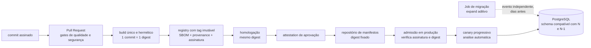

# Template de System Design: Aula 05 - Containers, CI/CD & Deploy sem Downtime

> **Contexto do Cenário: O Deploy que Quebrou o Checkout e o Rollback Impossível**
>
> Sua equipe está reestruturando a engenharia de release do serviço de **Checkout** após um incidente severo na Black Friday:
>
> 1. **O Incidente:** Para subir uma otimização urgente na Saga, o pipeline de produção recompilou a branch `main`, sobrescreveu a tag `checkout:latest` e iniciou a atualização. No boot da primeira instância nova, o **Flyway** renomeou a coluna `status_pagamento` para `estado_saga`.
> 2. **O Efeito em Cadeia:** Os 80% de servidores que ainda rodavam a versão anterior passaram a falhar imediatamente (`column "status_pagamento" does not exist`). Ao tentar acionar o rollback puxando `:latest`, a equipe descobriu que a imagem anterior havia sido sobrescrita e, mesmo restaurando um backup do binário antigo, ele continuou falhando porque o banco já estava alterado.
> 3. **A Carga:** 5.000 TPS ativos com múltiplas réplicas de aplicação conectadas ao mesmo banco PostgreSQL.
>
> **Instruções:** Responda às decisões arquiteturais abaixo fundamentando suas escolhas estritamente com base nos requisitos e restrições deste cenário. Documente suas decisões no repositório contínuo do seu projeto através de commits atômicos e bem descritivos.

---

## 0. Recorte, autópsia do incidente e premissas assumidas

### 0.1 O que estou desenhando

A **esteira de release do serviço de Checkout**: como o código se transforma em artefato, como esse artefato é identificado, promovido e admitido em produção, como o tráfego migra de uma versão para outra, como o schema do PostgreSQL evolui sem derrubar as réplicas antigas, e como tudo isso é testado antes de encostar num cliente.

Não estou desenhando o domínio do Checkout. A lógica da Saga, o modelo de dados e os serviços vizinhos são caixas-pretas com contrato. A única coisa que me interessa do domínio é que existe uma coluna chamada `status_pagamento` que alguém decidiu renomear.

### 0.2 Autópsia do incidente — seis causas, não uma

Este é o ponto de partida do documento, porque a resposta comum trata o incidente como "erro do Flyway" ou "erro da tag `latest`". São seis falhas independentes, e **cada uma sozinha teria sido suficiente** para produzir o estrago. Corrigir uma e não as outras cinco só muda qual delas causa o próximo incidente.

| # | Causa-raiz | O que ela produziu no incidente | Onde eu a corrijo neste documento |
| :--- | :--- | :--- | :--- |
| C1 | **Identidade mutável do artefato** (`:latest` sobrescrito) | Rollback impossível: o ponteiro para a versão anterior deixou de existir | 1.2 — tag imutável, referência por digest, `latest` proibido na admissão |
| C2 | **Promoção por recompilação** | O binário de produção **nunca existiu em homologação**. Foi compilado na hora, a partir da `main` | 1.2 — *build once, promote the same digest*, com provenance verificável |
| C3 | **A `main` carregava carga desconhecida** | A "otimização urgente" veio acompanhada de tudo o que havia sido mergeado desde o último release. Ninguém sabe o que exatamente subiu | 1.2 e 3.1 — release a partir de commit identificado, não de branch; feature flag para separar deploy de release |
| C4 | **DDL no boot da aplicação** | A migração disparou na primeira réplica nova, no meio de um rolling update, sem gate, sem aprovação e sem ninguém olhando | 2.2 — migração como evento independente do deploy, em Job próprio, com a aplicação sem permissão de DDL |
| C5 | **Mudança destrutiva de schema no mesmo release do código** | `RENAME COLUMN` quebrou instantaneamente os 80% que rodavam a versão anterior | 2.2 — expand/contract em três releases, com regra de compatibilidade N-1 |
| C6 | **Nenhum teste da versão anterior contra o schema novo** | A incompatibilidade era detectável em CI por um teste de 40 segundos e não existia | 3.2 — matriz de coexistência N-1 como gate obrigatório do PR |

Duas observações que derivam da tabela e que estruturam todo o resto:

**Primeira: o rolling update não é um detalhe do cenário, é a condição permanente.** O enunciado diz "os 80% de servidores que ainda rodavam a versão anterior". Isso não aconteceu porque a equipe escolheu canary — aconteceu porque **qualquer** atualização de múltiplas réplicas passa por um intervalo em que duas versões coexistem. Logo, compatibilidade N-1 não é um requisito do canary: é um requisito de deploy. Um sistema que só funciona quando todas as réplicas estão na mesma versão não tem como ser atualizado sem downtime, qualquer que seja a estratégia de rollout escolhida no item 2.1.

**Segunda: o incidente teve dois rollbacks falhos por motivos diferentes.** O primeiro falhou por *indisponibilidade do artefato* (C1/C2). O segundo falhou por *irreversibilidade do estado* (C4/C5) — e este é o mais grave, porque mesmo com a imagem antiga em mãos o sistema não voltava. É por isso que, neste documento, **a reversibilidade do banco não é obtida desfazendo o DDL; é obtida fazendo apenas DDL que não precisa ser desfeito.**

### 0.3 O que o cenário dá como dado

| Dado | Valor |
| :--- | :--- |
| Serviço em questão | Checkout |
| Carga no momento do incidente | 5.000 TPS ativos |
| Topologia de aplicação | Múltiplas réplicas |
| Topologia de banco | Um PostgreSQL compartilhado por todas as réplicas |
| Fração que quebrou | 80% das instâncias (as da versão anterior) |
| Erro observado | `column "status_pagamento" does not exist` |
| Ferramenta de migração | Flyway, executado no boot da aplicação |
| Estratégia de tag | `checkout:latest`, sobrescrita |
| Mudança de schema | `status_pagamento` → `estado_saga` |
| Momento | Pico de Black Friday |

### 0.4 O que estou assumindo

| # | Premissa | Valor assumido | Por que assumo |
| :--- | :--- | :--- | :--- |
| P1 | Stack | Java 25 (LTS), Spring Boot 4.1, PostgreSQL 18, Kubernetes, Argo CD + Argo Rollouts, GitHub Actions, registry OCI privado, Flyway 12 (Community) | É a stack dominante para esse tipo de plataforma e a que eu sustento numa arguição. As versões importam em dois pontos concretos do documento: Flyway `undo` é recurso pago, e `ADD COLUMN` sem default volátil é metadata-only no PostgreSQL moderno |
| P2 | Dimensionamento | ~40 réplicas do Checkout em pico (≈125 TPS por réplica), um primário PostgreSQL com réplicas de leitura | Preciso de um número para raciocinar sobre granularidade de canary por réplica e sobre custo de infraestrutura duplicada |
| P3 | Volume da tabela | `pedido` na ordem de centenas de milhões de linhas | É o que torna `ALTER TABLE` com *rewrite* inviável e o que obriga backfill em lotes. Se a tabela tivesse mil linhas, metade deste documento seria cerimônia |
| P4 | Semântica da renomeação | No caminho principal, assumo **renomeação pura**: mesmo tipo, mesmo domínio de valores, mesma semântica. O caso em que o domínio de valores também muda é tratado explicitamente no item 2.2 | O nome `estado_saga` sugere que o conceito mudou de "status do pagamento" para "estado da saga". Se os valores possíveis mudaram, **não é rename, é tradução** — e isso muda o desenho. Declaro a premissa porque é a diferença entre um documento correto e um documento que parece correto |
| P5 | Camada de roteamento | Existe roteamento com peso configurável (Gateway API ou malha de serviço) à frente do Checkout | Sem isso, canary fino simplesmente não existe: o peso vira proporção de réplicas, e com 40 réplicas a granularidade mínima é 2,5%. É pré-requisito, não enfeite |
| P6 | Janela de pico | Black Friday como janela de ~72h com congelamento de mudanças declarado; migrações de schema acontecem semanas antes | O incidente aconteceu porque algo subiu durante o pico. Parte da solução é processo, não tecnologia |
| P7 | Observabilidade | Prometheus com métricas rotuladas por versão da aplicação (`app_version` / digest), mais logs e traces com o mesmo rótulo | Análise automática de canary é impossível sem isso: métrica agregada mistura as duas versões e esconde exatamente o que se quer medir |
| P8 | SLO do Checkout | 99,9% de disponibilidade e p99 de 300 ms na criação de pedido | Sem SLO não existe critério objetivo de avanço ou de abort do canary. Todos os limiares do item 2.1 derivam daqui |
| P9 | Janela de rollback | A versão N-1 é elegível a rollback por 7 dias ou 2 releases, o que vier primeiro | É esse número que define quando a fase de *contract* pode rodar. Sem ele, "quando posso dropar a coluna?" não tem resposta |
| P10 | Segregação de funções | Quem desenvolve não aprova a promoção para produção | Contexto de pagamentos sob regulação; muda o desenho dos gates do item 3.1 |

### 0.5 Formato e visão geral

Respostas em primeira pessoa, com decisão explícita, alternativas nomeadas e trade-off assumido em cada item. Diagramas em Mermaid onde o texto sozinho não resolve.



O desenho tem um eixo único: **o artefato e o schema são dois ciclos de vida separados, e cada um é, isoladamente, reversível.**

---

## 1. Empacotamento, Superfície de Ataque e Promoção Imutável

### 1.1 Anatomia da Imagem e Redução de Superfície de Ataque

- **Construção vs Execução:** Como você estruturará o empacotamento do serviço de Checkout para produção? Especifique o que deve ser usado na etapa de compilação, o que deve (e o que não deve) entrar na imagem final de execução, com qual permissão de usuário o processo rodará e qual o trade-off da sua escolha de imagem base para a segurança e para o diagnóstico em produção.

  > #### As alternativas de empacotamento, antes da escolha
  >
  > | Abordagem | Como funciona | O que compra | O que custa |
  > | :--- | :--- | :--- | :--- |
  > | Dockerfile único estágio com JDK | `FROM eclipse-temurin:25-jdk`, copia o fonte, roda `mvn package`, `ENTRYPOINT java -jar` | Nada que valha a pena | Imagem de 700 MB a 1 GB com compilador, Maven, fonte, `~/.m2` e frequentemente o `settings.xml` com token do repositório interno. É a pior opção em todas as dimensões |
  > | **Dockerfile multi-estágio** | Estágio de build com JDK produz o jar; estágio final copia só o necessary para uma base mínima | Controle total, legível, auditável, sem dependência de plugin | Preciso cuidar de camadas, cache e reprodutibilidade na mão |
  > | Jib (plugin Maven/Gradle) | Monta as camadas OCI direto do projeto, sem Dockerfile e sem *daemon* Docker | Reprodutibilidade por construção (timestamps fixos → mesmo input, mesmo digest), camadas bem separadas, build sem privilégio de *daemon* | A definição da imagem vira configuração do plugin; menos óbvio para quem lê o repositório; customização de base fica indireta |
  > | Cloud Native Buildpacks (`bootBuildImage`) | Detecta o projeto e monta a imagem com um *builder* mantido por terceiros | SBOM automático, rebase de base sem rebuild da aplicação, zero configuração | Perco controle sobre o conteúdo exato da imagem — o que, num contexto em que preciso provar o que está rodando, é um custo alto. O *builder* é uma dependência de terceiros no caminho do artefato |
  > | `jlink` + imagem `static`/`base` | `jdeps` descobre os módulos usados, `jlink` monta um runtime Java sob medida, que vai para uma base quase vazia | Imagem muito pequena (60–120 MB) e superfície mínima | Preciso acertar os módulos (`jdk.crypto.ec` esquecido = TLS quebrado em produção, não em teste); perco ferramentas de diagnóstico do JDK a menos que as inclua deliberadamente |
  >
  > **Escolho o Dockerfile multi-estágio sobre base distroless, com o jar em camadas do Spring Boot**, e registro Jib como a alternativa que eu adotaria sem desconforto se o time quisesse reprodutibilidade de digest sem trabalho manual. Descarto Buildpacks pelo motivo que importa neste cenário: preciso ser capaz de afirmar, com evidência, o que existe dentro da imagem que atende 5.000 TPS de pagamento.
  >
  > #### A etapa de compilação
  >
  > O que o estágio de build usa, e por quê:
  >
  > - **JDK completo** (`eclipse-temurin:25-jdk`), fixado **por digest**, não por tag. Uma base referenciada por tag é a mesma classe de problema da C1: `25-jdk` aponta para conteúdos diferentes em dias diferentes, e o build deixa de ser reprodutível.
  > - **Cache de dependências explícito** via BuildKit, não via truque de `COPY pom.xml` primeiro: `RUN --mount=type=cache,target=/root/.m2`. O cache fica fora da imagem, então ele acelera o build sem virar camada.
  > - **Rede restrita ao repositório interno de pacotes** (proxy/Artifactory). O build não alcança a internet aberta. Isso protege de *typosquatting* e de uma dependência que muda ou desaparece entre dois builds.
  > - **Decomposição do jar em camadas**: o Spring Boot produz um jar com índice de camadas, e `java -Djarmode=tools -jar app.jar extract --layers` separa dependências, *loader*, dependências de snapshot e código da aplicação. Isso não é cosmético neste cenário: uma correção de uma linha troca apenas a camada da aplicação, de poucos megabytes, e **todas as outras camadas já estão no cache dos nós**. O efeito prático é tempo de `pull` em dois momentos que são exatamente os mais sensíveis aqui — o *scale-out* automático durante o pico e o rollback de emergência.
  > - **Testes não rodam dentro do Dockerfile.** O CI roda os testes como etapa própria, com relatório, cobertura e paralelismo. Teste dentro do `RUN` do Docker é teste cujo resultado ninguém lê e cujo cache invalida o build inteiro.
  >
  > #### A imagem final: o que entra
  >
  > Só quatro coisas:
  >
  > 1. O runtime Java (JRE ou runtime `jlink`).
  > 2. As camadas extraídas do jar.
  > 3. Os *labels* OCI de rastreabilidade (item 1.2).
  > 4. O `ENTRYPOINT`.
  >
  > #### O que **não** entra — e o motivo de cada exclusão
  >
  > | Excluído | Por quê |
  > | :--- | :--- |
  > | JDK, compilador, Maven/Gradle, `~/.m2`, `~/.gradle` | Ferramenta de build em produção é superfície de ataque sem nenhuma função |
  > | Código-fonte, testes, recursos de teste, dados de fixture | Vazamento de propriedade intelectual e de lógica; fixtures já causaram incidente de dado de teste em produção |
  > | `.git`, `.env`, `settings.xml`, chaves, `*.pem` | Credencial em imagem é credencial pública: quem puxa a imagem tem o arquivo. Mitigado também por `.dockerignore` tratado como artefato de segurança, não como conveniência |
  > | Shell (`sh`, `bash`), gerenciador de pacotes (`apt`, `apk`), `curl`, `wget`, `nc` | São as ferramentas que um invasor usa **depois** de conseguir execução de código. Sem shell, uma injeção de comando perde o interpretador; sem `curl`, perde o canal de download do próximo estágio |
  > | Segredos via `ARG` ou `ENV` | `ARG` fica no histórico da imagem e aparece em `docker history`; `ENV` fica legível em `/proc/<pid>/environ`, em dumps e em relatórios de crash. Segredo entra em runtime, como arquivo montado |
  > | Qualquer binário com *setuid* | Caminho clássico de escalada de privilégio |
  >
  > #### Permissão de execução
  >
  > ```dockerfile
  > # ---------- build ----------
  > FROM eclipse-temurin:25-jdk@sha256:<digest-fixado> AS build
  > WORKDIR /src
  > COPY --link pom.xml .
  > COPY --link src ./src
  > RUN --mount=type=cache,target=/root/.m2 \
  >     mvn -B -ntp -DskipTests package
  > RUN java -Djarmode=tools -jar target/checkout.jar extract --layers --destination /layers
  >
  > # ---------- runtime ----------
  > FROM gcr.io/distroless/java25-debian13:nonroot@sha256:<digest-fixado>
  > WORKDIR /app
  > COPY --from=build /layers/dependencies/ ./
  > COPY --from=build /layers/spring-boot-loader/ ./
  > COPY --from=build /layers/snapshot-dependencies/ ./
  > COPY --from=build /layers/application/ ./
  >
  > USER 65532:65532
  > EXPOSE 8080
  >
  > ENTRYPOINT ["java", \
  >   "-XX:MaxRAMPercentage=75", \
  >   "-XX:+ExitOnOutOfMemoryError", \
  >   "-XX:+HeapDumpOnOutOfMemoryError", "-XX:HeapDumpPath=/tmp/heapdump.hprof", \
  >   "-XX:+UseG1GC", \
  >   "-XX:StartFlightRecording=disk=true,maxsize=256m,filename=/tmp/app.jfr,settings=profile", \
  >   "org.springframework.boot.loader.launch.JarLauncher"]
  > ```
  >
  > Quatro decisões dentro desse arquivo que merecem defesa:
  >
  > **1. `USER 65532:65532` — numérico, não nome.** O Kubernetes, ao avaliar `runAsNonRoot: true`, precisa resolver o UID. Se o `USER` da imagem é um nome (`nonroot`), o kubelet não consegue resolvê-lo e o pod falha com `CreateContainerConfigError` — ou, pior, a política passa a depender de o `/etc/passwd` da imagem existir, que é justamente o que uma base mínima pode não ter. UID numérico é o que funciona de forma determinística. O corolário é a porta: usuário sem privilégio não pode escutar abaixo de 1024, então 8080.
  >
  > **2. `ENTRYPOINT` em forma exec, nunca em forma shell.** Em forma shell (`ENTRYPOINT java -jar app.jar`), o Docker executa `/bin/sh -c`, o shell torna-se PID 1, e **o `SIGTERM` do Kubernetes vai para o shell, que não o repassa à JVM**. O resultado é que o pod é morto por `SIGKILL` ao fim do `terminationGracePeriodSeconds`, com todas as requisições em voo derrubadas. Num documento sobre deploy sem downtime, isso não é detalhe de estilo: é a diferença entre um rollout silencioso e um rollout que gera erro em cada ciclo. Em base distroless o problema aparece de outra forma — não há `sh`, então a forma shell simplesmente não executa. Dois motivos para a mesma regra.
  >
  > **3. `MaxRAMPercentage` e não `-Xmx` fixo.** A JVM moderna respeita o cgroup, então ela já lê o limite do container; o percentual deixa o mesmo artefato funcionar com 2 GB em homologação e 8 GB em produção sem recompilar nem reempacotar — que é exatamente o princípio do item 1.2. Para CPU, o cuidado é o oposto: `limits.cpu` apertado causa *throttling* do CFS, e a JVM dimensiona *threads* de GC e de JIT por `ActiveProcessorCount`. A 5.000 TPS, prefiro `requests` honesto com limite generoso (ou ausente) a um limite baixo que transforma GC em latência de cauda.
  >
  > **4. Gravação em disco apenas em `/tmp` montado.** O pod roda com `readOnlyRootFilesystem: true`, e a JVM precisa escrever (`hsperfdata`, arquivos temporários, *heap dump*, JFR). Logo, `emptyDir` em `/tmp` e todos os caminhos de escrita apontando para lá.
  >
  > O manifesto que acompanha a imagem:
  >
  > ```yaml
  > securityContext:
  >   runAsNonRoot: true
  >   runAsUser: 65532
  >   runAsGroup: 65532
  >   readOnlyRootFilesystem: true
  >   allowPrivilegeEscalation: false
  >   capabilities:
  >     drop: ["ALL"]
  >   seccompProfile:
  >     type: RuntimeDefault
  > ```
  >
  > E a parte que fecha o "sem downtime", porque a imagem correta com manifesto errado continua derrubando conexão:
  >
  > ```yaml
  > lifecycle:
  >   preStop:
  >     exec: { command: ["sleep", "10"] }   # tempo para sair do EndpointSlice
  > terminationGracePeriodSeconds: 45         # > timeout de shutdown da aplicação
  > ```
  > ```properties
  > server.shutdown=graceful
  > spring.lifecycle.timeout-per-shutdown-phase=30s
  > ```
  >
  > O `preStop` existe por causa de uma corrida real e muito pouco conhecida: o kubelet envia `SIGTERM` **em paralelo** com a remoção do pod dos `EndpointSlice`. A propagação até o `kube-proxy` de cada nó e até o balanceador leva alguns segundos. Sem a espera, a aplicação já começou a recusar conexões enquanto o balanceador ainda a considera saudável — e o cliente recebe erro de conexão num deploy "sem downtime". Dez segundos de `sleep` custam dez segundos por pod e eliminam a classe inteira de erro.
  >
  > #### A escolha da base e seu trade-off — a parte que o item pede explicitamente
  >
  > | Base | Tamanho típico | Superfície | Diagnóstico | Observação decisiva |
  > | :--- | :--- | :--- | :--- | :--- |
  > | `eclipse-temurin:25-jre` (Debian/Ubuntu) | 250–400 MB | Shell, `apt`, dezenas de pacotes de SO | Ótimo: `exec`, `bash`, instalar o que precisar | Herda o fluxo de CVE de uma distribuição inteira para rodar um processo Java |
  > | `-alpine` | 150–200 MB | Shell e `apk`, poucos pacotes | Bom | **musl em vez de glibc.** Builds de JVM para musl existem, mas resolução de DNS e bibliotecas nativas (por exemplo o `netty-tcnative` usado por drivers e clientes HTTP) se comportam de forma diferente. Num serviço de pagamento, trocar a libc por 100 MB é um risco mal pago |
  > | **`gcr.io/distroless/java*:nonroot`** | 180–250 MB | Sem shell, sem gerenciador de pacotes, sem utilitários; glibc | **Ruim por construção** — é o preço | Variante `nonroot` já traz o usuário 65532. Contrapartida honesta: a cadência de atualização é menor que a de projetos de rebuild contínuo, então um CVE de SO pode ficar aberto mais tempo |
  > | `cgr.dev/chainguard/jre` (Wolfi) | 80–180 MB | Equivalente ao distroless, com glibc, SBOM e provenance gerados no próprio build | Ruim por construção; existe variante `-dev` com shell para desenvolvimento | Tecnicamente a melhor opção de postura de CVE pela política de rebuild contínuo. O custo é comercial: fixar versões específicas pertence ao catálogo pago, e o nível gratuito trabalha essencialmente com `:latest` — o que colide frontalmente com a C1 deste documento |
  > | `jlink` sobre `distroless/base` | 60–120 MB | A menor de todas | A pior: sem `jcmd`, `jstack`, `jmap` a menos que eu inclua `jdk.jcmd` deliberadamente | Exige acertar o grafo de módulos. `jdk.crypto.ec` ausente derruba TLS só em produção |
  >
  > **Escolho `distroless/java25:nonroot`**, fixada por digest, e registro Chainguard como a escolha que eu defenderia se a organização tivesse o contrato — porque rebuild contínuo resolve um problema (CVE de base envelhecendo) que o distroless não resolve, e porque SBOM e provenance nativos reduzem o trabalho do item 3.1.
  >
  > **O trade-off, nomeado sem rodeio:** eu troco capacidade de diagnóstico *interativo* por superfície de ataque. Numa imagem sem shell, `kubectl exec -it -- sh` não existe. Às 3h da manhã do sábado da Black Friday, com o p99 subindo, não há `top`, não há `curl localhost:8080/actuator`, não há `ls /tmp`. Essa perda é real e não deve ser minimizada em nome de uma métrica de CVE.
  >
  > **Como eu compro o diagnóstico de volta** — e é isso que torna o trade-off aceitável em vez de temerário:
  >
  > 1. **Container efêmero de depuração**: `kubectl debug -it checkout-abc --image=<imagem-de-ferramentas> --target=checkout`. O `--target` compartilha o namespace de PID, então eu vejo e inspeciono o processo Java do container original a partir de um container que tem ferramentas. A imagem de produção permanece mínima; as ferramentas vivem num container que existe por quinze minutos e desaparece. Dois detalhes que fazem isso falhar na prática se não forem resolvidos antes: o container efêmero precisa de `securityContext` compatível com `runAsNonRoot` do pod (uma imagem de ferramentas que roda como root falha a admissão), e `jcmd`/`jstack` só conseguem se anexar à JVM se o UID coincidir. Ambos se configuram uma vez e se testam em *game day* — caminho de emergência não ensaiado não funciona na emergência.
  > 2. **O diagnóstico de JVM é remoto, não local**: Actuator exposto numa porta de gestão separada, métricas de JVM e de pool no Prometheus, *heap dump* escrito em `/tmp` e coletável, e **JFR ligado continuamente** com buffer em disco (como no `ENTRYPOINT` acima). Com JFR sempre gravando, a pergunta "o que a JVM estava fazendo no momento do pico" é respondida copiando um arquivo, sem precisar reproduzir o problema — o que é melhor do que qualquer `jstack` tirado depois do susto.
  > 3. **O custo de boot do canary cai com AppCDS**: arquivo de CDS gerado no build a partir de uma execução de treino, reduzindo tempo de inicialização. Importa aqui porque canary e *scale-out* em pico são exatamente os momentos em que segundos de boot viram requisições enfileiradas. O trade-off é que o arquivo precisa ser gerado com a mesma JVM e o mesmo classpath da imagem final, o que amarra o build — aceitável, já que o build é único e identificado.
  >
  > **Resumo do trade-off assumido:** aceito depuração mais trabalhosa e dependente de ferramentas preparadas de antemão, em troca de uma imagem em que uma execução remota de código não encontra shell, nem gerenciador de pacotes, nem canal de download, nem usuário privilegiado, nem sistema de arquivos gravável. Num serviço que move dinheiro, esse é o lado certo da troca — mas só porque eu paguei o preço de montar o caminho de diagnóstico alternativo e de ensaiá-lo. Distroless sem container efêmero testado é insegurança operacional disfarçada de segurança.

---

### 1.2 Rastreabilidade, Identidade do Artefato e Parametrização

- **Da Homologação à Produção:** Como sua esteira garante que o binário executado em produção é exatamente o mesmo que passou nos testes de homologação? Explique como as configurações mudam entre ambientes (dev, staging, prod) sem recompilar o artefato e como você identifica a versão no registry para que um rollback nunca puxe um binário sobrescrito por engano.

  > Este item responde às causas C1, C2 e C3. Começo pela regra que o incidente violou e que organiza o resto: **compila-se uma vez, promove-se o mesmo digest.** Recompilar para promover não é uma otimização ruim — é uma mudança de artefato disfarçada de deploy.
  >
  > #### Por que o incidente era inevitável com promoção por recompilação
  >
  > O enunciado diz que "o pipeline de produção recompilou a branch `main`". Três consequências, em ordem crescente de gravidade:
  >
  > 1. **O binário de produção nunca foi testado.** O que passou em homologação foi *outro* binário, compilado em outro momento, possivelmente de outro commit, certamente com outra resolução de dependências. Qualquer afirmação de que "passou nos testes" é falsa por construção.
  > 2. **Dependências se movem entre builds.** Um `pom.xml` com qualquer faixa aberta, um snapshot, ou simplesmente uma versão transitiva que o resolvedor escolheu diferente, e os dois builds divergem. Isso já é suficiente para que o comportamento difira.
  > 3. **"A `main`" não é uma versão.** Recompilar a `main` para subir uma otimização urgente da Saga significa subir também **tudo o que foi mergeado desde o último release** — correções, refatorações, mudanças de outros times, e a migração do Flyway que ninguém pretendia ativar naquele momento. Essa é a causa C3, e é a mais invisível das seis: a equipe acredita que subiu uma otimização, e subiu um release inteiro não planejado. É bem possível que o `RENAME COLUMN` estivesse na `main` esperando o próximo release, e tenha ido ao ar de carona.
  >
  > #### Como eu garanto que é o mesmo binário — em quatro camadas, da mais fraca para a mais forte
  >
  > | Camada | Mecanismo | O que garante | O que não garante |
  > | :--- | :--- | :--- | :--- |
  > | 1. Processo | "o pipeline promove, não recompila" | Nada, sozinha | Qualquer desvio manual ou emergencial a derruba |
  > | 2. Identidade | Deploy por **digest** (`@sha256:...`), não por tag | Que o conteúdo é bit a bit o mesmo — digest é endereçamento por conteúdo | Que o conteúdo seja legítimo |
  > | 3. Procedência | **Provenance SLSA** assinada pelo builder, gerada fora da etapa de build | Qual workflow, qual repositório, qual commit, quais entradas produziram aquele digest | Que ele tenha passado em homologação |
  > | 4. Verificação na admissão | Política de admissão exige assinatura + provenance + **attestation de aprovação em homologação**, por digest | Que produção só executa o artefato exato que foi construído pelo workflow autorizado **e** aprovado | — |
  >
  > A camada 4 é a resposta de verdade. "Garantir que é o mesmo binário" por disciplina de processo é uma promessa; por verificação criptográfica na admissão é um controle. O fluxo concreto:
  >
  > - No build, `actions/attest-build-provenance@v3` gera a atestação de procedência SLSA, assinada sem chave de longa duração via OIDC. O detalhe importante é que a assinatura acontece **fora** da etapa de build, para que o código que está sendo compilado não tenha acesso ao material de assinatura.
  > - Ao fim de homologação, um segundo workflow emite uma atestação do tipo "aprovado em homologação" sobre o **mesmo digest**.
  > - Na admissão em produção, uma política do Kyverno (`ImageValidatingPolicy`) verifica as duas, exigindo identidade de signatário correspondente ao repositório e ao workflow esperados. Imagem sem as duas atestações não entra, mesmo que alguém a empurre para o registry correto com a tag correta.
  > - Verificação manual, quando se quer conferir à mão: `gh attestation verify oci://<registry>/checkout@sha256:... --owner <org>` ou `cosign verify-attestation --type slsaprovenance ...`.
  >
  > #### Identidade e imutabilidade — a correção direta de C1
  >
  > **Esquema de tags que eu adoto:**
  >
  > | Referência | Exemplo | Mutável? | Para que serve |
  > | :--- | :--- | :--- | :--- |
  > | Digest | `checkout@sha256:9f2c...` | **Nunca** | É a referência usada em **todo** manifesto de deploy. É a identidade real |
  > | Tag de versão | `checkout:1.42.0-a1b2c3d` | Imutável por configuração do registry | Legibilidade humana e correlação com o commit |
  > | `latest` | — | — | **Não existe.** Não é publicada, e é explicitamente negada na admissão |
  > | Tags de ambiente (`:prod`, `:stable`) | — | — | Também não existem. Ponteiro mutável é a C1 com outro nome |
  >
  > **E o controle que torna o incidente impossível, em vez de improvável:** habilitar **imutabilidade de tag no próprio registry** (`imageTagMutability: IMMUTABLE` no ECR; configuração equivalente em Harbor e Artifactory). Com isso, a tentativa de sobrescrever `checkout:1.42.0-a1b2c3d` **falha no `push`**. Não é uma convenção que o time precisa lembrar sob pressão às 2h da manhã: é um erro de API. Essa é a diferença entre corrigir a causa e pedir para o time ter mais cuidado.
  >
  > Três guardas adicionais que fecham o caminho do rollback:
  >
  > 1. **Política de retenção que não apaga o que pode ser necessário.** Uma regra de ciclo de vida mal escrita ("manter as 10 últimas") reintroduz o problema do incidente de forma silenciosa, porque a imagem desaparece sem ninguém notar. A regra correta retém, no mínimo, todas as imagens com atestação de produção dos últimos 90 dias, e nunca expira uma que esteja referenciada por algum manifesto vivo. E, como a configuração pode mudar, o pressuposto é **testado** (item 3.2, nível 8).
  > 2. **`imagePullPolicy`.** Com `latest`, qualquer reinício de pod puxava "o que estivesse lá", de modo que duas réplicas "da mesma versão" podiam ser binários diferentes — e um nó com cache antigo podia manter indefinidamente uma versão que ninguém sabia estar rodando. Com digest, a frota é homogênea por construção: o digest identifica o conteúdo, então `IfNotPresent` é seguro e o cache dos nós passa a ser uma vantagem no *scale-out*.
  > 3. **Mutação na admissão como rede**: o Kyverno pode resolver tag → digest no momento da admissão, o que neutraliza a classe inteira do problema mesmo se um manifesto escapar com tag.
  >
  > #### Rastreabilidade: do pod em execução até o commit
  >
  > O digest é a chave estrangeira que liga tudo. Em cima dele:
  >
  > - **Labels OCI na imagem**: `org.opencontainers.image.revision` (commit SHA completo), `.source`, `.version`, `.created`. Dado um digest, `crane config` responde de que commit ele veio sem consultar sistema nenhum.
  > - **Informação em runtime**: `/actuator/info` com o commit e a versão, alimentado pelo plugin de informação de build. Isso responde à pergunta oposta, que é a que se faz durante o incidente: "este pod que está errando, que commit ele é?"
  > - **Rótulo em toda métrica, log e trace** (P7): sem isso, nada do item 2.1 funciona.
  > - **Build reprodutível** como verificação independente: com timestamps normalizados e ordem determinística, reconstruir o mesmo commit produz o mesmo digest. Isso transforma "é o mesmo binário?" numa pergunta que se responde recompilando e comparando — útil em auditoria, e o motivo pelo qual Jib é tentador.
  >
  > #### Configuração por ambiente sem recompilar
  >
  > Princípio: **a imagem é o artefato; a configuração é injetada; o segredo nunca encosta na imagem.**
  >
  > | Mecanismo | Uso que eu faço | Trade-off |
  > | :--- | :--- | :--- |
  > | Variáveis de ambiente | Apenas para valores não sensíveis e de baixa cardinalidade (nome do ambiente, nível de log) | Legíveis em `/proc/<pid>/environ` e em dumps. **Nunca segredo** |
  > | **Arquivos montados de ConfigMap**, lidos via `spring.config.import=optional:file:/etc/config/application.yaml` | É o caminho principal para a configuração por ambiente | Mudança exige reinício do pod (ou recarga explícita), o que é aceitável e até desejável |
  > | **Secret montado como arquivo**, sincronizado do gerenciador de segredos pelo External Secrets Operator | Credenciais de banco, chaves de parceiro | Mais um componente para operar; em troca, rotação sem rebuild e sem tocar no artefato |
  > | Perfis do Spring (`SPRING_PROFILES_ACTIVE`) | Só para diferenças de **comportamento** (ativar um stub, desligar um agendador), nunca para valores de produção | Ver a ressalva abaixo |
  > | **Feature flags** (OpenFeature com provedor próprio ou de mercado) | Para separar *deploy* de *release* | Mais um plano de controle; exige higiene para flags não se acumularem |
  >
  > **A ressalva sobre perfis, porque aqui eu discordo da prática mais comum:** empacotar `application-prod.yaml` dentro do jar coloca a configuração de produção *dentro* do artefato. O efeito colateral é que mudar um `timeout` em produção passa a exigir novo build e novo deploy — ou seja, o artefato volta a depender do ambiente, que é precisamente o que esta seção quer evitar. Defaults seguros dentro do jar, sim. Endpoints, limites e credenciais de produção, não. E, em qualquer caso, nenhum segredo: um `application-prod.yaml` com senha dentro do jar está publicado para quem puxar a imagem.
  >
  > **Validação de configuração no boot, com falha dura.** `@ConfigurationProperties` com `@Validated`, propriedades obrigatórias sem default, e a aplicação se recusando a subir se faltar alguma. O modo de falha que eu quero é "o pod não sobe e o rollout para no primeiro passo"; o modo de falha que eu não quero é "o pod sobe, atende por quarenta minutos e começa a lançar exceção quando a primeira requisição toca o código que precisava daquela variável". Num canary, isso é ainda mais importante: configuração quebrada deve matar o canary antes de ele receber tráfego.
  >
  > #### A resposta para a "otimização urgente" — separar deploy de release
  >
  > Vale fechar o item atacando o gatilho do incidente. A sequência começou porque alguém precisava **subir código urgente durante o pico**. Mesmo com toda a esteira acima, subir código no pico é a atividade de maior risco possível, e nenhuma engenharia de release elimina esse risco: ela só o reduz.
  >
  > O que elimina é outra coisa: **a otimização da Saga é empacotada desligada, atrás de uma flag, e vai ao ar num release normal, dias antes do pico.** Durante a Black Friday, "ativar a otimização" é uma mudança de configuração, propagada em segundos, reversível em segundos, sem build, sem `pull`, sem rolling update e sem migração. E se a otimização piorar as coisas, o desligamento é instantâneo em vez de depender de um rollback de artefato.
  >
  > Esse é o padrão que eu defenderia com mais força neste item, porque ele muda a pergunta. A esteira descrita acima torna o deploy seguro; a flag torna o deploy desnecessário no pior momento para fazê-lo.
  >
  > **Trade-off que estou assumindo:** mais componentes e mais cerimônia — registry com imutabilidade e retenção pensadas, atestações para gerar e verificar, política de admissão para manter, segredos externalizados com um operador a mais, e um plano de controle de flags que precisa de dono e de limpeza periódica (flag esquecida é dívida que vira caminho de código morto e não testado). Em troca, o rollback deixa de depender de a imagem anterior "ainda estar lá", e a frase "é o mesmo binário que passou em homologação" deixa de ser uma crença e passa a ser uma verificação que o cluster faz sozinho, sem pedir licença a ninguém.

---

## 2. Estratégia de Rollout e Migração de Banco sem Downtime

### 2.1 O Modelo de Rollout em Produção

- **A Escolha:** ( ) Canary Release (Liberação Gradual por Percentual)  ( ) Blue-Green Deployment (Alternância de Ambientes)
- **Justificativa e Mitigação das Desvantagens do seu Modelo**

  > **Escolha: (x) Canary Release**, implementado com Argo Rollouts e roteamento por peso, com análise automática derivada do SLO (P8).
  >
  > #### Antes de escolher: as cinco estratégias reais, não duas
  >
  > O template oferece duas opções, mas o espaço de decisão tem cinco, e duas delas são melhores que as duas oferecidas para parte do problema. Começo por isso porque uma das respostas mais fortes aqui é "a melhor forma de reduzir o risco deste deploy é não precisar dele" (item 1.2).
  >
  > | Estratégia | Como funciona | Capacidade extra | Granularidade do dano | Tempo de rollback | Veredicto neste cenário |
  > | :--- | :--- | :--- | :--- | :--- | :--- |
  > | Rolling update nativo | `maxSurge`/`maxUnavailable` substituem pods gradualmente | ~10% | Proporcional ao avanço, **sem controle de tráfego e sem critério de parada automático** | Novo rollout: `pull` + boot de todas as réplicas, minutos | **É o que estava em uso no incidente.** Gradual não é o mesmo que controlado |
  > | **Canary** | Nova versão sobe ao lado, recebe fração crescente do tráfego, avança por análise de métricas | 1 réplica (~2,5%) | Controlada por peso, com abort automático | **Segundos** — muda o peso de roteamento | **Escolhido** |
  > | Blue-Green | Ambiente paralelo completo, virada de 100% | **100%** | Binária: 0% ou 100% | Segundos para voltar o ponteiro | Rejeitado — ver abaixo |
  > | Espelhamento de tráfego (*shadow*) | Tráfego real duplicado para a versão nova, cujas respostas são descartadas | 1 réplica | Zero para o cliente | N/A | **Complemento, não substituto.** Excelente para validar desempenho e caminhos de leitura sem risco; inútil para escrita, porque duplicaria cobrança |
  > | Feature flag (*dark launch*) | Código já em produção, desligado; o release é a ativação | Zero | Controlada por segmento de usuário | **Imediato**, sem deploy | **Complemento obrigatório** (item 1.2). É a única estratégia que dá controle no pico sem mover artefato |
  >
  > O desenho que eu levo adiante combina três: **flag para separar deploy de release, canary para o rollout do artefato, espelhamento para validar desempenho antes de qualquer tráfego real de escrita.**
  >
  > #### Por que canary e não blue-green — cinco argumentos, do mais fraco ao decisivo
  >
  > **1. Custo de capacidade no pior momento possível.** Blue-green exige, por definição, 100% de capacidade duplicada. Com ~40 réplicas em pico (P2), são ~40 réplicas extras, na hora do ano em que a infraestrutura está mais caprichada e mais caro — e, em nuvem, com risco concreto de a capacidade simplesmente não estar disponível (cota, limite de instância, zona saturada). Canary acrescenta uma réplica.
  >
  > **2. Risco binário na virada.** Virar 100% de 5.000 TPS para uma versão que nunca viu tráfego real é a aposta mais alta que existe. Com canary a 1%, o mesmo defeito atinge 50 TPS por dois minutos. A diferença não é de probabilidade de erro — é de tamanho do erro quando ele ocorre, e o incidente relatado já demonstrou que erros ocorrem.
  >
  > **3. Aquecimento.** Uma JVM recém-iniciada, com JIT frio, pool de conexões vazio e caches vazios, servindo 5.000 TPS no primeiro segundo, produz latência de cauda terrível e uma estampida de abertura de conexões contra o PostgreSQL. Blue-green permite pré-aquecer, mas pré-aquecimento sintético aquece os caminhos que o script conhece, não os que o tráfego real percorre — e são os segundos que não aquecem. No canary, o aquecimento é o próprio rollout: cada incremento de peso aquece mais a versão nova antes do incremento seguinte. É aquecimento com tráfego real, de graça, como subproduto da estratégia.
  >
  > **4. Blast radius do incidente relatado.** Oitenta por cento das instâncias quebraram de uma vez. Canary limita, por construção, quantas podem quebrar antes de alguém (ou algo) perceber.
  >
  > **5. O argumento que encerra a discussão: o banco é um só.** O enunciado é explícito — "múltiplas réplicas de aplicação conectadas ao mesmo banco PostgreSQL". Blue-green promete dois ambientes isolados, e é desse isolamento que vem sua vantagem principal: virar e voltar sem consequência. **Com estado compartilhado, esse isolamento não existe.** O "blue" e o "green" escrevem na mesma tabela, com o mesmo schema, ao mesmo tempo que a virada acontece. Logo:
  >
  > - Blue-green **não** dispensa compatibilidade de schema entre as versões. Ele só comprime a janela de coexistência, não a elimina — e durante a virada ela existe de todo modo.
  > - Voltar o ponteiro para "blue" **não** desfaz o que "green" gravou. O rollback continua dependendo inteiramente do desenho do item 2.2.
  > - Blue-green de verdade, com isolamento real, exigiria dois bancos e replicação bidirecional entre eles — o que, num sistema financeiro a 5.000 TPS, é uma fonte de conflito de escrita bem pior que o problema original.
  >
  > Ou seja: **eu pagaria 100% de infraestrutura extra por uma garantia que o estado compartilhado não permite entregar.** É esse o motivo central da rejeição, e é um motivo estrutural, não de custo.
  >
  > Em que cenário eu escolheria blue-green sem hesitar, para deixar claro que não é dogma: aplicação sem estado compartilhado ou com estado versionado por ambiente, volumetria em que duplicar é barato, necessidade de validar o ambiente inteiro (e não só a aplicação) antes de receber tráfego, ou exigência regulatória de homologar o ambiente de destino. Nada disso é este caso.
  >
  > #### Mitigação das desvantagens do canary
  >
  > O template pede a mitigação das desvantagens do modelo escolhido. O canary tem três, e a terceira é a que derrubou o Checkout.
  >
  > ##### Desvantagem 1 — Evolução do tráfego: quanto e por quanto tempo
  >
  > A pergunta real não é "qual percentual" mas **"quantas requisições eu preciso observar para detectar a regressão que me importa?"**. Janela definida por tempo arredondado é superstição; janela definida por volume de amostra é estatística. A 5.000 TPS eu tenho o luxo de acumular amostra rápido, e é o que eu explorarei.
  >
  > | Passo | Peso | TPS no canary | Duração | Requisições observadas | Para que serve este passo |
  > | :--- | :--- | :--- | :--- | :--- | :--- |
  > | 0 | **0%** | 0 | ~1 min | 0 | Pod sobe, `readiness` responde, smoke test pelo serviço de *preview*, configuração validada. **Nenhum cliente envolvido.** Defeito de boot e de configuração morre aqui |
  > | 1 | 1% | ~50 | 3 min | ~9.000 | Primeiro contato com tráfego real. Suficiente para detectar erro sistemático (como `column does not exist`) em segundos |
  > | 2 | 5% | ~250 | 5 min | ~75.000 | Detecta regressão de taxa de erro da ordem de décimos de ponto percentual |
  > | 3 | 20% | ~1.000 | 10 min | ~600.000 | Primeira carga capaz de revelar saturação de recurso compartilhado — pool de conexões, contenção de lock, latência de cauda. **É o passo do cenário do rollback descrito no item 2.2** |
  > | 4 | 50% | ~2.500 | 15 min | ~2.250.000 | Comportamento sob metade da carga de pico; revela vazamento e degradação de GC |
  > | 5 | 100% | 5.000 | — | — | Promoção. A versão estável antiga é mantida íntegra pela janela de rollback (P9) |
  >
  > Duas regras sobre a tabela:
  >
  > - **O canary é mais lento no começo e mais rápido no fim**, porque o valor informativo de cada passo decresce: o que 1% não pega em três minutos, 5% não pegará melhor; o que só aparece em 20% é saturação, que precisa de carga, não de tempo.
  > - **Durante o pico da Black Friday (P6) não há rollout de artefato.** Esta escada existe para os dias normais e para as semanas que antecedem o pico. No pico, a única alavanca é a flag. Dizer isso explicitamente é parte da resposta, porque o incidente foi um deploy no pico.
  >
  > ##### Desvantagem 2 — Os sinais: avanço e rollback automáticos
  >
  > Aqui há uma escolha de desenho que vale mais que a lista de métricas: **eu comparo o canary com o estável, não com um limiar absoluto.**
  >
  > Um limiar absoluto ("abortar se erro > 1%") não distingue "o canary está ruim" de "o sistema todo está ruim porque o parceiro de pagamento está instável". Na Black Friday, a segunda situação é frequente, e um limiar absoluto aborta deploys bons durante incidentes externos — o que treina o time a desligar a análise, o que é o pior resultado possível. Comparar canary contra estável, no mesmo intervalo, com o mesmo tráfego, isola a variável que eu quero medir: a versão.
  >
  > | Sinal | Consulta (conceitual) | Critério de abort | Por que este sinal, neste cenário |
  > | :--- | :--- | :--- | :--- |
  > | Taxa de erro relativa | `erro_5xx(canary) / total(canary)` ÷ `erro_5xx(stable) / total(stable)` | razão > 1,2 por 2 avaliações consecutivas | Detecta regressão de código independentemente do estado geral do sistema |
  > | Latência relativa | `p99(canary) / p99(stable)` | razão > 1,3 | É o sinal do cenário de rollback do item 2.2: "degradação grave de performance" |
  > | Latência absoluta | `p99(canary)` | > orçamento derivado do SLO de 300 ms (P8) | Guarda de último recurso, para o caso de o estável também estar degradado |
  > | **Erros de persistência** | contador de `SQLException` / erro de mapeamento de coluna, por versão | **> 0: abort imediato, sem esperar janela** | É o sinal específico do incidente. `column "status_pagamento" does not exist` não é "um pouco de erro": é incompatibilidade, e não existe quantidade aceitável dela |
  > | **Conversão de negócio** | pedidos confirmados por minuto por réplica, canary vs estável | queda > 5% | O incidente "quebrou o checkout". Painel técnico verde com conversão caindo é o modo de falha mais caro que existe, e só uma métrica de negócio o vê |
  > | Saturação | uso do pool Hikari, tempo de espera por conexão, pausas de GC | acima do orçamento | Pega o que só aparece a 20% de 5.000 TPS |
  > | Estabilidade do processo | reinícios do pod do canary, `CrashLoopBackOff` | > 0 | Abort imediato |
  > | Atraso de consumo | *lag* das filas que o Checkout consome, por versão | crescimento sustentado | Uma versão que responde bem em HTTP e para de drenar fila está quebrada de um jeito que a métrica de HTTP não vê |
  >
  > Na mecânica do Argo Rollouts isso é uma `AnalysisTemplate` com várias métricas, `failureLimit` baixo para os sinais graves, `inconclusiveLimit` para os ruidosos, e `consecutiveErrorLimit` para falha de coleta — porque Prometheus inacessível não é canary saudável nem canary doente, e tratar ausência de dado como sucesso é o furo clássico. Minha regra: **ausência de sinal é `inconclusive`, e `inconclusive` pausa para decisão humana em vez de abortar.** Abortar por falha de monitoramento treina o time a desconfiar da automação.
  >
  > ```yaml
  > strategy:
  >   canary:
  >     canaryService: checkout-canary
  >     stableService: checkout-stable
  >     dynamicStableScale: false        # ver a justificativa no item 2.2
  >     analysis:
  >       templates: [{ templateName: checkout-canary-vs-stable }]
  >       startingStep: 1                # passo 0 é smoke sem tráfego
  >     steps:
  >       - setWeight: 0
  >       - analysis: { templates: [{ templateName: smoke-preview }] }
  >       - setWeight: 1
  >       - pause: { duration: 3m }
  >       - setWeight: 5
  >       - pause: { duration: 5m }
  >       - setWeight: 20
  >       - pause: { duration: 10m }
  >       - setWeight: 50
  >       - pause: { duration: 15m }
  > ```
  >
  > Um detalhe de implementação que separa quem leu a documentação de quem decorou o padrão: **sem camada de roteamento com peso, o Argo Rollouts aproxima o peso pela proporção de réplicas.** Com 40 réplicas, o menor passo possível é 2,5%; com 10, é 10%. O primeiro passo de 1% da minha escada **não existe** sem Gateway API ou malha de serviço (P5). Além disso, peso por réplica distribui mal sob balanceamento com conexões persistentes: um cliente HTTP/2 com conexão aberta pode concentrar muito mais que o percentual nominal. É por isso que P5 é premissa declarada e não detalhe.
  >
  > ##### Desvantagem 3 — Duas versões atendendo simultaneamente: o problema inteiro
  >
  > Esta é a desvantagem que o incidente materializou, e ela é maior do que o template sugere, porque não é só sobre a API. São seis superfícies de compatibilidade, e falhar em qualquer uma produz um erro intermitente que só aparece durante o rollout — a pior categoria de bug, porque desaparece sozinha quando o rollout termina e ninguém consegue reproduzi-la depois.
  >
  > **a) Contrato HTTP.** Durante a coexistência, só mudança aditiva: não remover campo, não mudar tipo, não mudar a semântica de um valor existente, não tornar obrigatório um campo que era opcional, não apertar validação. Leitor tolerante de ambos os lados. Quando a mudança é incompatível de verdade, as duas versões do contrato são servidas **pelo mesmo binário** (versionamento por caminho ou por cabeçalho; o Spring Boot 4 traz versionamento de endpoint como recurso de primeira classe), e a versão antiga do contrato só é removida quando nenhum cliente a usa — o que se prova por métrica de uso por versão, não por aviso em canal de equipe.
  >
  > **b) Estado em banco.** É o item 2.2, e é o que quebrou.
  >
  > **c) Cache compartilhado.** Se a v2 muda o formato serializado de um objeto em cache, a v1 lê bytes que não sabe desserializar, e vice-versa. O erro é intermitente (só quando a chave foi escrita pela outra versão), aparece como exceção de desserialização e é um pesadelo para diagnosticar. Mitigação simples e barata: **a chave de cache carrega a versão do formato** (`pedido:v3:{id}`). Mudança de formato passa a ser uma chave nova, e as duas versões convivem sem se ver. O custo é um período de cache frio, que é aceitável e mensurável.
  >
  > **d) Mensageria.** Se a v2 publica um evento com formato novo que a v1 consome, o consumidor v1 precisa ignorar campos desconhecidos; se a v2 consome evento produzido pela v1, precisa tolerar a ausência dos campos novos. Isso se garante com registro de schema em modo de compatibilidade **FULL** durante a coexistência, não BACKWARD apenas — porque na coexistência o fluxo é bidirecional.
  >
  > **e) Agendadores e tarefas periódicas.** Duas versões rodando o mesmo `@Scheduled` executam a rotina duas vezes. Num fluxo de pagamento, isso pode significar dois estornos ou duas liquidações. Mitigação: agendador não vive no pod que atende API — ou, se viver, protegido por lock distribuído com identidade por tarefa e não por versão.
  >
  > **f) Observabilidade segregada por versão.** Já em P7, repetido aqui porque é pré-requisito do item anterior: sem rótulo de versão, a análise comparativa canary-vs-estável é aritmeticamente impossível, e o canary degenera em "esperar e ver".
  >
  > E há um caso que não se resolve com compatibilidade de contrato: **fluxos multi-passo**. Se o cliente inicia o checkout numa versão e confirma na outra, cada passo vê uma metade do mundo. Duas saídas: afinidade de sessão durante o canary (paliativo barato, com *hash* consistente por identificador de cliente), ou exigir que o fluxo seja correto em qualquer intercalação de versões. **Eu exijo a segunda** e uso a primeira como rede, porque afinidade quebra quando o pod morre, e a propriedade "correto em qualquer intercalação" é a única que sobrevive a reinício, a abort e a rollback. É mais trabalho e é o que de fato funciona.
  >
  > **Trade-off que estou assumindo:** o canary é mais lento (um rollout completo leva de 35 a 40 minutos contra poucos minutos de um rolling update), tem mais partes móveis (controlador de rollout, camada de roteamento com peso, consultas de análise que precisam ser mantidas junto com as métricas), e me obriga a tratar compatibilidade bidirecional em seis superfícies como requisito permanente de engenharia, não como cuidado de véspera de deploy. Aceito porque é exatamente essa obrigação que faz o rollback custar segundos — e porque, com estado compartilhado, a alternativa que prometia me poupar esse trabalho (blue-green) não cumpriria a promessa.

---

### 2.2 Evolução de Schema Sem Downtime e Plano de Rollback

- **Passo a Passo da Migração:** Descreva em etapas sequenciais como evoluir a coluna `status_pagamento` para `estado_saga` no PostgreSQL garantindo que as instâncias da versão antiga (`v1`) e da versão nova (`v2`) operem juntas sem erros de SQL.

  > #### Três regras, declaradas antes dos passos, porque são elas que fazem o resto funcionar
  >
  > **Regra 1 — DDL não roda no boot da aplicação.** A migração é um evento próprio, com disparo próprio, status próprio e aprovação própria, desacoplado do rollout. Correção direta de C4.
  >
  > **Regra 2 — Compatibilidade N-1 como invariante.** O schema, em qualquer instante, atende a versão atual **e** a anterior. Nenhum release contém, ao mesmo tempo, uma mudança destrutiva de schema e o código que depende dela. Consequência inescapável: **renomear uma coluna consome no mínimo três releases.** Quem quer renomear em um release está escolhendo downtime, saiba ou não.
  >
  > **Regra 3 — Banco é somente-avanço.** Não existe rollback de schema. O que torna o deploy reversível não é a capacidade de desfazer o DDL; é o DDL ser aditivo e, portanto, não precisar ser desfeito.
  >
  > #### Fase 0 — Preparação estrutural (uma vez, antes de qualquer migração)
  >
  > **a) Tirar o Flyway do boot.**
  >
  > ```properties
  > spring.flyway.enabled=false
  > spring.jpa.hibernate.ddl-auto=validate
  > ```
  >
  > A migração passa a rodar como **Job do Kubernetes**, disparado como etapa do pipeline (ou como `PreSync` hook do Argo CD), usando a mesma imagem ou uma imagem de migração com os scripts versionados.
  >
  > Por que `Job` e não `initContainer`, que é a alternativa que mais aparece: `initContainer` roda em **toda** réplica. Com ~40 réplicas (P2), são 40 tentativas concorrentes de migração. O Flyway não corrompe nada nesse caso, porque usa lock consultivo do PostgreSQL — mas serializa o boot das 40 réplicas atrás de uma migração, o que transforma `pull` e boot em fila justamente num *scale-out* de pico. E, pior, mantém migração acoplada a escala: aumentar réplicas passa a ser um evento de banco. O `Job` roda uma vez, tem status observável, e falha **antes** de o rollout começar, não no meio dele.
  >
  > **b) Inverter o controle: a aplicação verifica, não migra.** Com `ddl-auto=validate`, a aplicação se recusa a subir se o schema não contiver o que suas entidades esperam. Isso é desejável — é um gate de compatibilidade gratuito no boot. E explica tecnicamente o incidente: depois do `RENAME`, as instâncias v1 que reiniciassem falhariam na validação, e as que já estavam de pé falhariam na primeira consulta. Oitenta por cento quebrados é consistente com isso.
  >
  > **c) Retirar a permissão de DDL do usuário da aplicação.**
  >
  > ```sql
  > -- usuário da aplicação: só DML
  > REVOKE CREATE ON SCHEMA public FROM checkout_app;
  > GRANT SELECT, INSERT, UPDATE, DELETE ON ALL TABLES IN SCHEMA public TO checkout_app;
  > -- DDL exclusivo do usuário de migração, usado apenas pelo Job
  > GRANT CREATE ON SCHEMA public TO checkout_migrator;
  > ```
  >
  > Isso é a Regra 1 aplicada no banco, e não no pipeline. Mesmo que alguém reative o Flyway por engano, ou rode um `ALTER TABLE` a partir de um console da aplicação, **o banco recusa**. Controle técnico vale mais que convenção, e este é barato.
  >
  > **d) Guardas obrigatórios em toda migração.**
  >
  > ```sql
  > SET lock_timeout = '3s';
  > SET statement_timeout = '30s';
  > ```
  >
  > Este é um dos pontos técnicos mais valiosos do documento, e quase sempre está ausente. Qualquer forma de `ALTER TABLE` adquire lock `ACCESS EXCLUSIVE`, que conflita com **todos** os outros modos de lock, inclusive o `ACCESS SHARE` de um `SELECT`. E a fila de locks do PostgreSQL é ordenada: um `ALTER TABLE` esperando por uma transação longa **bloqueia também todas as consultas que chegarem depois dele**, mesmo as que não conflitariam com a transação original. A 5.000 TPS, isso significa que uma migração aparentemente inofensiva, esperando num lock por vinte segundos, enfileira centenas de milhares de requisições e derruba o checkout — sem ter alterado uma única linha. Com `lock_timeout` de três segundos, a migração **desiste rápido** e é retentada com espera, em vez de parar a plataforma. O custo é uma migração que às vezes precisa de várias tentativas; o benefício é que ela nunca é a causa de uma indisponibilidade.
  >
  > #### Release 1 — EXPAND: só DDL aditivo, zero mudança de código
  >
  > ```sql
  > -- V42__expand_estado_saga.sql
  > SET lock_timeout = '3s';
  >
  > -- 1) Coluna nova, anulável, sem default volátil:
  > --    é metadata-only no PostgreSQL moderno, instantâneo mesmo com centenas de milhões de linhas (P3).
  > ALTER TABLE pedido ADD COLUMN estado_saga VARCHAR(40);
  >
  > -- 2) Sincronização bidirecional, dentro da própria transação de escrita de quem escreve.
  > CREATE OR REPLACE FUNCTION fn_sync_estado_pedido() RETURNS trigger AS $$
  > BEGIN
  >   IF TG_OP = 'INSERT' THEN
  >     IF NEW.estado_saga IS NULL THEN
  >       NEW.estado_saga := NEW.status_pagamento;         -- escritor v1
  >     ELSIF NEW.status_pagamento IS NULL THEN
  >       NEW.status_pagamento := NEW.estado_saga;         -- escritor v2
  >     END IF;
  >   ELSIF TG_OP = 'UPDATE' THEN
  >     IF NEW.estado_saga IS DISTINCT FROM OLD.estado_saga THEN
  >       NEW.status_pagamento := NEW.estado_saga;         -- v2 escreveu
  >     ELSIF NEW.status_pagamento IS DISTINCT FROM OLD.status_pagamento THEN
  >       NEW.estado_saga := NEW.status_pagamento;         -- v1 escreveu
  >     END IF;
  >   END IF;
  >   RETURN NEW;
  > END $$ LANGUAGE plpgsql;
  >
  > CREATE TRIGGER trg_sync_estado
  >   BEFORE INSERT OR UPDATE ON pedido
  >   FOR EACH ROW EXECUTE FUNCTION fn_sync_estado_pedido();
  > ```
  >
  > Decisões dentro desse script:
  >
  > - **Trigger `BEFORE`, modificando `NEW`.** Um `AFTER` trigger que fizesse `UPDATE` na própria tabela dispararia a si mesmo e produziria recursão ou escrita extra. `BEFORE` escreve o valor antes de a linha ser gravada, numa única passagem, **dentro da mesma transação do escritor**. É isso que torna a paridade atômica — e é de onde vem a garantia de rollback da segunda metade deste item.
  > - **Coluna comum, não coluna gerada.** `GENERATED ALWAYS AS ... STORED` seria elegante para espelhar valores, mas coluna gerada **não é gravável**, e a v2 precisa escrever em `estado_saga`. Fica registrado como alternativa descartada por motivo técnico, não por gosto.
  > - **Alternativa real à trigger: dupla escrita na aplicação** (a v2 escreve nas duas colunas). Comparação honesta:
  >
  > | | Trigger no banco | Dupla escrita na aplicação |
  > | :--- | :--- | :--- |
  > | Cobre escritores que eu não controlo (batch, outro serviço, script manual) | **Sim** | Não |
  > | Custo por linha a 5.000 TPS | plpgsql por linha, mensurável — precisa ser medido | Zero no banco |
  > | Onde fica a lógica | No banco, menos visível para quem lê o código | No código, visível e testável |
  > | Dívida a remover depois | `DROP TRIGGER`, uma linha | Código temporário nas duas colunas, que é exatamente o tipo de coisa que se esquece de remover |
  >
  > **Escolho a trigger**, porque a garantia deixa de depender do bom comportamento de todos os escritores — e o cenário tem múltiplas réplicas, batch plausível e intervenção manual plausível. O trade-off é desempenho, e ele é medido no teste de carga do item 3.2; se o custo por transação for inaceitável, caio para dupla escrita na aplicação **com um teste que prova a paridade**, nunca com a confiança de que o desenvolvedor lembrou das duas colunas.
  >
  > - **Índice espelho, antes de a v2 ler pela coluna nova:**
  >
  > ```sql
  > -- V43: fora de transação, porque CREATE INDEX CONCURRENTLY não roda dentro de uma
  > -- flyway:executeInTransaction=false
  > CREATE INDEX CONCURRENTLY IF NOT EXISTS ix_pedido_estado_saga ON pedido (estado_saga);
  > -- CONCURRENTLY pode deixar índice inválido se falhar: conferir e refazer
  > -- SELECT indexrelid::regclass FROM pg_index WHERE NOT indisvalid;
  > ```
  >
  > Esquecer isso é o erro silencioso desta migração: a v2 entra no canary, filtra por `estado_saga`, não encontra índice, faz varredura sequencial numa tabela de centenas de milhões de linhas a 1.000 TPS no passo de 20%, e a análise aborta o rollout por latência — com todos acreditando que o código novo está lento, quando o problema é um índice que não foi criado. `CONCURRENTLY` é obrigatório porque a forma normal de `CREATE INDEX` toma lock de escrita na tabela.
  >
  > - **Backfill em lotes, nunca em um `UPDATE` só:**
  >
  > ```sql
  > -- executado repetidamente pelo Job, fora do pico, até não haver mais linhas
  > WITH alvo AS (
  >   SELECT id FROM pedido
  >    WHERE estado_saga IS NULL
  >    LIMIT 5000
  >    FOR UPDATE SKIP LOCKED
  > )
  > UPDATE pedido p SET estado_saga = p.status_pagamento
  >   FROM alvo WHERE p.id = alvo.id;
  > ```
  >
  > Um `UPDATE` único em centenas de milhões de linhas abre uma transação de horas, que (a) segura o `xmin` e impede o `VACUUM` de limpar versões mortas em todo o banco, (b) gera volume enorme de WAL e atraso de replicação, (c) infla a tabela com versões mortas, e (d) se falhar no fim, desfaz tudo. Lotes com `SKIP LOCKED` não brigam com o tráfego, têm pausa entre si, e o progresso é observável. Monitorar atraso de replicação e *dead tuples* enquanto roda.
  >
  > **Ao fim do Release 1, nenhuma linha de código mudou.** O rollback é trivial porque não há o que reverter: o artefato em produção é o mesmo.
  >
  > #### Release 2 — MIGRATE: código novo, zero DDL
  >
  > A v2 lê e escreve exclusivamente `estado_saga`. Não referencia `status_pagamento` em lugar algum: nem na entidade, nem em consulta nativa, nem em *view*, nem em projeção, nem em `Specification`.
  >
  > Rollout pelo canary do item 2.1. Durante toda a coexistência:
  >
  > | Quem escreve | Coluna que a aplicação toca | Coluna que a trigger preenche | Resultado |
  > | :--- | :--- | :--- | :--- |
  > | v1 | `status_pagamento` | `estado_saga` | As duas iguais |
  > | v2 | `estado_saga` | `status_pagamento` | As duas iguais |
  >
  > **As duas colunas carregam a mesma informação em todo instante**, porque a cópia acontece na mesma transação da escrita. Essa frase é a garantia inteira do rollback.
  >
  > Gate de paridade, rodando como verificação contínua e como critério de promoção:
  >
  > ```sql
  > -- precisa ser sempre zero, em produção e no teste
  > SELECT count(*) FROM pedido WHERE status_pagamento IS DISTINCT FROM estado_saga;
  > ```
  >
  > #### Release 3 — CONTRACT: remoção, só depois da janela de rollback
  >
  > ```sql
  > -- V44__contract_remove_status_pagamento.sql
  > SET lock_timeout = '3s';
  > DROP TRIGGER trg_sync_estado ON pedido;
  > DROP FUNCTION fn_sync_estado_pedido();
  > DROP INDEX IF EXISTS ix_pedido_status_pagamento;
  > ALTER TABLE pedido DROP COLUMN status_pagamento;
  > ```
  >
  > **Critério de entrada, e este é o amarrão conceitual do documento:** o *contract* só é liberado quando a v1 deixa de ser elegível a rollback (P9 — 7 dias ou 2 releases). Antes disso, dropar a coluna é recriar o incidente com atraso, porque um rollback futuro encontraria o schema contraído. Dito de outro modo: **a janela de rollback do item 1.2 é o que define quando o item 2.2 pode terminar.** Os dois itens não são independentes; o segundo é temporizado pelo primeiro.
  >
  > Dois detalhes operacionais do *contract*:
  >
  > - Antes do `DROP COLUMN`, inventário de dependências. Qualquer *view*, função, constraint, chave estrangeira, trigger ou política que referencie a coluna faz o `DROP` falhar (ou, com `CASCADE`, remover silenciosamente algo que ninguém queria remover). `pg_depend` responde isso antes, não durante.
  > - `DROP COLUMN` é metadata-only e rápido, mas o espaço só é devolvido com reescrita da tabela (`pg_repack` em produção, não `VACUUM FULL`, que toma lock exclusivo).
  >
  > #### A linha do tempo completa
  >
  > ```mermaid
  > flowchart TB
  >     subgraph R1["Release 1 — EXPAND (sem mudança de código)"]
  >         A1["Job: ADD COLUMN estado_saga (nulável)"] --> A2["Job: trigger de sincronização bidirecional"]
  >         A2 --> A3["Job: CREATE INDEX CONCURRENTLY"]
  >         A3 --> A4["Job: backfill em lotes, fora do pico"]
  >         A4 --> A5["Gate: divergência = 0"]
  >     end
  >     R1 --> R2
  >     subgraph R2["Release 2 — MIGRATE (sem DDL)"]
  >         B1["Canary da v2: lê e escreve estado_saga"] --> B2["Coexistência v1 + v2<br/>trigger mantém paridade"]
  >         B2 --> B3["Promoção a 100%"]
  >         B3 --> B4["Janela de rollback aberta: 7 dias (P9)"]
  >     end
  >     R2 --> R3
  >     subgraph R3["Release 3 — CONTRACT (só após a janela)"]
  >         C1["DROP TRIGGER + FUNCTION"] --> C2["DROP INDEX antigo"]
  >         C2 --> C3["DROP COLUMN status_pagamento"]
  >     end
  > ```
  >
  > | | O que o incidente fez | O que o expand/contract faz |
  > | :--- | :--- | :--- |
  > | Quando o DDL roda | No boot da primeira réplica nova, no meio do rollout | Em Job próprio, dias antes, fora do pico |
  > | Natureza do DDL | Destrutivo (`RENAME`) | Aditivo (`ADD COLUMN`) |
  > | Efeito na v1 | Quebra instantânea de 80% | Nenhum: a v1 não vê a coluna nova |
  > | Quem dispara | O deploy | Uma etapa aprovada do pipeline |
  > | Releases envolvidos | 1 | 3 |
  > | Rollback de artefato | Impossível | Mudança de peso de roteamento, em segundos |
  >
  > #### A premissa P4 cobrada: e se a semântica também mudou?
  >
  > O nome `estado_saga` sugere que o conceito mudou — de "status do pagamento" para "estado de uma saga", que tem estados intermediários e de compensação que um status de pagamento não tem. Se os domínios de valor diferem, **isto não é uma renomeação, é uma tradução**, e o desenho acima é necessário mas insuficiente. O que muda:
  >
  > 1. A trigger deixa de copiar e passa a **traduzir**, com duas funções de mapeamento explícitas: `v1→v2` e `v2→v1`.
  > 2. A tradução `v2→v1` é **lossy** por definição: um estado novo (`AGUARDANDO_COMPENSACAO`) precisa ser mapeado para o valor legado mais próximo que a v1 compreende. Essa perda tem de ser uma decisão de negócio documentada, não uma escolha de quem escreveu a trigger.
  > 3. Enquanto a v1 for elegível a rollback, a v2 **não pode produzir estados novos** — o que se controla por feature flag (item 1.2), não por boa intenção. Os estados novos são ativados depois que a janela de rollback fecha.
  >
  > Esse é o caso em que o documento precisa ser honesto: compatibilidade de coluna não é compatibilidade de dados, e o item seguinte explora exatamente essa fronteira.

- **Garantia de Rollback Imediato:** Caso a versão `v2` apresente degradação grave de performance com 20% do tráfego na Black Friday, qual é o procedimento exato de rollback e por que o seu desenho de banco de dados garante que a versão `v1` voltará a assumir 100% da carga sem quebrar nem perder dados gravados pela `v2`?

  > #### O procedimento, em ordem, com tempos
  >
  > **Passo 1 — Abortar o rollout. Segundos.**
  >
  > ```bash
  > kubectl argo rollouts abort checkout -n producao
  > ```
  >
  > Na prática isso costuma acontecer sozinho: a métrica de latência relativa (`p99(canary)/p99(stable) > 1,3`) é exatamente o sinal de "degradação grave de performance", e a `AnalysisRun` aborta antes de alguém abrir o terminal.
  >
  > O que o abort faz, e por que é tão rápido: ele zera o peso do canary na camada de roteamento. **Nada é recompilado, nenhuma imagem é puxada, nenhum pod da versão estável é reiniciado.** A v1 nunca saiu do ar — ela esteve servindo 80% do tráfego o tempo todo. Ela apenas volta a receber 100%. O tempo de rollback é o tempo de propagação de uma configuração de roteamento, não o tempo de `pull` mais boot de 40 réplicas. Essa assimetria é deliberada e é o principal argumento prático a favor do canary: **avançar é lento e cheio de gates; voltar é instantâneo e não pede permissão a ninguém.**
  >
  > **Uma armadilha de produção que decide se este passo funciona:** com `dynamicStableScale: true`, o Argo Rollouts reduz as réplicas estáveis conforme o canary cresce. Com 20% em canary, o estável está com ~80% da capacidade. Mandar 100% de 5.000 TPS de Black Friday para 80% da capacidade, com pods que precisam subir, é trocar um problema de latência por uma indisponibilidade. Por isso, no desenho do item 2.1, **`dynamicStableScale: false`**: eu pago capacidade ociosa durante o rollout em troca de um estável capaz de absorver 100% no instante do abort. É uma decisão de custo tomada em favor da reversibilidade, e eu a defenderia numa revisão de orçamento.
  >
  > **Passo 2 — Não tocar no banco. Zero segundos, e é o passo mais importante.**
  >
  > A primeira regra do procedimento é explícita: **não se executa DDL durante um rollback.** O banco está no estado expandido, que atende as duas versões. Não há migração para desfazer, não há `flyway undo` para rodar, não há restauração a fazer. Essa linha é a diferença entre este documento e o incidente — no incidente, o segundo rollback falhou justamente porque alguém tinha alterado o banco e o estado não voltava.
  >
  > **Passo 3 — Confirmar a convergência. Um a dois minutos.**
  >
  > Taxa de erro, p99 e conversão voltando ao baseline do estável, observados com o rótulo de versão (P7). Sem a segregação por versão, essa confirmação seria impossível: a média agregada já estava verde durante a degradação, porque 80% do tráfego estava saudável.
  >
  > **Passo 4 — Verificar a integridade do que a v2 gravou. Um minuto.**
  >
  > ```sql
  > SELECT count(*) FROM pedido WHERE status_pagamento IS DISTINCT FROM estado_saga;
  > ```
  >
  > Precisa ser zero. Se não for, há um escritor que escapou da trigger, e isso é um incidente de dados que precisa de tratamento próprio.
  >
  > **Passo 5 — Fechar.** Digest da v2 marcado como não promovível na esteira (a imagem continua existindo, por auditoria e para investigação); incidente registrado; *post-mortem*. **A migração permanece aplicada** — o banco continua expandido, e o próximo candidato encontra o terreno pronto. A migração não é parte do que se reverte.
  >
  > #### Por que a v1 volta a 100% sem quebrar e sem perder dado — o argumento, em três partes
  >
  > **Parte 1 — Por que não quebra: a v1 nunca deixou de ter o que precisa.** O único DDL executado foi `ADD COLUMN` de uma coluna anulável e `CREATE TRIGGER`. A coluna `status_pagamento` está intacta, com o mesmo nome, o mesmo tipo, o mesmo índice e as mesmas constraints de antes. Para a v1, o schema é indistinguível do que era antes da migração — ela não sabe que `estado_saga` existe e não precisa saber. Não existe o erro `column "status_pagamento" does not exist`, porque a coluna existe. **A compatibilidade não é obtida por tradução em tempo de execução nem por tolerância do código: é obtida por aditividade.**
  >
  > **Parte 2 — Por que não perde dado: a paridade é transacional.** Todo pedido que a v2 criou ou atualizou durante os 20% de tráfego escreveu em `estado_saga`. A trigger `BEFORE` copiou o valor para `status_pagamento` **dentro da mesma transação da escrita**, antes do `COMMIT`. Logo:
  >
  > - Não existe linha com `estado_saga` preenchido e `status_pagamento` vazio ou defasado. A atomicidade que garante isso é a da própria transação do escritor — nada de job assíncrono, nada de processo de reconciliação, nada que possa estar atrasado no momento do rollback.
  > - Quando a v1 lê `status_pagamento` de um pedido criado pela v2, ela lê o estado correto.
  > - Quando a v1 atualiza esse pedido, a trigger propaga para `estado_saga`, e o pedido continua consistente para uma v2 futura.
  >
  > A formulação que eu usaria numa arguição: **não é que a v1 ignore o que a v2 fez; é que as duas colunas são a mesma informação escrita duas vezes, de forma atômica.** O rollback não precisa migrar dado nenhum, porque o dado já está nos dois formatos.
  >
  > ```mermaid
  > sequenceDiagram
  >     autonumber
  >     participant C as Cliente
  >     participant V2 as réplica v2 (20%)
  >     participant TG as trigger BEFORE
  >     participant DB as PostgreSQL
  >     participant V1 as réplica v1 (80%)
  >
  >     C->>V2: POST /checkout
  >     V2->>DB: INSERT pedido (estado_saga='AGUARDANDO_PAGAMENTO')
  >     DB->>TG: antes de gravar a linha
  >     TG->>DB: status_pagamento := estado_saga
  >     Note over DB: COMMIT — as duas colunas gravadas juntas
  >     Note over V2,V1: abort do rollout: peso do canary = 0
  >     C->>V1: GET /pedidos/{id}
  >     V1->>DB: SELECT status_pagamento
  >     DB-->>V1: 'AGUARDANDO_PAGAMENTO'
  >     V1-->>C: estado correto, gravado pela v2
  > ```
  >
  > **Parte 3 — O limite da garantia, dito antes de alguém perguntar.** A aditividade de coluna garante que a v1 **encontra** o dado. Ela não garante que a v1 **compreende** o valor. Se a v2 gravou um estado que não existe no `enum` da v1 (`AGUARDANDO_COMPENSACAO`), a v1 lê a string, tenta convertê-la e lança exceção na desserialização — e aí o rollback "seguro" produz um erro novo, em cima de um incidente, com dados que não podem ser descartados. **É a falha que o expand/contract de coluna não cobre**, e é por isso que ela aparece aqui e não escondida numa nota.
  >
  > Três mitigações, que eu aplico juntas:
  >
  > | Mitigação | O que faz | Custo |
  > | :--- | :--- | :--- |
  > | **Expand/contract no domínio de valores, não só no nome** | Valores novos do enum entram num release **anterior** ao código que os produz; a v1 já os conhece (mesmo que só para exibir) antes de a v2 existir | Mais um release na sequência |
  > | **Desserialização tolerante na v1** | Valor desconhecido vira `DESCONHECIDO` com registro em log, nunca exceção. A v1 degrada em vez de quebrar | Precisa estar lá *antes*; não se adiciona durante o incidente |
  > | **Flag mantendo a v2 em valores legados** durante a janela de rollback | A v2 só começa a produzir estados novos quando a v1 não é mais elegível a rollback | Disciplina e uma flag a mais para limpar depois |
  >
  > #### Rollback de código vs rollback de schema: o que é reversível
  >
  > | Objeto | Reversível? | Mecanismo | Tempo |
  > | :--- | :--- | :--- | :--- |
  > | Artefato de aplicação | **Sim** | Peso de roteamento a 0; digest anterior permanece no registry (item 1.2) | Segundos |
  > | Configuração | **Sim** | Reversão do commit no repositório de manifestos; reconciliação | Segundos a um minuto |
  > | Feature flag | **Sim** | Desligar | Imediato |
  > | DDL aditivo (`ADD COLUMN`, `CREATE INDEX`, trigger) | **Não precisa** | Permanece aplicado; é compatível com as duas versões | — |
  > | DDL destrutivo (`DROP`, `RENAME`) | **Não** | Somente-avanço. Só acontece após a janela de rollback fechar | — |
  > | Dado já gravado | **Não** | Nunca se desfaz; a correção é uma transação nova, compensatória | — |
  >
  > #### Três alternativas que eu avaliei e descartei, com o motivo
  >
  > **`flyway undo`.** Duas objeções, em ordem de importância. A conceitual: desfazer DDL quando a versão nova já gravou dados é destrutivo — reverter `ADD COLUMN` apaga o que a v2 escreveu, e reverter um `RENAME` para trás não devolve as linhas gravadas no intervalo. A prática: `undo` é recurso das edições pagas do Flyway, indisponível na Community, de modo que uma esteira que depende dele depende de licença para ter plano de rollback. Minha política é **somente-avanço** para banco, o que também é a recomendação que a própria comunidade de ferramentas de migração defende: a reversibilidade vem da aditividade, não do comando de desfazer.
  >
  > **Restauração de backup / PITR.** Não é plano de rollback de deploy, é plano de desastre. A 5.000 TPS, restaurar para um ponto no tempo descarta todas as transações financeiras desde aquele ponto — o remédio é pior que a doença. Fica no plano de continuidade, para corrupção de dados, e explicitamente fora do procedimento de rollback.
  >
  > **`pgroll` e famílias de *views* versionadas.** Tecnicamente a solução mais elegante do espaço: múltiplas versões do schema servidas simultaneamente por *views*, com `search_path` por versão da aplicação, migração iniciada e completada ou revertida por comando único, e coexistência garantida pela ferramenta em vez de pela disciplina de quem escreve SQL. Encaixaria bem aqui, inclusive porque "qual versão de schema esta imagem usa" é mais uma propriedade do artefato, o que combina com a identidade imutável do item 1.2. Não adoto por dois motivos concretos: a aplicação precisaria configurar `search_path` por versão no pool de conexões (acoplamento novo entre artefato e banco, justamente o acoplamento que este documento está desfazendo), e um serviço de pagamento usa recursos de SQL — `UPDATE ... RETURNING`, `SELECT ... FOR UPDATE`, `ON CONFLICT` — cujo comportamento através de *views* atualizáveis exige verificação caso a caso. **Recomendaria avaliar com calma fora de temporada**, e registro que num greenfield minha escolha poderia ser diferente.
  >
  > **Trade-off que estou assumindo:** três releases e algumas semanas para uma mudança que o incidente tentou fazer em um deploy; uma trigger com custo por linha a ser medido; duas colunas com a mesma informação consumindo espaço e WAL durante a transição; capacidade estável mantida íntegra durante o rollout (`dynamicStableScale: false`), que é dinheiro gasto em réplicas que não estão recebendo a sua fração de tráfego; e um controle de domínio de valores que depende de flag e de disciplina. Em troca, o rollback deixa de ser um procedimento esperançoso e passa a ser uma mudança de peso de roteamento sem nenhuma operação de banco envolvida — e, mais importante, **nenhum instante da transição depende de todas as réplicas estarem na mesma versão.**

---

## 3. Guardrails de Segurança, Governança e Validação da Release

### 3.1 Gates de Segurança e Guardrails no Processo de Entrega

- **Guardrails do Commit ao Deploy:** Quais portões automatizados de qualidade e segurança devem proteger a sua esteira ao longo do fluxo de desenvolvimento (desde o Pull Request até a publicação e promoção da imagem)?

  > O princípio que ordena a lista: **cada gate existe para barrar uma falha nomeada, e quanto mais cedo ele roda, mais barato é.** Lista de verificação sem falha associada é teatro de segurança — e, pior, é ruído que o time aprende a contornar. Marco com ◆ os gates que teriam barrado este incidente especificamente.
  >
  > ```mermaid
  > flowchart LR
  >     L["local<br/>pre-commit"] --> PR["Pull Request"]
  >     PR --> B["build + empacotamento"]
  >     B --> H["homologação"]
  >     H --> P["promoção"]
  >     P --> ADM["admissão em produção"]
  >     ADM --> RO["rollout canary"]
  >     RO -.->|"abort automático"| ADM
  > ```
  >
  > **Estágio 0 — Local, antes do commit**
  >
  > | Gate | Falha que barra |
  > | :--- | :--- |
  > | Formatação e lint rápidos | Ruído de revisão |
  > | Varredura de segredo (`gitleaks`) em *hook* | Credencial no histórico do Git — que, uma vez empurrada, é pública para sempre, mesmo depois de removida |
  > | Commits convencionais | Histórico ilegível. O template pede commits atômicos e descritivos: isso é gate, não estilo |
  > | Assinatura de commit | Commit forjado em nome de outra pessoa |
  >
  > **Estágio 1 — Pull Request**
  >
  > | Gate | Critério de bloqueio | Falha que barra |
  > | :--- | :--- | :--- |
  > | Proteção de branch: revisão obrigatória, `CODEOWNERS`, histórico linear, sem `force-push`, **sem bypass de administrador** | Qualquer violação | Mudança sem revisão. O bypass de administrador merece destaque: um gate que o administrador contorna não é gate, é sugestão |
  > | Build + testes unitários e de integração | Qualquer falha | Regressão funcional |
  > | Cobertura **do diff**, não global | Código novo sem teste | Cobertura global de 80% esconde um arquivo novo com 0%. Medir o que mudou é o que detecta |
  > | Análise estática (SpotBugs, Error Prone/NullAway, Sonar) | Regra crítica | Defeito previsível |
  > | SAST (CodeQL/Semgrep) | Vulnerabilidade de severidade alta | Injeção, desserialização insegura, criptografia fraca |
  > | SCA de dependências (Trivy/Dependency-Check + Renovate) | Vulnerabilidade com correção disponível | Dependência vulnerável. O critério "com correção disponível" é deliberado: bloquear por CVE sem correção gera ruído que o time aprende a ignorar, e um gate ignorado é pior que gate inexistente |
  > | Varredura de segredo no PR + proteção de *push* | Qualquer achado | Credencial vazada |
  > | Lint de manifesto e IaC (kube-linter, Checkov, Trivy config) | `latest` no manifesto; `runAsRoot`; ausência de limites, de probes ou de `securityContext` | ◆ Metade das decisões dos itens 1.1 e 1.2 vira verificável aqui, em vez de depender de revisão humana |
  > | **◆ Lint de migração** (squawk, `atlas migrate lint`, eugene ou regra própria) | `DROP COLUMN`, `RENAME`, `ALTER TYPE`, `NOT NULL` sem default, `ADD COLUMN` com default volátil, `CREATE INDEX` sem `CONCURRENTLY`, ausência de `lock_timeout` | ◆ **É o gate que o incidente pedia.** Um `RENAME COLUMN` num PR passa a ser reprovado automaticamente, só liberável com rótulo explícito de *contract* e evidência de que a versão N-1 não usa o objeto |
  > | **◆ Teste de coexistência N-1** | A imagem N-1 falhar contra o schema migrado | ◆ **O gate central deste documento.** Detalhado no item 3.2 |
  >
  > **Estágio 2 — Build e empacotamento**
  >
  > | Gate | Falha que barra |
  > | :--- | :--- |
  > | Build hermético, com rede restrita ao repositório interno de pacotes | Typosquatting; dependência que muda entre builds; build irreprodutível |
  > | Verificação estrutural da imagem (`container-structure-test`) | ◆ Usuário root, shell presente, arquivo proibido, label ausente, tamanho além do teto — tudo o que o item 1.1 decidiu |
  > | SBOM (CycloneDX ou SPDX, via Syft) | Impossibilidade de responder "estamos expostos a esta CVE?" sem reconstruir a imagem |
  > | Varredura da imagem construída (Trivy/Grype) | Vulnerabilidade com correção disponível na imagem final — que é diferente de vulnerabilidade na dependência declarada, porque a base também traz pacotes |
  > | **Assinatura** (cosign, sem chave, via OIDC) | Imagem de origem desconhecida |
  > | **Atestações**: provenance SLSA + SBOM | ◆ Impossibilidade de provar de que commit e de que workflow veio aquele digest |
  > | `push` com **tag imutável** para repositório de *staging* | ◆ Sobrescrita de artefato — a causa C1, agora barrada pelo registry |
  >
  > **Estágio 3 — Homologação e promoção**
  >
  > | Gate | Falha que barra |
  > | :--- | :--- |
  > | Deploy do **mesmo digest** em homologação | ◆ A causa C2: promoção por recompilação |
  > | Testes de contrato, fumaça e carga curta | Incompatibilidade com consumidores; regressão de desempenho |
  > | **Aprovação humana com segregação de função** (P10): quem desenvolveu não aprova | Mudança não revisada chegando a produção; exigência de auditoria em ambiente financeiro |
  > | **Atestação de "aprovado em homologação"** assinada sobre o digest | ◆ O passo que transforma "passou nos testes" de crença em verificação |
  > | Promoção = copiar o manifesto por digest para o repositório de produção, **nunca** reconstruir | ◆ C2 de novo, agora no nível da mecânica |
  >
  > **Estágio 4 — Admissão em produção: o gate que não se contorna**
  >
  > Este estágio é diferente dos outros porque não roda no pipeline — roda no cluster, no momento em que o pod é criado. Um gate de pipeline protege o caminho feliz; um gate de admissão protege **todos** os caminhos, inclusive o `kubectl apply` de alguém com pressa às 2h da manhã.
  >
  > Política do Kyverno (`ImageValidatingPolicy`) exigindo, para todo contêiner:
  >
  > 1. Origem no registry autorizado.
  > 2. Referência por **digest**; qualquer tag é recusada, e `latest` é negado explicitamente. ◆
  > 3. Assinatura válida, verificada contra a identidade do workflow e do repositório esperados (verificação sem chave, por identidade de certificado).
  > 4. Provenance SLSA do construtor esperado. ◆
  > 5. Atestação de aprovação em homologação. ◆
  >
  > Mais as políticas de pod (`restricted` do Pod Security Admission, reforçado por Kyverno): não-root, raiz somente leitura, *capabilities* removidas, limites e probes obrigatórios, perfil de seccomp. E, de preferência, mutação de tag para digest na admissão — assim, mesmo um manifesto que escape com tag é normalizado antes de rodar.
  >
  > **O resultado prático:** produção se torna um ambiente em que *não é possível* executar um binário que não tenha sido construído pelo workflow autorizado a partir de um commit revisado e aprovado em homologação. Não porque o time é disciplinado, mas porque o cluster recusa.

- **Governança e Controle em Produção:** Quais *guardrails* de processo e arquitetura impedem que alterações manuais não rastreadas cheguem à produção e como equilibrar segurança rigorosa com agilidade de resposta durante incidentes críticos sem perder a trilha de auditoria?

  > #### Governança: a alteração manual não é proibida, ela não sobrevive
  >
  > A diferença entre uma governança que funciona e uma que gera burocracia está nessa frase. Proibir por política escrita depende de fiscalização e punição. Fazer com que a alteração manual **seja desfeita automaticamente** não depende de ninguém.
  >
  > | Guardrail | Como funciona | O que ele impede |
  > | :--- | :--- | :--- |
  > | **GitOps como único caminho de escrita** | O cluster é reconciliado continuamente a partir do repositório de manifestos. O estado desejado vive no Git, e só lá | Que uma alteração de cluster exista sem um commit correspondente |
  > | **Auto-correção e `prune` do Argo CD** | Qualquer `edit`, `patch` ou `scale` manual é revertido na reconciliação seguinte, em segundos, com evento de divergência registrado | É o guardrail mais forte: o incentivo deixa de ser "não faça" e passa a ser "faça pelo Git, porque é o único jeito de a sua mudança **permanecer**" |
  > | **RBAC mínimo para humanos** | Pessoas têm leitura, logs e `port-forward`. Não têm `create`, `patch`, `delete` nem `pods/exec` em produção | Alteração direta e execução de comando dentro do contêiner |
  > | **Alarme de divergência** | Estado fora de sincronia gera alerta, não só um ícone na interface | Que uma alteração manual fique viva porque ninguém olhou o painel |
  > | **Imagem + registry + admissão** (item 1.2 e estágio 4) | Mesmo com acesso, não é possível injetar binário não assinado | Substituição de artefato |
  > | **◆ Banco sem permissão de DDL para a aplicação** (Fase 0 do item 2.2) | Só o usuário de migração, usado pelo Job, altera schema | ◆ O `ALTER TABLE` manual de madrugada — e também a reativação acidental do Flyway no boot |
  > | **Credenciais efêmeras** | Nenhum token humano de longa duração; acesso via identidade federada com MFA e sessão curta; pipeline autentica por OIDC, sem segredo armazenado | Credencial vazada virando acesso permanente |
  > | **Congelamento de mudanças no pico** (P6) | Declarado, com exceções por processo | Exatamente o que o incidente fez: subir código durante a Black Friday |
  >
  > E a propriedade que torna a trilha de auditoria utilizável em vez de apenas existente: **tudo se correlaciona pelo digest.** Commit → build → atestações → digest → manifesto no Git → evento do Argo → pod em execução → métrica e log rotulados. Dado um pod errando em produção, chego ao commit em uma consulta; dado um commit suspeito, descubro se ele já rodou em produção e por quanto tempo. Sem essa chave única, auditoria vira arqueologia.
  >
  > #### Equilíbrio com agilidade: o *break-glass*
  >
  > Aqui eu quero ser direta sobre uma coisa, porque é a parte da resposta que normalmente é só retórica: **a maior parte da pressão para burlar o processo existe porque reverter é difícil.** Se a única forma de parar um incidente é passar por quatro aprovações, alguém vai contornar — e deveria. Então a primeira medida de equilíbrio não é desenhar um bom *break-glass*; é tornar o *break-glass* raro.
  >
  > **Primeiro: três caminhos rápidos legítimos, sem aprovação nenhuma.**
  >
  > | Caminho | Tempo | Aprovação | Por que não precisa de aprovação |
  > | :--- | :--- | :--- | :--- |
  > | Abort do rollout (item 2.2) | Segundos | **Nenhuma** | Voltar a um estado conhecido, já aprovado e já em produção é sempre mais seguro que ficar onde se está. Exigir aprovação para reverter é um erro de desenho de governança |
  > | Desligar feature flag | Imediato | **Nenhuma** | Mesma lógica: é remover algo, não introduzir |
  > | Escala horizontal automática | Automático | **Nenhuma** | Reação a carga não é mudança de comportamento |
  >
  > Essa assimetria é a principal ferramenta de equilíbrio do desenho: **avançar exige todos os gates do estágio 1 ao 4; recuar não exige nenhum.** Com isso, a grande maioria dos incidentes se resolve sem que ninguém precise de privilégio elevado.
  >
  > **Segundo: o *break-glass* propriamente, para o que sobra.**
  >
  > 1. **Obtenção por autosserviço**, com justificativa obrigatória em texto livre e vínculo a um incidente aberto. Sem fila, sem espera por gente.
  > 2. **Dois pares de olhos, com aprovação possivelmente diferida.** Idealmente um segundo aprovador em tempo real; se ninguém estiver disponível em X minutos, o acesso é concedido e a aprovação é **revisada depois**, obrigatoriamente. Governança que falha fechada às 3h da manhã de um sábado de Black Friday não é governança rigorosa, é indisponibilidade com boa intenção.
  > 3. **TTL curto e expiração automática** (30 a 60 minutos). O privilégio desaparece sozinho; ninguém precisa lembrar de devolvê-lo, o que é a forma como privilégios temporários se tornam permanentes.
  > 4. **Gravação integral**: sessão registrada, log de auditoria do cluster, incidente aberto automaticamente, e abertura automática de um PR de reconciliação com o diff do que foi alterado à mão.
  > 5. **O que o *break-glass* não libera, nunca:** verificação de assinatura e de atestação (não existe deploy de imagem não verificada, nem em emergência — o custo de errar aqui é uma porta dos fundos permanente, não um minuto de indisponibilidade) e DDL destrutivo (é o que criou o incidente; sob pressão é quando mais erra).
  > 6. **Reconciliação obrigatória em até N horas.** Toda alteração manual precisa voltar para o Git, ou a auto-correção a desfaz — o que, convenientemente, é também o incentivo: a forma mais rápida de a correção *permanecer* é passar pelo Git.
  > 7. **Ensaio periódico.** O *break-glass* é exercitado em *game day*, junto com o container efêmero de depuração do item 1.1. Caminho de emergência não ensaiado não funciona na emergência — e descobrir que a imagem de ferramentas falha a admissão por rodar como root é o tipo de surpresa que não se quer ter durante o incidente.
  > 8. **Métrica de saúde do processo:** número de acionamentos por trimestre. Crescendo, o problema não é indisciplina — é que o caminho normal está lento demais, e a correção é no caminho normal.
  >
  > **Trade-off que estou assumindo:** a esteira fica lenta e cara. Dezenas de gates para manter, falsos positivos de varredura para triar, uma política de admissão que, mal configurada, impede deploy legítimo, um fluxo de aprovação que depende de gente disponível, e um processo de *break-glass* que precisa de dono e de ensaio. Pago isso por uma propriedade específica: **nenhum caminho até produção depende de alguém fazer a coisa certa sob pressão.** O incidente do enunciado não aconteceu por incompetência; aconteceu porque, na madrugada do pico, o caminho errado era o mais rápido disponível. Governança boa é a que torna o caminho certo também o mais rápido.

---

### 3.2 Estratégia de Testes da Imagem e da Migração

- **Validação Pré-Tráfego:** Passar nos testes unitários durante o build do código não prova que a imagem final do container sobe nem que a migração de banco é retrocompatível.
- **Plano de Testes na Pipeline:** Descreva como você testará automaticamente a imagem construída e validará a coexistência da migração de banco de dados na esteira antes de liberar o deploy para o tráfego real de clientes.

  > O enunciado deste item já contém a tese, e eu a estendo: **teste unitário testa o código; a esteira precisa testar o artefato, o schema e os próprios controles.** Há cinco coisas que nenhuma suíte unitária prova, e as cinco causaram ou agravaram o incidente:
  >
  > 1. Que a imagem construída sobe.
  > 2. Que ela sobe com a forma de configuração de produção.
  > 3. Que a migração aplica em volume real sem derrubar o banco.
  > 4. **Que a versão anterior continua funcionando com o schema novo.**
  > 5. Que o rollback é possível — isto é, que a imagem N-1 ainda existe e ainda sobe.
  >
  > #### A pirâmide
  >
  > | Nível | O que prova | Ferramenta | Onde roda |
  > | :--- | :--- | :--- | :--- |
  > | 1. Lint de Dockerfile e manifesto | Erro estrutural óbvio | hadolint, kube-linter, Trivy config | Todo PR, segundos |
  > | 2. Verificação estrutural da imagem | Usuário, entrypoint, ausência de shell, labels, arquivos proibidos, tamanho | `container-structure-test`, `crane`, `dive` | Todo PR, segundos |
  > | 3. Smoke da imagem construída | **Ela sobe?** Readiness responde? Encerra graciosamente? | Testcontainers com a imagem por digest | Todo PR, ~1 min |
  > | 4. Boot sem permissão de DDL | A aplicação não tenta migrar | Testcontainers + usuário restrito | Todo PR |
  > | 5. Teste da migração | Aplica, em volume, sob carga, de forma repetível | Testcontainers + dump anonimizado + k6/pgbench | PR que toca `db/migration/`; completo no merge |
  > | **6. Matriz de coexistência N-1** | **A v1 sobrevive ao schema novo** | Testcontainers com **dois** contêineres de aplicação | **◆ Todo PR que toca `db/migration/`** |
  > | 7. Teste do mecanismo de rollout | O canary aborta quando deve, no passo esperado | Staging + falha injetada + a `AnalysisTemplate` real | Semanal e pré-release |
  > | 8. Teste do pressuposto do rollback | A imagem N-1 e N-2 ainda existem e ainda sobem | Job periódico no registry | Diário |
  > | 9. Zero-downtime medido | Rollout completo sem uma única requisição perdida | k6 com carga constante durante rollout em staging | Pré-release |
  > | 10. Teste dos controles | Imagem não assinada é **recusada** pela admissão | Deploy deliberado de artefato inválido | Semanal |
  >
  > Vale observar o que os níveis 7, 8 e 10 têm em comum: eles testam **os mecanismos de proteção**, não o produto. Um alarme não testado é um alarme desconhecido; uma política de admissão nunca exercitada pode estar em modo de aviso há seis meses sem ninguém notar; e um rollback cujo pressuposto (a imagem existir) nunca foi verificado é o incidente do enunciado esperando para acontecer de novo.
  >
  > #### Nível 3 — Testar a imagem, não o jar
  >
  > O ponto que diferencia este teste: ele roda contra **o artefato que vai para produção, referenciado por digest**. Não contra o jar, não contra uma imagem reconstruída para o teste. É aqui que a promessa do item 1.2 ("o binário de produção é o mesmo que passou nos testes") se torna verificável em vez de declarada.
  >
  > ```java
  > @Testcontainers
  > class ImagemDeProducaoIT {
  >
  >     @Container static PostgreSQLContainer<?> db =
  >         new PostgreSQLContainer<>("postgres:18").withNetwork(rede);
  >
  >     // O digest exato produzido por este build. Nada é reconstruído aqui.
  >     static final String DIGEST = System.getenv("IMAGEM_CANDIDATA");
  >
  >     @Container static GenericContainer<?> app =
  >         new GenericContainer<>(DockerImageName.parse(DIGEST))
  >             .withNetwork(rede)
  >             .withExposedPorts(8080)
  >             .withFileSystemBind("/ci/config", "/etc/config", READ_ONLY) // forma de produção
  >             .waitingFor(Wait.forHttp("/actuator/health/readiness")
  >                            .forStatusCode(200)
  >                            .withStartupTimeout(Duration.ofSeconds(90)));
  >
  >     @Test
  >     void a_imagem_sobe_e_se_identifica() {
  >         var info = get("/actuator/info");
  >         // A imagem diz de que commit ela é — rastreabilidade do item 1.2, verificada.
  >         assertThat(info.get("git").get("commit").get("id").asText())
  >             .isEqualTo(System.getenv("GITHUB_SHA"));
  >     }
  >
  >     @Test
  >     void encerra_graciosamente_sem_derrubar_requisicao_em_voo() throws Exception {
  >         var carga = dispararCargaConstante(50);            // 50 req/s contra a imagem
  >         Thread.sleep(2_000);
  >         app.getDockerClient().killContainerCmd(app.getContainerId())
  >            .withSignal("SIGTERM").exec();                   // o que o Kubernetes faz
  >         var resultado = carga.aguardarDrenagem(Duration.ofSeconds(40));
  >
  >         // Entrypoint em forma shell faria este teste falhar: o SIGTERM não chegaria à JVM.
  >         assertThat(resultado.errosDeConexao()).isZero();
  >         assertThat(resultado.respostas5xx()).isZero();
  >     }
  >
  >     @Test
  >     void falha_rapido_quando_falta_configuracao_obrigatoria() {
  >         // Fail-fast do item 1.2: configuração incompleta mata o pod no boot,
  >         // não às 3h da manhã sob carga.
  >         var semConfig = new GenericContainer<>(DockerImageName.parse(DIGEST));
  >         assertThatThrownBy(semConfig::start).isInstanceOf(ContainerLaunchException.class);
  >     }
  > }
  > ```
  >
  > O segundo teste é incomum e eu o defenderia com entusiasmo: ele é a verificação automatizada da decisão de forma exec do `ENTRYPOINT` e da configuração de encerramento gracioso do item 1.1. Sem ele, "deploy sem downtime" é uma intenção; com ele, é uma propriedade que o CI reprova quando alguém a quebra — e alguém vai quebrar, mudando o `ENTRYPOINT` para forma shell numa refatoração inocente.
  >
  > #### Nível 5 — Testar a migração de verdade
  >
  > | Sub-teste | O que faz | Falha que pega |
  > | :--- | :--- | :--- |
  > | **a) Aplicar em volume representativo** | Restaurar dump anonimizado de produção (ou gerar dataset com a ordem de grandeza de P3) e aplicar a migração, medindo duração | Migração que leva 50 ms em banco vazio e 40 minutos em 300 milhões de linhas. Testar em banco vazio é o erro mais comum deste nível |
  > | **b) Lint de destrutividade** | squawk / `atlas migrate lint` | ◆ `RENAME`, `DROP`, `NOT NULL` sem default, índice sem `CONCURRENTLY`, ausência de `lock_timeout` |
  > | **c) Teste de lock sob carga** | Aplicar a migração **enquanto** uma carga sintética escreve na tabela; assertar que a migração conclui ou falha rápido, que o p99 da carga respeita o orçamento e que nenhuma requisição recebe erro | **A fila de locks do `ACCESS EXCLUSIVE`.** É este teste que prova que a migração não derruba o checkout a 5.000 TPS, e é o único jeito de descobrir isso antes da produção |
  > | **d) Repetibilidade** | Aplicar duas vezes (o Job pode ser retentado) | Migração não idempotente que falha no retry e deixa o schema no meio |
  > | **e) Concorrência** | Dois Jobs simultâneos | Um adquire o lock consultivo, o outro espera e sai sem reaplicar |
  > | **f) Paridade pós-backfill** | A consulta de divergência retorna zero | Backfill incompleto passando desapercebido |
  >
  > #### Nível 6 — A matriz de coexistência N-1: o teste que teria evitado o incidente
  >
  > | # | Schema | Versões em execução | Asserção esperada | O que prova |
  > | :--- | :--- | :--- | :--- | :--- |
  > | 1 | pré-migração | v1 | verde | Controle |
  > | **2** | **pós-migração** | **v1 (imagem anterior, por digest, não recompilada)** | **verde; zero erro de SQL** | **◆ Exatamente o que quebrou. Um teste de 40 segundos contra um incidente de Black Friday** |
  > | 3 | pós-migração | v2 | verde | Que o código novo funciona no schema novo |
  > | 4 | pós-migração | **v1 e v2 simultâneas, no mesmo banco** | verde nas duas; divergência = 0 | O rolling update e o canary |
  > | 5 | pós-migração | v2 escreve → v1 lê a mesma linha | v1 lê o valor gravado pela v2 | A trigger, e com ela toda a garantia de rollback do item 2.2 |
  > | 6 | pós-migração | v1 escreve → v2 lê | v2 lê o valor gravado pela v1 | A direção inversa da trigger |
  > | 7 | pós-migração | v2 grava estado **novo** → v1 lê | v1 degrada para `DESCONHECIDO`, **não lança exceção** | O limite da garantia, discutido no item 2.2 |
  > | 8 | **pós-contract** | v1 | **deve falhar** | Documenta a dependência e prova que a janela de rollback (P9) existe por um motivo. É um teste que assere falha — contraintuitivo e valioso |
  >
  > ```java
  > @Testcontainers
  > class CoexistenciaN1IT {
  >
  >     static Network rede = Network.newNetwork();
  >
  >     @Container static PostgreSQLContainer<?> db =
  >         new PostgreSQLContainer<>("postgres:18").withNetwork(rede);
  >
  >     // v1 = a imagem que está em produção AGORA, por digest.
  >     // Vem do repositório de manifestos, não de um rebuild.
  >     static final String V1 = System.getenv("DIGEST_VERSAO_ESTAVEL");
  >     static final String V2 = System.getenv("DIGEST_CANDIDATO");
  >
  >     @BeforeAll
  >     static void aplicarMigracaoExpand() {
  >         // Exatamente os scripts do PR, pelo mesmo Job que roda em produção.
  >         Flyway.configure().dataSource(db.getJdbcUrl(), USUARIO_MIGRACAO, SENHA)
  >               .locations("filesystem:db/migration").load().migrate();
  >     }
  >
  >     @Test
  >     void caso_2_versao_anterior_sobrevive_ao_schema_novo() {
  >         try (var v1 = subir(V1)) {
  >             // Se este teste falhar, o PR é reprovado: a migração não é retrocompatível.
  >             assertThat(v1.readinessOk()).isTrue();
  >             assertThat(v1.rodarSuiteDeContrato()).isSuccessful();
  >             assertThat(v1.logs()).doesNotContain("does not exist");
  >         }
  >     }
  >
  >     @Test
  >     void casos_4_e_5_as_duas_versoes_no_mesmo_banco_veem_o_mesmo_pedido() {
  >         try (var v1 = subir(V1); var v2 = subir(V2)) {
  >             // A v2 cria um pedido escrevendo só em estado_saga.
  >             var pedidoId = v2.criarPedido(valor("3000.00"));
  >
  >             // A v1, que só conhece status_pagamento, precisa ver o estado correto:
  >             // é a trigger BEFORE operando na mesma transação da escrita.
  >             assertThat(v1.consultarPedido(pedidoId).status())
  >                 .isEqualTo("AGUARDANDO_PAGAMENTO");
  >
  >             // E a direção inversa: a v1 atualiza, a v2 enxerga.
  >             v1.confirmarPagamento(pedidoId);
  >             assertThat(v2.consultarPedido(pedidoId).estado())
  >                 .isEqualTo("PAGAMENTO_RECEBIDO");
  >
  >             // A invariante que sustenta o rollback inteiro.
  >             assertThat(divergencias(db)).isZero();
  >         }
  >     }
  >
  >     @Test
  >     void caso_7_estado_desconhecido_degrada_e_nao_quebra_a_v1() {
  >         try (var v1 = subir(V1)) {
  >             gravarDiretoNoBanco("AGUARDANDO_COMPENSACAO");   // valor que a v1 não conhece
  >             var pedido = v1.consultarPedido(ID);              // não deve lançar exceção
  >             assertThat(pedido.status()).isEqualTo("DESCONHECIDO");
  >             assertThat(v1.readinessOk()).isTrue();
  >         }
  >     }
  > }
  > ```
  >
  > As asserções foram escolhidas, não acumuladas. Cada uma pega uma forma específica de o sistema estar errado:
  >
  > | Asserção | Falha que ela pega |
  > | :--- | :--- |
  > | `v1.readinessOk()` após a migração | ◆ O incidente: a versão anterior deixando de subir |
  > | `logs()` sem `does not exist` | ◆ O erro literal do enunciado |
  > | v1 lê o que a v2 gravou | Trigger ausente, errada, ou `AFTER` em vez de `BEFORE` |
  > | v2 lê o que a v1 gravou | Trigger unidirecional — o erro sutil que só aparece no rollback |
  > | `divergencias() == 0` | Escritor que escapou da sincronização |
  > | Estado desconhecido degrada | O limite da garantia: coluna compatível com dado incompatível |
  >
  > #### Nível 7 — Testar o alarme, não só o sistema
  >
  > Em staging, executar um rollout que **deve** ser abortado: uma v2 com defeito deliberado (5% de erro num endpoint, ou latência artificial de 500 ms), rodando com a `AnalysisTemplate` **real de produção**, não uma versão simplificada para o teste.
  >
  > Asserções: o rollout aborta no passo esperado (o de 1% ou de 5%, não o de 50%); o tempo entre a injeção do defeito e o peso do canary voltar a zero fica abaixo do orçamento; e a quantidade de requisições afetadas é compatível com o peso do passo. Isso é o equivalente, em esteira de release, de testar se o detector de fumaça apita — e é a diferença entre ter análise automática e **saber** que ela funciona. No incidente, a pergunta "quanto tempo levaríamos para perceber?" não tinha resposta.
  >
  > #### Nível 8 — Testar o pressuposto do rollback
  >
  > Um job diário que puxa os digests N-1 e N-2 do registry e os sobe. Parece trivial e é o teste que endereça a C1 de forma permanente: "a imagem anterior foi apagada" é exatamente o que aconteceu, e uma regra de ciclo de vida mal escrita ou um `push` recusado reintroduz o problema **silenciosamente**, meses depois, sem nenhum sinal — até o dia em que o rollback for necessário. Plano de rollback cujo pressuposto nunca é verificado não é plano.
  >
  > #### Nível 9 — Zero-downtime com número, não com adjetivo
  >
  > k6 mantendo carga constante durante um rollout completo em staging. Critérios: zero erro de conexão, zero 5xx atribuível ao deploy, e p99 dentro do orçamento durante toda a transição. É isto que transforma "deploy sem downtime" de aspiração em critério de aceite — e é o teste que pega a ausência do `preStop`, o `terminationGracePeriodSeconds` curto demais e a probe mal configurada, que são as três causas mais comuns de erro durante rollout.
  >
  > **Trade-off que estou assumindo:** esta suíte é caríssima. O nível 6 sobe dois contêineres de aplicação mais um PostgreSQL por execução; o nível 5a precisa de um dump de produção anonimizado, com todo o processo de anonimização e de guarda que isso exige; os níveis 7 a 10 precisam de um ambiente de staging que se pareça com produção, o que é um custo fixo permanente. Mitigo por escalonamento: níveis 1 a 4 em todo PR, em menos de dois minutos; nível 5 e **nível 6 obrigatórios sempre que o PR toca `db/migration/`** e nunca puláveis; níveis 5c, 9 no merge para a `main`; níveis 7, 8, 10 em cadência semanal e antes de cada release. E assumo que teste de infraestrutura tem instabilidade residual: por isso espera condicional em vez de `sleep`, e por isso teste instável é bug de prioridade alta — suíte que o time aprendeu a reexecutar até passar é pior que suíte inexistente, porque dá sensação de cobertura onde não há.

---

## 4. Resumo das decisões e trade-offs

| Item | Decisão | Trade-off assumido | Alternativas descartadas |
| :--- | :--- | :--- | :--- |
| 1.1 Empacotamento | Multi-estágio com BuildKit, jar em camadas do Spring Boot, base fixada por digest | Reprodutibilidade de digest na mão em vez de automática | Único estágio com JDK (imagem enorme com compilador e credenciais); Buildpacks (perco controle do conteúdo, e preciso provar o que roda); Jib — **não descartado, adiado**: é a escolha se o time quiser reprodutibilidade sem trabalho manual |
| 1.1 Base | `distroless/java:nonroot`, por digest | **Sem shell: diagnóstico interativo em produção deixa de existir**, e isso só é aceitável porque o caminho alternativo (container efêmero, JFR contínuo, Actuator) está montado e ensaiado | Temurin JRE (fluxo de CVE de uma distro inteira); Alpine (troca glibc por musl num serviço de pagamento); `jlink` (menor, mas módulo esquecido quebra TLS só em produção); Chainguard — tecnicamente superior pela política de rebuild contínuo, barrado pelo licenciamento, que empurra para `:latest` e colide com a C1 |
| 1.1 Execução | UID numérico 65532, raiz somente leitura, `capabilities` removidas, entrypoint em forma exec, `preStop` + encerramento gracioso | Dez segundos a mais por pod no rollout | `USER nonroot` por nome (`runAsNonRoot` não resolve); forma shell no entrypoint (**o `SIGTERM` nunca chega à JVM**, e o rollout derruba conexão) |
| 1.2 Identidade | Deploy por **digest**; tag imutável no registry; `latest` negado na admissão | Manifestos menos legíveis; é preciso cuidar da política de retenção e testá-la | `latest` e tags de ambiente (**a causa C1**); confiar em disciplina em vez de imutabilidade no registry |
| 1.2 Promoção | Build único; promoção move o mesmo digest; assinatura, provenance SLSA e atestação de homologação verificadas **na admissão** | Mais componentes e mais cerimônia na esteira | Recompilar para promover (**C2**: o binário de produção nunca foi testado, e "a `main`" não é uma versão — **C3**) |
| 1.2 Configuração | Arquivos montados de ConfigMap/Secret; segredo nunca na imagem nem em variável de ambiente; validação com falha dura no boot | Operador de segredos a mais; reinício para aplicar mudança | `application-prod.yaml` no jar como mecanismo principal (devolve o acoplamento com o ambiente ao artefato); segredo em `ARG`/`ENV` (fica no histórico da imagem e em `/proc`) |
| 1.2 Deploy vs release | **Feature flag**: a otimização da Saga sobe desligada, dias antes, e é ativada por configuração | Plano de controle de flags, com dono e limpeza periódica | Subir código no pico — que é o gatilho do incidente, e nenhuma esteira o torna seguro, só menos arriscado |
| 2.1 Rollout | **Canary** com Argo Rollouts, análise comparativa canary-vs-estável, escada 0→1→5→20→50→100% | Rollout de 35 a 40 min; controlador e roteamento com peso para operar; compatibilidade bidirecional em seis superfícies como requisito permanente | Rolling update (o que estava em uso: gradual sem ser controlado); **blue-green** — rejeitado não pelo custo de 100% de capacidade extra, mas porque **com banco compartilhado o isolamento que o justifica não existe**; espelhamento e flags mantidos como complementos |
| 2.1 Sinais | Comparação relativa com o estável, mais erro de persistência e conversão de negócio; ausência de dado é `inconclusive`, não sucesso | Mais consultas de análise para manter junto com as métricas | Limiar absoluto (não distingue "canary ruim" de "sistema ruim", aborta deploy bom durante incidente externo e treina o time a desligar a análise); só métrica técnica (painel verde com conversão caindo é o modo de falha mais caro) |
| 2.2 Migração | **Expand/contract em três releases**, com trigger `BEFORE` bidirecional, índice espelho concorrente e backfill em lotes | Três releases e semanas para uma mudança; custo da trigger por linha a ser medido; duas colunas com o mesmo dado durante a transição | `RENAME` direto (**C5**, o incidente); *views* de compatibilidade e **pgroll** — elegantes, adiados por acoplarem `search_path` ao artefato e exigirem verificar `FOR UPDATE`/`RETURNING` caso a caso; dupla escrita na aplicação (não cobre escritor que eu não controlo) |
| 2.2 Onde o DDL roda | **Job próprio**, desacoplado do deploy; aplicação com `flyway.enabled=false` e **sem permissão de DDL no banco** | Uma etapa a mais na esteira, com aprovação própria | Flyway no boot (**C4**); `initContainer` (40 migrações concorrentes e boot serializado atrás delas, no pior momento) |
| 2.2 Guardas de DDL | `lock_timeout` e `statement_timeout` em toda migração | Migração que às vezes precisa de várias tentativas | DDL sem `lock_timeout`: a 5.000 TPS, `ACCESS EXCLUSIVE` esperando num lock **enfileira também as consultas que chegam depois** e derruba a plataforma sem ter alterado uma linha |
| 2.2 Rollback | Abort do canary (segundos) + **nenhuma operação de banco**; `dynamicStableScale: false` para o estável absorver 100% no instante do abort | Capacidade ociosa paga durante todo o rollout | `flyway undo` (destrutivo com dados da v2 já gravados, e recurso pago — plano de rollback que depende de licença); restauração PITR (descarta transações financeiras; é plano de desastre, não de deploy) |
| 2.2 Limite da garantia | Valores novos de enum entram num release anterior; v1 com desserialização tolerante; flag segurando estados novos durante a janela | Mais um release e mais disciplina | Supor que coluna compatível significa dado compatível — a falha que o expand/contract de coluna **não** cobre |
| 3.1 Gates | Escada do pre-commit à admissão, cada gate atado a uma falha nomeada, com **lint de migração** e **teste N-1** como gates de PR | Esteira lenta, falsos positivos para triar, política de admissão que mal configurada barra deploy legítimo | Lista de verificação sem falha associada (ruído que o time aprende a contornar); gate em CVE sem correção disponível; cobertura global em vez de cobertura do diff; bypass de administrador na proteção de branch |
| 3.1 Governança | GitOps com auto-correção e `prune`; RBAC sem escrita para humanos; **aplicação sem DDL no banco**; correlação de toda a trilha pelo digest | Fluxo mais rígido para mudanças legítimas de infraestrutura | Proibir alteração manual por política escrita — depende de fiscalização, enquanto a auto-correção simplesmente **a desfaz** |
| 3.1 Break-glass | Assimetria deliberada: **reverter não pede aprovação nenhuma; avançar pede todos os gates.** Para o resto, privilégio temporário com justificativa, dois pares de olhos (possivelmente diferidos), TTL curto, gravação integral e reconciliação obrigatória | Mais um processo com dono e com ensaio periódico | Exigir aprovação para rollback (erro de desenho: garante que alguém vá contornar o processo); governança que falha fechada às 3h de sábado; *break-glass* que libera verificação de assinatura ou DDL destrutivo |
| 3.2 Testes | Pirâmide de 10 níveis sobre **artefato, schema e controles**, com a matriz N-1 como gate não pulável | Suíte caríssima: dois contêineres de aplicação por execução, dump anonimizado, staging permanente | Parar no teste unitário (não prova que a imagem sobe nem que a migração é retrocompatível); testar migração em banco vazio (50 ms contra 40 minutos); testar só o sistema e não os alarmes, a admissão e a existência da imagem N-1 |

---

## Apêndice A — Referências

Documentação consultada e verificada ao escrever este documento.

- **Migração de schema sem downtime** — [pgroll (Xata): expand/contract automatizado com múltiplas versões de schema por *views*, PostgreSQL 14+](https://github.com/xataio/pgroll) · [Schema changes and the power of expand-contract](https://xata.io/blog/pgroll-expand-contract) · [Flyway: `undo` requer licença Teams ou superior](https://productsupport.red-gate.com/hc/en-us/community/posts/24973588563101-Does-Flyway-Community-edition-supports-undo) · [Redgate: a preferência por *roll forward* em vez de *rollback*](https://www.red-gate.com/de/blog/why-would-you-pay-for-flyway/) · Flyway na série 12.x em 2026 ([notas de release](https://www.componentsource.com/product/flyway/releases))
- **PostgreSQL** — [Explicit Locking: `ACCESS EXCLUSIVE` conflita com todos os modos, inclusive `ACCESS SHARE`](https://www.postgresql.org/docs/current/explicit-locking.html) · [`ALTER TABLE`: `ADD COLUMN` sem default volátil não reescreve a tabela](https://www.postgresql.org/docs/current/sql-altertable.html) · [`CREATE INDEX CONCURRENTLY`](https://www.postgresql.org/docs/current/sql-createindex.html) · [`lock_timeout`](https://www.postgresql.org/docs/current/runtime-config-client.html) · versões correntes em 2026: 18.6 estável, 19 lançada no segundo semestre ([postgresql.org](https://www.postgresql.org/))
- **Entrega progressiva** — [Argo Rollouts: canary, blue-green, `AnalysisTemplate`, `dynamicStableScale`](https://argo-rollouts.readthedocs.io/) · [Canary com gestão de tráfego e análise automática](https://oneuptime.com/blog/post/2026-02-09-argo-rollouts-canary-traffic-management/view) · [Argo Rollouts com Argo CD: abort, retry e rollback por Git](https://oneuptime.com/blog/post/2026-02-26-argocd-canary-deployments-argo-rollouts/view)
- **Cadeia de suprimentos e admissão** — [GitHub Artifact Attestations com `actions/attest-build-provenance@v3` e `ImageValidatingPolicy` do Kyverno](https://nirmata.com/2026/03/16/supply-chain-security-with-github-artifact-attestations-and-kyverno/) · [`gh attestation verify`, com `https://slsa.dev/provenance/v1` como tipo padrão](https://www.mankier.com/1/gh-attestation-verify) · [Sigstore / cosign](https://docs.sigstore.dev/) · [SLSA](https://slsa.dev/)
- **Imagens mínimas** — [Chainguard vs Alpine vs Google Distroless: libc, variantes de depuração, comportamento de usuário não-root](https://oneuptime.com/blog/post/2026-07-29-chainguard-alpine-google-distroless/view) · [Depurando imagens distroless com containers efêmeros e `kubectl debug`, incluindo a falha de `runAsNonRoot` com imagem de ferramentas que roda como root](https://edu.chainguard.dev/chainguard/containers/troubleshooting/debugging-distroless-images/) · [Google Distroless](https://github.com/GoogleContainerTools/distroless) · [Comparativo de imagens Java](https://www.chainguard.dev/supply-chain-security-101/best-java-docker-image-comparison-guide-2026)
- **Spring e Java** — Spring Boot na série 4.1 em 2026, sobre Spring Framework 7, com Java 17 como mínimo e suporte até Java 25/26 ([versões e EOL](https://www.herodevs.com/blog-posts/spring-boot-versions-eol-dates-and-latest-releases-april-2026), [Spring e Spring Boot versions](https://www.marcobehler.com/guides/spring-and-spring-boot-versions)) · [Jar em camadas e `jarmode`](https://docs.spring.io/spring-boot/reference/packaging/efficient.html) · [Encerramento gracioso](https://docs.spring.io/spring-boot/reference/web/graceful-shutdown.html)
- **Lint de migração** — [squawk](https://github.com/sbdchd/squawk) · [`atlas migrate lint`](https://atlasgo.io/versioned/lint) · [eugene](https://github.com/kaaveland/eugene)
- **Teste de artefato** — [Testcontainers](https://testcontainers.com/) · [container-structure-test](https://github.com/GoogleContainerTools/container-structure-test) · [k6](https://grafana.com/docs/k6/latest/)
- **Padrões** — Jez Humble e David Farley, *Continuous Delivery*: *build binaries once*, promoção de artefato e esteira de implantação · Martin Fowler, [*ParallelChange* (expand / migrate / contract)](https://martinfowler.com/bliki/ParallelChange.html) · [*BlueGreenDeployment*](https://martinfowler.com/bliki/BlueGreenDeployment.html) · [*CanaryRelease*](https://martinfowler.com/bliki/CanaryRelease.html) · [*FeatureToggle*](https://martinfowler.com/articles/feature-toggles.html)

---

## Apêndice B — Comparação com a resposta esperada: o que daria de diferença

Registro, item por item, onde este documento divergiria da resposta mais comum. É onde a defesa oral vai se concentrar.

| Item | A resposta comum | O que ela deixa passar — e o que muda |
| :--- | :--- | :--- |
| Diagnóstico do incidente | "O problema foi a tag `latest` e o Flyway no boot" | Que são **seis** causas independentes, e cada uma sozinha bastaria. Corrigir duas e deixar quatro só muda qual delas causa o próximo incidente |
| Recompilação | Mencionar que "não se deve recompilar" | Que recompilar a **`main`** significa subir tudo que foi mergeado desde o último release. A equipe achou que subiu uma otimização da Saga; subiu um release inteiro não planejado — e provavelmente foi assim que o `RENAME` foi ao ar de carona (C3) |
| Multi-stage | Mostrar dois `FROM` e listar o que não entra | O **jar em camadas**: correção de uma linha troca poucos megabytes em vez da imagem toda, e isso é tempo de `pull` nos dois momentos mais sensíveis do cenário — *scale-out* em pico e rollback de emergência |
| Usuário não-root | `USER nonroot` | Que `runAsNonRoot` do Kubernetes precisa resolver **UID numérico**: nome de usuário causa `CreateContainerConfigError` ou passa a depender de um `/etc/passwd` que a base mínima pode não ter |
| Entrypoint | Não comentar | Que **forma shell faz o `SIGTERM` morrer no `sh`**: a JVM é morta por `SIGKILL` ao fim do período de graça e as requisições em voo caem. Num documento sobre deploy sem downtime isso não é estilo, é a diferença entre rollout silencioso e rollout com erro em cada ciclo |
| Deploy sem downtime | Falar de probes | O **`preStop`**: o `SIGTERM` e a remoção do `EndpointSlice` acontecem em paralelo, e a propagação até o `kube-proxy` leva segundos. Sem a espera, a aplicação recusa conexão enquanto o balanceador ainda a considera saudável |
| Base da imagem | "Use distroless, é mais seguro" | Nomear o preço: **sem shell não há `exec` às 3h da manhã**. E pagar o preço de volta com container efêmero com `--target`, JFR contínuo e Actuator — incluindo as duas armadilhas que fazem isso falhar na prática (imagem de ferramentas que roda como root falha a admissão; `jcmd` precisa de UID coincidente) |
| Chainguard | Citar como "o mais seguro" ou ignorar | Que a política de rebuild contínuo é tecnicamente superior ao distroless, **e** que o licenciamento empurra o nível gratuito para `:latest`, colidindo com a causa C1 deste próprio incidente |
| `latest` | "Não use `latest`, use versionamento semântico" | Que **tag é ponteiro mutável, independentemente do nome**: `:prod` e `:stable` são a mesma falha. A identidade real é o **digest**, e a correção definitiva é **imutabilidade de tag no registry**, que faz o `push` de sobrescrita falhar — controle técnico em vez de disciplina sob pressão |
| Rollback de artefato | "Mantenha as imagens antigas no registry" | Que **a política de retenção reintroduz o incidente silenciosamente** meses depois, e que por isso o pressuposto do rollback é **testado diariamente** (nível 8): puxar e subir N-1 e N-2 |
| "Mesmo binário" | "O pipeline promove sem recompilar" | Que isso é uma promessa de processo. A garantia é **verificação criptográfica na admissão**: assinatura, provenance SLSA e atestação de aprovação em homologação, todas por digest. Produção passa a ser incapaz de executar um artefato não aprovado |
| Config por ambiente | "Use `SPRING_PROFILES_ACTIVE=prod`" | Que `application-prod.yaml` dentro do jar coloca a configuração de produção **dentro do artefato**: mudar um timeout volta a exigir rebuild, que é exatamente o acoplamento que se quer desfazer. E que segredo em jar está publicado para quem puxar a imagem |
| A urgência | Aceitar que havia uma otimização urgente a subir | Que a resposta mais forte é **não subir código no pico**: a otimização vai ao ar desligada, dias antes, e a ativação é uma flag reversível em segundos. A esteira torna o deploy seguro; a flag o torna desnecessário no pior momento para fazê-lo |
| Canary vs blue-green | "Canary é mais barato; blue-green duplica infra" | Que o argumento decisivo não é custo: **com um único PostgreSQL compartilhado, o isolamento que justifica o blue-green não existe.** As duas versões escrevem na mesma tabela durante a virada, voltar o ponteiro não desfaz o que a versão nova gravou, e a compatibilidade de schema continua obrigatória. Eu pagaria 100% de infraestrutura por uma garantia que o estado compartilhado não entrega |
| Evolução do tráfego | "10% → 25% → 50% → 100%, com 5 minutos entre passos" | Que a janela se dimensiona por **volume de amostra**, não por tempo redondo: a 5.000 TPS, 1% rende 9.000 requisições em três minutos. E que o passo **0%** (smoke pelo serviço de preview, sem cliente nenhum) é o mais barato de todos |
| Sinais do canary | "Abortar se erro > 1% ou latência > X" | Que limiar absoluto não distingue "canary ruim" de "sistema ruim porque o parceiro caiu" — e aborta deploys bons durante incidentes externos, até o time desligar a análise. A comparação é **canary contra estável no mesmo intervalo** |
| Sinais do canary | Só métricas técnicas | Que o incidente "quebrou o checkout" com painéis plausíveis: é preciso **conversão por réplica** e um **contador de erro de persistência com tolerância zero**, porque `column does not exist` não tem quantidade aceitável |
| Análise automática | Tratar como infalível | Que **ausência de dado não é sucesso**: Prometheus inacessível deve dar `inconclusive` e pausar para decisão humana, não abortar nem avançar |
| Granularidade | Supor que o canary dá qualquer percentual | Que sem Gateway API ou malha o peso é **proporção de réplicas**: com 40 réplicas o mínimo é 2,5%, e o passo de 1% não existe. Daí ser premissa declarada, não detalhe |
| Duas versões | Tratar como questão de contrato de API | Que são **seis** superfícies: HTTP, banco, **cache** (formato serializado — resolve-se versionando a chave), **mensageria** (compatibilidade FULL, porque na coexistência o fluxo é bidirecional), **agendadores** (duas versões, dois disparos, dois estornos) e **observabilidade por versão**. E os **fluxos multi-passo**, em que o cliente inicia numa versão e confirma na outra |
| Coexistência | Tratar como requisito do canary | Que é requisito de **deploy**: o enunciado diz "80% ainda rodavam a versão anterior", e isso acontece em qualquer rolling update. Sistema que só funciona com todas as réplicas na mesma versão não tem como ser atualizado sem downtime, com estratégia nenhuma |
| Flyway no boot | "Rode as migrações num `initContainer`" | Que `initContainer` roda em **toda** réplica: 40 tentativas concorrentes, boot das 40 serializado atrás do lock, e migração acoplada a escala. **Job** roda uma vez, tem status próprio e falha antes do rollout |
| Governança de DDL | "Só o pipeline roda migração" | **Retirar a permissão de DDL do usuário da aplicação no PostgreSQL.** Com isso, Flyway reativado por engano ou `ALTER TABLE` manual de madrugada são recusados pelo banco. Controle técnico vence convenção |
| Expand/contract | "Adiciona coluna, copia, remove a antiga" | Os detalhes que decidem se funciona: **`lock_timeout`** (sem ele, `ACCESS EXCLUSIVE` esperando num lock enfileira também as consultas que chegam depois e derruba a plataforma sem alterar uma linha); **backfill em lotes com `SKIP LOCKED`** (um `UPDATE` único segura o `xmin`, impede o `VACUUM`, infla a tabela e desfaz tudo se falhar no fim); e **índice espelho com `CONCURRENTLY` antes** de a v2 ler pela coluna nova |
| Índice esquecido | Não mencionar | O modo de falha mais traiçoeiro desta migração: sem o índice espelho, a v2 entra no canary, varre sequencialmente uma tabela de centenas de milhões de linhas, a análise aborta por latência, e **todos concluem que o código novo está lento** quando falta um índice |
| Sincronização | "A aplicação escreve nas duas colunas" | Que **trigger `BEFORE` cobre todo escritor**, inclusive batch, outro serviço e script manual — e que dupla escrita na aplicação é código temporário que se esquece de remover. O trade-off é desempenho, e ele é **medido**, não presumido. E que `AFTER` produziria recursão, e coluna gerada não serviria porque **não é gravável** |
| Garantia do rollback | "A v1 continua lendo a coluna antiga" | **Por que** ela funciona: a trigger `BEFORE` copia **dentro da mesma transação da escrita**, antes do `COMMIT`. Não existe janela, não há job assíncrono que possa estar atrasado. Não é que a v1 ignore a v2 — **as duas colunas são a mesma informação escrita atomicamente duas vezes** |
| Limite do rollback | Parar na compatibilidade de coluna | Que **coluna compatível não é dado compatível**: um valor novo de enum gravado pela v2 faz a v1 lançar exceção na desserialização — rollback "seguro" gerando erro novo sobre um incidente. Mitigação em três camadas: expand/contract do **domínio de valores**, desserialização tolerante e flag segurando estados novos durante a janela |
| Semântica | Tratar `estado_saga` como renomeação | Que o nome sugere **mudança de conceito**: se o domínio de valores mudou, não é rename, é **tradução**, com mapeamento bidirecional explícito e perda documentada na direção v2→v1 |
| Procedimento de rollback | "Volta a imagem anterior" | Que **nada é puxado e nada é reiniciado**: o abort zera o peso de roteamento e o estável, que nunca saiu do ar, volta a 100%. Rollback custa propagação de configuração, não `pull` mais boot de 40 réplicas |
| Capacidade no rollback | Não mencionar | Que com **`dynamicStableScale: true`** o estável está com 80% da capacidade quando o canary tem 20%: mandar 100% de 5.000 TPS de Black Friday para 80% de capacidade troca latência por indisponibilidade. Por isso `false`, pagando ociosidade em troca de reversibilidade |
| Rollback de banco | Propor `flyway undo` ou script de *down* | Que `undo` é **recurso pago** (plano de rollback que depende de licença) e, pior, **conceitualmente errado**: desfazer DDL com dados já gravados pela versão nova é destrutivo. A política é **somente-avanço**, e a reversibilidade vem da **aditividade** |
| Backup | Citar PITR como rollback | Que restaurar a 5.000 TPS descarta transações financeiras: é plano de desastre, explicitamente **fora** do procedimento de rollback |
| Gates | Listar lint, SAST, SCA e scan de imagem | **O gate que faltava e que teria barrado o incidente**: lint de migração reprovando `RENAME`/`DROP` e a **matriz de coexistência N-1**, rodando a imagem **anterior por digest** contra o schema migrado. Um teste de 40 segundos contra um incidente de Black Friday |
| Cobertura | Gate em cobertura global | Que 80% global esconde um arquivo novo com 0%: o gate é na **cobertura do diff** |
| Scan | Bloquear por qualquer CVE alta | Que bloquear por CVE **sem correção disponível** é ruído que o time aprende a contornar — e gate contornado é pior que gate ausente |
| Proteção de branch | Exigir revisão | Lembrar de **desligar o bypass de administrador**: gate que o administrador contorna é sugestão |
| Admissão | Confiar no pipeline | Que gate de pipeline protege o caminho feliz e gate de **admissão** protege todos — inclusive o `kubectl apply` de alguém com pressa. Produção torna-se **incapaz** de executar imagem por tag, sem assinatura, sem provenance ou sem atestação de homologação |
| Governança | "Proibir alteração manual em produção" | Que proibição depende de fiscalização. **Auto-correção do Argo CD desfaz** a alteração em segundos: o incentivo passa a ser "faça pelo Git, porque é o único jeito de a sua mudança permanecer" |
| Auditoria | "Guardar logs" | Que a trilha só é utilizável com **chave de correlação única**: o **digest** liga commit, build, atestações, manifesto, evento de reconciliação, pod, métrica e log. Sem ela, auditoria é arqueologia |
| Break-glass | Descrever acesso emergencial com aprovação | Que a medida mais eficaz vem antes: **tornar reverter trivial e sem aprovação nenhuma**, porque a maior parte da pressão para burlar o processo existe porque reverter é difícil. **Avançar pede todos os gates; recuar não pede nenhum.** E que governança que falha fechada às 3h de um sábado de Black Friday é indisponibilidade com boa intenção — daí a aprovação diferida |
| Break-glass | Permitir "tudo" na emergência | Que duas coisas **nunca** se liberam: verificação de assinatura (errar aqui é uma porta dos fundos permanente, não um minuto de indisponibilidade) e DDL destrutivo (é o que criou o incidente, e sob pressão é quando mais se erra) |
| Testes | "Teste de integração com Testcontainers" | Que o teste precisa rodar contra **a imagem por digest**, não contra o jar nem contra uma imagem reconstruída — é assim que "é o mesmo binário" deixa de ser declaração e vira verificação |
| Testes | Verificar que a aplicação sobe | Testar **encerramento gracioso com `SIGTERM` sob carga**, com asserção de zero erro de conexão. É a verificação automatizada da forma exec do entrypoint e do `preStop`, e é o teste que reprova quem quebrar isso numa refatoração inocente |
| Teste de migração | Aplicar num banco vazio e verificar que passou | Que 50 ms em banco vazio são 40 minutos em 300 milhões de linhas, e que falta o **teste de lock sob carga concorrente**, que é o único jeito de descobrir antes da produção se a migração derruba o checkout |
| Testes | Testar o sistema | Testar os **mecanismos de proteção**: que o canary **aborta** quando deve e em quanto tempo (nível 7), que a imagem N-1 ainda existe e ainda sobe (nível 8), e que a admissão **recusa** imagem não assinada (nível 10). Alarme não testado é alarme desconhecido |
| Teste N-1 | Não existir | Além do caso central, os casos cruzados: v2 escreve → v1 lê (prova a trigger), v1 escreve → v2 lê (prova a direção inversa, o erro sutil que só aparece no rollback), e um teste **pós-contract que assere falha**, documentando por que a janela de rollback existe |
| Zero-downtime | Afirmar que o deploy não tem downtime | Dar um **número**: carga constante durante um rollout completo, com critério de zero erro de conexão e zero 5xx atribuível ao deploy. É o teste que pega `preStop` ausente, período de graça curto e probe mal configurada |

---

## Apêndice C — Perguntas difíceis e as respostas que eu daria

Preparação para arguição. São as dez perguntas que eu faria a mim mesma lendo este documento.

**1. Você escolheu canary, mas o enunciado deixa claro que o problema foi a migração de banco. Canary não resolveria nada, resolveria?**
Correto, e é importante dizer isso em voz alta: **canary não protege contra DDL incompatível.** Com `RENAME COLUMN` aplicado, 1% de tráfego na v2 e 99% na v1, o resultado seria 99% das requisições quebrando — o canary teria *piorado* o incidente, porque a versão saudável seria a minoria. Quem protege é o item 2.2, não o 2.1. A escolha de canary resolve um problema diferente e também presente: limitar o dano de código ruim e tornar o rollback instantâneo. E há uma relação de dependência entre os dois itens que eu faço questão de explicitar: **só é possível fazer canary porque o schema é compatível com as duas versões.** A migração habilita o rollout, não o contrário.

**2. Três releases para renomear uma coluna não é exagero? Ninguém tem essa paciência.**
É o custo real da propriedade "atualizável sem downtime", e quem quer renomear em um release está escolhendo downtime — sabendo ou não. O ponto que eu faria é outro: **a renomeação em si quase nunca vale três releases.** Se a motivação é clareza de nome, a resposta certa costuma ser não renomear, ou renomear apenas na camada de domínio (`@Column(name = "status_pagamento") String estadoSaga`), com zero DDL e zero risco. Se a motivação é mudança de conceito — e o nome `estado_saga` sugere que é —, aí os três releases não são burocracia: são a forma de uma mudança de modelo de dados atravessar um sistema de 40 réplicas sem derrubar nenhuma.

**3. A trigger não vai matar o desempenho a 5.000 TPS?**
Pode. É uma função plpgsql por linha alterada, e eu não vou alegar que é gratuita. Por isso ela não é uma decisão de fé: é uma decisão com teste (nível 5c), medindo latência de escrita com e sem trigger sob carga realista. Se o custo for inaceitável, a alternativa está desenhada — dupla escrita na aplicação, com um teste de paridade que não depende de o desenvolvedor lembrar das duas colunas. O que eu **não** aceitaria é não ter nenhuma sincronização, porque é dela que vem a garantia de rollback. Vale notar também que a trigger é temporária por construção: ela vive apenas entre o expand e o contract.

**4. Por que não blue-green, se ele dá rollback instantâneo de verdade?**
Porque esse "de verdade" depende de isolamento, e aqui há um PostgreSQL só. Voltar o ponteiro para o ambiente azul não desfaz o que o ambiente verde escreveu na tabela `pedido`, e durante a virada as duas versões escrevem simultaneamente. Então eu continuaria precisando de todo o expand/contract do item 2.2 — e pagaria, além disso, 100% de capacidade duplicada na Black Friday. Blue-green cobraria o preço do isolamento sem poder entregá-lo. Em compensação, seria minha escolha num serviço sem estado compartilhado, ou quando o que precisa ser homologado é o ambiente inteiro e não só a aplicação.

**5. Distroless sem shell parece ótimo até dar problema em produção. Você não está trocando segurança por tempo de resolução de incidente?**
Estou, e esse é o trade-off que eu assumi por escrito. O que torna a troca defensável é que eu paguei o preço antes: container efêmero com `--target` configurado e com `securityContext` compatível com `runAsNonRoot`, JFR gravando continuamente com buffer em disco, Actuator em porta de gestão, *heap dump* em volume coletável — e tudo isso **ensaiado em game day**, não descoberto durante o incidente. Se eu não tivesse montado esse caminho, a resposta honesta seria usar uma base com shell, porque distroless sem plano de diagnóstico é insegurança operacional disfarçada de segurança.

**6. Feature flag não é só empurrar a complexidade para outro lugar?**
Em parte, sim: flags acumulam, viram caminho de código morto e não testado, e precisam de política de limpeza e de dono. O que elas compram é específico e, neste cenário, decisivo: **separar o momento do deploy do momento do release.** O incidente começou porque era preciso subir código no pico. Com flag, o código já está em produção, dormindo, validado por um rollout normal dias antes, e a decisão de ativar é reversível em segundos sem build, sem `pull`, sem rolling update e sem migração. É a única ferramenta deste documento que dá controle durante o pico sem mover artefato.

**7. Toda essa esteira não vai deixar a entrega lenta a ponto de o time contorná-la?**
É o risco real, e é por isso que o desenho tem uma assimetria explícita: **avançar passa por todos os gates; recuar não passa por nenhum.** Abort de rollout, desligar flag e escalar não pedem aprovação de ninguém. A maior parte da pressão para burlar processo nasce de reverter ser difícil; tornando reverter trivial, o *break-glass* fica raro. E eu monitoro isso com número: acionamentos de *break-glass* por trimestre. Se estiver crescendo, o diagnóstico não é indisciplina do time — é que o caminho normal está lento demais, e a correção é no caminho normal.

**8. Você diz que o rollback não perde dado. E se a trigger tiver um bug?**
Aí eu perco a garantia, e por isso ela não é confiada: é testada nos dois sentidos (casos 5 e 6 da matriz N-1) e **verificada continuamente em produção** pela consulta de divergência, que precisa ser sempre zero e que é também um alarme. Se a divergência for maior que zero, isso não é um deploy com problema — é um incidente de dados, com tratamento próprio, e o rollback passa a exigir reconciliação manual das linhas afetadas. O que o desenho garante é que eu **descobriria** isso por alarme, com a lista exata das linhas, em vez de descobrir pelo cliente.

**9. Você nunca migraria no pico. E se a urgência for real e inadiável?**
Então eu avalio o que exatamente é inadiável. Se é comportamento de código, a flag resolve em segundos. Se é configuração, a reconciliação resolve em um minuto. Se é capacidade, a escala resolve sozinha. Se é genuinamente um `ALTER TABLE` — o que é raríssimo e normalmente significa que algo já está corrompido —, aí é incidente, não deploy: *break-glass* com dois pares de olhos, janela mínima, `lock_timeout` curto obrigatório, e a certeza de que estou tomando um risco consciente em cima de um problema que já existe. O que eu não faço é tratar esse caminho como normal, porque o incidente do enunciado nasceu exatamente de tratá-lo assim.

**10. Qual é o único item que, se você só pudesse implementar um, mudaria o resultado deste incidente?**
A matriz de coexistência N-1 como gate de pull request (nível 6 do item 3.2). Ela não impede a tag mutável, não impede a recompilação e não dá rollback instantâneo — mas ela **reprova o PR** que contém o `RENAME COLUMN`, e o incidente simplesmente não acontece. É um teste de quarenta segundos, roda numa máquina de CI, não precisa de malha de serviço, de controlador de rollout, de política de admissão nem de orçamento. Se eu tivesse uma semana e uma pessoa, começaria por aí. O resto deste documento torna a esteira sólida; esse gate específico é o que teria evitado esta Black Friday.

---

## Apêndice D — Sequência de commits sugerida

O template pede commits atômicos e bem descritivos, então o histórico faz parte da entrega. A sequência acompanha a ordem de construção do raciocínio, para que o histórico seja legível como argumento e não como "wip".

```
docs(aula-05): declara recorte, premissas e visão geral da esteira de release
docs(aula-05): registra a autopsia do incidente com as seis causas-raiz independentes
docs(aula-05): compara estrategias de empacotamento e escolhe multi-stage com jar em camadas
docs(aula-05): define o que entra e o que nao entra na imagem final de execucao
docs(aula-05): fixa usuario nao-root por UID numerico e contexto de seguranca do pod
docs(aula-05): justifica entrypoint em forma exec e encerramento gracioso para rollout sem erro
docs(aula-05): assume o trade-off da base distroless e desenha o caminho de diagnostico alternativo
docs(aula-05): estabelece build unico e promocao do mesmo digest entre ambientes
docs(aula-05): adota tag imutavel, referencia por digest e proibicao de latest na admissao
docs(aula-05): define rastreabilidade do pod ao commit via labels OCI e provenance assinada
docs(aula-05): externaliza configuracao por ambiente sem recompilar o artefato
docs(aula-05): separa deploy de release com feature flag para mudanca urgente em pico
docs(aula-05): compara as cinco estrategias de rollout e escolhe canary
docs(aula-05): rejeita blue-green pelo isolamento inexistente com banco compartilhado
docs(aula-05): dimensiona a escada de trafego do canary por volume de amostra
docs(aula-05): define analise comparativa canary-vs-estavel com sinal de erro de persistencia
docs(aula-05): mapeia as seis superficies de compatibilidade entre versoes coexistentes
docs(aula-05): desacopla a migracao do boot da aplicacao e remove DDL do usuario de aplicacao
docs(aula-05): adiciona lock_timeout e statement_timeout como guardas obrigatorios de migracao
docs(aula-05): detalha o expand de status_pagamento para estado_saga com trigger bidirecional
docs(aula-05): define backfill em lotes e indice espelho concorrente antes da leitura pela v2
docs(aula-05): condiciona o contract ao encerramento da janela de rollback
docs(aula-05): especifica o procedimento exato de rollback a 20% de trafego em v2 degradada
docs(aula-05): explica a atomicidade da paridade de colunas como garantia de nao perda de dado
docs(aula-05): nomeia o limite da garantia para dominios de valor divergentes entre versoes
docs(aula-05): descarta flyway undo, restauracao PITR e views versionadas com justificativa
docs(aula-05): estrutura os gates do pre-commit a admissao em producao
docs(aula-05): adiciona lint de migracao e teste de coexistencia N-1 como gates de pull request
docs(aula-05): define governanca por GitOps com auto-correcao e trilha correlacionada por digest
docs(aula-05): desenha o break-glass com assimetria entre avancar e reverter
docs(aula-05): estrutura a piramide de testes de artefato, schema e controles
docs(aula-05): adiciona a matriz de coexistencia N-1 com os casos cruzados de leitura e escrita
docs(aula-05): adiciona teste do mecanismo de rollout e do pressuposto do rollback
docs(aula-05): consolida resumo de decisoes, referencias e preparacao de arguicao
```
