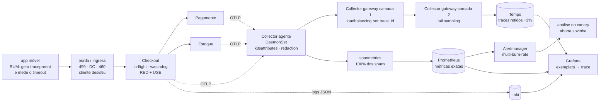

# Template de System Design: Aula 06 - Observabilidade & Diagnóstico em Produção

> **Contexto do Cenário: O Checkout que Trava sem Dar Erro**
>
> Sua equipe responde pelo serviço de **Checkout** do marketplace, que chama **Pagamento** e **Estoque**. Os três rodam em imagens *Distroless*.
>
> 1. **O Incidente:** Na abertura da Black Friday, com **5.000 TPS**, uma versão nova do Checkout entrou em *Canary*. Minutos depois, os painéis continuavam verdes, com latência média de 120 ms, CPU abaixo de 40% e nenhum pico de HTTP 500.
> 2. **O Impacto:** A conversão despencou. Milhares de reclamações chegaram ao suporte, todas com a mesma cena. O cliente clica em "Finalizar Pedido", a tela fica carregando e o aplicativo desiste por timeout.
> 3. **As Restrições:** A imagem não tem `sh` e não há SSH nos servidores. Cada serviço escreve logs em texto livre, do seu jeito, sem um identificador que ligue a chamada do Checkout à chamada que ele fez ao Pagamento. E dado de cliente que vai parar em log continua sujeito à LGPD.
>
> **Instruções:** Responda às decisões arquiteturais abaixo fundamentando suas escolhas estritamente com base nos requisitos e restrições deste cenário. Documente suas decisões no repositório contínuo do seu projeto através de commits atômicos e bem descritivos.

---

## 0. Recorte, autópsia do incidente e premissas assumidas

### 0.1 O que estou desenhando

A **telemetria do serviço de Checkout e da sua fronteira com Pagamento e Estoque**: que sinais os três emitem, como esses sinais se ligam entre si, como são amostrados, armazenados e consultados, que perguntas eles respondem em quanto tempo, e como eu provo — antes do próximo pico — que responderiam *a esta* pergunta.

Não estou desenhando o domínio do Checkout, nem corrigindo o defeito que travou a v2. Isso é deliberado e é o ponto de partida: **eu não sei o que travou, e o cenário também não diz.** O trabalho deste documento é construir o sistema que me diria. Um documento de observabilidade que começa supondo a causa está trapaceando — a observabilidade é justamente a propriedade de responder perguntas que não foram previstas quando o sistema foi instrumentado.

Três coisas, portanto, ficam fora do recorte e são tratadas como caixa-preta com contrato: a lógica de negócio do Checkout, a implementação interna de Pagamento e Estoque, e a decisão de qual código subir. Uma coisa entra no recorte mesmo sem o template pedir: **como diagnosticar um processo Java dentro de uma imagem sem shell e sem SSH** (seção 5), porque isso é restrição explícita do cenário e nenhum dos quatro itens do template pergunta.

### 0.2 Autópsia: por que os painéis estavam verdes

Este é o coração do documento. A leitura comum do cenário é "faltava observabilidade". É uma leitura fraca, porque a equipe **tinha** painéis, **tinha** latência, **tinha** CPU e **tinha** contagem de HTTP 500. O que havia não era ausência de telemetria: era telemetria respondendo a perguntas erradas, com uma confiança que não se justificava.

São **oito cegueiras independentes**, e a observação que organiza o resto é esta: **cada uma delas, sozinha, bastaria para o incidente ficar invisível.** Corrigir duas e deixar seis só muda qual delas esconde o próximo incidente.

| # | Cegueira | Por que o painel ficou verde | Onde eu a corrijo |
| :--- | :--- | :--- | :--- |
| C1 | **Latência medida só em requisição concluída** (viés de sobrevivência) | O histograma observa a requisição no momento em que ela termina. A requisição que nunca termina **não entra na amostra**. Os 120 ms são a média das que funcionaram | 2.1 — in-flight, idade da mais antiga, SLI de razão sobre requisições *iniciadas* |
| C2 | **Média em vez de distribuição, e sem rótulo de versão** | Média esconde bimodalidade, e sem `service.version` os 5% do canary se diluem nos 95% do estável. Dois mecanismos de diluição somados | 2.1 e 2.3 — histograma com quantis, comparação canary-vs-estável |
| C3 | **Erro definido como status HTTP 5xx** | Não houve resposta. Sem resposta não há status, e sem status não há 500. A ausência de 500 não era sinal de saúde: era sinal de que **o servidor não chegou a responder** | 2.1 — taxonomia de `outcome` com `timeout`, `aborted`, `rejected` |
| C4 | **CPU como sinal de saturação** | Thread bloqueada em I/O não gasta CPU. **CPU baixa com latência alta é a assinatura do bloqueio**, não a sua refutação. Os 40% eram a prova do problema lida como prova de saúde | 2.2 — saturação de concorrência, não de computação; mais *throttling* de CFS |
| C5 | **Nenhum identificador de correlação** | Com log em texto livre e sem `trace_id`, não existe a pergunta "o que aconteceu nesta requisição". Existe só "o que cada serviço falou, separadamente" | 1.1 e 1.2 — schema único e W3C Trace Context |
| C6 | **Sem orçamento de timeout, e o cliente desistindo primeiro** | O enunciado diz que *o aplicativo* desiste. Logo o timeout do cliente era menor que o do servidor — ou o servidor não tinha nenhum. **A falha inteira vivia do lado do cliente**, e o servidor seguia trabalhando para alguém que já tinha ido embora | 2.1 — `aborted` no servidor, 499/460 na borda, RUM no cliente |
| C7 | **Nenhuma métrica de negócio** | "A conversão despencou" foi descoberto pelo suporte. O único instrumento que viu o incidente foi o faturamento, e ele tem latência de minutos a horas | 2.1 — pedidos confirmados por minuto como SLI de primeira classe |
| C8 | **Nenhuma telemetria do cliente** | O lugar onde o incidente era trivialmente visível — a tela girando — não era instrumentado. O cliente era o único observador honesto, e falava por ticket de suporte | 1.2 e 4 — trace começando no app, sonda sintética da jornada |

Duas consequências que derivam da tabela e estruturam todo o resto do documento:

**Primeira: o incidente não foi uma falha de monitoramento, foi uma falha de *definição*.** Os quatro números do painel estavam corretos. A latência média *era* 120 ms, a CPU *estava* abaixo de 40%, e *não houve* pico de 500. Nenhum dado estava errado; nenhum coletor estava quebrado. O que estava errado era a crença de que esses quatro números respondiam à pergunta "o cliente consegue finalizar o pedido?". Isso muda o remédio: não adianta mais dashboards, mais retenção ou mais ferramenta. Adianta mudar **o que é medido** e, principalmente, **sobre que denominador**.

**Segunda, e é a mais incômoda: a correção mais barata deste incidente não é de observabilidade, é de resiliência.** Um `TimeLimiter` de 2 segundos na chamada ao Pagamento transformaria o travamento em exceção, a exceção em HTTP 500, e **o painel de 500 já existia**. Um *circuit breaker* com `slowCallRateThreshold` abriria e transformaria a espera invisível numa rejeição rápida e contável. Em outras palavras: boa parte da invisibilidade vinha de o sistema não ter **nenhum limite declarado** — e um sistema sem limite declarado não tem como ter falha declarada, porque falhar é violar um limite. Eu faço questão de abrir o documento por aqui porque é o argumento que eu defenderia com mais convicção numa arguição: **timeout não é só um padrão de resiliência, é um instrumento de medição.** Ele é o que converte "lento" em "errado", e só o que é "errado" aparece num painel de erros.

### 0.3 A prova aritmética de que as requisições travadas não estavam na métrica

Vale fazer a conta, porque ela fecha a discussão sobre C1 e C2 e porque é o tipo de argumento que não se refuta com opinião.

Suponha que a métrica de latência tivesse de fato observado as requisições travadas. Seja `p` a fração travada, cada uma durando 30 s (o timeout do app, P3), e as restantes concluindo em 50 ms:

```
média = (1 − p) × 0,05 s + p × 30 s = 0,12 s
      → p × 29,95 = 0,07
      → p = 0,0023  (0,23%)
```

**Para que a média fosse 120 ms, no máximo 0,23% das requisições poderiam estar travando.** Agora confronte com o cenário: o canary recebia uma fração do tráfego (P2: ~5%) e, pelo relato, estava falhando de forma sistemática — "todas com a mesma cena". Se os 5% do canary estivessem travando:

```
média = 0,95 × 0,05 + 0,05 × 30 = 0,0475 + 1,5 = 1,55 s
```

O painel teria mostrado **1,55 s**, não 120 ms. Mostrou 120 ms. Logo, por aritmética e não por suposição: **as requisições travadas não estavam na amostra.** Elas não foram diluídas, não foram suavizadas pela média, não foram escondidas por bucket largo. Elas simplesmente **não foram contadas** — porque uma requisição é registrada no histograma quando termina, e estas não terminaram.

Essa é a diferença entre "a média esconde a cauda" (verdade genérica, e insuficiente aqui) e "a cauda não existe na amostra" (o que de fato aconteceu). As duas pedem remédios diferentes: a primeira pede percentil, a segunda pede **medir a requisição que ainda não acabou**. Este documento faz as duas coisas, mas a segunda é a que resolve o cenário.

Há um corolário operacional que eu uso no item 2.1 e que vale adiantar, porque é o ponto que mais me entusiasma nesta resposta: **se eu conheço a taxa de chegada e a concorrência em voo, eu consigo calcular a latência real sem depender do histograma.** Pela Lei de Little, `L = λ × W`. A 250 TPS no canary, se o histograma afirma `W = 0,12 s`, então a concorrência em voo deveria ser `L = 30`. Se o medidor de in-flight mostra 7.500, então `W = 7.500 / 250 = 30 s`. Duas métricas baratas se contradizem, e a contradição **é ela própria um alerta**: um detector de painel mentiroso, construído com uma divisão.

### 0.4 Por que o servidor não registrou nada — o mecanismo, não a metáfora

Falta explicar *fisicamente* por que não havia log das requisições travadas, porque sem isso o item 1.1 degenera numa lista de campos.

A 250 TPS no canary com 30 s de permanência, a concorrência exigida é de 7.500 requisições simultâneas (0.3). Um Tomcat padrão tem `maxThreads=200` e `maxConnections=8192`. O que acontece com as 7.500:

1. As **200 primeiras** pegam uma thread de trabalho, entram na cadeia de filtros, executam o código instrumentado, chamam o Pagamento — e **bloqueiam**. Essas aparecem em log de início, se houver, e em nenhum log de fim.
2. As **seguintes, até 8.192**, têm a conexão TCP aceita e ficam **estacionadas no conector**, esperando uma thread livre. E aqui está o ponto: nenhum filtro rodou, nenhum interceptador rodou, nenhum `Timer` do Micrometer começou, nenhum span foi criado. **A aplicação não sabe que essas requisições existem.** Elas não estão lentas: elas são invisíveis por construção, porque a instrumentação vive dentro do código que ainda não foi alcançado.
3. As **além disso** ficam no backlog do sistema operacional (`acceptCount`) e depois são recusadas no nível do socket — o cliente vê erro de conexão, que também não é um 500 do servidor.

É por isso que, neste cenário, instrumentação de aplicação **não é suficiente em princípio**, e não apenas insuficiente na prática. O sinal tem de vir de três lugares que o código da aplicação não controla:

- **do conector / do servidor** (threads ocupadas, conexões estacionadas, fila),
- **da borda** (o balanceador sabe que o cliente foi embora: 499 no nginx, `DC` no Envoy, 460 no ALB),
- **do cliente** (o único que sabe que desistiu).

E, dentro da aplicação, o sinal tem de ser emitido por algo que **não dependa do fim da requisição** — daí o *watchdog* do item 1.1 e o medidor de in-flight do item 2.1. Essa é a espinha dorsal técnica do documento.

### 0.5 O que o cenário dá como dado

| Dado | Valor |
| :--- | :--- |
| Serviço em questão | Checkout, chamando Pagamento e Estoque |
| Carga no momento do incidente | 5.000 TPS |
| Estratégia de deploy em curso | Canary de uma versão nova do Checkout |
| Latência média observada | 120 ms |
| CPU observada | abaixo de 40% |
| Erros HTTP 5xx observados | nenhum pico |
| Sintoma do cliente | clica em "Finalizar Pedido", tela carregando, app desiste por **timeout** |
| Impacto | queda de conversão; milhares de reclamações no suporte |
| Tempo até perceber | "minutos depois" os painéis seguiam verdes; a detecção veio pelo suporte |
| Imagem dos três serviços | Distroless, **sem `sh`** |
| Acesso aos servidores | **sem SSH** |
| Formato de log | texto livre, um por serviço, **sem identificador de correlação** |
| Restrição legal | LGPD sobre dado de cliente em log |

### 0.6 O que estou assumindo

| # | Premissa | Valor assumido | Por que assumo |
| :--- | :--- | :--- | :--- |
| P1 | Stack de aplicação | Java 25 (LTS), Spring Boot 4.1, Micrometer + OpenTelemetry Java Agent 2.x, Resilience4j, PostgreSQL 18, Kafka, Kubernetes | É a stack dominante para esse tipo de plataforma e a que eu sustento numa arguição. Importa em pontos concretos: o agente OTel precisa ser embutido na imagem (1.2), o Actuator é o único canal de diagnóstico sem shell (seção 5), e o `slowCallRateThreshold` do Resilience4j é um detector de saturação (2.2) |
| P2 | Volumetria e topologia | 5.000 TPS no Checkout; canary com ~5% do tráfego; ~40 réplicas de Checkout em pico; ~12 a 18 spans por trace de checkout (Checkout + Pagamento + Estoque + banco + fila) | Preciso de números para dimensionar cardinalidade (2.3), custo de retenção (3) e a conta da Lei de Little (0.3). Sem volumetria, "guardar 100% custa caro" não tem como ser respondido com número |
| P3 | **Timeout do cliente** | ~30 s no aplicativo móvel | O enunciado diz que "o aplicativo desiste por timeout", então esse número **existe** e é dado de projeto. Ele determina três coisas neste documento: o maior bucket finito do histograma (2.1), o `decision_wait` do tail sampling (3) e o limiar do watchdog (1.1). É a premissa mais importante do documento, e quase sempre é ignorada |
| P4 | SLO | 99,9% das requisições de criação de pedido **iniciadas** concluídas com sucesso em menos de 1 s, em janela de 30 dias; conversão (pedidos confirmados por minuto) como SLI de negócio | Sem SLO não existe critério objetivo de alerta, nem orçamento de erro, nem taxa de queima. Todos os limiares dos itens 2 e 4 derivam daqui. E a definição "sobre iniciadas" é deliberada — é o que impede o SLI de herdar a cegueira C1 |
| P5 | Causa do travamento | **Não é dado do cenário.** Mantenho quatro hipóteses vivas (0.7) e exijo que o desenho as distinga sem eu precisar escolher | Um documento de observabilidade que presume a causa está respondendo a outra pergunta. O critério de sucesso é "o desenho identifica qual das quatro é, em minutos", não "eu adivinhei certo" |
| P6 | Propriedade dos serviços | Checkout é do meu time; Pagamento e Estoque são de outros times da **mesma organização**, e pelo menos um deles é legado e propaga contexto em formato antigo | Muda o desenho de 1.2: o schema de log e o propagador passam a ser contrato entre times, com propagador composto para o hop legado, em vez de decisão unilateral. Se fossem terceiros, a resposta seria outra |
| P7 | Backend de telemetria | Prometheus 3.x + Grafana para métricas, Tempo/Jaeger para traces, Loki/OpenSearch para logs, OpenTelemetry Collector em duas camadas, Alertmanager; **hospedagem em nuvem fora do Brasil** | A hospedagem fora do Brasil não é detalhe de infraestrutura: é **transferência internacional de dados pessoais** sob a LGPD, e muda o item 1.3 materialmente |
| P8 | Orçamento de telemetria | Teto de ~10% do custo de infraestrutura do serviço | O enunciado afirma que guardar 100% dos traces "custa caro", então existe um teto. Sem declará-lo, a resposta do item 3 vira preferência estética em vez de decisão de engenharia |
| P9 | Restrição Distroless | Permanente, não temporária: a imagem continua sem `sh` e sem SSH, por decisão de segurança | Se fosse temporária, a resposta seria "adicione um shell". Como é permanente, o diagnóstico tem de ser **projetado**, e isso é a seção 5 |
| P10 | Governança | Existe dono para a plataforma de observabilidade; o schema de log é uma biblioteca compartilhada versionada, não uma convenção em documento | Convenção de log sem biblioteca e sem gate de CI é exatamente o que produziu "cada serviço escreve do seu jeito". A correção é técnica, não documental |
| P11 | Retenção legal | O **registro financeiro** (pedido, transação, estorno) vive no banco, com retenção legal própria. O **log de diagnóstico** não é registro financeiro e não herda essa retenção | É o que permite retenção curta de log sem conflito regulatório. Confundir os dois é o que faz times guardarem log de debug por cinco anos, o que é caro e, sob LGPD, pior que caro |
| P12 | Relógio | NTP com desvio residual de dezenas de milissegundos entre nós | Tem consequência direta: **ordenar eventos de serviços diferentes por timestamp não é confiável.** A causalidade vem da relação pai-filho do trace, não do relógio. Isso justifica o `parent_span_id` como campo obrigatório em 1.1 |
| P13 | Entrega progressiva | O canary é operado por ferramenta com análise automática (Argo Rollouts ou equivalente), capaz de abortar por métrica | O cenário diz "entrou em Canary", então a ferramenta existe. Isso torna o item 4 muito mais forte: o desfecho correto não é "alguém olha o painel e percebe", é **o rollout se aborta sozinho** |

### 0.7 As quatro hipóteses que o desenho precisa distinguir

Como P5 declara, não escolho a causa. Declaro as candidatas e, para cada uma, o sinal que a identifica — porque é esse mapeamento que prova que o desenho é suficiente.

| # | Hipótese | Mecanismo | Sinal que a distingue das outras |
| :--- | :--- | :--- | :--- |
| H1 | Cliente HTTP novo **sem timeout** chamando Pagamento ou Estoque | A thread fica em leitura de socket indefinidamente | Pilha das threads presas em `SocketRead`/`read`; `peer.service` do span pendurado; espera de aquisição no pool de conexões HTTP |
| H2 | Pool de conexões do banco esgotado | Consulta nova sem índice, ou transação longa, retendo conexões | `hikaricp_connections_pending > 0`; pilha presa em `getConnection`; `pg_stat_activity` com sessões em `idle in transaction` |
| H3 | Lock de aplicação ou lock distribuído | `synchronized`, lock pessimista ou lock em Redis sem expiração | Threads em `BLOCKED` no **mesmo** monitor; CPU próxima de zero; pilha convergindo num ponto só |
| H4 | Chamada bloqueante dentro de código assíncrono | Event loop ou executor saturado por bloqueio | Poucas threads, todas presas; `reactor.netty` com aquisições pendentes; fila do executor crescendo |

As quatro produzem o **mesmo sintoma externo** — tela girando, CPU baixa, zero 500 — e são **trivialmente distinguíveis pela pilha da thread presa**. É daí que vem a decisão mais original deste documento: no item 1.1, a requisição travada passa a **registrar a própria pilha no log**, sem ninguém pedir. Com isso, o tempo entre "a conversão caiu" e "é a linha X do `PagamentoClient`" deixa de depender de alguém conseguir entrar num contêiner que não tem shell.

### 0.8 Formato e visão geral

Respostas em primeira pessoa, com decisão explícita, alternativas nomeadas e trade-off assumido em cada item. Diagramas em Mermaid onde o texto sozinho não resolve. Números sempre que o cenário permitir calcular.



O desenho tem um eixo único, e ele responde diretamente às oito cegueiras: **o sinal é coletado em 100% e agregado em 100%; só o armazenamento do detalhe é amostrado — e a decisão de amostrar acontece depois de saber se a requisição foi interessante.**

---

## 1. Logs e Correlação

### 1.1 Campos do Log

- **Campos do Log:** Que campos todo log do Checkout precisa ter para você encontrar, no meio de milhares de linhas, as da requisição que travou? Liste os campos e diga para que serve cada um.

  > #### A armadilha da pergunta, e a resposta honesta
  >
  > Antes da lista, preciso dizer o que a pergunta esconde, porque a resposta boa depende disso: **a requisição que travou não escreveu linha nenhuma.**
  >
  > Log de aplicação é escrito em dois momentos — quando algo acontece e quando a requisição termina. A requisição travada não terminou (C1) e, nas 7.300 que ficaram estacionadas no conector, o código instrumentado nem começou a rodar (0.4). Então nenhuma escolha de campo me ajuda a "encontrar as linhas da requisição que travou", porque **essas linhas não existem**. Campo nenhum encontra o que não foi escrito.
  >
  > Isso parte a resposta em duas metades, e eu considero a segunda a contribuição real deste item:
  >
  > 1. **Um schema de log estruturado e compartilhado**, que torna qualquer busca possível (hoje, com texto livre e sem correlação, nem as linhas que *existem* são encontráveis).
  > 2. **Um mecanismo que faça a requisição travada escrever sozinha** — porque a única forma de achá-la no log é fazê-la emitir uma linha enquanto ainda está presa.
  >
  > #### Decisão 0 — Log estruturado, com schema compartilhado e gate de CI
  >
  > A restrição do cenário é "cada serviço escreve logs em texto livre, do seu jeito". A correção não é um documento pedindo padronização: é **uma biblioteca** (`starter` interno de observabilidade) que configura o encoder JSON, os campos obrigatórios, os filtros de redação e o appender OTLP, mais um **teste de contrato** que falha o build se uma linha de log do serviço não validar contra o JSON Schema do padrão (item 4, nível 1).
  >
  > Por que biblioteca e não convenção, no espírito de "controle técnico vence disciplina": convenção em wiki é exatamente o que produziu três formatos diferentes. Biblioteca versionada com gate de CI produz um formato só, e a divergência passa a ser um build vermelho em vez de uma descoberta durante o incidente.
  >
  > Formato: **JSON de uma linha por evento** (`logstash-logback-encoder` ou o appender OTLP do OpenTelemetry), nomes de campo seguindo as **convenções semânticas do OpenTelemetry**. A escolha das convenções em vez de nomes próprios não é purismo: é o que faz o mesmo rótulo `service.version` existir no log, na métrica e no trace, e é isso que permite a comparação canary-vs-estável atravessar os três sinais sem tradução.
  >
  > #### Os campos, por função
  >
  > **Grupo 1 — Identidade do evento e da origem.** Responde "quem falou, quando, de onde, e em que versão".
  >
  > | Campo | Para que serve | Observação que decide o desenho |
  > | :--- | :--- | :--- |
  > | `timestamp` | Ordenar eventos **dentro** de um serviço | RFC 3339 com milissegundos e offset. **Não serve para ordenar entre serviços**: com desvio de NTP de dezenas de ms (P12), a ordem por timestamp entre Checkout e Pagamento é ficção. A causalidade vem do `parent_span_id` |
  > | `observed_timestamp` | Quando o coletor recebeu | A diferença com `timestamp` mede atraso do pipeline. Durante o incidente, um pipeline atrasado faz o painel parecer saudável porque o dado ruim ainda não chegou — e isso é indistinguível de saúde se eu não medir |
  > | `severity` / `level` | Filtro grosso | — |
  > | `service.name` | De que serviço veio | — |
  > | **`service.version`** | **De que versão veio** | **É o campo que teria isolado o canary.** Sem ele, as linhas da v2 e da v1 são o mesmo conjunto, e a pergunta "o problema é da versão nova?" não tem como ser feita. Se eu só pudesse acrescentar um campo ao sistema do cenário, seria este |
  > | `service.instance.id` / `k8s.pod.name` | Qual réplica | Separa "o serviço está ruim" de "um pod está ruim" — duas causas com remédios opostos |
  > | `deployment.environment` | Ambiente | Impede que log de homologação contamine consulta de produção |
  > | `container.image.digest` | Qual binário exatamente | Liga a linha de log ao artefato imutável. É a chave que atravessa esteira de release e telemetria |
  > | `logger.name`, `thread.name` | Onde no código, em que thread | `thread.name` é o que **casa a linha de log com a pilha do dump** (seção 5). Num cenário sem shell, essa junção é o que substitui o `jstack` interativo |
  >
  > **Grupo 2 — Correlação.** Responde "esta linha pertence a qual requisição". É o grupo inteiramente ausente no cenário.
  >
  > | Campo | Para que serve |
  > | :--- | :--- |
  > | **`trace_id`** | O identificador único da jornada do clique. É por ele que eu junto a linha do Checkout com a do Pagamento e a do Estoque. **É o campo que o cenário diz explicitamente não existir** |
  > | `span_id` | Identifica a operação específica dentro da jornada |
  > | `parent_span_id` | Reconstrói a **causalidade** — quem chamou quem. É o que substitui a ordenação por relógio (P12) |
  > | `trace_flags` / `sampled` | Diz se o trace daquela requisição foi retido. Serve para duas coisas: saber se vale clicar para o trace, e **decidir a retenção do próprio log de forma consistente com a do trace** (manter log de trace descartado é pagar por um dado que não dá para investigar) |
  > | `idempotency_key` (em HMAC) | Agrupa as **tentativas** do mesmo clique. A razão entre requisições e chaves distintas é um **detector de tempestade de retry**: se o app tenta 3 vezes após o timeout de 30 s, a carga quadruplica e a saturação se auto-alimenta. Sem este campo, esse efeito é invisível |
  >
  > **Grupo 3 — Contexto da operação.** Responde "o que estava sendo feito, e com que resultado".
  >
  > | Campo | Para que serve |
  > | :--- | :--- |
  > | `http.request.method`, `http.route` | Qual operação. **`http.route` é o template** (`POST /checkout`), nunca o caminho com id dentro. Caminho cru é a mesma doença de cardinalidade do item 2.3, e em log ainda atrapalha a agregação |
  > | `http.response.status_code` | Resultado HTTP, **quando existe** |
  > | **`outcome`** | `success \| client_error \| server_error \| timeout \| aborted \| rejected`. É o campo que resolve a cegueira C3: a requisição abandonada pelo cliente tem `outcome=aborted` e **nenhum** status HTTP. Sem este campo, ela é indistinguível de uma requisição que nunca existiu |
  > | `duration_ms` | Quanto durou — presente apenas na linha de fim |
  > | `peer.service` + `peer.duration_ms` + `peer.outcome` | **Para cada chamada de saída**, a quem e quanto tempo. É o que localiza o hop lento *a partir do log*, quando o trace daquela requisição foi descartado pela amostragem. Responde "é o Pagamento ou o Estoque?" sem depender do trace |
  > | `retry.attempt` | Qual tentativa. Junto com a chave de idempotência, mede amplificação |
  > | `order_id` | A referência de negócio pela qual o suporte busca |
  > | `customer_ref` | Pseudônimo interno opaco — **nunca CPF, nunca e-mail** (item 1.3) |
  > | `payment_method` | `pix`, `cartao`, `boleto`. Baixa cardinalidade e alto valor: se o travamento for só no Pix, um painel global não mostra |
  > | `error.type`, `error.message` | Classe da exceção e mensagem **sem valores interpolados** (1.3) |
  >
  > **Grupo 4 — Os campos que fazem a requisição travada aparecer.** É aqui que o item se resolve.
  >
  > | Campo | Para que serve |
  > | :--- | :--- |
  > | `event.name` | Discrimina o **tipo** de linha: `request.start`, `request.end`, `request.watchdog`, `request.aborted`, `downstream.call`. É o que permite consultar só as linhas de watchdog em vez de varrer tudo |
  > | `phase` | `start` ou `end`. Com isso, **"trace_id com início e sem fim na janela" é uma consulta**, e essa consulta devolve exatamente as requisições travadas |
  > | `elapsed_ms` | Na linha de watchdog, **quanto tempo a requisição já está presa**. Diferente de `duration_ms`, que só existe no fim. Este campo é escrito *durante* o travamento |
  > | `stack` | Na linha de watchdog em nível alto, a **pilha da thread presa**. É o campo que distingue H1, H2, H3 e H4 (0.7) sem ninguém entrar no contêiner |
  >
  > #### Decisão 1 — O watchdog de requisições em voo
  >
  > Mecanismo concreto, porque sem ele isto é só uma boa ideia:
  >
  > - Um filtro registra cada requisição que entra num mapa de em-voo: `trace_id → (início, rota, versão, thread)`; remove no `finally`.
  > - Uma tarefa agendada a cada segundo percorre o mapa e, para cada requisição acima de um limiar, emite **uma** linha estruturada:
  >
  > | Limiar | Nível | Campos | Por que este limiar |
  > | :--- | :--- | :--- | :--- |
  > | 1 s | `INFO` | `event.name=request.watchdog`, `elapsed_ms`, rota, versão, `peer.service` corrente | 1 s é o SLO (P4). Passar dele já é violação, não curiosidade |
  > | 5 s | `WARN` | os acima | Nenhum cliente espera 5 s de boa vontade |
  > | 15 s | `ERROR` + `stack` | os acima mais a **pilha da thread** | Metade do timeout do cliente (P3). A requisição ainda está viva, e a pilha é colhida **enquanto o problema acontece** — não depois, reconstituída |
  >
  > - Um `AsyncListener` (`onTimeout`, `onError`) e o tratamento de desconexão emitem `event.name=request.aborted` com `outcome=aborted`. **É assim que o abandono do cliente se torna um evento do servidor.**
  >
  > Três propriedades que fazem eu defender isso com entusiasmo:
  >
  > 1. **O custo é proporcional ao problema.** Em estado saudável, com p99 abaixo de 1 s, quase nenhuma requisição cruza o limiar e o watchdog não escreve nada: um mapa e uma varredura por segundo sobre poucas centenas de entradas. Durante o incidente, ele escreve muito — e é exatamente quando eu quero. É o oposto do log de início para todas as requisições, que paga 5.000 linhas/s para, no dia bom, não informar nada.
  > 2. **Ele converte um não-evento em evento.** Observabilidade clássica instrumenta transições. Travamento é a **ausência** de transição, e ausência não emite sinal. O watchdog é um relógio que transforma ausência em presença.
  > 3. **Ele entrega o diagnóstico, não só o alerta.** A linha de 15 s contém a pilha. Num cenário sem `sh` e sem SSH (P9), isso é a diferença entre dez minutos e duas horas de MTTR.
  >
  > **E o risco, dito antes de alguém perguntar:** numa queda total, 7.500 requisições em voo × 3 limiares = enxurrada de log no pior momento, possivelmente derrubando o próprio pipeline de log — telemetria que falha exatamente quando é necessária. Mitigação: por ciclo, **agrupar por assinatura de pilha + rota e emitir no máximo N linhas** (digamos 20), com um campo `occurrences`. Vinte linhas por segundo com contagem agregada dizem a mesma coisa que 7.500 e não derrubam nada. Coletar pilha também não é gratuito (`Thread.getStackTrace` sobre thread alheia tem custo e pode exigir *safepoint*); por isso só no limiar de 15 s, e com teto de threads por ciclo.
  >
  > #### A consulta que acha a requisição travada
  >
  > O item pede para encontrar as linhas no meio de milhares. Com o desenho acima, não é uma garimpagem — são três consultas, nessa ordem:
  >
  > ```logql
  > # 1. Existe travamento? Onde, e de quem é a culpa?
  > {service_name="checkout"} | json
  >   | event_name = "request.watchdog" and elapsed_ms > 5000
  >   | count by (service_version, http_route, peer_service)
  >
  > # 2. É da versão nova? (resolve C2 em uma linha)
  > #    → service_version="2.14.0": 8.431   |   service_version="2.13.0": 0
  >
  > # 3. Por que travou? (resolve 0.7 sem entrar no contêiner)
  > {service_name="checkout"} | json
  >   | event_name = "request.watchdog" and severity = "ERROR"
  >   | line_format "{{.stack}}"
  > ```
  >
  > A primeira responde "está travando, no `POST /checkout`, esperando o Pagamento". A segunda responde "é só a v2" — e isso, por si, já autoriza abortar o rollout. A terceira devolve a pilha e nomeia a hipótese. **Tempo total: menos de um minuto, sem shell, sem SSH, sem reproduzir nada.** Compare com o cenário real, em que a informação equivalente chegou por ticket de suporte.
  >
  > #### O custo, com número
  >
  > | Fonte | Volume | Linhas/s | Bytes/dia (JSON ~600 B) |
  > | :--- | :--- | :--- | :--- |
  > | Linha de fim de requisição, 3 serviços | 5.000 TPS × 3 | 15.000 | ~780 GB bruto, ~110 GB comprimido |
  > | Linha por chamada de saída | 5.000 × 2 | 10.000 | ~520 GB bruto |
  > | Watchdog em estado saudável | ~0 | ~0 | ~0 |
  > | Watchdog durante incidente | teto de 20/s/pod | ~800 | irrelevante no total |
  >
  > Com retenção de 7 dias em quente e 30 em frio, isso cabe em P8. O que **não** cabe, e por isso fica de fora: `DEBUG` ligado em produção, log de corpo de requisição e linha de início para todas as requisições. Nos três casos, a alternativa é melhor e mais barata: `DEBUG` sob demanda por pod via Actuator (seção 5), corpo nunca (1.3), e início substituído pelo watchdog.
  >
  > **Trade-off que estou assumindo:** mais código no caminho da requisição (um filtro, um mapa concorrente, uma tarefa agendada), uma biblioteca compartilhada para manter e versionar entre três times, um gate de CI que vai reprovar PR de gente que só queria logar uma mensagem, e um mecanismo — o watchdog — que é meu, não de mercado, e portanto não vem documentado em lugar nenhum e precisa de teste próprio (item 4). Aceito porque a alternativa é manter a propriedade que define este incidente: **o modo de falha mais caro do sistema é também o único que não escreve nada.**

---

### 1.2 O Caminho do Contexto

- **O Caminho do Contexto:** Como o mesmo identificador de rastreamento passa do Checkout para o Pagamento e o Estoque numa chamada HTTP?

  > #### A escolha do padrão de propagação
  >
  > | Padrão | Como viaja | Situação | Por que escolho ou não |
  > | :--- | :--- | :--- | :--- |
  > | **W3C Trace Context** (`traceparent` + `tracestate`) | Dois cabeçalhos HTTP padronizados | Recomendação W3C, padrão de fato e default do OpenTelemetry | **Escolhido.** É padrão aberto, independente de fornecedor, e o `tracestate` carrega a informação de probabilidade de amostragem que o item 3 precisa |
  > | B3 (`X-B3-TraceId`, …) e B3 single | Um ou vários cabeçalhos | Legado do Zipkin | Não escolho como padrão, mas **aceito na entrada**: P6 diz que há um hop legado, e recusar B3 na borda quebraria a cadeia justamente ali |
  > | `X-Request-ID` / `X-Correlation-ID` | Um cabeçalho com um id | Convenção caseira comum | Rejeitado como solução. Dá correlação, não dá **causalidade**: não há pai, não há filho, não há duração por hop, e portanto não responde "qual dos dois hops está lento" — que é a pergunta do cenário |
  > | Jaeger `uber-trace-id` | Um cabeçalho | Legado do Jaeger | Aceito na entrada, não emitido |
  >
  > Formato do cabeçalho, porque o detalhe importa na depuração:
  >
  > ```
  > traceparent: 00-4bf92f3577b34da6a3ce929d0e0e4736-00f067aa0ba902b7-01
  >              ││ └── trace_id (16 bytes) ──┘ └ span_id (8) ┘ └ flags
  >              └ versão                                          01 = amostrado
  >
  > tracestate: ot=th:fd70a4;rv:fe123456789abc
  >             └ limiar de amostragem (1%) e valor de aleatoriedade — ver item 3
  > ```
  >
  > Na entrada eu configuro um **propagador composto** (`tracecontext,baggage,b3multi`): o Checkout aceita W3C, B3 e baggage, e **emite sempre W3C**. Isso é o que torna a migração incremental — o hop legado continua funcionando e a cadeia não se rompe nele. E é um detalhe que decide o resultado: **a cadeia de rastreamento é tão forte quanto o seu elo mais fraco.** Um único serviço que ignora o `traceparent` e cria um trace novo orfana tudo que vem depois dele, e o sintoma é traços curtos e inexplicáveis que parecem "o Estoque é rápido" quando na verdade são dois traços diferentes.
  >
  > #### Como isso é implementado — três caminhos, com escolha
  >
  > | Caminho | Como | Custo | Veredicto |
  > | :--- | :--- | :--- | :--- |
  > | **Agente Java OTel** (`-javaagent`) | Instrumenta bytecode de Spring, clientes HTTP, JDBC, Kafka, executores, sem mudar código | ~5–10% de latência típico, menos controle fino, versões a acompanhar | **Escolhido** como base. Em três serviços de times diferentes (P6), instrumentação que não exige mudança de código é a única com chance de ser adotada por todos num prazo curto |
  > | Micrometer Tracing / OTel Starter | Dependência e configuração no projeto | Mais controle, menos mágica, exige PR em cada serviço | **Complemento**, para os spans de negócio e as métricas customizadas que o agente não conhece |
  > | Instrumentação manual | `Tracer` injetado, spans à mão | Controle total, esquecimento garantido | Só para operações de negócio específicas |
  >
  > **A parte Distroless, que é restrição do cenário e quase sempre passa batido:** `-javaagent` exige o jar do agente dentro do contêiner. Na imagem sem `sh`, não há como baixá-lo em runtime — não há `curl`, não há `wget`, não há script de entrada. Duas saídas, as duas válidas:
  >
  > 1. **Embutir no build**: `COPY --from=otel /otel/opentelemetry-javaagent.jar /otel/` no Dockerfile, com o agente fixado por digest. Simples e auditável; acoplar versão do agente à imagem é o preço.
  > 2. **Injetar pelo OpenTelemetry Operator** (`instrumentation.opentelemetry.io/inject-java`): um **init container** copia o agente para um volume compartilhado e injeta `JAVA_TOOL_OPTIONS`. O detalhe elegante é que o init container tem a **própria** imagem, com as ferramentas que precisar — a imagem da aplicação segue sem shell. Atualizar o agente deixa de exigir rebuild dos três serviços.
  >
  > **Escolho a injeção pelo Operator**, com embutir no build registrado como alternativa que eu adotaria sem desconforto se o time não quisesse operar o Operator. Motivo: com três times (P6), desacoplar a versão do agente do ciclo de release de cada serviço é a diferença entre uma migração que termina e uma que fica pela metade.
  >
  > #### O caminho completo, incluindo o pedaço que falta no cenário
  >
  > ```mermaid
  > sequenceDiagram
  >     autonumber
  >     participant APP as app móvel (RUM)
  >     participant LB as Ingress
  >     participant CK as Checkout
  >     participant PG as Pagamento
  >     participant ES as Estoque
  >
  >     APP->>APP: inicia trace, gera trace_id
  >     APP->>LB: POST /checkout<br/>traceparent: 00-4bf9…-aaaa-01
  >     LB->>CK: repassa traceparent (não recria)
  >     Note over CK: extrai contexto, abre span filho,<br/>injeta trace_id no MDC
  >     CK->>PG: POST /pagamentos<br/>traceparent: 00-4bf9…-bbbb-01
  >     Note over PG: mesmo trace_id, novo span_id,<br/>parent = bbbb
  >     PG-->>CK: 201
  >     CK->>ES: POST /reservas<br/>traceparent: 00-4bf9…-cccc-01
  >     ES--xCK: não responde (o incidente)
  >     Note over CK: watchdog a 15 s registra<br/>trace_id + pilha + peer.service=estoque
  >     APP->>APP: timeout a 30 s, desiste
  >     APP->>LB: envia span do cliente:<br/>outcome=aborted, duration=30s
  >     Note over LB: 499 / DC / 460 no log de acesso
  > ```
  >
  > Dois pontos do diagrama merecem defesa, porque são onde eu divirjo da resposta usual.
  >
  > **Primeiro: o trace começa no aplicativo, não no gateway.** A cegueira C8 diz que o único observador honesto era o cliente. Se o trace nasce na borda, o span que representa "o cliente esperou 30 s e desistiu" **não existe em lugar nenhum** — e esse é o span que descreve o incidente. Com RUM gerando o `traceparent`, o mesmo `trace_id` cobre a jornada inteira, e a pergunta "o cliente viu o que o servidor acha que entregou?" passa a ter resposta.
  >
  > A contrapartida, que eu não escondo: aceitar `trace_id` fornecido pelo cliente é aceitar entrada não confiável. Um cliente malicioso pode injetar `trace_id` repetido para poluir, forçar `sampled=1` em todas as requisições para estourar meu orçamento de telemetria, ou reusar o `trace_id` de outra pessoa para tentar correlacionar. Mitigação em três partes: **aceito o `trace_id`** (é só um identificador, não uma credencial), **não confio na decisão de amostragem** — a decisão é retomada na borda —, e **limito a taxa** de traces por cliente. Em contexto de regulação mais dura, a alternativa é iniciar um trace do lado servidor e **ligar** ao do cliente por *span link*, perdendo um pouco de conveniência e ganhando isolamento.
  >
  > **Segundo: o Ingress repassa, não recria.** Parece óbvio e é um erro de configuração comum: um proxy que não propaga cabeçalhos desconhecidos, ou uma malha configurada para iniciar trace próprio, quebra a cadeia na borda. Entra no teste de propagação do item 4, nível 2.
  >
  > #### A junção log ↔ trace: o MDC
  >
  > Sem isso, trace e log são dois sistemas sobre os mesmos fatos sem nenhuma ponte, e o operador faz a junção de olho — que é o que acontece hoje no cenário.
  >
  > ```properties
  > # o agente injeta trace_id e span_id no MDC do SLF4J
  > otel.instrumentation.logback-mdc.enabled=true
  > otel.instrumentation.logback-appender.experimental-log-attributes=true
  > ```
  >
  > Com `trace_id` no MDC e o encoder JSON promovendo o MDC a campos de primeira classe, o Grafana liga painel → trace → logs daquele trace em dois cliques. A relação é bidirecional e **as duas direções importam em momentos diferentes**: do trace para o log quando eu já sei qual requisição investigar; do log para o trace quando o suporte me dá um `order_id` e eu preciso da jornada.
  >
  > #### O problema que de fato quebra traces em Java
  >
  > Se eu tivesse que apostar em uma única causa de "o trace para no meio" num sistema Java real, seria esta, e não a configuração de cabeçalho: **o contexto vive num `ThreadLocal` e morre ao trocar de thread.**
  >
  > | Fronteira | O que acontece sem tratamento | Mitigação |
  > | :--- | :--- | :--- |
  > | `@Async`, `ExecutorService`, `CompletableFuture.supplyAsync` | O span filho nasce sem pai; o trace se parte em dois | `Context.taskWrapping(executor)`; `TaskDecorator` no executor do Spring. O agente instrumenta os executores comuns — mas **não** um executor criado à mão dentro de uma classe |
  > | Reactor / WebFlux | Contexto perdido na troca de scheduler | `ContextPropagator` do Reactor + `Hooks.enableAutomaticContextPropagation()` |
  > | Virtual threads | Em geral funciona, porque o `ThreadLocal` acompanha a thread virtual | A troca ainda se perde se o trabalho for entregue a um pool clássico |
  > | Kafka / RabbitMQ | O consumidor abre trace novo; produtor e consumidor ficam sem relação | Propagar nos **headers da mensagem** (o agente faz); e decidir a semântica — ver abaixo |
  > | `@Scheduled`, retry assíncrono | Sem contexto nenhum | Trace próprio, **ligado** ao original por span link |
  >
  > Uma decisão de modelagem no caso assíncrono que vale explicitar porque **tem consequência direta no item 3**: pendurar um consumidor demorado como filho do trace da requisição produz um trace que **só termina quando o consumidor termina**. Se isso leva minutos, o tail sampling já decidiu sobre o trace muito antes de ele estar completo, e a decisão sai errada. Por isso: para trabalho assíncrono **disparado e esquecido**, trace novo com *span link*; filho direto só quando o trabalho está dentro do ciclo de vida da requisição.
  >
  > #### E o `baggage`, que eu uso com parcimônia
  >
  > `baggage` propaga pares chave-valor de negócio por toda a cadeia (`baggage: tenant=br,tier=gold`). É útil — por exemplo, marcar o segmento do cliente para o tail sampling decidir com base nele. Dois cuidados que fazem eu limitar seu uso: ele entra em **todos** os cabeçalhos de saída, inclusive para fora da organização, e é um vetor de vazamento de dado pessoal (1.3) além de inflar o tamanho do cabeçalho em cada hop. Regra que adoto: **lista de permissão explícita de chaves de baggage, sem dado pessoal, e removida na borda de saída da organização.**
  >
  > **Trade-off que estou assumindo:** sobrecarga do agente (5–10% de latência e algumas dezenas de MB de heap), um Operator a mais para operar, dependência de um contrato de propagação entre três times que eu não controlo integralmente (P6), e um conjunto de armadilhas assíncronas que exige teste dedicado em vez de confiança. Em troca, a pergunta "o que aconteceu nesta requisição" passa de impossível — que é o estado atual do cenário — a uma consulta por `trace_id`.

---

### 1.3 LGPD nos Logs

- **LGPD nos Logs:** Quais dados de cliente ficam fora de logs e traces? Para os identificadores que precisam aparecer, qual tratamento você aplica e quem pode ler esses registros?

  > #### O enquadramento jurídico, em três frases
  >
  > Log e trace de um sistema de pagamento são **tratamento de dados pessoais** sob a LGPD (Lei 13.709/2018) — não um subproduto técnico isento. Isso significa que precisam de base legal (art. 7º: execução de contrato para o fluxo do pedido, legítimo interesse para segurança e diagnóstico, cumprimento de obrigação legal para o que a regulação financeira exigir), e precisam obedecer aos princípios do art. 6º, dos quais dois mordem diretamente aqui: **necessidade** (só o mínimo para a finalidade) e **finalidade** (log coletado para diagnosticar não pode virar base de análise de comportamento).
  >
  > E há um ponto que decide o desenho mais do que qualquer princípio: o art. 18 dá ao titular o direito de **eliminação**. Um repositório de log imutável, append-only, com retenção de anos, **não tem como atender a um pedido de eliminação**. Isso não é detalhe de conformidade — é uma restrição de arquitetura, e é de onde vem a técnica central deste item.
  >
  > #### O que nunca entra em log nem em trace
  >
  > | Categoria | Exemplos | Regra |
  > | :--- | :--- | :--- |
  > | Identificadores civis | CPF, CNPJ do titular, RG, CNH, passaporte | **Nunca em claro, nunca.** Entram pseudonimizados ou não entram |
  > | Dados de contato e qualificação | Nome, endereço, e-mail, telefone, data de nascimento | Nunca. Não há finalidade de diagnóstico que exija nome do cliente |
  > | Dados de cartão | PAN completo, CVV, validade, trilha, PIN | **Nunca, em nenhuma forma — nem hash.** Aqui o PCI DSS é mais duro que a LGPD: dado de autenticação sensível não pode ser retido após a autorização, e PAN só aparece mascarado. CVV em log é achado de auditoria, não bug |
  > | Chave Pix e payload | CPF, telefone, e-mail ou EVP como chave; o copia-e-cola e o QR | Nunca o payload completo — ele **contém** a chave. Mesmo a EVP aleatória é identificador e segue a regra dos pseudônimos |
  > | **Dados sensíveis (art. 5º, II)** | Origem racial, convicção religiosa, opinião política, filiação sindical, saúde, vida sexual, **dado biométrico**, genético | Nunca, em hipótese nenhuma. Biometria merece destaque: app de pagamento usa face e digital, e o resultado dessa verificação é dado sensível |
  > | Credenciais | Senha, token, JWT completo, chave de API, cookie de sessão | Nunca. JWT é duplamente proibido: é credencial **e** o payload carrega dado pessoal. Loga-se `jti`, no máximo |
  > | **Corpo de requisição e resposta** | Qualquer `body` | **Nunca por padrão.** É a maior fonte de dado pessoal acidental em log que existe: ninguém decide logar um CPF, as pessoas decidem logar o payload "para depurar" e o CPF vem dentro |
  > | Cabeçalhos | `Authorization`, `Cookie`, `Set-Cookie`, `X-Api-Key` | Redigidos. E por **lista de permissão**, não de proibição — lista de proibição deixa passar o cabeçalho que ninguém previu |
  > | URL com dado | `?cpf=…`, `?email=…`, token em query | Registro só de `http.route` (template) e caminho sem query |
  > | **Mensagem de exceção com valor interpolado** | `IllegalArgumentException: CPF 123.456.789-00 inválido` | Proibido construir mensagem com o valor. É a via de vazamento mais sutil, porque a stack trace é vista como artefato técnico e vai para o log em `ERROR`, em claro, e com frequência para fora da organização num ticket |
  > | SQL com parâmetro ligado | `WHERE cpf = '123…'` | Instrução sim, parâmetro nunca |
  > | **Heap dump** | O artefato inteiro | Tratado como dado pessoal da pior espécie: um heap dump de 8 GB de um serviço de pagamento contém, em claro, tudo que estava em memória. É o maior vazamento potencial do kit de diagnóstico (seção 5) |
  >
  > #### Por que hash puro não resolve — a conta que muda a decisão
  >
  > Aqui está a parte técnica que eu mais faria questão de defender, porque "a gente faz hash do CPF" é a resposta padrão e **ela está errada**.
  >
  > Hash não é anonimização; é pseudonimização. A LGPD (art. 12) só retira do seu escopo o dado **anonimizado**, e só enquanto a reversão não for possível por meios razoáveis. Para o CPF, a reversão é trivial:
  >
  > ```
  > CPF = 9 dígitos base + 2 verificadores → 10^9 = 1 bilhão de valores válidos
  > Uma GPU moderna calcula bilhões de SHA-256 por segundo
  > → o espaço inteiro de CPFs é enumerável em segundos
  > ```
  >
  > Logo, **um SHA-256 de CPF é um CPF com passos extras.** Quem tiver o log tem o CPF. O mesmo vale para telefone (~11 dígitos), para PAN (BIN conhecido reduz o espaço a 10^9 com Luhn) e, com uma lista de endereços conhecidos, para e-mail.
  >
  > A correção é a chave secreta: **HMAC-SHA256 com uma chave (pepper) que não vive no log nem no backend de telemetria.** Sem a chave, a força bruta não funciona; com rotação periódica da chave, a janela de correlação fica limitada — o que é uma propriedade de privacidade e também um incômodo operacional, e eu aceito os dois.
  >
  > #### O tratamento que eu aplico, por técnica
  >
  > | Técnica | O que é | Onde uso | Limite honesto |
  > | :--- | :--- | :--- | :--- |
  > | **Supressão** | Não coletar | Default para tudo que não tem finalidade de diagnóstico declarada | Nenhum. É a única técnica perfeita: dado não coletado não vaza, não precisa de retenção e não precisa de eliminação |
  > | **Referência interna opaca** | `customer_ref = usr_8f3a2c…`, chave do meu banco | **É o caminho principal.** `customer_ref` e `order_id` substituem CPF em todo log e span | O log vira chave para a **minha** base, não para um identificador nacional. Reidentificar exige acesso ao banco, que já é controlado e auditado. O custo é que o log, sozinho, não diz quem é o cliente — e isso é o objetivo |
  > | **HMAC com chave e rotação** | Pseudônimo estável e não reversível por força bruta | Quando preciso **correlacionar ocorrências** da mesma pessoa sem saber quem é — por exemplo, `idempotency_key` para detectar tempestade de retry (1.1) | Rotação quebra a correlação entre janelas. É feature e é incômodo |
  > | **Tokenização com vault** | Token reversível só por serviço autorizado | Quando um fluxo precisa do valor real adiante | Vault no caminho crítico. Mitigo tokenizando **uma vez na borda** |
  > | **Máscara parcial** | `***.***.789-01` | Telas de suporte, **não** log | Máscara parcial é reidentificável por mosaico: dois logs com máscaras diferentes do mesmo valor reconstroem o valor, e máscara + nome + CEP identifica uma pessoa. Não conta como proteção em log |
  > | Hash sem chave | SHA-256 puro | **Rejeitado** para CPF, telefone, cartão, e-mail | Pelo motivo da conta acima. Só aceitável sobre valor de alta entropia, onde não compra nada |
  >
  > #### A técnica que resolve o direito de eliminação: criptoapagamento
  >
  > Juntando a restrição do art. 18 com a referência opaca: se o log contém apenas `customer_ref`, e o mapeamento `customer_ref → pessoa` vive numa tabela controlada, então **apagar a entrada do mapeamento torna todo o histórico de log efetivamente anônimo**, sem tocar em um único arquivo de log. Pedido de eliminação atendido em uma transação, não numa varredura de 110 GB/dia × 30 dias de log imutável.
  >
  > É o mesmo raciocínio aplicado ao vault, com a chave de criptografia por titular: destruir a chave torna o dado irrecuperável. **Esse é o argumento que faz o desenho ser conforme por construção, em vez de conforme por procedimento** — e é a diferença entre uma resposta que cita artigos e uma que resolve o problema que os artigos criam.
  >
  > #### Traces merecem o mesmo rigor, e quase nunca recebem
  >
  > Vale um parágrafo próprio porque é o ponto cego mais comum: atributo de span é tão perigoso quanto campo de log, e a instrumentação automática captura coisas por padrão. Controles:
  >
  > - **Processador de span que redige atributos** por lista de permissão, no SDK, antes de qualquer exportação.
  > - Captura de cabeçalho **desligada** explicitamente (`otel.instrumentation.http.*.capture-request-headers` vazio) — e isso é um teste de configuração, não um acordo.
  > - `db.statement` sanitizado (o agente parametriza por padrão; eu **verifico**, não presumo).
  > - Payload de mensageria nunca em atributo.
  > - `url.full` com query removida.
  > - Nos quatro, o controle equivalente no **Collector** (`transform`/`redaction`), para que um serviço desatualizado não envenene o backend. Defesa em profundidade com uma ressalva honesta: **só a primeira camada — não produzir — é suficiente; as outras são redes.**
  >
  > E o ponto que P7 torna obrigatório: se o backend de telemetria está fora do Brasil, exportar trace e log com dado pessoal — **mesmo pseudonimizado**, porque pseudônimo não é anônimo — é **transferência internacional de dados** (arts. 33 a 36). A Resolução CD/ANPD nº 19/2024 regulamentou isso e aprovou as cláusulas-padrão contratuais, com prazo de adequação encerrado em 23 de agosto de 2025; desde então, transferência por cláusulas contratuais sem as CCPs está sujeita a sanção. Há notícia de reconhecimento recíproco de adequação entre Brasil e União Europeia em 2026, o que, se confirmado, muda o custo de conformidade de um backend na UE em relação a um nos Estados Unidos — e é, portanto, **um critério de escolha de região do backend de observabilidade**, não só de latência e preço. Numa entrega real, isso eu confirmaria com o jurídico antes de afirmar; registro como ponto de atenção com as duas consequências de desenho: região importa, e contrato com o fornecedor de telemetria é parte do desenho de observabilidade.
  >
  > #### Quem pode ler
  >
  > Três camadas de acesso, porque "o time de engenharia vê os logs" não é uma resposta aceitável num sistema de pagamento.
  >
  > | Camada | Conteúdo | Quem acessa | Controle |
  > | :--- | :--- | :--- | :--- |
  > | **A — Telemetria técnica** | Métricas, traces e logs **sem** identificador de pessoa: rota, versão, duração, pilha, `outcome` | Engenharia em geral | RBAC de leitura. É aqui que 95% do diagnóstico acontece — inclusive todo o diagnóstico deste incidente |
  > | **B — Telemetria com pseudônimo** | `customer_ref`, `order_id`, HMAC de chave de idempotência | Plantão e suporte N2, por função | RBAC por função, acesso registrado, redação em tempo de consulta para quem é da camada A |
  > | **C — Reidentificação** | `customer_ref` → pessoa; consulta ao vault | Ninguém, por padrão | **Quebra de vidro**: justificativa obrigatória, vínculo a um incidente ou pedido do titular, dois pares de olhos, TTL curto, sessão registrada |
  >
  > Dois complementos que fecham o desenho:
  >
  > - **O acesso ao log é, ele mesmo, um evento de log.** Quem consultou, o que consultou, quando e por quê. Auditar a auditoria não é paranoia: é o que torna a camada B defensável.
  > - **Heap dump e thread dump são artefatos de camada C**, não de camada A, porque podem conter qualquer coisa que estivesse em memória. Na seção 5 isso tem consequência prática: o thread dump (só pilhas, sem valores) é camada A e pode ir para o log; o heap dump exige quebra de vidro, armazenamento cifrado e expurgo automático.
  >
  > #### Retenção
  >
  > | Sinal | Quente | Frio | Por quê |
  > | :--- | :--- | :--- | :--- |
  > | Métricas agregadas (sem pessoa) | 15 dias em resolução cheia | 13 meses reduzidas | Não são dado pessoal; servem para comparar com a Black Friday anterior |
  > | Logs camada A | 7 dias | 30 dias | Diagnóstico tem meia-vida curta |
  > | Logs camada B (com pseudônimo) | 7 dias | 30 dias, cifrado | Prazo curto é a melhor proteção disponível. O que precisa durar é registro financeiro, não log |
  > | Traces retidos | 15 dias | 90 dias para erro e alto valor | Erro antigo ainda ensina |
  > | **Registro financeiro** | no banco | retenção legal própria | **P11, e é a trava do desenho:** é ele que tem obrigação legal de durar anos, e ele não é log. Confundir os dois é o que faz times guardarem log de debug por cinco anos — caro e, sob LGPD, pior que caro |
  >
  > **Trade-off que estou assumindo:** diagnóstico fica mais difícil, e de um jeito que incomoda todo dia. O suporte não pode mais achar o cliente por CPF no log — tem de ir por `order_id` ou pedir quebra de vidro. O desenvolvedor não pode logar o payload quando está sem ideia. A conformidade passa a exigir vault, rotação de chave, três camadas de RBAC, contrato com o fornecedor de telemetria e um teste de dado-canário no CI (item 4, nível 3). Pago isso por duas razões. A primeira é que vazamento de log é um dos vetores mais comuns de incidente de dado pessoal, e o custo esperado de um vazamento de CPF em escala de marketplace é muito maior que o custo deste aparato. A segunda é mais incômoda e eu diria em voz alta numa arguição: **praticamente todo o diagnóstico deste incidente acontece na camada A.** Rota, versão, duração, `outcome`, pilha, saturação de pool — nenhum desses é dado pessoal. O cenário é a melhor prova de que privacidade e observabilidade não estão em conflito aqui: o que faltava não era dado do cliente, era **dado do sistema**.

---

## 2. Métricas

### 2.1 Visão do Cliente (RED)

- **Visão do Cliente (RED):** Quais métricas do Checkout entram no painel? Explique como você mede a duração para que o travamento de uma parte dos clientes não desapareça na média.

  > #### Antes das métricas: redefinir as três letras
  >
  > RED é Rate, Errors, Duration — a tríade de Tom Wilkie para serviços orientados a requisição. O cenário tinha as três e ficou cego, então a resposta não pode ser "implemente RED". Tem de ser **RED com as três definições corrigidas**:
  >
  > | Letra | Definição comum | Definição que eu uso, e por quê |
  > | :--- | :--- | :--- | 
  > | **Rate** | Requisições concluídas por segundo | Requisições **iniciadas** por segundo, mais as concluídas, **mais a diferença entre as duas** — que é a concorrência em voo. O cenário prova que medir só o fim é medir só o sucesso |
  > | **Errors** | Proporção de HTTP 5xx | Proporção de requisições que **não produziram desfecho de negócio bem-sucedido** — com `timeout`, `aborted` e `rejected` dentro da conta. "Zero 500" era verdade e não significava nada (C3) |
  > | **Duration** | Latência média ou p99 das concluídas | Distribuição em histograma **mais** a idade das não concluídas. Sem a segunda metade, o viés de sobrevivência (C1) permanece |
  >
  > #### Rate
  >
  > | Métrica | Tipo | Para que serve |
  > | :--- | :--- | :--- |
  > | `http.server.request.started` | contador | Quantas entraram. É o **denominador honesto** do SLI |
  > | `http.server.request.duration` (contagem do histograma) | histograma | Quantas saíram |
  > | **`http.server.active_requests`** | medidor up/down | **Quantas estão dentro agora.** É a métrica que faltava |
  > | `pedidos.confirmados` | contador | Rate de negócio (C7) |
  >
  > A relação entre as três primeiras é o instrumento, não as três isoladas: **iniciadas − concluídas = em voo**, e em voo que cresce e não volta é travamento, sem ambiguidade nenhuma. Não existe outra explicação para esse padrão. Comparado com interpretar latência média, é um sinal binário.
  >
  > #### Errors — a taxonomia que inclui o não-erro
  >
  > Toda requisição recebe exatamente um valor de `outcome`:
  >
  > | `outcome` | Significado | Como é detectado | Visível no painel antigo? |
  > | :--- | :--- | :--- | :--- |
  > | `success` | Concluída, 2xx, pedido criado | normal | sim |
  > | `client_error` | 4xx de culpa do cliente | normal | sim |
  > | `server_error` | 5xx | normal | sim — e era zero |
  > | `timeout` | Estourou o timeout **nosso** para Pagamento ou Estoque | `TimeLimiter` / timeout do cliente HTTP | **não existia, porque não havia timeout** |
  > | **`aborted`** | **O cliente desistiu antes de a resposta sair** | `AsyncListener.onTimeout`/`onError`, canal inativo; 499/`DC`/460 na borda | **não** — e é o desfecho deste incidente |
  > | `rejected` | Recusada rápido por bulkhead, circuit breaker ou fila cheia | Resilience4j | não |
  >
  > Duas observações sobre a tabela, e as duas são argumentos fortes:
  >
  > **A primeira é que `timeout` só existe se houver timeout.** Parece tautologia e é a chave do caso: a taxonomia de erro de um serviço é limitada pelos limites que ele declara. Sem `TimeLimiter`, a categoria `timeout` é vazia por construção — não porque não haja timeouts, mas porque o sistema não tem o conceito. É o que eu adiantei em 0.2: **limite declarado é pré-requisito de falha observável.**
  >
  > **A segunda é que `aborted` é medido em três lugares, de propósito.** No servidor (listener assíncrono), na borda (log de acesso) e no cliente (RUM). Redundância deliberada, porque cada um falha de um jeito: o servidor não vê a requisição que nunca chegou a uma thread (0.4); a borda não sabe se o pedido foi criado; o cliente não sabe por que. Os três juntos cobrem o espaço. E vale sublinhar que **a borda sabia a verdade o tempo inteiro**: o log de acesso do ALB registra `target_processing_time` de 30 s e `elb_status_code` 460, e o 460 aparece **só no log de acesso** — não na métrica padrão de códigos HTTP. Quer dizer: o dado existia, num lugar que o painel não olhava. Trazer o 499/`DC`/460 da borda para o painel é o item de menor custo e maior retorno de todo este documento.
  >
  > #### Duration — a parte que o item pergunta diretamente
  >
  > A pergunta é como medir para que o travamento de uma parte dos clientes não desapareça na média. Minha resposta tem **cinco camadas**, da correção óbvia à que de fato resolve.
  >
  > ##### Camada 1 — Histograma, não média. E quantil calculado sobre buckets, não sobre quantis
  >
  > A média é indefensável: ela não é agregável entre instâncias de forma significativa, e esconde bimodalidade por construção. Mas trocar média por p99 tem uma armadilha que derruba muita implementação: **percentil não se soma e não se faz média.** Se cada um dos 40 pods calcula o seu p99 e o painel tira a média dos 40, o número resultante não é o p99 de nada. O correto é cada pod exportar **contagens por bucket** e o quantil ser calculado sobre a união:
  >
  > ```promql
  > histogram_quantile(0.99,
  >   sum by (le, service_version, http_route) (
  >     rate(http_server_request_duration_seconds_bucket[5m])
  >   )
  > )
  > ```
  >
  > O `sum by (le, …)` é o ponto: sem ele a expressão parece funcionar e devolve lixo.
  >
  > ##### Camada 2 — Os buckets precisam ir além do timeout do cliente
  >
  > Esta é a camada que eu mais gosto, porque mostra **como um painel mente sem que ninguém minta**.
  >
  > O `histogram_quantile` do Prometheus interpola linearmente dentro do bucket em que o quantil cai. E quando o quantil cai no bucket `+Inf`, ele **devolve o limite superior do penúltimo bucket** — ou seja, do maior bucket finito. Consequência direta: com um conjunto de buckets terminando em 2,5 s (que é exatamente o conjunto que a maioria das configurações copia), uma requisição de 30 s cai em `+Inf`, e o p99 é reportado como **2,5 s**. Não 30 s, não `+Inf`, não `NaN`: **2,5 s** — um número ruim, mas plausível, do tipo que ninguém trata como emergência.
  >
  > É um teto silencioso imposto pela configuração: o painel fica **incapaz** de exibir o problema, e a incapacidade não gera nenhum aviso.
  >
  > Duas correções:
  >
  > | Correção | Como | Custo |
  > | :--- | :--- | :--- |
  > | Buckets que passam do timeout do cliente | `0,05 · 0,1 · 0,25 · 0,5 · 1 · 2 · 5 · 10 · 30 · 60` s — o maior bucket finito **acima** dos 30 s de P3 | Cada bucket é uma série por combinação de rótulos (item 2.3) |
  > | **Histogramas nativos** (exponenciais) | Resolução automática, sem escolher bucket, com custo de série muito menor | Maturidade do ecossistema; exige backend e consultas compatíveis |
  >
  > **Escolho buckets explícitos ancorados em P3 e no SLO de P4**, e registro os histogramas nativos como o caminho que eu adotaria com entusiasmo onde o backend já os suporta bem — porque eles eliminam a classe inteira do erro acima: não há bucket máximo para escolher errado.
  >
  > ##### Camada 3 — Medir a requisição que não terminou
  >
  > As camadas 1 e 2 melhoram a medição das requisições que **terminam**. Nenhuma delas resolve C1, porque, como a conta de 0.3 provou, as travadas não estavam na amostra. Duas métricas resolvem:
  >
  > | Métrica | Tipo | Por que resolve |
  > | :--- | :--- | :--- |
  > | `http.server.active_requests{route, version}` | medidor up/down | Sobe no início e desce no fim. Travamento = sobe e não desce. **Não depende de a requisição terminar** |
  > | **`http.server.oldest_active_request.age`** | medidor, em segundos | A idade da requisição em voo mais antiga. Se passa de 30 s, **há cliente sendo abandonado agora** |
  >
  > A segunda é absurdamente simples — o watchdog de 1.1 já mantém o mapa, então é um `min` sobre os horários de início — e eu raramente a vejo implementada. Ela tem uma propriedade que nenhum percentil tem: **é um sinal de presente, não de passado.** Um p99 de janela de 5 minutos responde "como estavam as requisições que acabaram"; `oldest_active_request_age` responde "o que está acontecendo neste segundo". Num incidente, a diferença entre as duas perguntas é o MTTD.
  >
  > ##### Camada 4 — A Lei de Little como detector de painel mentiroso
  >
  > Com in-flight e rate medidos, a latência média real vem de graça por `L = λ × W`:
  >
  > ```promql
  > # latência média implícita, derivada da concorrência
  > sum(http_server_active_requests) / sum(rate(http_server_request_started_total[1m]))
  >
  > # e a métrica de controle: a razão entre o que o histograma afirma
  > # e o que a concorrência implica
  > (sum(http_server_active_requests) / sum(rate(http_server_request_started_total[1m])))
  >   /
  > (sum(rate(http_server_request_duration_seconds_sum[1m]))
  >   / sum(rate(http_server_request_duration_seconds_count[1m])))
  > ```
  >
  > Em operação normal essa razão fica perto de 1. No incidente ela teria sido:
  >
  > ```
  > implícita   = 7.500 / 250 = 30 s
  > histograma  = 0,12 s
  > razão       = 250
  > ```
  >
  > Um alerta em `razão > 3` dispara em um minuto e diz algo que nenhum painel convencional diz: **"a sua métrica de latência está errada".** É o único sinal do documento que detecta a *cegueira* em vez do defeito, e eu o defenderia como o controle mais barato aqui: duas métricas que eu já tenho, uma divisão, e uma propriedade de teoria de filas que não depende de nada da aplicação.
  >
  > ##### Camada 5 — O SLI de razão, que estruturalmente não pode esconder travamento
  >
  > Esta é a resposta final e a mais importante, porque muda a forma do indicador em vez de ajustar o seu cálculo.
  >
  > Em vez de alertar em percentil, defino o SLI como **proporção de eventos bons sobre eventos válidos**, com o limiar derivado do SLO (P4):
  >
  > ```
  > válidos = requisições INICIADAS de POST /checkout
  > bons    = concluídas com sucesso em menos de 1 s
  > SLI     = bons / válidos        (meta: 99,9%)
  > ```
  >
  > ```promql
  > sum(rate(http_server_request_duration_seconds_bucket{le="1", outcome="success", route="POST /checkout"}[5m]))
  >   /
  > sum(rate(http_server_request_started_total{route="POST /checkout"}[5m]))
  > ```
  >
  > O que faz isso ser estruturalmente imune à cegueira C1: o denominador conta requisições **iniciadas**. Uma requisição que travou está no denominador e **não** está no numerador — logo, **conta como ruim**. Ela não precisa terminar, não precisa produzir status, não precisa cair em bucket nenhum. O travamento vira violação de SLO automaticamente, pela forma da conta.
  >
  > Comparando com o alerta de percentil, que é a escolha usual:
  >
  > | | Alerta em p99 | SLI de razão sobre iniciadas |
  > | :--- | :--- | :--- |
  > | Conta requisição travada | **Não** (não está na amostra) | **Sim** (está no denominador) |
  > | Sensível a escolha de bucket | Sim (camada 2) | Só no bucket do limiar |
  > | Agregável entre pods e janelas | Problemático | Trivial |
  > | Liga a orçamento de erro | Não diretamente | **Sim, por definição** |
  > | Interpretável pelo negócio | "p99 subiu" | "0,8% dos clientes não conseguiu finalizar" |
  >
  > Com isso, o alerta é **multi-janela e multi-taxa de queima**, no padrão do SRE workbook: queima rápida (14,4× o orçamento em 1 h, confirmada em janela de 5 min) aciona plantão; queima lenta (6× em 6 h) abre tarefa. A 5.000 TPS, 5 minutos são 1,5 milhão de requisições, então 1,44% de erro são ~21 mil eventos ruins — significância estatística não é preocupação aqui, e a detecção pode ser de minutos.
  >
  > #### O painel, na ordem em que eu o leio
  >
  > | Linha | Painéis | Pergunta que responde |
  > | :--- | :--- | :--- |
  > | 1 — Negócio | Pedidos confirmados/min **canary vs estável**; conversão; receita/min | "Está vendendo?" É a linha que o cenário descobriu por ticket |
  > | 2 — SLO | SLI de razão, orçamento restante, taxa de queima | "Estamos quebrando a promessa?" |
  > | 3 — RED | Rate iniciadas/concluídas; `outcome` empilhado; **in-flight**; **idade da mais antiga**; quantis por rota e versão | "Onde e de que jeito?" |
  > | 4 — Coerência | Razão da Lei de Little; atraso do pipeline; `up`/`absent` dos alvos | "Dá para confiar nas linhas acima?" |
  > | 5 — Dependências | Latência e `outcome` por `peer.service`; estado dos circuit breakers | "É nosso ou do vizinho?" |
  > | 6 — Recursos | USE (item 2.2) | "Por quê?" |
  >
  > A linha 4 é incomum e eu a defenderia: num incidente, a primeira pergunta honesta é **"meu instrumento está funcionando?"**. O cenário é a demonstração de por quê — quatro números corretos levaram a equipe a concluir que estava tudo bem. Um painel que não é capaz de duvidar de si mesmo repete isso.
  >
  > #### Segmentação: a "parte dos clientes" do enunciado
  >
  > O item fala de "o travamento de uma parte dos clientes". Se a fatia for pequena, até um p99 bom pode esconder. Então quantis e SLI são quebrados por dimensões de **baixa cardinalidade e alto poder explicativo**: `service.version` (a mais importante — era o canary), `http.route`, `payment_method` (se é só Pix, um painel global não mostra), `client.platform`, e `region`/`az`. E uma honestidade necessária: **não existe percentil por cliente.** Segmento é escolhido de antemão, e segmento não previsto não aparece em métrica — para isso existem traces, com `trace_id` por requisição (item 3). É essa divisão de trabalho que o item 2.3 protege.
  >
  > **Trade-off que estou assumindo:** mais séries (buckets até 60 s, `outcome` com 6 valores, versão, plataforma), mais instrumentação no caminho da requisição (medidor up/down, mapa de em-voo, listener de abandono), um SLI que exige um contador de requisições iniciadas que ninguém instrumenta por padrão, e um painel com uma linha dedicada a desconfiar das outras. Em troca: **nenhuma das métricas que eu proponho pode exibir 120 ms enquanto o cliente espera 30 segundos.** Não por configuração cuidadosa — por forma do indicador.

---

### 2.2 Visão dos Recursos (USE)

- **Visão dos Recursos (USE):** Que recursos você monitora? Que sinal acusaria saturação antes do primeiro HTTP 500?

  > #### A premissa errada da pergunta, e por que isso importa
  >
  > O item pergunta que sinal acusaria saturação **antes do primeiro HTTP 500**. Preciso começar dizendo que, neste cenário, **o primeiro HTTP 500 nunca chegou.** Não houve pico de 500 porque não houve resposta nenhuma (C3). Um desenho construído para antecipar o 500 pressupõe que o 500 acabe vindo, e aqui ele não veio — ele teria vindo se existisse timeout, e não existia.
  >
  > Então respondo a pergunta em duas versões:
  >
  > - **a literal**: que sinais precedem o 500, quando há 500 — e a resposta é a tabela de saturação abaixo;
  > - **a que o cenário exige**: que sinais aparecem quando o 500 **não** vem. São os mesmos sinais, e é essa coincidência que faz a resposta ser robusta: **sinal de saturação não depende de o sistema conseguir falhar.** Ele mede a fila, não o desfecho.
  >
  > #### E a correção do recurso errado
  >
  > USE é Utilização, Saturação, Erros por recurso (Brendan Gregg). A equipe monitorava a utilização de **um** recurso — CPU — e tirou dele uma conclusão sobre o sistema. Três problemas, em ordem crescente de gravidade:
  >
  > 1. **CPU era o recurso errado.** O que saturou foi **concorrência**, não computação.
  > 2. **Utilização era a dimensão errada.** Utilização diz quanto está em uso; saturação diz **quanto está esperando**. Fila é o que mede sofrimento, e "CPU a 40%" não tem dimensão de fila.
  > 3. **CPU baixa era a assinatura positiva da falha.** Thread bloqueada em socket não consome CPU. Logo, latência alta com CPU baixa **é** bloqueio — por definição, não por coincidência. Os 40% não eram evidência contra o diagnóstico: eram o diagnóstico, lido ao contrário (C4).
  >
  > #### Os recursos, com as três dimensões
  >
  > | Recurso | Utilização | **Saturação** (o sinal que antecipa) | Erros |
  > | :--- | :--- | :--- | :--- |
  > | **Pool de threads HTTP** (Tomcat) | `threads.busy / threads.config.max` | **Conexões aceitas e estacionadas sem thread**; fila de aceitação | Conexões recusadas |
  > | **Pool de conexões ao Pagamento/Estoque** | arrendadas / máximo | **Aquisições pendentes e tempo de espera de aquisição** | Falha de conexão, timeout |
  > | **Pool de conexões do banco** (Hikari) | `connections.active / max` | **`connections.pending` e `connections.acquire` (tempo)** | `connections.timeout` |
  > | **Semáforo de bulkhead** (Resilience4j) | permissões em uso | **permissões disponíveis = 0**; espera por permissão | chamadas rejeitadas |
  > | **Circuit breaker** | — | **`slowCallRate`** (ver abaixo) | `failureRate`, estado aberto |
  > | **JVM — heap** | `jvm.memory.used / max` | **fração do tempo de parede em GC**; taxa de alocação | `OutOfMemoryError`, `OOMKilled` |
  > | **JVM — threads** | contagem por estado | **`jvm.threads.states{state="blocked\|waiting"}` subindo com CPU parada** | threads mortas por exceção |
  > | **CPU** | uso médio | **`container_cpu_cfs_throttled_seconds_total`** | — |
  > | **Memória do contêiner** | working set / limite | proximidade do limite; expurgo de cache | contagem de `OOMKilled` |
  > | **Rede e sockets** | conexões estabelecidas | **`TIME_WAIT`, exaustão de porta efêmera, backlog de SYN descartado, tabela de conntrack cheia** | retransmissões |
  > | **Descritores de arquivo** | abertos / limite | proximidade do limite | `Too many open files` |
  > | **Filas de mensageria** | taxa de consumo | **lag e idade da mensagem mais antiga** | mensagens em DLQ |
  > | **Pagamento e Estoque como recurso** | concorrência em voo em direção a eles | **tempo esperando permissão/conexão** | timeout, 5xx deles |
  > | **Borda / balanceador** | conexões ativas | fila de surto; **499 / `DC` / 460** | recusas |
  >
  > Quatro linhas dessa tabela merecem defesa porque são as que mudam o resultado no cenário:
  >
  > **Threads estacionadas no conector.** É o mecanismo de 0.4 e o buraco mais importante. Uma requisição aceita pelo socket e sem thread não executou **nenhuma** instrumentação de aplicação. Ela é invisível para Micrometer, para o agente OTel e para qualquer filtro. Logo, esse sinal tem de vir do **conector** (as métricas do Tomcat/Undertow que o Actuator expõe), não do código. É o tipo de métrica que times ignoram por parecer "infra" e que, neste cenário, é o único observador das requisições que mais importam. Uma nuance que vale registrar: com **virtual threads**, não há pool limitado de workers, então essa fila não existe nesse lugar — ela **se desloca** para o pool de conexões de saída e para a memória. Virtual threads mudam **onde** a saturação aparece, não **se** aparece; e trocar o conector sem mover o monitoramento é trocar um ponto cego por outro.
  >
  > **`container_cpu_cfs_throttled_seconds_total`.** Rebate diretamente o "CPU abaixo de 40%": o CFS do Linux distribui cota em períodos de 100 ms, e um contêiner pode esgotar a cota dentro do período e ficar **parado** no resto dele, repetidamente, exibindo média baixa na janela de um minuto. Média de CPU em janela longa **esconde** throttling que acontece em escala de 100 ms. É um caso particular de uma lição geral do documento: agregação temporal apaga exatamente o fenômeno que interessa.
  >
  > **`slowCallRate` do Resilience4j.** O circuit breaker tem dois gatilhos: taxa de falha e **taxa de chamadas lentas** (`slowCallDurationThreshold` + `slowCallRateThreshold`). No cenário, um breaker configurado só por falha **nunca abriria** — não havia falhas, havia esperas. Configurado por lentidão, ele abre, e o efeito é duplo: protege o Checkout **e transforma a espera invisível numa rejeição rápida, contável e alertável**. Vale explicitar a leitura: `slowCallRate` **é** um detector de saturação. Padrão de resiliência e instrumento de medição são, aqui, a mesma coisa.
  >
  > **Conntrack e backlog de SYN.** Quase nunca aparecem em resposta de prova e produzem exatamente o sintoma relatado: a conexão é descartada no kernel, o cliente fica esperando, e **não há nenhum registro no servidor** — nem no conector. Se a investigação de aplicação não achar nada, esse é o lugar seguinte, e o sinal precisa estar coletado de antemão (métricas de nó), porque não há como ir buscá-lo depois.
  >
  > #### O sinal que antecipa, e por que ele antecipa por construção
  >
  > A resposta ordenada, com o mecanismo da antecipação:
  >
  > | Ordem | Sinal | Por que vem antes |
  > | :--- | :--- | :--- |
  > | 1 | **`oldest_active_request_age` e in-flight subindo** | Sobem no instante em que as requisições param de terminar. Não há atraso nenhum: é o primeiro momento observável do fenômeno |
  > | 2 | **Tempo de espera para adquirir conexão/permissão** | **Esperar é anterior a falhar, por construção.** A requisição primeiro espera, depois estoura o timeout, e só então — se houver timeout — vira erro. A espera é o evento causalmente anterior, não um indicador correlacionado por sorte |
  > | 3 | `pending` de pool > 0 | Primeiro momento em que a demanda excede a oferta |
  > | 4 | `slowCallRate` subindo | Mede lentidão antes de haver falha |
  > | 5 | Threads em `BLOCKED`/`WAITING` com CPU parada | A assinatura de H1/H3 |
  > | 6 | Throttling de CFS | Antecede latência por computação |
  > | 7 | Lag de consumo crescendo | O serviço responde HTTP e parou de drenar fila |
  >
  > O item 2 é a resposta de uma frase, se eu tivesse que dar uma: **tempo de espera por um recurso compartilhado é o indicador antecedente universal, porque a fila se forma antes de o prazo estourar.** É independente de modo de falha, de linguagem e de ferramenta. E, diferente do 500, ele existe mesmo quando o sistema é incapaz de falhar.
  >
  > #### Um alerta sobre tornar readiness dependente do vizinho
  >
  > Vale registrar uma opção que parece atraente e que eu **rejeito**: fazer a *readiness probe* falhar quando o pool de saída satura. Soa elegante — o pod saturado sai do balanceamento. Na prática, se a saturação vem do Pagamento estar lento, **todos** os pods saturam ao mesmo tempo, todos ficam *not ready*, o serviço perde todos os endpoints e uma degradação parcial se transforma em indisponibilidade total. Readiness reflete "este pod consegue atender", não "as dependências dele estão bem". O lugar de reagir à dependência lenta é o circuit breaker, que degrada o fluxo; não a probe, que remove capacidade.
  >
  > **Trade-off que estou assumindo:** muito mais métricas de recurso, muitas delas de camadas que o time de aplicação não considera suas (conector, nó, conntrack, borda), mais séries, mais painel e mais limiar para calibrar — com risco real de fadiga de alerta se eu alertar em todas. Mitigo com uma regra: **alerto no SLI e na taxa de queima (2.1); as métricas USE são de diagnóstico, não de notificação.** Elas existem para responder "por quê" depois de o SLI acusar "o quê". As únicas exceções, que alertam sozinhas, são `oldest_active_request_age` acima do timeout do cliente e `pending` sustentado — porque essas duas já são, elas mesmas, cliente sofrendo.

---

### 2.3 Labels

- **Labels:** Quais labels você permite nessas métricas e quais proíbe? Diga o efeito de cada escolha no servidor de métricas.

  > #### A aritmética primeiro, porque ela é o argumento inteiro
  >
  > Cada combinação distinta de valores de rótulo é uma **série temporal** própria, e cardinalidade **multiplica**. Com os rótulos que eu permito:
  >
  > ```
  > http.server.request.duration
  >   rotas (12) × método (2) × outcome (6) × versão (2) = 288 combinações
  >   × buckets (10 + soma + contagem = 12)              = 3.456 séries por pod
  >   × pods (40)                                        = 138.240 séries
  > ```
  >
  > Para o serviço inteiro, com ~300 nomes de métrica, o alvo de projeto fica na casa de **1 a 2 milhões de séries ativas** nos três serviços. A ~2–4 KB de memória por série ativa (cabeçote, índice invertido e rótulos), isso é 2 a 8 GB no Prometheus — dimensionável, e eu dimensiono.
  >
  > Agora um rótulo proibido:
  >
  > ```
  > ... × order_id  →  5.000 novas séries POR SEGUNDO
  >                 →  432 milhões de séries por dia
  >                 →  Prometheus morto em minutos
  > ```
  >
  > E aqui está o detalhe que faz essa falha ser pior do que parece: **série que para de receber amostra não desaparece na hora.** Ela continua ocupando memória e índice até sair da janela de obsolescência e até o bloco ser compactado. Então a métrica com `order_id` não causa um pico — causa **crescimento monotônico** até o processo ser morto. E é morto com um perfil de uso de memória que parece "o Prometheus precisa de mais RAM", o que leva o time a aumentar a RAM e repetir o problema maior.
  >
  > #### Rótulos permitidos
  >
  > | Rótulo | Valores | Por que vale o custo |
  > | :--- | :--- | :--- |
  > | `service.name` | ~3 | Separar os serviços |
  > | **`service.version`** | 2 em rollout | **O rótulo mais importante do documento.** É o que permite comparar canary e estável; sem ele, o incidente é aritmeticamente invisível (C2). Custo: 2× |
  > | `deployment.environment` | 2 | Isolar ambientes |
  > | `http.route` | ~12, **template** | Localizar a operação |
  > | `http.request.method` | 2–3 | — |
  > | `http.response.status_code` | ~8 úteis | Quando existe resposta |
  > | **`outcome`** | 6 | A taxonomia de 2.1. É o que faz `aborted` ser contável |
  > | `peer.service` | 2–3 | "É o Pagamento ou o Estoque?" em uma consulta |
  > | `payment_method` | ~4 | Se o travamento é só no Pix, segmento global não mostra |
  > | `client.platform` | 3 | A "parte dos clientes" do enunciado |
  > | `error.type` | lista de permissão + `other` | Classe da exceção |
  > | `pool.name` | ~5 | Só em métricas de recurso |
  > | `pod` / `instance` | ~40 | **Só em métricas USE.** Agregado fora nos SLIs, por regra de registro |
  >
  > #### Rótulos proibidos, com o mecanismo da proibição
  >
  > | Rótulo proibido | Cardinalidade | Efeito no servidor de métricas | Onde a informação deve estar |
  > | :--- | :--- | :--- | :--- |
  > | `customer_id`, `cpf`, `email` | milhões | Morte por memória **e violação de LGPD numa métrica** — pior que em log, porque métrica tem retenção longa e leitura ampla | Log camada B e trace |
  > | `order_id`, `payment_id`, `idempotency_key` | 5.000/s | Crescimento monotônico até OOM | Log e trace |
  > | **`trace_id`** | 5.000/s | Idem — e é o erro mais comum, porque a intenção é legítima | **Exemplars** (abaixo) |
  > | Caminho cru (`/pedidos/12345`) | ilimitada | Idem. E impede agregação: cada pedido vira uma série de uma amostra | `http.route` template |
  > | Mensagem de exceção / stack | ilimitada | Idem, com rótulos enormes inflando o índice | `error.type` no rótulo; mensagem no log |
  > | `user_agent` completo | milhares | Explosão silenciosa, que cresce com a base de clientes | Família parseada |
  > | Timestamp ou epoch em rótulo | infinita | Nova série a cada amostra; destrói o TSDB em minutos | O eixo do tempo já é o tempo |
  > | `error_code` de terceiro, sem filtro | "limitada" na teoria | Ilimitada na prática, quando o parceiro inventa código novo | Lista de permissão + `other` |
  > | `pod` em métrica de SLI | 40, **mas com rotatividade** | Custo escondido: cada deploy cria 40 séries novas e abandona 40. Com vários deploys/dia, a rotatividade domina o consumo | Agregar fora por regra de registro |
  >
  > #### Exemplars: como colocar `trace_id` em métrica sem pagar cardinalidade
  >
  > Esta é a resposta para o impulso legítimo que leva as pessoas a usar `trace_id` como rótulo. Um **exemplar** anexa um `trace_id` a uma **amostra** de bucket do histograma, sem criar série nova. No Grafana, o painel de latência mostra pontinhos clicáveis que levam ao trace exato daquela requisição lenta.
  >
  > ```properties
  > management.prometheus.metrics.export.properties.prometheus.exemplars.enabled=true
  > # no Prometheus: --enable-feature=exemplar-storage
  > ```
  >
  > O ganho é exatamente o que o cenário precisava: do painel "p99 está ruim" para "aqui está uma requisição que travou, com a pilha" em um clique, **sem nenhuma série a mais**. É a ponte métrica → trace, e ter essa ponte é o que permite manter a disciplina de cardinalidade sem perder poder de investigação.
  >
  > #### Efeito de cada escolha no servidor de métricas
  >
  > O item pede isso explicitamente, então vale ser específica sobre as cinco consequências:
  >
  > | Efeito | Mecanismo | Por que importa neste cenário |
  > | :--- | :--- | :--- |
  > | **Memória** | O cabeçote mantém todas as séries ativas; o índice invertido cresce com valores distintos | **O monitoramento morre exatamente quando é necessário.** Pico de tráfego → pico de cardinalidade → OOM do Prometheus no meio da Black Friday |
  > | **Latência de consulta** | Uma regra que varre um milhão de séries leva segundos a minutos | **Cardinalidade alta piora o MTTD.** O alerta que deveria disparar em 1 minuto dispara em 10 — e isso não aparece como problema de cardinalidade, aparece como "o alerta é lento" |
  > | **Ingestão, WAL e remote write** | Bytes/s escalam com séries e rotatividade | Pipeline atrasa, o painel fica velho, e painel velho durante incidente é indistinguível de painel saudável (daí `observed_timestamp` em 1.1) |
  > | **Custo** | Em SaaS, cobrança por série customizada | Um rótulo ruim custa mais que o cluster. E a conta chega um mês depois do PR |
  > | **Rotatividade** | Séries abandonadas ocupam até compactar | É o custo invisível: não aparece em "quantas séries eu tenho", aparece em "por que a memória só sobe" |
  >
  > #### Guardrails: controle técnico, não convenção
  >
  > No mesmo espírito do resto do documento — **o rótulo proibido deve ser impossível, não desencorajado**:
  >
  > ```java
  > @Bean
  > MeterFilter apenasRotulosPermitidos() {
  >     var permitidos = Set.of("service.name","service.version","deployment.environment",
  >                             "http.route","http.request.method","http.response.status_code",
  >                             "outcome","peer.service","payment_method","client.platform",
  >                             "error.type","pool.name");
  >     return MeterFilter.denyUnless(id ->
  >         id.getTags().stream().allMatch(t -> permitidos.contains(t.getKey())));
  > }
  >
  > @Bean
  > MeterFilter tetoPorRotuloArriscado() {
  >     // se alguém usar error.type sem lista de permissão, para em 50 e não em 50 mil
  >     return MeterFilter.maximumAllowableTags(
  >         "http.server.request.duration", "error.type", 50, MeterFilter.deny());
  > }
  > ```
  >
  > Em volta disso, quatro camadas:
  >
  > 1. **No scrape**: `sample_limit`, `label_limit`, `label_value_length_limit` por alvo. Uma aplicação descontrolada é **descartada** em vez de derrubar o servidor. Essa inversão é importante: o padrão de falha passa a ser "perdi a métrica de um serviço" em vez de "perdi o monitoramento inteiro".
  > 2. **No Collector**: processador que remove atributos fora da lista, para que serviço desatualizado não envenene o backend.
  > 3. **No CI**: teste de aprovação sobre o conjunto de chaves de rótulo por nome de métrica. Rótulo novo passa a ser mudança deliberada num PR, com revisor (item 4, nível 1).
  > 4. **Em produção**: alerta em `prometheus_tsdb_head_series` e em rotatividade, mais painel de cardinalidade por nome de métrica. Observabilidade da observabilidade — e é o único jeito de descobrir a explosão antes do OOM.
  >
  > #### A tese de fechamento
  >
  > Todo rótulo que eu proíbo é uma pergunta que eu não consigo responder com métrica. Isso é aceitável porque os três sinais têm divisão de trabalho:
  >
  > | Sinal | Pergunta | Cardinalidade |
  > | :--- | :--- | :--- |
  > | **Métrica** | "Tem algo errado, onde, e quanto?" | Baixa e **limitada** por desenho |
  > | **Trace** | "O que aconteceu **nesta** requisição?" | **Alta — é a função dele** |
  > | **Log** | "O que o código disse?" | Alta, com busca textual |
  >
  > **Toda explosão de cardinalidade que eu já vi nasceu de tentar responder pergunta de trace com métrica.** Querer `trace_id`, `order_id` ou `customer_id` em rótulo é querer que a métrica faça o trabalho do trace. A resposta certa não é "não pode", é "**já existe lugar para isso, e exemplars são a ponte**". Enquadrado assim, a disciplina de cardinalidade deixa de ser proibição e passa a ser arquitetura.

---

## 3. Traces e Amostragem

- **A Escolha:** ( ) Head Sampling  ( ) Tail Sampling  **(x) Combinação das duas**
- **Justificativa:** Guardar 100% dos traces a 5.000 TPS custa caro. Qual é a sua regra de retenção, e como ela evita que justamente as requisições que travaram sejam descartadas?

  > #### A conta do custo, para o "custa caro" ter número
  >
  > | Grandeza | Valor |
  > | :--- | :--- |
  > | Taxa | 5.000 TPS |
  > | Spans por trace (P2) | ~15 |
  > | Spans por segundo | **75.000** |
  > | Spans por dia | 6,5 bilhões |
  > | Bytes armazenados por span | ~400 B |
  > | **100% retido** | **~2,6 TB/dia** → 39 TB em 15 dias |
  > | **~3% retido** (desenho abaixo) | **~78 GB/dia** → 1,2 TB em 15 dias |
  >
  > Um fator de 30 em armazenamento e em custo de consulta. É isso que está em jogo, e é por isso que a escolha importa.
  >
  > #### Head e tail: o que cada um é, e onde cada um falha
  >
  > | | **Head sampling** | **Tail sampling** |
  > | :--- | :--- | :--- |
  > | Quando decide | No span raiz, **antes** da requisição acontecer | Depois que o trace está completo, no Collector |
  > | Como propaga | Bit no `traceparent`; todos os serviços obedecem | Não precisa propagar: a decisão é central |
  > | Custo que evita | **Tudo**: nem instrumenta, nem serializa, nem envia | Só o armazenamento. Rede e CPU do Collector são pagos integralmente |
  > | Vantagem decisiva | Barato de verdade, consistente, sem estado | **Decide sabendo se o trace foi interessante** |
  > | **Falha decisiva** | **Decide sem saber nada.** A 1%, descarta 99% das requisições travadas | Exige estado, buffer, roteamento por trace e janela de decisão |
  >
  > A falha do head sampling neste cenário merece ser quantificada, porque "head é pior" sem número é opinião:
  >
  > ```
  > requisições travadas (0.3)     ≈ 0,2% do tráfego  →  ~600/min
  > head sampling a 1%             →  ~6 traces travados retidos/min
  >                                   dentro de ~3.000 traces retidos/min
  > ```
  >
  > Seis em três mil. Três problemas, e o terceiro é o que mata:
  >
  > 1. **Não dá para achar**: 0,2% dos traces retidos são os interessantes, e eu não tenho como filtrar por "travado" se o critério não existe no momento da decisão.
  > 2. **Não dá para medir**: nenhuma estatística sobre travamento com amostra de seis.
  > 3. **Não responde à pergunta do suporte.** O cliente reclama de um pedido específico. Head sampling a 1% dá 1% de chance de ter o trace dele. **Head sampling destrói o uso mais valioso de tracing, que é a requisição específica.** E, pior, destrói de forma garantida: por construção, **head sampling nunca retém 100% dos erros**, porque a decisão é anterior ao erro.
  >
  > E há o efeito específico do canary: ele é ~5% do tráfego (P2). Head a 1% retém 0,05% do total vindo do canary — um fio d'água, quando o que eu quero é **tudo** o que o canary faz, porque é a versão sob suspeita e é barata de guardar justamente por ser 5%.
  >
  > #### A combinação que eu escolho, em quatro camadas
  >
  > "Combinação" não quer dizer "um pouco de cada". Quer dizer: cada camada faz o que só ela pode fazer.
  >
  > ```mermaid
  > flowchart TB
  >     A["Camada 1 — SDK no pod<br/>ParentBased(root=AlwaysOn)<br/>+ descarte de rota sem valor"] --> B["Camada 2 — Collector agente<br/>DaemonSet<br/>spanmetrics: RED de 100% dos spans<br/>redação de atributos"]
  >     B --> C["Camada 3 — Collector gateway 1<br/>loadbalancing por trace_id<br/>todos os spans do trace no mesmo nó"]
  >     C --> D["Camada 4 — Collector gateway 2<br/>tail_sampling<br/>decide com o trace completo"]
  >     B --> M[("Prometheus<br/>métricas exatas, nunca amostradas")]
  >     D --> T[("Tempo<br/>~3% dos traces")]
  > ```
  >
  > **Camada 1 — head sampling, mas só onde ele é indiscutível.** `ParentBased` com raiz `AlwaysOn`: todo trace é gravado e exportado, para que a camada 4 tenha o que decidir. O componente de head que eu mantenho é um **descarte na origem** de tráfego que nenhuma política jamais vai querer: *health checks*, `/metrics`, estáticos, polling interno de alta frequência. Isso é head sampling honesto — descarta o que é **conhecidamente** sem valor, antes de pagar rede. Descartar por probabilidade cega, não.
  >
  > **Camada 2 — e aqui está a decisão mais importante do item: `spanmetrics` antes da amostragem.** O conector `spanmetrics` deriva, de **100% dos spans**, as métricas RED (contagem, erros, histograma de duração por serviço, operação, versão e `outcome`). Só depois o trace segue para a decisão de amostragem.
  >
  > A consequência é a resposta completa para o medo de que amostragem esconda o incidente: **eu nunca amostro a métrica, só o trace.** As contagens e os histogramas são **exatos** — derivados de todos os spans — ainda que eu guarde 3% dos traces. A amostragem deixa de ter qualquer efeito sobre "existe problema e qual o tamanho dele", e passa a afetar apenas "tenho o exemplo específico guardado". É a distinção que torna a economia de 30× indolor. O conector `servicegraph`, no mesmo lugar, dá o mapa com latência por aresta — e teria mostrado, no dia do incidente, a aresta Checkout → Estoque em 30 s.
  >
  > **Camada 3 — a armadilha de implementação que silencia o tail sampling.** O tail sampling só decide bem se **todos os spans de um trace chegarem à mesma instância** do Collector. Atrás de um Service com balanceamento round-robin, os spans de um trace se espalham por N instâncias, cada uma vê um pedaço, e **cada uma decide errado, silenciosamente** — sem erro, sem log, com traces pela metade no backend. Daí as duas camadas de gateway: a primeira só roteia por `trace_id` (exportador `loadbalancing` com `routing_key: traceID`), a segunda amostra. Quem implementa tail sampling sem isso tem um sistema que parece funcionar e não funciona, e descobre durante um incidente.
  >
  > **Camada 4 — a política, que é a resposta à pergunta do item.**
  >
  > | Prioridade | Política | Regra | Retenção |
  > | :--- | :--- | :--- | :--- |
  > | 1 | `status_code` | span com status de erro | **100%** |
  > | 2 | `string_attribute` | `outcome in (timeout, aborted, rejected)` | **100%** — é o desfecho deste incidente |
  > | 3 | `latency` | duração total acima de 1 s (o SLO de P4) | **100%** |
  > | 4 | **trace incompleto** | sem span raiz encerrado após o `decision_wait` | **100%** — **são as requisições travadas** |
  > | 5 | `string_attribute` | `service.version` = canary, durante o rollout | **100%** (é 5% do tráfego: barato) |
  > | 6 | `numeric_attribute` | `amount` acima de um valor material | **100%** |
  > | 7 | rota rara | rotas de baixo volume | **100%** |
  > | 8 | `probabilistic` | todo o resto | **0,5 a 1%** |
  > | 9 | `rate_limiting` | teto global de spans/s | rede de proteção |
  >
  > Taxa efetiva estimada: ~3% — os 78 GB/dia da tabela de custo.
  >
  > #### Como a regra evita descartar justamente as travadas — os três mecanismos
  >
  > O item pergunta isso diretamente, e a resposta tem três partes, porque uma só não basta.
  >
  > **Mecanismo 1 — a política 3 (latência) pega por definição.** O travamento é o caso extremo de lentidão. Qualquer requisição acima de 1 s é retida integralmente. A 0,2% de travamento, isso são ~600 traces/min retidos em vez de 6.
  >
  > **Mecanismo 2 — a política 4 existe porque a 3 não é suficiente, e esse é o detalhe fino do item.** A política de latência avalia a **duração do span raiz**, e span raiz tem duração quando **termina**. A requisição travada que o cliente abandonou em 30 s pode não ter span raiz encerrado nenhum — o mesmo viés de sobrevivência de C1, agora dentro do amostrador. Logo:
  >
  > - **`decision_wait` maior que o timeout do cliente.** Com P3 em 30 s, uso `decision_wait: 45s`. Se eu usasse os 10 s do exemplo da documentação, **todo trace de 30 s seria avaliado sobre dados parciais** e a política de latência nunca o veria. Esse único parâmetro é a diferença entre reter e perder exatamente o que importa.
  > - **Encerrar o span mesmo no abandono.** O listener que emite `request.aborted` (1.1) **encerra o span** com status de erro e `outcome=aborted`. Isso é o que faz o trace ficar completo e cair nas políticas 1, 2 e 3 em vez de sumir. É um detalhe de instrumentação que decide um comportamento de amostragem — e mostra por que os itens 1 e 3 deste documento não são independentes.
  > - **Política explícita de trace incompleto**, para o que escapar das duas acima.
  > - **Alerta na perda do amostrador**: o Collector tem teto de `num_traces` em memória, e quando estoura ele descarta cedo e **sem avisar**. O contador de traces descartados antes da decisão é monitorado e alertado — senão eu acabo com um amostrador que silenciosamente deixou de reter erros, o que é pior que não ter amostrador, porque eu confio nele.
  >
  > **Mecanismo 3 — mesmo que tudo acima falhasse, a métrica não falharia.** Pela camada 2, o `spanmetrics` já contou **todos** os spans antes de qualquer decisão. Se o amostrador perder todos os traces travados, o painel continua mostrando a contagem e o histograma corretos, e o alerta continua disparando. A amostragem deixa de ser um ponto único de falha da detecção: ela afeta a **investigação**, não a **detecção**. Essa separação é o que me deixa confortável em guardar 3%.
  >
  > #### Amostragem probabilística consistente: contagens corretas a partir de amostra
  >
  > Um refinamento que eleva bastante a qualidade do desenho e que vale explicitar porque é o que há de mais atual no assunto. A especificação de amostragem probabilística do OpenTelemetry carrega, no `tracestate`, o limiar de rejeição usado, sob a chave `ot`:
  >
  > ```
  > tracestate: ot=th:fd70a4;rv:fe123456789abc
  >             th:0      → 100%
  >             th:8      → 50%
  >             th:c      → 25%
  >             th:fd70a4 → 1%
  > ```
  >
  > Com o limiar propagado, o backend calcula a **contagem ajustada** — o número de itens da população que cada span retido representa — por `adjusted_count = 2^56 / (2^56 − T)`. Duas consequências práticas:
  >
  > 1. **Estatística honesta a partir de amostra**: 1% dos traces retidos, com peso 100 cada, estimam a população corretamente. Sem isso, qualquer contagem derivada de span amostrado está errada por um fator que ninguém sabe qual é — e essa é uma das formas mais comuns de um painel derivado de traces mentir.
  > 2. **Os limiares compõem por máximo, não por multiplicação**: passar por um estágio de 50% e depois por um de 25% resulta em 25%, e o `tracestate` registra o limiar efetivo. Isso mantém a interpretação estatística correta num pipeline com vários estágios de amostragem — que é exatamente o meu caso, com head na camada 1 e tail na camada 4.
  >
  > Em Java isso aparece como amostradores componíveis (`ComposableSampler.probability(...)`, `parentThreshold(...)`). Registro como refinamento e não como pré-requisito: o desenho funciona sem ele, e com ele as contagens derivadas de span passam a ser defensáveis.
  >
  > #### A regra de retenção, consolidada
  >
  > | Classe de trace | Retido | Quente | Frio |
  > | :--- | :--- | :--- | :--- |
  > | Erro, `timeout`, `aborted`, `rejected` | 100% | 15 dias | 90 dias |
  > | Acima do SLO (> 1 s) | 100% | 15 dias | 30 dias |
  > | Incompleto após `decision_wait` | 100% | 15 dias | 30 dias |
  > | Canary, durante rollout | 100% | 7 dias | — |
  > | Alto valor | 100% | 15 dias | 90 dias |
  > | Rota rara | 100% | 15 dias | — |
  > | Baseline saudável | 0,5–1% | 7 dias | — |
  > | **Métricas derivadas de span** | **100%, sempre** | 15 dias | 13 meses |
  >
  > Mais dois tetos operacionais: **spans por trace** limitado (um trace de lote com 50 mil spans estoura o processador e distorce qualquer agregação) e **spans por segundo** no total, com alerta quando o teto morde — porque teto que morde silenciosamente é perda de dado disfarçada de economia.
  >
  > #### Alternativas que avaliei e descartei
  >
  > **Head sampling puro, mesmo a 10%.** Rejeitado pelos três problemas acima, e por um quarto que é definitivo: a 10% o custo ainda é alto (260 GB/dia) **e** eu continuo sem 100% dos erros. Pago quase o preço do tail sem a propriedade que justifica o tail.
  >
  > **Tail sampling puro, sem nenhum head.** É quase o meu desenho, e a diferença é pequena: eu mantenho o descarte de health check e polling na origem porque é tráfego que nenhuma política quer e que custa rede e CPU de Collector para ser carregado até a decisão. Chamar isso de "combinação" é honesto, não retórico.
  >
  > **Amostragem no SDK com buffer e descarte retroativo no pod** (gravar tudo em memória, exportar só o que deu erro). Atraente: economiza rede. Rejeitado aqui por dois motivos — consome memória no pod que atende 5.000 TPS, e decide sobre o trace **com visão apenas local**, enquanto o travamento pode estar num hop que o Checkout não vê terminar. É justamente a visão global que me faz querer o tail no Collector.
  >
  > **Guardar 100%.** Rejeitado por P8, e com um argumento que não é só de custo: 2,6 TB/dia também significa consulta mais lenta no momento do incidente. Retenção total piora a investigação que ela deveria melhorar.
  >
  > **Trade-off que estou assumindo:** duas camadas de Collector para operar e dimensionar, estado em memória no amostrador com teto que precisa de alerta próprio, um `decision_wait` de 45 s que atrasa em 45 segundos a disponibilidade do trace para busca — e esse atraso é real durante um incidente, quando 45 s parecem muito —, políticas de amostragem que são configuração viva e precisam de revisão quando o SLO muda, e um pipeline em que "por que este trace não está aqui?" tem quatro respostas possíveis. Aceito por uma razão específica: **a única coisa que eu não posso amostrar é a detecção, e o `spanmetrics` antes da amostragem garante que eu não a amostro.** O resto é economia sobre a investigação, com regra explícita de que o travamento — o modo de falha deste cenário — é retido em 100% por três mecanismos independentes.

---

## 4. Estratégia de Testes

- **Qual a nossa estratégia para testar isso e garantir que funciona?** Antes da próxima Black Friday, como você prova que os painéis e os alertas mostrariam este incidente?

  > #### A tese
  >
  > **Um painel é uma hipótese sobre como o sistema falha. Enquanto a falha não for injetada, é código não testado — e código não testado em produção é o que acabou de custar uma Black Friday.**
  >
  > E há uma assimetria que torna isso mais grave do que parece: todo o resto do sistema é exercitado continuamente pelo tráfego real. A observabilidade **não**. Ela só é usada no caminho que importa — alerta disparando, painel apontando a causa, trace retido, pilha disponível — durante o incidente, que é a única hora em que não dá para descobrir que não funciona. Isso faz da telemetria o subsistema **menos testado por operação normal e mais crítico sob estresse** da plataforma. Ela precisa de exercício deliberado, e é isso que esta seção desenha.
  >
  > Cinco coisas que nenhum teste de aplicação prova e que o incidente exige provar:
  >
  > 1. Que o `trace_id` atravessa Checkout → Pagamento → Estoque **e** as fronteiras assíncronas.
  > 2. Que nenhum dado pessoal chega ao backend de telemetria.
  > 3. Que o painel **mostra** o travamento — e não a média de 120 ms.
  > 4. Que o alerta **dispara**, em quanto tempo, e chega a alguém.
  > 5. Que o diagnóstico é possível **dentro das restrições reais**: sem shell, sem SSH.
  >
  > #### A pirâmide
  >
  > | Nível | O que prova | Ferramenta | Onde roda | Custo |
  > | :--- | :--- | :--- | :--- | :--- |
  > | 1. Contrato de instrumentação | Campos de log, chaves de rótulo, métricas existem e têm o nome certo | JSON Schema, `SimpleMeterRegistry`, teste de aprovação | **Todo PR**, segundos | trivial |
  > | 2. **Propagação de contexto** | `trace_id` atravessa os hops e as fronteiras assíncronas | Testcontainers + WireMock + `InMemorySpanExporter` | **Todo PR**, ~1 min | baixo |
  > | 3. **Dado-canário (LGPD)** | Nenhum dado pessoal no backend | E2E em staging + varredura | Diário | médio |
  > | 4. **Reprodução do incidente** | **O painel mostra e o alerta dispara** | k6 + Toxiproxy + asserção sobre a telemetria | Semanal e pré-release | alto |
  > | 5. Alertas como código | A expressão do alerta está correta, inclusive sem dado | `promtool test rules` | **Todo PR**, segundos | trivial |
  > | 6. Cobertura painel ↔ modo de falha | Todo modo de falha conhecido tem painel e alerta | Matriz viva + painel como código | Contínuo | baixo |
  > | 7. **Game day com as restrições reais** | Uma pessoa de plantão diagnostica **sem shell e sem SSH** | Exercício cronometrado | Trimestral + pré-Black Friday | alto |
  > | 8. Validação contínua em produção | Sonda sintética, RUM, análise do canary | Sempre ligado | Contínuo | médio |
  >
  > Observação sobre a forma da pirâmide: os níveis 1, 2 e 5 custam segundos e rodam em todo PR — e são os que impedem a **regressão** da instrumentação, que é o jeito silencioso de voltar ao cenário. Os níveis 4 e 7 são caros e são os que **provam** a pergunta do item. Os dois grupos são necessários por razões diferentes.
  >
  > #### Nível 2 — Propagação, o gate que o cenário pedia
  >
  > ```java
  > @Testcontainers
  > class PropagacaoDeContextoIT {
  >
  >     static Network rede = Network.newNetwork();
  >
  >     @Container static GenericContainer<?> pagamento =
  >         new GenericContainer<>("wiremock/wiremock:3").withNetwork(rede);
  >
  >     static final InMemorySpanExporter spans = InMemorySpanExporter.create();
  >
  >     @Test
  >     void o_trace_id_atravessa_os_tres_servicos() {
  >         var resposta = checkout.post("/checkout", pedidoValido());
  >
  >         var traces = spans.getFinishedSpanItems();
  >         // Um trace_id só para toda a jornada.
  >         assertThat(traces).extracting(SpanData::getTraceId).containsOnly(traceIdEsperado);
  >         // E a relação pai-filho reconstruída (P12: é ela, não o relógio).
  >         assertThat(spanDe("POST /pagamentos").getParentSpanId())
  >             .isEqualTo(spanDe("POST /checkout").getSpanId());
  >
  >         // O cabeçalho realmente chegou no vizinho — e no formato padrão.
  >         pagamento.verify(postRequestedFor(urlEqualTo("/pagamentos"))
  >             .withHeader("traceparent", matching("00-" + traceIdEsperado + "-[0-9a-f]{16}-0[01]")));
  >     }
  >
  >     @Test
  >     void o_contexto_sobrevive_a_fronteira_assincrona() {
  >         // A causa número um de trace partido em Java (1.2).
  >         checkout.post("/checkout", pedidoComNotificacaoAssincrona());
  >         await().untilAsserted(() ->
  >             assertThat(spanDe("notificacao.enviada").getTraceId()).isEqualTo(traceIdEsperado));
  >     }
  >
  >     @Test
  >     void o_log_do_hop_seguinte_carrega_o_mesmo_trace_id() {
  >         // Sem isso, trace e log são dois sistemas sobre os mesmos fatos, sem ponte.
  >         assertThat(linhasDeLogDe(pagamento))
  >             .allSatisfy(l -> assertThat(l.get("trace_id")).isEqualTo(traceIdEsperado));
  >     }
  >
  >     @Test
  >     void o_propagador_composto_aceita_o_hop_legado() {
  >         // P6: um dos vizinhos propaga em B3. A cadeia não pode quebrar nele.
  >         var resposta = checkout.post("/checkout", pedidoValido(),
  >             headers("X-B3-TraceId", b3TraceId, "X-B3-SpanId", b3SpanId));
  >         assertThat(spanDe("POST /checkout").getTraceId()).isEqualTo(b3TraceId);
  >     }
  > }
  > ```
  >
  > O quarto teste é o que eu mais defenderia como gate obrigatório: **ele reprova o PR que adiciona um cliente HTTP novo ou um executor novo sem propagação.** Sem ele, a cobertura de tracing degrada silenciosamente a cada sprint, e a descoberta acontece no próximo incidente.
  >
  > #### Nível 3 — O dado-canário: o único teste que prova a conformidade do item 1.3
  >
  > Controles de redação são fáceis de escrever e fáceis de furar — basta uma mensagem de exceção interpolada, um `toString()` de entidade, uma captura de cabeçalho ligada por padrão numa atualização do agente. Então eu não confio na revisão: eu testo com dado falso e varredura.
  >
  > 1. Em staging, injetar um pedido com **CPF sintético conhecido**, e-mail e PAN de teste marcados — valores que não existem na natureza e são buscáveis.
  > 2. Esperar o pipeline assentar.
  > 3. **Varrer o backend inteiro** — logs, atributos de span, rótulos de métrica — procurando os três valores, inclusive em SHA-256 (para pegar quem "protegeu" com hash puro, que o item 1.3 rejeita).
  > 4. Asserção: **zero ocorrências**. Qualquer achado reprova e aponta o campo.
  >
  > Complementos estáticos, baratos, no PR: regra que proíbe interpolar tipo anotado como sensível em chamada de log; teste que afirma que `toString()` das entidades não contém os campos pessoais; teste de configuração afirmando que captura de cabeçalho e de corpo está **desligada** na configuração efetiva — não na pretendida.
  >
  > #### Nível 4 — A reprodução do incidente, que é a resposta à pergunta do item
  >
  > Este é o centro da seção. O objetivo não é testar o Checkout: é **testar os painéis e os alertas**, com a asserção feita sobre a telemetria, não sobre a aplicação.
  >
  > **Montagem.** Em staging, com carga proporcional (digamos 500 TPS, 10% do pico), três ingredientes que precisam ser exatamente estes:
  >
  > | Ingrediente | Como | Por que exatamente assim |
  > | :--- | :--- | :--- |
  > | Um vizinho que **aceita e não responde** | Toxiproxy com `timeout`, ou stub que segura o socket | **Não** é erro e **não** é lentidão: é buraco negro. Injetar 500 ou 2 s de latência testa outro incidente — e os painéis antigos já pegariam esses dois |
  > | Um cliente que **desiste** | k6 com `timeout: '30s'` e sem retry infinito | Carga que espera para sempre não reproduz o cenário. O essencial é o **abandono**, que é o que produz `aborted` e 460 |
  > | Canary com **rótulo de versão** | Duas versões rodando, só uma com o defeito | Reproduz C2 e permite verificar a comparação canary-vs-estável |
  >
  > **As asserções.** Esta tabela é, na minha leitura, o entregável mais importante do item 4:
  >
  > | # | Asserção | Sinal | O que ela prova |
  > | :--- | :--- | :--- | :--- |
  > | 1 | `http_server_active_requests` sobe e **não volta** | 2.1 | O sinal que não existia |
  > | 2 | `oldest_active_request_age` passa de 30 s | 2.1 | Há cliente sendo abandonado **agora** |
  > | 3 | `outcome="aborted"` maior que zero | 2.1 | O abandono virou evento do servidor |
  > | 4 | 499/`DC`/460 na borda maior que zero | 2.1 | O dado que já existia e ninguém olhava |
  > | 5 | **`pending` e tempo de aquisição do pool sobem ANTES de qualquer 5xx** | 2.2 | Responde literalmente "que sinal acusaria saturação antes do primeiro HTTP 500" — **com medição, não com argumento** |
  > | 6 | SLI de razão cai abaixo de 99,9% | 2.1 | O indicador que estruturalmente não esconde |
  > | 7 | **A latência média permanece baixa** | 2.1 | **Asserção de que o painel antigo mentiria.** Documenta a cegueira como regressão: ninguém pode voltar a usar a média depois disso |
  > | 8 | A razão da Lei de Little passa de 3 | 2.1 | O detector de painel mentiroso dispara |
  > | 9 | `pedidos_confirmados` por minuto cai | 2.1 | Detecção por métrica, não por ticket |
  > | 10 | Linha de watchdog com `elapsed_ms > 15000` **e pilha** | 1.1 | A requisição travada escreveu sozinha |
  > | 11 | Trace retido com `outcome=aborted` e span raiz encerrado | 3 | A amostragem **não** descartou o travamento |
  > | 12 | As métricas derivadas de span conferem com as da aplicação | 3 | `spanmetrics` antes da amostragem está exato |
  > | 13 | O alerta dispara e **o MTTD medido fica no orçamento** | 4 abaixo | A pergunta do item, respondida com um número |
  > | 14 | A análise do canary **aborta o rollout sozinha** | P13 | O desfecho correto: ninguém precisou olhar painel |
  >
  > A asserção 7 é contraintuitiva e eu a incluiria com convicção. Ela afirma que **o indicador antigo continua verde** durante a falha. Serve para duas coisas: documenta a cegueira de forma executável, e impede que alguém, numa reformulação futura de painel, volte a tratar a média como sinal de saúde — porque o teste vermelho explicaria por quê.
  >
  > A asserção 14 é o desfecho que eu quero de verdade. O cenário tem canary com ferramenta de análise (P13). O sucesso não é "o plantão percebeu em 3 minutos": é **o rollout ter se abortado sozinho antes de milhares de clientes serem afetados**, com os sinais 1, 2, 3, 5 e 9 como critérios de aborto comparando canary e estável. Essa é a ligação entre este documento e o resultado de negócio.
  >
  > #### O MTTD tem um piso aritmético, e ele precisa ser calculado
  >
  > "O alerta dispara" é insuficiente; o critério é **em quanto tempo**. E o tempo mínimo é imposto pelo próprio pipeline, não pela vontade:
  >
  > ```
  > intervalo de scrape        15 s
  > + janela de rate           60 s
  > + cláusula "for"           60 s
  > + agrupamento no roteador  30 s
  > ────────────────────────────────
  > MTTD mínimo realista     ~2,5 a 3 min
  > ```
  >
  > Prometer detecção em 30 segundos com scrape de 60 s é **aritmeticamente impossível**, e é o tipo de promessa que se faz em reunião e se descobre em incidente. Então eu declaro orçamento e verifico:
  >
  > | Caminho de detecção | MTTD orçado | Observação |
  > | :--- | :--- | :--- |
  > | `oldest_active_request_age` acima do timeout do cliente | **~1,5 min** | `for: 1m`, sinal imediato, sem janela de taxa |
  > | SLI com queima rápida | **~3 min** | O caminho principal, ligado ao orçamento de erro |
  > | Sonda sintética da jornada | **~1,5 min** | A 30 s de intervalo; independente da instrumentação do app |
  > | Métrica de negócio | ~5 min | Precisa de janela maior para não ser ruído |
  > | **Painéis do cenário** | **nunca** | É o ponto de partida |
  >
  > Com isso, "os painéis mostrariam este incidente?" deixa de ser pergunta de opinião e passa a ter resposta com unidade: **sim, em menos de três minutos, e o rollout se aborta antes disso.**
  >
  > #### Nível 5 — Testar o alerta, inclusive o caso de não haver dado
  >
  > Regras de alerta são código e têm bug: o `sum by (le, …)` esquecido, o rótulo novo que quebra a agregação, o `rate` numa janela menor que o scrape. `promtool test rules` testa a expressão com séries sintéticas, em segundos, no PR.
  >
  > ```yaml
  > tests:
  >   - interval: 15s
  >     input_series:
  >       - series: 'http_server_active_requests{service_version="2.14.0"}'
  >         values: '30+120x20'          # concorrência explodindo
  >       - series: 'http_server_oldest_active_request_age_seconds{service_version="2.14.0"}'
  >         values: '0.1+3x20'           # idade passando de 30 s
  >     alert_rule_test:
  >       - eval_time: 5m
  >         alertname: ClienteSendoAbandonado
  >         exp_alerts:
  >           - exp_labels: { severity: critical, service_version: "2.14.0" }
  > ```
  >
  > E o caso que quase ninguém testa e que é o mais perigoso neste cenário: **ausência de dado não é ausência de problema.** Um pod que para de reportar, um Collector que caiu, um scrape que falha — tudo isso produz painel sem linha vermelha, que é visualmente idêntico a saúde. Dois controles:
  >
  > - `absent()` / `up == 0` / atraso do pipeline como alertas de primeira classe.
  > - Um **alerta de homem morto**: uma regra que dispara **sempre**, cujo desaparecimento é que aciona o plantão. É o único teste que exercita o caminho inteiro — Prometheus → roteador → notificação → telefone — e esse caminho nunca é exercitado por operação normal. Testar a regra sem testar o roteamento é testar metade: um alerta que cai num canal que ninguém lê às 2h da manhã não é alerta.
  >
  > #### Nível 6 — Matriz de cobertura: painel ↔ modo de falha
  >
  > Documento vivo, revisado a cada incidente, que transforma painel de decoração em cobertura verificável:
  >
  > | Modo de falha | Painel que mostra | Alerta | MTTD | Testado em |
  > | :--- | :--- | :--- | :--- | :--- |
  > | Vizinho não responde (**o incidente**) | in-flight, idade, pool | sim | ~1,5 min | nível 4 |
  > | Vizinho lento mas responde | quantis, `slowCallRate` | sim | ~3 min | nível 4 |
  > | Vizinho retorna erro | `outcome=server_error` | sim | ~2 min | nível 4 |
  > | Pool do banco esgotado (H2) | `pending`, aquisição | sim | ~2 min | nível 4 |
  > | Lock de aplicação (H3) | threads `BLOCKED`, pilha do watchdog | sim | ~2 min | **lacuna** |
  > | Pausa longa de GC | fração de tempo em GC | sim | ~2 min | nível 4 |
  > | Throttling de CPU | throttling de CFS | sim | ~3 min | **lacuna** |
  > | Pipeline de telemetria atrasado | atraso, homem morto | sim | ~2 min | nível 5 |
  > | Conntrack / backlog de SYN | métricas de nó | **não** | — | **lacuna conhecida** |
  >
  > Registrar as lacunas é parte do valor da matriz. Observabilidade sem lacuna declarada é observabilidade que ainda não foi examinada, e eu prefiro três lacunas conhecidas a zero lacunas alegadas. A matriz também fica em par com **painel como código** (JSON versionado), para que a consulta do painel e a do alerta não divirjam com o tempo — divergência silenciosa entre as duas significa olhar uma coisa e ser notificada sobre outra.
  >
  > #### Nível 7 — Game day com as restrições reais
  >
  > O exercício que prova a seção 5. Condução deliberadamente desconfortável: **uma pessoa que não construiu a instrumentação**, de plantão, sem aviso de qual falha foi injetada, com cronômetro, e com as restrições de P9 valendo integralmente — sem shell, sem SSH.
  >
  > | Marco medido | Orçamento |
  > | :--- | :--- |
  > | Alerta → pessoa ciente | 2 min |
  > | Pessoa ciente → "é a versão nova" | 2 min |
  > | → "é a chamada ao Estoque" | 3 min |
  > | → pilha da thread presa em mãos | 5 min |
  > | → mitigação aplicada (aborto do rollout) | 8 min |
  > | → perfil de CPU ou dump de heap, se necessário | 15 min |
  >
  > Exercitar junto, porque caminho de emergência não ensaiado não funciona na emergência: o contêiner efêmero de depuração (e se ele **passa na admissão**, que é onde falha de verdade), o `jcmd` anexando com UID coincidente, a quebra de vidro para reidentificação de camada C, e a mudança de nível de log em runtime. Descobrir que a imagem de ferramentas roda como root e é recusada pela política de admissão é o tipo de surpresa que não se quer ter durante o incidente — e é exatamente o que acontece quando não se ensaia.
  >
  > #### Nível 8 — Validação contínua, e o controle que sozinho teria pego tudo
  >
  > | Controle | O que faz | Por que vale |
  > | :--- | :--- | :--- |
  > | **Sonda sintética da jornada** | De fora, a cada 30 s, executa "Finalizar Pedido" num pedido de teste, com timeout, e mede ponta a ponta | **É o único sinal imune a todas as oito cegueiras**, porque mede de onde o cliente está. Teria ficado vermelho em ~1 minuto. É também o mais barato do documento inteiro, e isso é um resultado desconfortável que eu diria em voz alta |
  > | RUM no aplicativo | Timeout, abandono e latência vistos pelo cliente | Fecha C8. É o observador honesto |
  > | **Análise do canary com estes sinais** | In-flight, idade, pool, `aborted` e conversão, comparando canary e estável | Fecha o ciclo: a próxima v2 defeituosa é abortada **automaticamente** |
  > | Alerta na ausência de evento de negócio | `pedidos_confirmados == 0` por 2 min | Homem morto da receita |
  > | Observabilidade da observabilidade | Cardinalidade, atraso, descarte do amostrador, saúde do Collector | Garante que os instrumentos acima estão vivos |
  >
  > Vale assumir a conclusão incômoda: entre todo o aparato deste documento, **o item de menor custo e maior retorno é uma sonda sintética que clica em "Finalizar Pedido" a cada 30 segundos.** Ela não diagnostica nada, não diz por quê, não ajuda no MTTR — e teria detectado o incidente em um minuto, contra horas de ticket de suporte. O resto do documento existe para responder "por quê" depois que ela avisa "o quê", e para que a resposta chegue em minutos sem ninguém entrar num contêiner que não tem shell.
  >
  > **Trade-off que estou assumindo:** é caro. Staging que se pareça com produção é custo fixo permanente; o nível 4 precisa de injeção de falha, gerador de carga e um arcabouço que faz asserção sobre o backend de telemetria, que é código que ninguém mais vai manter se não tiver dono; o nível 3 precisa de dado sintético e de varredura com credencial de leitura ampla, que é ela mesma um risco a controlar; o nível 7 consome um dia de várias pessoas por trimestre. Mitigo por escalonamento — 1, 2, 5 em todo PR em menos de dois minutos; 3 diário; 4 semanal e antes de cada release; 6 contínuo; 7 trimestral e obrigatoriamente antes da Black Friday; 8 sempre ligado — e assumo que teste de infraestrutura tem instabilidade residual: espera condicional em vez de pausa fixa, e teste instável tratado como bug de prioridade alta, porque suíte que o time aprendeu a reexecutar até passar é pior que suíte inexistente.

---

## 5. Diagnóstico sob as restrições do cenário: Distroless sem shell e sem SSH

> O template não tem item para isto. O cenário tem: *"A imagem não tem `sh` e não há SSH nos servidores."* Como o critério de qualidade é endereçar os problemas que o cenário apresenta — e não apenas os que o template enumera —, respondo aqui. Sem esta seção, o documento descreve uma telemetria excelente e deixa sem resposta o que fazer às 3h da manhã quando a telemetria aponta para dentro do processo.

### 5.1 O que exatamente se perde

Sem `sh` e sem SSH, deixam de existir: `kubectl exec -it -- sh`, `top`, `curl localhost:8080/actuator`, `ls /tmp`, `jstack`, `jcmd`, `jmap` executados de dentro. Essa perda é real e não deve ser minimizada em nome de uma métrica de CVE. A questão é que, num cenário de travamento, a informação mais valiosa do mundo é **a pilha da thread presa** — e é precisamente ela que parece inalcançável.

A resposta deste documento é que ela não é inalcançável: ela precisa ser **projetada para sair sozinha**.

### 5.2 Os quatro canais, do mais barato ao mais caro

| # | Canal | O que entrega | Precisa de shell? | Quando uso |
| :--- | :--- | :--- | :--- | :--- |
| 1 | **Watchdog no log** (1.1) | Pilha da thread presa, automaticamente, durante o travamento | **Não** | Sempre. É o canal padrão e o único que funciona **sem ninguém fazer nada** |
| 2 | **Actuator em porta de gestão** | Thread dump, métricas, mudança de nível de log, heap dump | **Não** — é HTTP | Primeira ação manual |
| 3 | **Perfilamento contínuo** | Flame graph do minuto do incidente, sem reproduzir | **Não** | Quando o problema é CPU ou alocação |
| 4 | **Contêiner efêmero de depuração** | `jcmd`, `jfr`, ferramentas de rede | Não na imagem da aplicação — o shell está no contêiner de ferramentas | Último recurso |

**Canal 1 é a resposta principal, e é o que torna a restrição tolerável.** Vale insistir na inversão: em vez de ir buscar a pilha dentro do contêiner, eu faço a requisição travada **publicar a própria pilha** no fluxo de log, no momento em que está presa. Isso não só contorna a ausência de shell — é **melhor** que `jstack`, por três razões: já vem correlacionada por `trace_id`, chega sem ninguém ser acionado, e é colhida durante o fenômeno em vez de depois, reconstituída. A restrição do cenário, nesse caso, empurrou para uma solução superior à que eu usaria se tivesse shell.

**Canal 2 — Actuator, e o endpoint subestimado.**

```yaml
management:
  server.port: 8081                      # porta separada, não exposta ao Ingress
  endpoints.web.exposure.include: health,info,metrics,prometheus,threaddump,heapdump,loggers,env
```

| Endpoint | Para que, neste cenário |
| :--- | :--- |
| `/actuator/threaddump` | **O `jstack` sem `jstack`.** Pilhas de todas as threads, por HTTP, via `kubectl port-forward`. Distingue H1, H2, H3 e H4 em segundos. Contém só pilhas, sem valores: camada A de 1.3 |
| **`/actuator/loggers/{nome}`** (POST) | **Sobe o nível de log de um logger específico, num pod específico, em runtime** — sem reiniciar, sem redeploy, sem shell. É a resposta para "eu preciso de mais detalhe agora". Com TTL operacional: o que subiu volta, senão vira custo permanente |
| `/actuator/metrics/{nome}` | Valor de uma métrica num pod isolado, quando a suspeita é de um pod só |
| `/actuator/heapdump` | **Camada C de 1.3**: contém tudo que estava em memória, inclusive dado pessoal. Exige quebra de vidro, armazenamento cifrado e expurgo automático. Não é ferramenta de rotina |

`/actuator/loggers` é, na minha leitura, o endpoint mais subestimado do Spring Boot, e num cenário Distroless ele é o que mais se aproxima de "entrar na máquina para ver melhor".

**Canal 3 — perfilamento contínuo e JFR sempre ligado.**

```
-XX:StartFlightRecording=disk=true,maxsize=256m,filename=/tmp/app.jfr,settings=profile
-XX:+HeapDumpOnOutOfMemoryError -XX:HeapDumpPath=/tmp/heapdump.hprof
```

Com JFR gravando continuamente em disco (`/tmp` em volume efêmero, já que o sistema de arquivos raiz é somente leitura), a pergunta "o que a JVM estava fazendo no minuto do pico" se responde **copiando um arquivo**, sem reproduzir o problema. Um agente de perfilamento contínuo (async-profiler ou eBPF, enviando para um backend de perfis) torna isso ainda melhor: o flame graph do minuto do incidente já está lá, correlacionado por rótulo de versão, antes de alguém pedir.

**Canal 4 — contêiner efêmero, com as duas armadilhas que o fazem falhar na hora errada.**

```bash
kubectl debug -it checkout-abc --image=registro/ferramentas:1.4 \
  --target=checkout --profile=general -n producao
```

`--target` compartilha o namespace de PID, então eu vejo e inspeciono o processo Java do contêiner original de um contêiner que tem ferramentas. A imagem de produção segue mínima. Duas coisas que quebram isso na prática e que só se descobrem ensaiando (nível 7):

1. **A imagem de ferramentas precisa passar na admissão.** Se o pod exige `runAsNonRoot` e a imagem de ferramentas roda como root, o contêiner efêmero é **recusado** — no meio do incidente.
2. **`jcmd` só anexa com UID coincidente.** O mecanismo de anexação exige o mesmo usuário do processo alvo. Imagem de ferramentas com UID diferente falha com erro pouco informativo.

As duas se configuram uma vez e se testam em game day. Distroless com contêiner efêmero não ensaiado é insegurança operacional disfarçada de segurança.

### 5.3 O que eu explicitamente não faço

| Tentação | Por que não |
| :--- | :--- |
| Adicionar `sh` à imagem "só para depurar" | Devolve a superfície de ataque que a imagem existe para remover, e remove o incentivo de construir os canais acima — que são melhores |
| Imagem `-dev` com shell em produção, "temporariamente" | Temporário em produção é permanente. Se for para ter shell, que seja decisão declarada, não exceção que ninguém revoga |
| Expor o Actuator no Ingress | `threaddump` e `heapdump` são dados internos valiosos. Porta de gestão separada, alcançável só por `port-forward` com RBAC |
| Habilitar JMX remoto | Superfície de execução remota de código, e substituível pelos quatro canais acima |

**Trade-off que estou assumindo:** diagnóstico mais trabalhoso e inteiramente dependente de preparação prévia — watchdog implementado, Actuator configurado em porta separada, JFR ligado com custo contínuo de alguns por cento, imagem de ferramentas mantida e compatível com a política de admissão, e um game day que prove que tudo isso funciona. Em troca, uma imagem em que execução remota de código não encontra shell, nem gerenciador de pacotes, nem canal de download. É o lado certo da troca num serviço que move dinheiro — **mas só porque eu paguei o preço de montar os canais alternativos e de ensaiá-los.** Se eu não tivesse montado, a resposta honesta seria usar uma base com shell, porque Distroless sem plano de diagnóstico troca um risco mensurável por um risco invisível.

---

## 6. Resumo das decisões e trade-offs

| Item | Decisão | Trade-off assumido | Alternativas descartadas |
| :--- | :--- | :--- | :--- |
| 0 Diagnóstico | **Oito cegueiras independentes**, cada uma suficiente para o incidente ficar invisível; e a observação de que **a correção mais barata é um timeout**, porque limite declarado é pré-requisito de falha observável | Documento mais longo, e um diagnóstico que incomoda — parte da culpa é de resiliência, não de telemetria | "Faltava observabilidade" (a equipe tinha quatro painéis corretos); culpar a média (a conta de 0.3 prova que as travadas não estavam na amostra) |
| 1.1 Formato de log | JSON estruturado, convenções semânticas do OTel, **biblioteca compartilhada com gate de CI** | Biblioteca para versionar entre três times; PRs reprovados por campo faltando | Convenção em wiki — foi exatamente ela que produziu "cada serviço do seu jeito" |
| 1.1 Campos | Quatro grupos; `service.version` como o campo que isolaria o canary; `outcome`; `peer.*` por hop; `parent_span_id` para causalidade (P12) | Linha de log maior e mais série de campos a manter | Ordenar por `timestamp` entre serviços (desvio de NTP torna a ordem ficção); caminho cru em vez de `http.route` |
| 1.1 **Watchdog** | A requisição travada **escreve a própria pilha** em 1 s / 5 s / 15 s; `request.aborted` no abandono | Código no caminho da requisição; mecanismo próprio, sem documentação de mercado, que precisa de teste próprio; risco de enxurrada mitigado por agrupamento e teto | Linha de início para todas as requisições (5.000/s para nada no dia bom); confiar na linha de fim — **que a requisição travada nunca escreve** |
| 1.2 Propagação | **W3C Trace Context**, com propagador composto aceitando B3 na entrada | Sobrecarga do agente (5–10%); contrato com times que eu não controlo (P6) | `X-Request-ID` (dá correlação, não causalidade — não responde "qual hop está lento"); só W3C sem composto (quebraria no hop legado) |
| 1.2 Instrumentação | Agente Java OTel **injetado pelo Operator via init container** | Um Operator a mais para operar | Embutir no build (válido, acopla versão do agente à imagem); baixar em runtime — **impossível sem shell** |
| 1.2 Onde o trace começa | **No aplicativo (RUM)**, não no gateway | Aceitar `trace_id` de entrada não confiável: aceito o id, **não** a decisão de amostragem, e limito taxa | Iniciar no gateway — o span "o cliente esperou 30 s e desistiu" deixaria de existir, e ele é o que descreve o incidente |
| 1.2 Assíncrono | Propagação explícita em executores; span link para disparo-e-esquece | Mais código e um teste de fronteira assíncrona obrigatório | Filho direto em consumidor demorado: **produz trace que nunca fecha e o tail sampling decide errado** |
| 1.3 O que não entra | Lista fechada; corpo **nunca** por padrão; mensagem de exceção sem valor interpolado; heap dump como camada C | Depurar fica mais difícil todo dia | Lista de proibição em vez de permissão (deixa passar o cabeçalho que ninguém previu) |
| 1.3 Tratamento | Referência interna opaca como principal; **HMAC com chave** quando precisa correlacionar; tokenização com vault | Vault, rotação de chave, uma busca a mais para o suporte | **SHA-256 puro de CPF** — 10^9 valores, enumeráveis em segundos numa GPU: é um CPF com passos extras; máscara parcial em log (reidentificável por mosaico) |
| 1.3 Eliminação | **Criptoapagamento**: apagar o mapeamento `customer_ref → pessoa` anonimiza todo o histórico | Mapeamento vira ativo crítico | Varrer e reescrever log imutável para atender o art. 18 — inviável em 110 GB/dia |
| 1.3 Acesso e retenção | Três camadas (A técnica, B pseudônimo, C reidentificação com quebra de vidro); log 7/30 dias; **registro financeiro no banco, não no log** (P11) | RBAC em três níveis e contrato com fornecedor de telemetria, incluindo transferência internacional (Res. ANPD 19/2024) | Retenção longa de log por suposta exigência legal — confunde registro financeiro com log de debug |
| 2.1 RED | As três letras **redefinidas**: rate sobre iniciadas, errors com `aborted`/`timeout`/`rejected`, duration com in-flight | Mais instrumentação e mais séries | RED com definições padrão — o cenário tinha as três e ficou cego |
| 2.1 Duração | Cinco camadas: histograma com `sum by (le)`; **buckets além do timeout do cliente**; in-flight + idade da mais antiga; Lei de Little; **SLI de razão sobre iniciadas** | Mais buckets, mais séries, um contador de iniciadas que ninguém instrumenta por padrão | Média (indefensável); média de p99 entre pods (não é o p99 de nada); **buckets até 2,5 s — o `histogram_quantile` devolve o maior bucket finito e o p99 fica silenciosamente limitado a 2,5 s** |
| 2.1 Alerta | Multi-janela e multi-taxa de queima sobre o SLI de razão | Mais regras para manter | Alerta em percentil: **não conta a requisição travada**, porque ela não está na amostra |
| 2.2 USE | Saturação de **concorrência**, não de computação; threads estacionadas no conector; `pending` e tempo de aquisição; throttling de CFS; `slowCallRate`; conntrack | Muitas métricas de camadas que o time de aplicação não considera suas; risco de fadiga de alerta | CPU como sinal de saturação — **CPU baixa com latência alta é a assinatura do bloqueio, não a sua refutação** |
| 2.2 Sinal antecedente | **Tempo de espera por recurso compartilhado**, porque esperar é anterior a falhar por construção | Nenhum: é mais barato que o que estava lá | Esperar o 500 — que neste cenário **nunca veio**, e só viria se houvesse timeout |
| 2.2 Reação | Alertar no SLI; USE para diagnóstico; readiness **não** depende do vizinho | Duas exceções que alertam sozinhas (idade e `pending`) | Readiness dependente de dependência: **todos os pods saturam juntos, perdem os endpoints, e degradação parcial vira queda total** |
| 2.3 Labels | Lista de permissão de ~13 chaves imposta por `MeterFilter`, mais tetos no scrape, no Collector e no CI | Pergunta que métrica não responde passa a exigir trace | `trace_id`/`order_id` em rótulo (5.000 séries/s, crescimento monotônico até OOM); `pod` em SLI (rotatividade é o custo invisível) |
| 2.3 Ponte métrica→trace | **Exemplars** | Recurso a habilitar nos dois lados | `trace_id` como rótulo: a intenção é legítima, o mecanismo é fatal |
| 3 Amostragem | **Combinação**: head só para descarte de tráfego sem valor; `spanmetrics` em 100%; roteamento por `trace_id`; tail com 9 políticas; ~3% retido | Duas camadas de Collector; `decision_wait` de 45 s atrasa o trace para busca justamente no incidente | Head puro (**nunca retém 100% dos erros**, e a 1% dá 1% de chance de ter o trace do cliente que reclamou); 100% (2,6 TB/dia e consulta mais lenta no pior momento); amostragem retroativa no pod (decide com visão local, e o travamento está no hop que o Checkout não vê terminar) |
| 3 Não descartar o travamento | Três mecanismos independentes: política de latência; **política de trace incompleto + `decision_wait` > timeout do cliente + span encerrado no abandono**; e métricas exatas antes da amostragem | Políticas são configuração viva, que precisa revisão quando o SLO muda | `decision_wait` de 10 s: todo trace de 30 s seria avaliado sobre dado parcial, e a política de latência nunca o veria |
| 3 Estatística | Limiar propagado no `tracestate` e contagem ajustada | Maturidade do ecossistema | Contagem crua sobre span amostrado: errada por um fator que ninguém sabe qual é |
| 4 Testes | Pirâmide de 8 níveis **sobre a telemetria**, com reprodução do buraco negro, cliente que desiste e **14 asserções sobre os sinais** | Staging permanente, injeção de falha, arcabouço de asserção sobre o backend, um dia por trimestre de game day | Testar a aplicação e supor que o painel funciona — é a suposição que produziu o incidente |
| 4 Asserção central | **A média permanece em 120 ms** durante a falha | Teste contraintuitivo, que precisa de comentário explicando | Testar só que o alerta dispara: não documenta a cegueira e permite que alguém volte a usar a média |
| 4 MTTD | Piso aritmético calculado (scrape + janela + `for` + agrupamento ≈ 3 min) e orçado por caminho | Detecção abaixo de ~1,5 min exige sonda sintética | Prometer 30 s com scrape de 60 s — aritmeticamente impossível |
| 4 Controle mais eficaz | **Sonda sintética clicando em "Finalizar Pedido" a cada 30 s** | Dado de teste em produção, com cuidado para não contaminar métrica de negócio | Confiar só em instrumentação interna: a sonda é **o único sinal imune às oito cegueiras** |
| 4 Desfecho | A análise do canary **aborta o rollout sozinha** (P13) | Mais métricas na análise e mais um critério para calibrar | "O plantão percebe em 3 minutos" — melhor que o cenário, e pior do que é possível |
| 5 Distroless | Quatro canais: watchdog, Actuator em porta de gestão, perfilamento contínuo, contêiner efêmero | Preparação prévia obrigatória; JFR com custo contínuo; imagem de ferramentas compatível com a admissão | Adicionar `sh` "só para depurar"; expor Actuator no Ingress; JMX remoto |
| 5 Inversão | A requisição travada publica a própria pilha, em vez de alguém ir buscá-la | Mecanismo próprio para manter | `jstack` — que aqui **não existe**, e que seria pior mesmo se existisse: não vem correlacionado, exige alguém acionado, e é colhido depois do fato |

---

## Apêndice A — Referências

Documentação consultada e verificada ao escrever este documento.

- **Correlação e propagação** — [W3C Trace Context](https://www.w3.org/TR/trace-context/) · [OpenTelemetry: convenções semânticas de HTTP e de log](https://opentelemetry.io/docs/specs/semconv/) · [Propagadores e `ContextStorage` no OTel Java](https://opentelemetry.io/docs/languages/java/) · [OpenTelemetry Operator: injeção de auto-instrumentação por init container](https://opentelemetry.io/docs/platforms/kubernetes/operator/automatic/) · [W3C Baggage](https://www.w3.org/TR/baggage/)
- **Amostragem** — [OTel: TraceState Handling, sub-chave `th`](https://opentelemetry.io/docs/specs/otel/trace/tracestate-handling/) · [OTel: TraceState Probability Sampling, contagem ajustada e composição de limiares por máximo](https://opentelemetry.io/docs/specs/otel/trace/tracestate-probability-sampling/) · [OTel SDK: `ProbabilitySampler` sobre W3C Trace Context Level 2](https://github.com/open-telemetry/opentelemetry-specification/blob/main/specification/trace/sdk.md) · [Elastic: por que head sampling sem limiar propagado produz contagem errada, e amostradores componíveis em Java](https://www.elastic.co/observability-labs/blog/how-we-fixed-head-based-sampling-in-opentelemetry) · [Tail sampling e o pré-requisito do exportador `loadbalancing` com `routing_key: traceID`](https://github.com/open-telemetry/opentelemetry-collector-contrib/tree/main/processor/tailsamplingprocessor) · [Conectores `spanmetrics` e `servicegraph`](https://github.com/open-telemetry/opentelemetry-collector-contrib/tree/main/connector/spanmetricsconnector)
- **Métricas e quantis** — [Prometheus: `histogram_quantile` — se o quantil cai no bucket mais alto, é devolvido o limite superior do penúltimo bucket](https://github.com/prometheus/prometheus/blob/main/promql/quantile.go) · [Boas práticas de histograma e de cardinalidade](https://prometheus.io/docs/practices/histograms/) · [Histogramas nativos](https://prometheus.io/docs/specs/native_histograms/) · [Exemplars](https://prometheus.io/docs/prometheus/latest/feature_flags/) · [Micrometer: `MeterFilter`, `denyUnless`, `maximumAllowableTags`](https://docs.micrometer.io/micrometer/reference/concepts/meter-filters.html) · [`promtool test rules`](https://prometheus.io/docs/prometheus/latest/configuration/unit_testing_rules/)
- **Método e SLO** — Tom Wilkie, [método RED](https://grafana.com/blog/2018/08/02/the-red-method-how-to-instrument-your-services/) · Brendan Gregg, [método USE](https://www.brendangregg.com/usemethod.html) · Google, [SRE Workbook: SLI de razão e alertas multi-janela com taxa de queima](https://sre.google/workbook/alerting-on-slos/) · Lei de Little (`L = λW`), como teste de consistência entre concorrência, taxa e latência
- **Cliente que desiste** — [ALB: `460` é registrado quando o cliente fecha a conexão antes do idle timeout, e aparece **apenas** no log de acesso](https://docs.aws.amazon.com/elasticloadbalancing/latest/application/load-balancer-troubleshooting.html) · [Campos do log de acesso do ALB, incluindo `target_processing_time`](https://docs.aws.amazon.com/elasticloadbalancing/latest/application/load-balancer-access-logs.html) · `499` do nginx e sinalizadores de resposta do Envoy (`DC` para término pelo lado de baixo, `UT` para timeout do lado de cima)
- **Saturação e JVM** — [Resilience4j: `slowCallDurationThreshold` e `slowCallRateThreshold`](https://resilience4j.readme.io/docs/circuitbreaker) · [HikariCP: métricas de `pending` e tempo de aquisição](https://github.com/brettwooldridge/HikariCP/wiki/Dropwizard-Metrics) · [Throttling de CFS em cgroup](https://kubernetes.io/docs/concepts/configuration/manage-resources-containers/) · [JDK Flight Recorder](https://docs.oracle.com/en/java/javase/21/jfapi/)
- **Diagnóstico sem shell** — [`kubectl debug` com contêiner efêmero e `--target`](https://kubernetes.io/docs/tasks/debug/debug-application/debug-running-pod/) · [Depurando imagens distroless: a imagem de ferramentas precisa passar na admissão, e a anexação exige UID coincidente](https://edu.chainguard.dev/chainguard/containers/troubleshooting/debugging-distroless-images/) · [Spring Boot Actuator: `threaddump`, `heapdump`, `loggers` em porta de gestão](https://docs.spring.io/spring-boot/reference/actuator/endpoints.html)
- **LGPD e privacidade** — [Lei 13.709/2018](https://www.planalto.gov.br/ccivil_03/_ato2015-2018/2018/lei/l13709.htm): art. 5º II (dados sensíveis), art. 6º (finalidade, necessidade, segurança), art. 7º (bases legais), art. 12 (dado anonimizado), art. 18 (direitos do titular, inclusive eliminação), arts. 33–36 (transferência internacional), art. 46 (segurança), art. 48 (notificação de incidente) · [Resolução CD/ANPD nº 19/2024: Regulamento de Transferência Internacional e cláusulas-padrão contratuais, publicada em 23/08/2024, com prazo de adequação encerrado em 23/08/2025](https://www.gov.br/anpd/pt-br) · [Análise do regulamento e das CCPs](https://www.mattosfilho.com.br/?p=107482) · Reconhecimento recíproco de adequação Brasil–UE noticiado em 2026 ([análise](https://confidata.com.br/blog/transferencia-internacional-dados-atualizacao-anpd-2026)) — **a confirmar com o jurídico antes de virar decisão de arquitetura; o efeito prático é que a região do backend de telemetria passa a ser critério de conformidade, não só de latência e preço** · PCI DSS v4: dado de autenticação sensível não retido após autorização; PAN apenas mascarado
- **Padrões** — Cindy Sridharan, *Distributed Systems Observability* · Charity Majors, Liz Fong-Jones e George Miranda, *Observability Engineering* (cardinalidade alta como função do trace, não da métrica) · Martin Fowler, [*SyntheticMonitoring*](https://martinfowler.com/bliki/SyntheticMonitoring.html)

---

## Apêndice B — Comparação com a resposta esperada: o que daria de diferença

Registro, item por item, onde este documento divergiria da resposta mais comum. É onde a defesa oral vai se concentrar.

| Item | A resposta comum | O que ela deixa passar — e o que muda |
| :--- | :--- | :--- |
| Diagnóstico do incidente | "Faltava observabilidade" | Que a equipe **tinha** quatro painéis e os quatro números estavam **corretos**. Não faltava telemetria: faltava **definição**. São oito cegueiras independentes, cada uma suficiente, e corrigir duas só muda qual esconde o próximo incidente |
| Por que a média era 120 ms | "A média esconde a cauda" | Que a conta refuta isso: para a média ser 120 ms, no máximo **0,23%** poderia estar travando. Com 5% do tráfego travado, a média seria **1,55 s**. Logo as requisições travadas **não estavam na amostra** — não foram diluídas, não foram contadas. Isso muda o remédio: percentil resolve cauda, e aqui o problema é **medir o que não terminou** |
| A correção mais importante | Listar pilares, campos e dashboards | Que a correção mais barata deste incidente **não é de observabilidade**: um `TimeLimiter` transformaria o travamento em 500, e **o painel de 500 já existia**. Limite declarado é pré-requisito de falha observável — timeout é instrumento de medição, não só padrão de resiliência |
| Por que não havia log | "Faltava `trace_id`" | O mecanismo: a 7.500 requisições em voo com 200 workers, a maioria fica **estacionada no conector**. Nenhum filtro, nenhum `Timer`, nenhum span. **A aplicação não sabe que elas existem.** Logo instrumentação de aplicação é insuficiente **em princípio**, e o sinal tem de vir do conector, da borda e do cliente |
| Campos de log | Listar `timestamp`, `level`, `trace_id`, `user_id` | Que **a requisição travada não escreveu linha nenhuma** — então campo nenhum a encontra. Daí a segunda metade da resposta: um **watchdog** que faz a requisição presa escrever sozinha, com `elapsed_ms` e a **própria pilha**, aos 15 s |
| Campo mais importante | `trace_id` | `trace_id` responde "o que houve nesta requisição". **`service.version`** responde "é da versão nova?" — que é **a** pergunta de um incidente em canary, e cuja ausência tornou os 5% defeituosos aritmeticamente invisíveis |
| Ordenação de eventos | Ordenar logs dos três serviços por `timestamp` | Que com desvio de NTP de dezenas de ms a ordem entre serviços é **ficção**. Causalidade vem de `parent_span_id`, não do relógio — daí ele ser campo obrigatório |
| Custo do log | Não mencionar | Que linha de início para todas as requisições são 5.000/s por serviço **para não informar nada no dia bom**. O watchdog tem custo **proporcional ao problema**: ~zero saudável, loquaz no incidente — e com teto por ciclo, senão derruba o próprio pipeline no pior momento |
| Propagação | "Use `X-Request-ID`" | Que isso dá **correlação sem causalidade**: sem pai, sem filho, sem duração por hop, e portanto **não responde "é o Pagamento ou o Estoque?"** — que é a pergunta do cenário. W3C `traceparent` dá a árvore |
| Propagação | "Configure o W3C e pronto" | Que **a cadeia é tão forte quanto o elo mais fraco**: um serviço que ignora o cabeçalho orfana tudo adiante, e o sintoma é traces curtos que parecem "o Estoque é rápido". Daí **propagador composto** aceitando B3 na entrada — o hop legado existe (P6) |
| Agente em Distroless | Não mencionar | Que `-javaagent` exige o jar **dentro** do contêiner e **não há como baixá-lo em runtime sem shell**. Duas saídas: embutir no build, ou **init container do Operator** copiando para volume compartilhado — o init container tem a própria imagem com ferramentas, e a da aplicação segue sem shell |
| Onde o trace começa | No gateway | Que aí o span "**o cliente esperou 30 s e desistiu**" não existe em lugar nenhum — e é esse span que descreve o incidente. Trace nasce no app (RUM); e a contrapartida é nomeada: aceito o `trace_id` do cliente, **não** a decisão de amostragem dele, e limito taxa |
| Trace quebrado | Suspeitar da configuração do cabeçalho | Que a causa número um em Java é **o contexto morrer ao trocar de thread** (`@Async`, executor, Reactor, Kafka). Daí um teste de fronteira assíncrona como **gate de PR** — senão a cobertura degrada a cada sprint e a descoberta é no próximo incidente |
| Assíncrono | Pendurar o consumidor como filho da requisição | Que isso produz **trace que só fecha quando o consumidor fecha** — e o tail sampling decide muito antes, sobre dado parcial. Disparo-e-esquece usa **span link**, não filho. É uma decisão do item 1 que determina o comportamento do item 3 |
| LGPD | "Não logue dado pessoal; faça hash do CPF" | Que **SHA-256 de CPF é um CPF com passos extras**: 10^9 valores válidos, enumeráveis em segundos numa GPU. Hash puro **não é anonimização** (art. 12 exige irreversibilidade). A correção é **HMAC com chave** fora do backend de telemetria, ou referência interna opaca |
| LGPD | Mascarar parcialmente | Que máscara parcial é reidentificável **por mosaico**: dois logs com máscaras diferentes do mesmo valor reconstroem o valor, e máscara + outros campos identifica a pessoa. Máscara serve para tela de suporte, não para log |
| LGPD | Falar de bases legais e retenção | O **art. 18 contra log imutável**: repositório append-only **não tem como atender pedido de eliminação**. A saída é **criptoapagamento** — apagar o mapeamento `customer_ref → pessoa` anonimiza o histórico inteiro sem tocar em um arquivo de log. É restrição de arquitetura, não de conformidade |
| Maior fonte de vazamento | Pensar em campos | Que ninguém **decide** logar um CPF: as pessoas decidem logar **o payload** "para depurar", e o CPF vem dentro. Por isso corpo nunca por padrão. E a via mais sutil: **mensagem de exceção interpolada** (`CPF 123… inválido`), que vai em `ERROR`, em claro, e frequentemente para fora num ticket |
| LGPD em traces | Tratar só de logs | Que **atributo de span é tão perigoso quanto campo de log** e a instrumentação automática captura coisas por padrão — cabeçalhos, query, `db.statement`. Precisa de processador de redação **no SDK**, verificação de que a captura está desligada na configuração **efetiva**, e rede no Collector |
| LGPD no backend | Ignorar onde o dado fica | Que exportar telemetria para backend fora do Brasil é **transferência internacional** (arts. 33–36), inclusive de pseudônimo — pseudônimo não é anônimo. Res. ANPD 19/2024, prazo encerrado em 23/08/2025. **A região do backend de observabilidade passa a ser critério de conformidade** |
| Heap dump | Ferramenta de diagnóstico | Que um heap dump de um serviço de pagamento contém, **em claro**, tudo que estava em memória: é o maior vazamento potencial do kit de diagnóstico, e por isso é artefato de camada C com quebra de vidro — enquanto thread dump, que tem só pilhas, é camada A |
| Retenção | Guardar log por anos "por exigência legal" | Que **registro financeiro não é log de diagnóstico**. O registro com obrigação legal vive no banco; o log de debug não herda essa retenção. Confundir os dois é o que faz times guardarem log por cinco anos — caro e, sob LGPD, pior que caro |
| RED | "Implemente RED" | Que a equipe **tinha** as três e ficou cega. As três definições têm de mudar: rate sobre **iniciadas**, errors incluindo **`aborted`/`timeout`/`rejected`**, duration incluindo **o que não terminou** |
| Errors | Contar 5xx | Que **não houve resposta, logo não houve status, logo não houve 500**. "Zero 500" era verdade e não significava nada. E que `timeout` **só existe se houver timeout** — a taxonomia de erro é limitada pelos limites que o serviço declara |
| Duração | "Use p99 em vez de média" | Que **percentil não se faz média**: 40 pods reportando o próprio p99, agregados por média, não dão o p99 de nada. Precisa de `sum by (le, …)` sobre os buckets |
| Duração | Configurar histograma e seguir | **A armadilha dos buckets**: com o maior bucket finito em 2,5 s, uma requisição de 30 s cai em `+Inf` e o `histogram_quantile` devolve **2,5 s** — um número ruim, plausível e tranquilizador. O painel fica **incapaz** de exibir o problema, e a incapacidade não gera aviso. Buckets vão até além do timeout do cliente (P3) |
| Duração | Parar no percentil | Que percentil só mede quem **terminou**. Entram **in-flight** e **`oldest_active_request_age`** — a segunda é um `min` sobre um mapa que o watchdog já mantém, e é **sinal de presente**, não de passado. Num incidente, essa diferença é o MTTD |
| Verificar o instrumento | Confiar nos painéis | **A Lei de Little como detector de painel mentiroso**: `L/λ` dá a latência implícita. No incidente, 7.500/250 = 30 s contra 0,12 s do histograma — razão de 250. Um alerta nessa razão detecta **a cegueira**, não o defeito, e custa uma divisão entre duas métricas que eu já tenho |
| SLO | Alertar em p99 | Que alerta em percentil **não conta a requisição travada**, pelo mesmo viés. O SLI de razão **sobre iniciadas** conta: a travada está no denominador e não no numerador, logo é ruim **por forma da conta** — sem precisar terminar, produzir status ou cair em bucket |
| Detecção | "Alguém vê o painel" | Que a conversão caindo foi descoberta **pelo suporte**. Pedidos confirmados por minuto é SLI de primeira classe, com alerta — e pior: **o dado da borda existia**. O ALB registra `target_processing_time` de 30 s e `elb_status_code` 460, e o **460 aparece só no log de acesso**, não na métrica de códigos HTTP. Trazer 499/`DC`/460 para o painel é o item de menor custo do documento |
| USE | Monitorar CPU, memória, disco, rede | Que **o recurso era o errado e a dimensão também**. Saturou **concorrência**, não computação; e utilização não tem dimensão de fila. Pior: **CPU baixa com latência alta é a assinatura do bloqueio**, não a sua refutação. Os 40% eram o diagnóstico lido ao contrário |
| CPU | "CPU estava baixa, então não era recurso" | **Throttling de CFS**: a cota é distribuída em períodos de 100 ms, e o contêiner pode esgotá-la dentro do período e ficar parado no resto, exibindo média baixa no minuto. Agregação temporal apaga exatamente o fenômeno que interessa |
| Recurso esquecido | Pools da aplicação | As **conexões estacionadas no conector**: aceitas pelo socket, sem thread, **sem nenhuma instrumentação executada**. Esse sinal vem do Tomcat, não do código — e é o único observador das requisições que mais importam. Com **virtual threads** a fila se desloca para o pool de saída e a memória: muda **onde** aparece, não **se** aparece |
| Recurso esquecido | — | **Conntrack e backlog de SYN**: produzem exatamente o sintoma relatado — conexão descartada no kernel, cliente esperando, **nada no servidor**. Precisa estar coletado antes, porque não há como buscar depois |
| Circuit breaker | Configurar por taxa de falha | Que aqui **não havia falhas, havia esperas** — um breaker por falha **nunca abriria**. Com `slowCallRateThreshold` ele abre e **converte espera invisível em rejeição rápida e contável**. `slowCallRate` **é** um detector de saturação |
| "Antes do primeiro 500" | Procurar sinais que antecedem o 500 | Que **o primeiro 500 nunca chegou.** Desenhar para antecipá-lo pressupõe que ele venha. O sinal robusto é **tempo de espera por recurso compartilhado**, porque esperar é anterior a falhar **por construção** — e existe mesmo quando o sistema é incapaz de falhar |
| Reagir à saturação | Readiness falhar quando o pool satura | Que se a causa é o vizinho lento, **todos os pods saturam juntos**, ficam *not ready*, o serviço perde todos os endpoints, e degradação parcial vira **queda total**. Readiness é "este pod atende", não "as dependências estão bem" |
| Labels | "Evite alta cardinalidade" | A aritmética: `order_id` são **5.000 séries novas por segundo**, 432 milhões/dia. E o detalhe que piora: **série abandonada não desaparece na hora** — o perfil é crescimento monotônico até OOM, que parece "falta RAM" e leva o time a aumentar RAM e repetir maior |
| Labels | Falar de memória e custo | Que **cardinalidade alta piora o MTTD**: uma regra sobre um milhão de séries leva segundos a minutos, e o alerta que deveria disparar em 1 min dispara em 10 — aparecendo como "o alerta é lento", não como problema de cardinalidade. E que **rotatividade** (`pod` em SLI, novo a cada deploy) é o custo invisível |
| `trace_id` em métrica | Proibir | Oferecer o substituto: **exemplars** anexam `trace_id` a uma amostra de bucket **sem criar série**. Do painel "p99 ruim" para "esta requisição travada, com a pilha" em um clique. Sem a ponte, a disciplina de cardinalidade vira perda de poder de investigação |
| Enquadramento de labels | Lista de proibições | A tese: **toda explosão de cardinalidade nasce de tentar responder pergunta de trace com métrica.** Métrica responde "tem algo errado e quanto"; trace responde "o que houve nesta requisição" — e alta cardinalidade é **a função** dele. Enquadrado assim, deixa de ser proibição e passa a ser arquitetura |
| Guardrails | Documentar a convenção | Que convenção em wiki produziu "cada serviço do seu jeito". `MeterFilter.denyUnless` torna o rótulo proibido **impossível**; `sample_limit` no scrape faz o padrão de falha ser "perdi a métrica de um serviço" em vez de "perdi o monitoramento" |
| Amostragem | Escolher tail e justificar por custo | Quantificar a falha do head: a 1%, ~6 traces travados por minuto dentro de 3.000 — não dá para achar, não dá para medir, e **não responde ao cliente que reclamou de um pedido específico** (1% de chance). E que head **nunca retém 100% dos erros, por construção**: a decisão é anterior ao erro |
| Amostragem | "Tail sampling resolve" | **A armadilha que silencia o tail sampling**: todos os spans do trace precisam chegar à **mesma** instância. Atrás de round-robin, cada instância vê um pedaço e **decide errado sem erro e sem log**. Daí duas camadas de gateway, a primeira roteando por `trace_id` |
| Amostragem | Política de erro e latência | Que a de latência avalia **a duração do span raiz**, e span raiz só tem duração quando **termina** — o mesmo viés de C1, agora dentro do amostrador. Daí `decision_wait` **maior que o timeout do cliente** (45 s, não os 10 s do exemplo), **encerrar o span no abandono**, e política explícita de **trace incompleto** |
| Medo da amostragem | "Amostrar pode esconder o incidente" | A decisão que elimina o medo: **`spanmetrics` antes da amostragem**. Contagens e histogramas derivam de **100%** dos spans; só o trace é amostrado. A amostragem afeta a **investigação**, nunca a **detecção** — deixa de ser ponto único de falha |
| Amostragem | Guardar 1% e tirar conclusões | Que **contagem crua sobre span amostrado está errada** por um fator desconhecido. A especificação do OTel propaga o limiar no `tracestate` (`ot=th:fd70a4` = 1%) e permite **contagem ajustada** — e limiares **compõem por máximo**, não por multiplicação, o que mantém a estatística correta num pipeline com dois estágios |
| Perda silenciosa | Confiar no amostrador | Que o Collector tem teto de traces em memória e, quando estoura, **descarta cedo sem avisar**. Amostrador que silenciosamente deixou de reter erros é **pior** que nenhum, porque eu confio nele. Daí alerta no contador de descarte precoce |
| Testes | "Fazemos teste de carga" | Que carga normal **não reproduz nada**: o ingrediente é um vizinho que **aceita e não responde** (buraco negro, não erro nem lentidão — essas duas os painéis antigos já pegariam) e um cliente que **desiste**. Teste que espera para sempre não reproduz o cenário |
| Testes | Testar a aplicação | Que a asserção é **sobre a telemetria**: in-flight sobe e não volta, idade passa de 30 s, `aborted` > 0, `pending` sobe **antes** de qualquer 5xx, SLI cai, watchdog traz a pilha, o trace travado foi **retido**, e o rollout **se aborta sozinho** |
| Testes | Verificar que o alerta dispara | **Assertar que a média permanece em 120 ms** durante a falha. Documenta a cegueira de forma executável e impede que alguém volte a tratar a média como saúde num redesenho futuro — o teste vermelho explicaria por quê |
| MTTD | "Detectamos em menos de 1 minuto" | Que há **piso aritmético**: scrape + janela de taxa + `for` + agrupamento ≈ 3 min. Prometer 30 s com scrape de 60 s é **impossível**, e é promessa que se faz em reunião e se descobre em incidente. Orçamento por caminho, medido no teste |
| Alertas | Testar o sistema | Testar **o alarme**: `promtool test rules` com séries sintéticas no PR; alertas de `absent()`; e **homem morto** — a regra que dispara sempre e cuja ausência aciona o plantão, porque o caminho Prometheus → roteador → telefone **nunca é exercitado por operação normal**. Alerta num canal que ninguém lê às 2h não é alerta |
| Alertas | Tratar ausência de dado como silêncio bom | Que **"sem dado" não é "sem problema"**: pod que para de reportar produz painel idêntico a saúde. É a mesma falha de leitura do incidente, num lugar diferente |
| Cobertura | Lista de dashboards | Uma **matriz modo de falha → painel → alerta → MTTD → testado em**, com as **lacunas declaradas**. Observabilidade sem lacuna declarada é observabilidade que ainda não foi examinada; prefiro três lacunas conhecidas a zero alegadas |
| Game day | "Fazemos simulações" | Conduzir com as restrições **reais** (sem shell, sem SSH), com **quem não construiu a instrumentação**, cronometrado, e ensaiando o que falha de verdade: **a imagem de ferramentas ser recusada pela admissão por rodar como root**, e `jcmd` precisar de UID coincidente |
| Distroless | Não tratar, ou dizer "use `kubectl debug`" | A **inversão**: em vez de buscar a pilha dentro do contêiner, a requisição travada **publica a própria pilha** no log. Isso não só contorna a ausência de shell — é **melhor** que `jstack`: vem correlacionado por `trace_id`, chega sem ninguém acionado, e é colhido **durante** o fenômeno |
| Distroless | Citar contêiner efêmero | O endpoint mais subestimado: **`POST /actuator/loggers/{nome}`** sobe o nível de log de um logger num pod específico **em runtime**, sem reiniciar, sem redeploy e sem shell. É o mais próximo de "entrar na máquina para ver melhor" |
| Conclusão | Listar o aparato implementado | A conclusão incômoda: o item de **menor custo e maior retorno** é uma **sonda sintética clicando em "Finalizar Pedido" a cada 30 s**. Não diagnostica nada e teria detectado em um minuto, contra horas de ticket. O resto do documento existe para responder "por quê" depois que ela avisa "o quê" |
| Desfecho desejado | "O plantão percebe em 3 minutos" | Que o cenário tem canary com análise automática (P13): o desfecho correto é **o rollout se abortar sozinho**, com in-flight, idade, `pending`, `aborted` e conversão como critérios comparando canary e estável. Melhor que o painel ser visto é o painel não precisar ser visto |

---

## Apêndice C — Perguntas difíceis e as respostas que eu daria

Preparação para arguição. São as dez perguntas que eu faria a mim mesma lendo este documento.

**1. Você escreveu que a correção mais barata é um timeout. Então este documento inteiro é desnecessário?**
Não, mas a pergunta é justa e eu não recuo da afirmação. Um `TimeLimiter` resolveria a **invisibilidade** deste incidente específico, convertendo travamento em 500, e o painel de 500 já existia. O que ele **não** resolve é tudo o que vem depois do alerta: com timeout, eu saberia que há erro em dois minutos e continuaria sem saber **qual hop**, **qual versão**, **qual linha de código** — porque sem `trace_id`, sem `service.version` e sem a pilha da thread presa, a investigação ainda começaria do zero, em três serviços com log em texto livre. Então a ordem de prioridade que eu defenderia é: timeout e circuit breaker por lentidão primeiro, porque são baratos e convertem o invisível em visível; depois correlação e rótulo de versão, porque reduzem o MTTR de horas para minutos; depois o resto. E eu abriria o documento com isso justamente porque a tentação, numa aula de observabilidade, é responder tudo com telemetria.

**2. O watchdog é invenção sua. Não é mais seguro usar algo de mercado?**
É invenção minha no detalhe, não no conceito — é um relógio sobre um registro de requisições em voo, e a mesma ideia aparece em *stall detectors* e em monitores de event loop. O que me faz defendê-lo é o raciocínio que leva até ele: observabilidade clássica instrumenta **transições**, e travamento é a **ausência** de transição. Ausência não emite sinal, então ou eu tenho um relógio olhando o que não aconteceu, ou o modo de falha mais caro do sistema continua sendo o único que não escreve nada. Dito isso, assumo os custos: é código meu no caminho da requisição, não vem documentado em lugar nenhum, precisa de teste próprio e de um teto de linhas por ciclo para não derrubar o pipeline de log exatamente quando ele é necessário. Se o time preferisse não manter isso, a alternativa mais próxima seria extrair o mesmo sinal do perfilamento contínuo mais o medidor de in-flight — eu perderia a pilha correlacionada por `trace_id`, que é a parte boa.

**3. In-flight e `oldest_active_request_age` não são só mais duas métricas na pilha? Por que elas mereceriam destaque?**
Porque elas têm uma propriedade que nenhuma outra métrica do documento tem: **não dependem de a requisição terminar**. Todo o resto do arsenal convencional — histograma, percentil, status, taxa de erro — observa a requisição no instante em que ela acaba, e a conta de 0.3 prova que, neste cenário, as que importavam não acabaram. Essas duas são medidas de **presente**: elas respondem "o que está acontecendo neste segundo", não "como estavam as que terminaram". Num travamento, essa é a diferença entre detectar e não detectar, e `oldest_active_request_age` custa um `min` sobre um mapa que eu já mantenho.

**4. Tail sampling com `decision_wait` de 45 segundos significa que o trace só aparece 45 segundos depois. Isso não é inaceitável num incidente?**
É um custo real e eu não o minimizo: durante um incidente, 45 segundos esperando o trace aparecer parecem uma eternidade. Três coisas tornam isso tolerável. Primeira: a **detecção** não espera, porque as métricas vêm do `spanmetrics` em tempo real, antes da amostragem — em 45 segundos eu já sei que há travamento, em que rota e em que versão. Segunda: a pilha também não espera, porque o watchdog já escreveu no log aos 15 s. Terceira: o `decision_wait` é escolhido pelo timeout do cliente (P3), não por gosto — com 10 s, **todo trace de 30 s seria avaliado sobre dado parcial** e a política de latência nunca o veria, o que é infinitamente pior que esperar. Se o timeout do app caísse para 10 s, eu baixaria o `decision_wait` junto; o parâmetro é derivado, não arbitrário.

**5. Você proíbe `trace_id` como rótulo, mas é justamente o que eu quero quando vejo um pico no painel. Não é purismo?**
Não, e a resposta não é "não pode" — é "existe o mecanismo certo". **Exemplars** anexam o `trace_id` a uma amostra de bucket do histograma **sem criar série nenhuma**, e no Grafana isso é um ponto clicável no painel de latência que leva ao trace daquela requisição lenta. Eu entrego exatamente o que a pessoa queria, pelo caminho que não mata o Prometheus. E vale enquadrar o impulso: querer `trace_id` em rótulo é querer que a métrica faça o trabalho do trace. Alta cardinalidade é **a função** do trace, e o que faltava era a ponte entre os dois.

**6. Você insiste muito em LGPD, mas isso atrapalha o diagnóstico. Num incidente de Black Friday, privacidade não deveria ceder?**
Eu diria o contrário, e com uma evidência tirada do próprio cenário: **praticamente todo o diagnóstico deste incidente acontece na camada A**, que não tem dado pessoal nenhum. Rota, versão, duração, `outcome`, saturação de pool, pilha da thread — nada disso é dado de cliente. O que faltava não era dado do cliente, era **dado do sistema**. Então, neste caso, privacidade e observabilidade não estão em conflito: a telemetria que eu preciso é justamente a que não tem pessoa dentro. O conflito real aparece em outro lugar, e é mais estreito: no atendimento ao cliente que ligou. Para isso existe a camada C com quebra de vidro, dois pares de olhos e registro — o que é mais lento que grepar CPU no log, e é o preço que eu pago com convicção, porque vazamento de log é um dos vetores mais comuns de incidente de dado pessoal e o custo esperado de um vazamento em escala de marketplace é muito maior que o deste aparato.

**7. Toda essa instrumentação não vai degradar o serviço que você está tentando medir?**
Vai, e eu prefiro dizer o número a dizer que é desprezível: o agente OTel custa tipicamente 5 a 10% de latência, o JFR contínuo alguns por cento, e o watchdog é um mapa concorrente mais uma varredura por segundo. O que me faz aceitar é o critério de proporcionalidade: em 5.000 TPS de pagamento, **o custo de um incidente de 30 minutos invisível é maior que o custo de 7% de latência durante um ano**. E há uma assimetria deliberada no desenho — a instrumentação caríssima é condicional. O watchdog quase não escreve no dia bom; a coleta de pilha só acontece aos 15 s; o tail sampling guarda 3%. Eu paguei o custo fixo onde ele é baixo e empurrei o custo alto para o momento em que já estou em incidente, onde ele é irrelevante.

**8. Você diz que a sonda sintética é o item de menor custo e maior retorno. Então por que escrever cinquenta páginas de telemetria?**
Porque elas respondem a perguntas diferentes, e eu quis deixar isso explícito em vez de esconder. A sonda responde "**o quê**" em um minuto: tem cliente que não consegue finalizar o pedido. Ela não diz em qual versão, em qual hop, por qual motivo, nem o que fazer. Com apenas a sonda, eu sairia do cenário do enunciado — detecção por ticket de suporte, horas — para detecção em um minuto e depois **horas de investigação sem instrumento**, em três serviços com log em texto livre, dentro de contêineres sem shell. O resto do documento é o MTTR, não o MTTD. Dito isso, a conclusão incômoda fica de pé e eu a repetiria numa arguição: se eu tivesse uma semana e uma pessoa, começaria pela sonda e pelo timeout, não pelo pipeline de traces.

**9. E se, apesar de tudo isso, o próximo incidente for de um tipo que você não previu?**
Vai ser, e é por isso que a matriz de cobertura do nível 6 declara lacunas em vez de alegar completude. Mas há duas propriedades do desenho que valem independentemente do modo de falha. A primeira é que **tempo de espera por recurso compartilhado** é um indicador antecedente universal: a fila se forma antes do prazo estourar, qualquer que seja a causa, em qualquer linguagem. A segunda é o **SLI de razão sobre requisições iniciadas**: ele não pergunta como o sistema falhou, pergunta se o cliente conseguiu — e qualquer modo de falha que impeça o cliente de conseguir aparece nele, inclusive um que eu nunca imaginei. É essa a diferença entre monitorar sintomas conhecidos e ter observabilidade: eu não preciso ter previsto a falha para que o indicador a registre. E o que eu adiciono a cada incidente não é um painel novo — é uma linha na matriz e um caso no nível 4, para que aquele modo de falha passe a ser testado.

**10. Qual é o único item que, se você só pudesse implementar um, mudaria o resultado deste incidente?**
Depende do que eu chamo de "resultado", e eu daria as duas respostas. Se o resultado é **detectar**: a sonda sintética da jornada, por um minuto contra horas, com custo quase nulo — e eu diria isso mesmo sabendo que soa anticlimático depois de todo o documento. Se o resultado é **não ter acontecido**: o rótulo `service.version` nas métricas, ligado à análise automática do canary. Com ele, a ferramenta de rollout compara canary e estável, vê a conversão caindo e o in-flight explodindo só na versão nova, e **aborta sozinha em minutos** — sem alerta, sem plantão, sem painel, sem ninguém acordado. Os milhares de clientes afetados simplesmente não existiriam. Entre as duas, eu escolheria a segunda, porque detectar rápido ainda é um incidente, e abortar sozinho não é.

---

## Apêndice D — Sequência de commits sugerida

O template pede commits atômicos e bem descritivos, então o histórico faz parte da entrega. A sequência acompanha a ordem de construção do raciocínio, para que o histórico seja legível como argumento e não como "wip".

```
docs(aula-06): declara recorte, premissas e visao geral da telemetria
docs(aula-06): registra as oito cegueiras que mantiveram os paineis verdes
docs(aula-06): demonstra por aritmetica que as requisicoes travadas nao estavam na amostra
docs(aula-06): explica o mecanismo das conexoes estacionadas no conector sem instrumentacao
docs(aula-06): nomeia timeout como instrumento de medicao, nao so padrao de resiliencia
docs(aula-06): mantem as quatro hipoteses de travamento e o sinal que distingue cada uma
docs(aula-06): adota log estruturado com schema compartilhado e gate de CI
docs(aula-06): define os campos de log por funcao, com service.version como chave do canary
docs(aula-06): adiciona watchdog que faz a requisicao travada registrar a propria pilha
docs(aula-06): converte o abandono do cliente em evento de servidor via listener assincrono
docs(aula-06): escolhe W3C Trace Context com propagador composto para o hop legado
docs(aula-06): injeta o agente OTel por init container, viavel em imagem sem shell
docs(aula-06): inicia o trace no aplicativo e assume o trade-off do trace_id de entrada
docs(aula-06): trata a perda de contexto nas fronteiras assincronas como gate de PR
docs(aula-06): define o que nunca entra em log e trace sob LGPD e PCI
docs(aula-06): rejeita hash puro de CPF e adota HMAC com chave e referencia opaca
docs(aula-06): resolve o direito de eliminacao por criptoapagamento do mapeamento
docs(aula-06): estende a redacao a atributos de span e ao Collector
docs(aula-06): registra a hospedagem da telemetria como transferencia internacional
docs(aula-06): estrutura acesso em tres camadas e separa registro financeiro de log
docs(aula-06): redefine as tres letras de RED para o cenario do travamento
docs(aula-06): adiciona taxonomia de outcome com timeout, aborted e rejected
docs(aula-06): ancora os buckets do histograma no timeout do cliente
docs(aula-06): adiciona medidor de requisicoes em voo e idade da mais antiga
docs(aula-06): deriva a Lei de Little como detector de painel mentiroso
docs(aula-06): define o SLI de razao sobre requisicoes iniciadas e a taxa de queima
docs(aula-06): corrige o recurso monitorado de CPU para saturacao de concorrencia
docs(aula-06): adiciona throttling de CFS, conntrack e threads estacionadas no conector
docs(aula-06): usa slowCallRate do circuit breaker como detector de saturacao
docs(aula-06): rejeita readiness dependente de dependencia para nao transformar degradacao em queda
docs(aula-06): define lista de permissao de labels e impoe por MeterFilter
docs(aula-06): adota exemplars como ponte metrica-trace sem custo de cardinalidade
docs(aula-06): escolhe combinacao de head e tail sampling com regra de retencao
docs(aula-06): deriva metricas de 100% dos spans antes da amostragem
docs(aula-06): exige roteamento por trace_id antes do tail sampling
docs(aula-06): garante retencao do travamento por tres mecanismos independentes
docs(aula-06): propaga limiar de amostragem para contagem ajustada correta
docs(aula-06): estrutura a piramide de testes sobre a telemetria
docs(aula-06): reproduz o incidente com vizinho buraco negro e cliente que desiste
docs(aula-06): assere que a latencia media permanece baixa, documentando a cegueira
docs(aula-06): calcula o piso aritmetico do MTTD e orca por caminho de deteccao
docs(aula-06): testa as regras de alerta e adiciona alerta de homem morto
docs(aula-06): monta a matriz de cobertura painel-modo de falha com lacunas declaradas
docs(aula-06): define o game day com as restricoes de imagem sem shell e sem SSH
docs(aula-06): adiciona sonda sintetica e analise de canary com os novos sinais
docs(aula-06): desenha os quatro canais de diagnostico em imagem distroless
docs(aula-06): consolida resumo de decisoes, referencias e preparacao de arguicao
```
